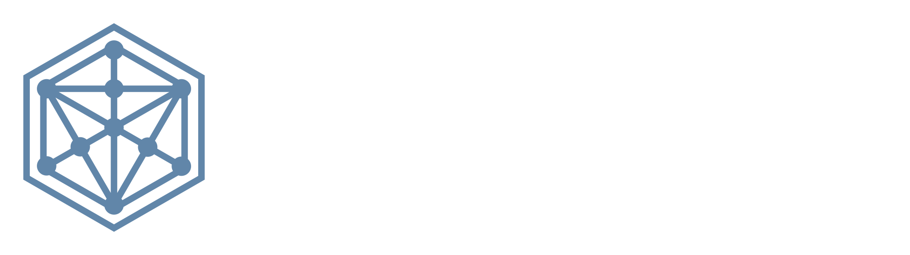
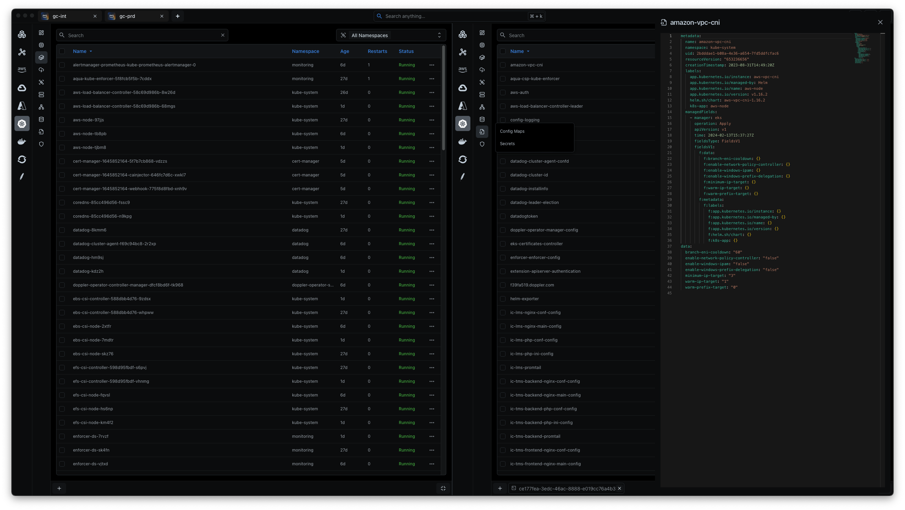

<br>

<p align="center">
    <a href="https://omniview.dev#gh-dark-mode-only" target="_blank">
        
    </a>
    <a href="https://omniview.dev#gh-light-mode-only" target="_blank">
        
    </a>
</p>

<h3 align="center">The future-proof, highly extendable IDE for DevOps engineering, transforming how you visualize, manage, and interact with your infrastructure.</h3>

<br>

<p align="center">
    <a href="https://github.com/omniviewdev/omniview"></a>
    &nbsp;
    <a href="https://github.com/omniviewdev/omniview"></a>
    &nbsp;
	<a href="https://github.com/omniviewdev/omniview/actions"></a>
    &nbsp;
    <a href="https://github.com/omniviewdev/omniview/license"></a>
</p>

<p align="center">
    <a href="https://twitter.com/omniviewdev"></a>
    &nbsp;
    <a href="https://dev.to/omniview"></a>
    &nbsp;
    <a href="https://www.linkedin.com/company/omniviewdev/"></a>
</p>

<p align="center">
        
</p>


<h2>What is Omniview?</h2>

Omniview is a groundbreaking Integrated Development Environment (IDE) tailored specifically for DevOps engineers. It redefines the concept of infrastructure management by offering a unified platform to visualize, manage, and operate across clouds, environments, and hosting platforms. Inspired by the principles of extensibility and efficiency, Omniview integrates seamlessly with your existing tools, enhancing them with a powerful plugin system that propels your operational workflow into the future.

## Key Features

- **Unified Interface**: A singular, intuitive gateway to manage your entire infrastructure landscape.
- **Extensible Plugin System**: Tailor Omniview to your needs, leveraging an ecosystem of plugins for comprehensive infrastructure management.
- **Cross-Cloud Compatibility**: Seamlessly integrate with AWS, Azure, Google Cloud, and more, for a truly unified cloud management experience.
- **Kubernetes and Cloud-Native Support**: First-class support for Kubernetes and cloud-native technologies, ensuring that you're equipped for the future of infrastructure.
- **Real-Time Visualization**: Dive deep into your infrastructure with dynamic, real-time visualizations that bring clarity to complex environments.

## Why Omniview?

In the fast-paced world of DevOps, engineers need tools that are not only powerful but also adaptable and intuitive. Omniview bridges the gap between complexity and usability, offering a platform that grows with you. It's not just about managing infrastructure; it's about empowering DevOps engineers with a workflow that’s as innovative as they are.

## Getting Started

To begin transforming your DevOps experience with Omniview, follow these steps:

1. **Install Omniview**: Download the latest version from our [releases page](https://github.com/omniviewdev/omniview/releases).
2. **Explore Plugins**: Dive into our plugin ecosystem and customize your environment. [Discover plugins](https://omniview.dev/plugins).
3. **Connect Your Infrastructure**: Easily connect Omniview to your cloud and hosting platforms, setting up your unified workspace.
4. **Enjoy Unified DevOps**: Start managing and visualizing your infrastructure like never before.

### Plugin compatibility

This build's UI runs on `@omniviewdev/base-ui` and no longer ships MUI, Emotion or the legacy `@omniviewdev/ui` design system to plugins. Plugins whose UI still imports those packages (older releases from the upstream marketplace) will not load; use plugin releases built against base-ui.

For contributors: resource-toolbar controls should consistently request `size="sm"` and rely on the shared density scale rather than fixed pixel heights.

Neutral buttons and labeled selection controls share quiet decorative borders
and opaque interaction surfaces. Keep required input/choice boundaries and
keyboard focus distinct; do not restore bright idle borders with local CSS.
See the [shared control design language](https://github.com/omniviewdev/ui/blob/main/docs/THEMING.md#native-control-language)
for contrast measurements, nested-theme behavior, and screenshots.

The titlebar search owns a flexible 500px preferred-width region; adjacent header regions share the remaining width. Keep sizing on the region rather than imposing a minimum width on the input, so narrow windows can shrink without clipping decorators.

Plugin imports of `@omniviewdev/base-ui/styles.css` must resolve through `ui/theme/base-ui.css`, the same layered entry used by the host. Loading the package stylesheet directly a second time bypasses the cascade layer and can override host component sizing and spacing after plugin startup.

Compact filter popovers use `size="sm"` and let the shared popup own outer padding and inter-section gaps. Group headings and controls into sections instead of adding another padded surface inside the popup.

### Developing against published UI patches

`task dev` starts an explicitly selected development workspace; it no longer mutates dependency versions implicitly. Use `task ui:update` separately to refresh published Base UI, AI UI, and Editors within their declared ranges, then review and commit intended lockfile changes.

Named workspaces use selected local source overlays rather than consuming unpublished sibling changes accidentally. Running `pnpm dev` directly starts only Vite, not an isolated host. See [development workspaces](docs/development-workspaces.md) and the [native toolchain](docs/development-native-toolchain.md) for explicit state selection and bootstrap-aware Go commands.

The root manifest’s `packageManager` field declares the repository's pnpm version. Keep workflow setup pins and managed policy aligned with it. CI and release workflows use frozen lockfile installs; review and commit intended lockfile changes from development.

`task check:ui-typecheck` checks application and test programs separately. The test configuration explicitly loads React diagnostic augmentation types, so component flags such as `whyDidYouRender` do not depend on unrelated imports being present.

Drag-and-drop handlers preserve domain IDs: homepage contributions use strings; bottom-drawer tab positions use numbers, including zero. The owned Playwright drawer journey verifies real terminal-tab reordering rather than simulated drag callbacks.

The frontend source cohort uses Node.js 26.13.0 LTS, pnpm 12.14.0, React 19.3.1, and the native TypeScript 7 compiler. TypeScript's JavaScript tooling uses the separate TypeScript 6 compatibility package. Nx is not required; pnpm workspace scripts own package builds.

Monaco stays pinned to 0.52.2 while the current YAML worker integration requires its legacy API. A maintained YAML fork and coordinated newer-Monaco upgrade are tracked in the UI repository's `packages/editors/docs/MONACO_YAML_COMPAT.md`.

Vite remains on 7.3.7 to preserve SystemJS plugin output. Vite 8 and newer pnpm versions require separate loader/backend work and are not part of this frontend-only upgrade. Keep strict peer validation and the 24-hour release-age policy enabled.

Build the runtime before the Vite plugin: shim generation verifies the current runtime's exports. Host lint excludes generated bindings and linked plugin repositories; run each plugin's own lint and behavior suite. Owned Playwright runs use the existing isolated source-cohort runner, not ambient marketplace plugins or cluster credentials.

Keep tracked `dist/.gitkeep` for Go's `all:dist` embed during clean pre-frontend compile checks. Production and application acceptance still require actual built frontend assets.

Error reports retain their normalized error, reference ID, and timestamp as occurrence-owned state rather than compiler optimization caches. Inspecting or copying a report must not replace its identity; a new failure must. Metric stream starts capture the current resource payload, including payload-only updates.

### Host profiling

Open **Settings → Developer Settings**, enable **Local profiling (pprof)**, choose **Profiling port**, then save and restart Omniview. These settings work in development and production builds. Profiling is off by default; the default port is `6060`. Saving does not start, stop, or rebind the current listener.

The footer's **pprof** indicator shows actual listener status: green when running, gray when off, and red on error. Click it for the active endpoint, errors, and configuration source. Crucial safety and override details are available through help tooltips. Its **Developer Settings** action opens the controls. Restart-required markers distinguish saved preferences from the configuration currently running. Port `0` selects an available port. The indicator reports listener state, not live client connections or capture activity.

For an explicit launch-time override, set `OMNIVIEW_PPROF_PORT`. A nonempty value enables profiling and overrides the saved port without changing saved preferences:

```sh
OMNIVIEW_PPROF_PORT=6067 omniview-dev workspace up \
  --workspace /absolute/path/to/workspace --mode browser --watch=false --json

GOWORK=off go tool pprof 'http://127.0.0.1:6067/debug/pprof/profile?seconds=10'
GOWORK=off go tool pprof 'http://127.0.0.1:6067/debug/pprof/heap'
curl --fail -o host.trace 'http://127.0.0.1:6067/debug/pprof/trace?seconds=5'
GOWORK=off go tool trace host.trace
```

The listener binds only `127.0.0.1`. Invalid environment port values fail startup; bind failures leave the IDE usable and appear in profiling status. The actual endpoint appears in the footer popover and host logs. Remove the environment override to let saved settings control the next startup.

Local access is unauthenticated and profiles can contain sensitive information. Do not publish or forward the port. Use the numeric `127.0.0.1` URL; requests with a different Host header or any Origin header are rejected.

CPU captures are capped at 120 seconds and execution traces at 15 seconds; larger `seconds` values are clamped. Standard default durations remain unchanged. Both capture routes reject HEAD requests without starting a capture. Request reads, including bodies, time out after 10 seconds; this does not limit capture response duration.

This endpoint profiles the host, not the UI. Disable continuous Pyroscope profiling before capturing CPU through pprof: Go permits only one CPU profiler per process. Block/mutex sampling remains disabled by default.

Core startup hydration, durable writes and reusable restart-state semantics are documented in [Settings validation and lifecycle](docs/settings-validation.md).

### Plugin process profiling

Enable **Settings → Developer Settings → Plugin profiling (pprof)**, save, and restart Omniview. The preference is off by default and works in development and production. Each running plugin built with the profiling-capable SDK receives its own automatically allocated `127.0.0.1` port; no plugin port configuration is needed.

Open the footer's **pprof** popover to find each plugin's PID and actual endpoint. Use that endpoint with the same `go tool pprof` and `go tool trace` commands shown above. Host and plugin profiling are independent. Older plugin binaries show **SDK update required** and must be rebuilt with the updated SDK; restarting an old binary does not add profiling support.

Saving never opens or closes an existing plugin listener. Restart Omniview after enabling or disabling the preference. Plugin reloads replace the process, PID, and endpoint; do not reuse an endpoint from a previous process. Status requests run only while the popover is open and pause while the window is hidden. The display reports listeners, not client connections or active captures.

The host explicitly supplies `OMNIVIEW_PLUGIN_PPROF_ENABLED=true` or `false` from its startup preference and removes inherited host profiling ports. The SDK accepts only the exact value `true` as opt-in. Listeners use the same unauthenticated local-only access, request guards, capture caps, and shutdown cleanup as host profiling. Disable **Telemetry → Profiling** before restarting plugins for CPU captures when continuous Pyroscope profiling is enabled; Omniview does not pause it automatically.

## Documentation

For detailed instructions, tutorials, and API documentation, visit our [official documentation](https://docs.omniview.dev/docs/introduction).

## Community and Support

Join the growing community of Omniview users and contributors! For support, discussion, and sharing insights:

- [Discord](https://discord.gg/omniview) - Join our Discord server for live discussions.
- [GitHub Issues](https://github.com/omniviewdev/omniview/issues) - Report bugs or request features directly through our GitHub issues.

## Contributing

We welcome contributions from the community! If you're interested in making Omniview even better, check out our [contributing guidelines](https://github.com/omniviewdev/omniview/blob/main/CONTRIBUTING.md) for more information on getting started.

## License

Omniview is open-source software licensed under the [AGPL-3.0 License](https://github.com/omniviewdev/omniview/blob/main/LICENSE).

---

Transform your DevOps workflow today with **Omniview** - the extendable IDE where innovation meets infrastructure.
