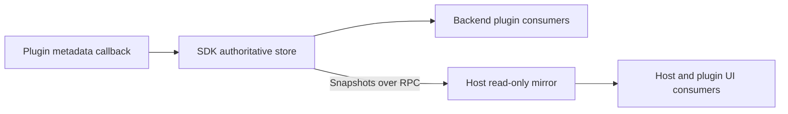
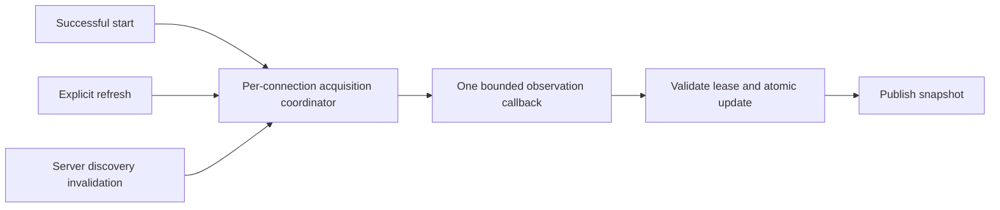
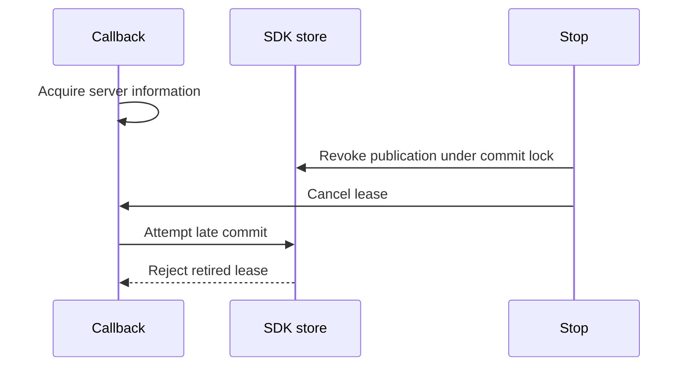

# Connection metadata

**Status:** implemented in the dedicated `connection-metadata` feature workspace. The examples below explain the design; use [plugin development](plugin-development.md#connectionserver-metadata) for public runtime signatures.

## 1. The idea in one example

A connection exposes a map of facts about the server or service it connects to:

```ts
// Logical values, without the SDK's freshness envelope.
const kubernetesFacts = {
  'kubernetes.server_url': 'https://cluster.example.com',
  'kubernetes.server_version': 'v1.34.1',
  'kubernetes.server_platform': 'linux/amd64',
};

const awsFacts = {
  'aws.region': 'us-east-1',
  'aws.account_id': '123456789012',
};
```

Plugins choose their keys. The convention is `<namespace>.<snake_case_fact>`.

A consumer can combine any keys into a header, compatibility check, or other derived view. We do **not** store summary text.

### What belongs here?

| Connection metadata | Not connection metadata |
| --- | --- |
| Server software version | Node count or resource inventory |
| Server endpoint and platform | Resource health aggregates |
| AWS region and account ID | Resource catalog capabilities or coverage |
| Other public connection/server facts | Credentials or kubeconfig contents |

Configuration still lives in connection profiles. Resource information still comes from resource queries and catalogs.

## 2. A fact includes freshness

A version string alone cannot tell a consumer whether it belongs to the current connection.

The SDK wraps each value:

```ts
type JsonValue =
  | null | boolean | number | string
  | JsonValue[]
  | { [key: string]: JsonValue };

type SafeMetadataError = { code: string; message: string };

type MetadataEntry =
  | { state: 'current'; value: JsonValue; observedAt: string }
  | { state: 'stale'; value: JsonValue; observedAt: string; error?: SafeMetadataError }
  | { state: 'unavailable'; error: SafeMetadataError };

type ConnectionMetadataSnapshot = {
  connectionID: string;
  generation: string;
  revision: string;
  active: boolean;
  refreshing: boolean;
  lastRefreshError?: SafeMetadataError;
  entries: Record<string, MetadataEntry>;
};
```

| Entry | Meaning | Consumer use |
| --- | --- | --- |
| `current` | Successfully observed for this admitted client generation | Display or use in a decision, subject to recency requirements |
| `stale` | Previous value exists, but is no longer verified | Display with a warning; do not approve support from it |
| `unavailable` | Observation failed and no previous value exists | Explain why no fact is available |
| Key absent | No published fact | Do not interpret as false or incompatible |

**Current does not mean recently checked.** Consumers needing a recent observation request refresh or apply an explicit age policy.

Each key has its own UTC timestamp. Timestamps describe observations; they never order concurrent writes.

## 3. How a plugin supplies facts

The plugin implements an optional metadata callback. The SDK calls it with an already-started, lease-bound client.

The callback returns observations, not a replacement connection configuration:

```ts
// Illustrative provider result; the SDK assigns lifecycle state and revision.
type MetadataObservation =
  | { state: 'success'; value: JsonValue; observedAt: string }
  | { state: 'unavailable'; error: SafeMetadataError };

type MetadataUpdate = {
  set: Record<string, MetadataObservation>;
  remove: string[];
};

const observation: MetadataUpdate = {
  set: {
    'kubernetes.server_version': {
      state: 'success',
      value: 'v1.34.1',
      observedAt: '2026-10-31T10:00:00Z',
    },
    'kubernetes.server_platform': {
      state: 'success',
      value: 'linux/amd64',
      observedAt: '2026-10-31T10:00:00Z',
    },
  },
  remove: [],
};
```

### Three update operations

| Operation | Result |
| --- | --- |
| Put a key in `set` | Replace its observation |
| Put a key in `remove` | Delete it |
| Omit a key from both | Leave it unchanged, including its freshness |

The SDK validates and commits the whole update atomically. A key cannot appear in both `set` and `remove`.

Every attempted observation must return success or unavailable. An omitted key means **not attempted**, not failed.

### Partial failure does not discard successful siblings

Suppose version succeeds but platform fails:

```ts
const partialObservation: MetadataUpdate = {
  set: {
    'kubernetes.server_version': {
      state: 'success',
      value: 'v1.34.2',
      observedAt: '2026-10-31T11:00:00Z',
    },
    'kubernetes.server_platform': {
      state: 'unavailable',
      error: { code: 'OBSERVATION_FAILED', message: 'Platform information is unavailable.' },
    },
  },
  remove: [],
};
```

The SDK makes version current. If platform had a previous value, the SDK retains it as stale with its original timestamp. Otherwise platform becomes unavailable.

An overall callback failure marks retained values stale and sets `lastRefreshError`. A successful callback clears that overall error, even if some individual keys remain unavailable.

## 4. How a consumer reads facts

Proposed host API:

```ts
GetConnectionMetadata(pluginID, connectionID);     // Read only; no acquisition.
RefreshConnectionMetadata(pluginID, connectionID); // Explicit acquisition; never connects.
```

The runtime hook exposes provider support, transport availability, the snapshot, and a refresh action.

Example selector for a known string key:

```ts
function readCurrentString(
  snapshot: ConnectionMetadataSnapshot | undefined,
  transportAvailable: boolean,
  key: string,
): string | undefined {
  if (!transportAvailable || !snapshot?.active) return undefined;
  const entry = snapshot.entries[key];
  return entry?.state === 'current' && typeof entry.value === 'string'
    ? entry.value
    : undefined;
}

// Inside a consumer with the hook's snapshot and transport status:
const version = readCurrentString(snapshot, transportAvailable, 'kubernetes.server_version');
const platform = readCurrentString(snapshot, transportAvailable, 'kubernetes.server_platform');
const headerText = [version, platform].filter(value => value !== undefined).join(' · ');
```

The header text is derived locally. It is not another metadata key.

Display components can also show stale values with their timestamp and warning. Decision code must distinguish **supported**, **unsupported**, and **unknown**.

Metadata cannot grant authorization. Prefer catalog capabilities for resource operations, and enforce backend capability/authorization checks when executing an action.

### Unsupported is not empty

| Situation | API meaning |
| --- | --- |
| Plugin has no metadata provider | Explicitly unsupported; send no metadata RPC calls |
| Provider exists, no facts observed yet | Supported, empty snapshot |
| Connection ID does not exist | Unknown-connection error |
| Plugin is unreachable | Transport unavailable; cached facts are display-only |

Metadata watch envelopes own transport availability. A failed Get or Refresh reports its operation error without retiring the watch epoch or downgrading unrelated cached facts. Runtime ignores request failures superseded by newer events and skips deferred calls after the last subscriber leaves. Unsupported providers can still have available transport.

## 5. One authority, several readers



The SDK owns observations, revisions, and lifecycle transitions. The host never independently rewrites entry state or allocates revisions.

If the plugin crashes, the host reports **transport unavailable**. It can display cached facts as stale without pretending that the SDK published a new snapshot.

Use existing plugin registration, client leases, RPC conventions, and runtime subscriptions. Metadata stays separate from `Connection.Data`, labels, desired profiles, lifecycle responses, and resource catalogs.

## 6. Refresh without competing writers

All acquisition uses one coordinator per connection:



- Concurrent refresh callers share the running acquisition.
- Discovery invalidation during acquisition queues one follow-up pass; repeated invalidations coalesce.
- Different connections acquire independently.
- Cancelling one caller detaches that waiter; it does not cancel shared work.
- Stop or source retirement cancels shared work and revokes publication.
- A deadline failure follows overall callback-failure semantics if the generation remains active.

Providers cannot directly publish previously captured observations around the coordinator.

**Cache reuse rule:** reuse existing server information only when cache updates share this same ordering coordinator. Otherwise acquire again. Belonging to the same generation does not prove that a cached observation is newer.

Reads never acquire. Refresh never implicitly connects, probes, or lists resource inventory.

## 7. What happens over a connection's lifetime?

| Event | Metadata effect |
| --- | --- |
| Inventory discovery | Empty, inactive snapshot for a supported provider |
| Successful start | New generation; clear previous client's facts; schedule acquisition |
| Acquisition begins | Set `refreshing`; retain individual entry states |
| Acquisition completes | Apply successful/failed observations atomically; clear `refreshing` |
| Stop | Revoke writes, retain values as stale, mark inactive, cancel acquisition |
| Endpoint/authentication changes | Clear old facts immediately |
| Connection removed | Clear facts and publish an ordered removal tombstone |
| Plugin replaced | Retire registration; discard old mirror and delayed responses |
| Application restarted | No observations retained; storage is in-memory |

A repeated stop is a no-op. Cancelled waiters do not change metadata. Lifecycle cancellation cannot publish callback failures into a retired generation.

### The crucial stop race



If commit wins the lock first, stop marks its result stale. If stop wins first, commit is rejected. Every completion clears `refreshing` only for the acquisition it owns.

Metadata updates must not reconnect clients, alter auto-connect signatures, invalidate catalogs, or change readiness/resource authority.

## 8. Three identities prevent stale results

| Field | Purpose | Ordering rule |
| --- | --- | --- |
| Provider registration | Identify this running plugin incarnation | Reject retired registrations; never sort IDs |
| `generation` | Identify the admitted client/source | New identity on each start; stop revokes it |
| `revision` | Order snapshots for a connection within one registration | Monotonic unsigned decimal string; compare numerically |

Revisions continue across client-generation changes and connection removal/re-addition. Retain a revision high-water mark for the provider lifetime.

For example, a delayed fetch cannot overwrite a newer event:

```ts
// Both belong to the same established provider registration.
const cachedRevision = '42';
const delayedFetchRevision = '39';
const acceptFetch = BigInt(delayedFetchRevision) > BigInt(cachedRevision); // false
```

The host wraps snapshots/events with plugin and registration identity. It discards old-registration responses before comparing revisions. Plugin/connection IDs remain opaque; never build routing keys by concatenating them.

Subscribe before fetching. Get, refresh responses, events, and removal tombstones use the same ordering rules. After transport reconnection, resynchronize before treating facts as usable.

## 9. Keys, types, and safety

### Extensible, not untyped

- Matching is case-sensitive. Recommend lowercase namespaces and snake_case fact names.
- Dots are literal characters: `entries['aws.region']`, not a nested object path.
- Providers own the whole map. Namespaces do not introduce multiple writers or cross-plugin access.
- Export key constants, value types, and validators. Consumers ignore unknown keys and validate known values.
- Preserve a key's meaning and JSON type. An incompatible change needs a new key; additive structured fields remain compatible.
- Prefer scalar facts. Bounded structured values are allowed, but not resource snapshots or summary blobs.

### Values must survive the wire

`null`, `false`, `0`, and `''` are real values, distinct from absent, deleted, or unavailable.

Use strings for identifiers, versions, and large integers. JSON numbers must round-trip through JavaScript without precision loss; non-finite numbers are invalid.

### Public by design

Sanitize before storage or publication, never afterward. Strip endpoint userinfo, queries, and fragments by default. Do not publish credentials, raw errors, or kubeconfig contents.

The core validates JSON shape, entry shape, and limits. Providers validate their keys' semantics and public safety. A namespaced key is not a security guarantee.

## 10. Keep the primitive cheap

| Cost | Rule |
| --- | --- |
| Memory growth | Bound key length/count, entry bytes, nesting, and final aggregate snapshot size |
| Update admission | Reject invalid or oversized results atomically; reject duplicate removals |
| Copying | Detach input once; reuse unchanged internal entries; never clone through JSON |
| Mutable Go maps | Detach at public boundaries; do not expose writable maps as “read-only” |
| Event traffic | Emit only effective changes; timestamps and lifecycle flags count as changes |
| UI rendering | Use structural sharing/selectors so unrelated keys do not rerender consumers |
| Subscriptions | One upstream stream per provider, not one per component |
| Recovery | Complete bounded snapshots; resynchronize lagging mirrors instead of unbounded queues |

No-op means identical values, timestamps, errors, and lifecycle state. A successful unchanged-value re-observation can still advance its timestamp.

No general rules engine, schema registry, multi-writer system, polling, delta replay, per-key subscriptions, or durable cache is required. Add those only through a separate design justified by actual needs.

## 11. First consumer: Kubernetes

| Key | Meaning | Source |
| --- | --- | --- |
| `kubernetes.server_url` | Sanitized API-server endpoint | Resolved REST configuration |
| `kubernetes.server_version` | Server software version | `/version.gitVersion` |
| `kubernetes.server_platform` | API-server platform, not node-fleet architecture | `/version.platform` |

`kubernetes.api_version` fits the naming convention, but needs precise semantics before publication. Server software version is not a resource API version; served resource versions stay in the catalog.

Migrate overview and edit-page Cluster Info together. If the header retains node/API-group counts, obtain those separately from resource/catalog sources.

Replace a misleading single “Checked” timestamp with per-fact freshness, or clearly label the oldest displayed successful observation. Resource-query freshness remains independent.

Remove legacy discovered-data writes and misleading persistence comments during cutover. Audit `data:*` folder rules first. Preserve configured `kubeconfig`, `cluster`, `namespace`, and `user` values, plus existing catalog-based feature gates.

## 12. Contract regression checklist

Two independent agents reviewed lifecycle/ordering and efficiency/extensibility. Their findings shaped the contract above.

| Scenario to prove | Required outcome |
| --- | --- |
| Stop races commit | Result becomes stale or is rejected; never revived after stop |
| Old fetch arrives after reconnect/event | Revision/registration fencing rejects it |
| Remove/re-add reuses connection ID | Tombstone and revision high-water mark prevent resurrection |
| Refresh overlaps discovery invalidation | One callback runs; at most one follow-up pass waits |
| One of two refresh callers cancels | Other caller still receives the committed result |
| One key fails | Successful siblings stay current; previous failed value stays stale |
| Refresh omits a stale key | It remains stale |
| Plugin transport disappears | Cached facts cannot approve functionality |
| Values are null/false/zero/empty | Preserve their distinct meaning |
| Incremental updates exceed aggregate limit | Reject without partially changing entries |
| Provider mutates returned maps | Authoritative snapshot remains unchanged |

This checklist states required outcomes. Executed verification is recorded below.

---

## Appendix: original empty-header investigation

At investigation time, enrichment wrote facts into isolated configuration copies without an authoritative metadata publication path. The screenshot's exact original runtime sequence was not reproduced.

Paths below are relative to workspace root:

| Evidence | Finding |
| --- | --- |
| `plugin-sdk/pkg/types/connection.go:63-123` | Configuration and lifecycle share one connection model |
| `omniview/backend/pkg/plugin/resource/connection_profiles.go:25-81,194-244` | Desired profiles and discovered inventory already have separate ownership |
| `omniview/backend/pkg/plugin/resource/controller.go:657-691` | Health-check responses do not update inventory |
| `omniview/packages/omniviewdev-runtime/src/hooks/connection/useConnection.tsx:35-44,73-77` | Lifecycle responses and connection-detail cache are separate |
| `kubernetes/pkg/plugin/resource/connections.go:25-77` | Legacy enrichment writes facts and resource counts into configuration data |
| `kubernetes/pkg/plugin/resource/connection_provider.go:129-183` | Successful checks invoke enrichment |
| `kubernetes/pkg/plugin/resource/native_provider.go:108-161` | Native start acquires a catalog without this enrichment |
| `kubernetes/ui/src/pages/dashboard/overview/index.tsx:111-144` | Header receives connection data |
| `kubernetes/ui/src/pages/dashboard/overview/components/ClusterInfoCard.tsx:34-75,125-150` | Missing fields become `N/A` |
| `kubernetes/pkg/plugin/resource/native_catalog.go:20-35,45-63,118-144` | Catalog capabilities differ from authorization; partial discovery cannot prove absence |

### Current v2 SDK evidence

The workspace SDK checkout lacks `pkg/resource/v2`, while the host pins `v0.9.0`. Current implementation was inspected in `/Users/joshuapare/go/pkg/mod/github.com/omniviewdev/plugin-sdk@v0.9.0`:

| Path within that module | Finding |
| --- | --- |
| `pkg/resource/v2/controller_lifecycle.go:195-212,242-283` | Start receives a clone and returns registry configuration, not callback mutations |
| `pkg/resource/v2/controller_lifecycle.go:429-466` | Check does not commit enriched responses |
| `pkg/resource/v2/connection_copy.go:20-50` | Copies isolate maps; `Data` affects client-configuration equality |
| `pkg/resource/v2/controller_lifecycle.go:129-157,321-350` | Client leases already cancel and drain during retirement |
| `proto/resource/v2/domain.proto:274-282` and `pkg/resource/v2/plugin/connections.go:86-165` | Current transport uses JSON with strict decoding, not legacy v1 conversion |

Implementation now uses the workspace SDK's `origin/main` baseline, `3cea9e48c9942b06e347d61de90fbf8f612868a8`, after independent review of its protected isolation files. No module-cache edits or isolation bypass flags were used. The feature reuses optional-trait negotiation and ancillary JSON RPC conventions.

Normal host and Kubernetes Go builds pin the metadata-capable SDK at `v0.9.1-0.20261031225250-85d184bd4557`. Candidate source builds still require exact cohort and isolation approval; the module pin does not bypass those gates. The host's regular UI test command includes the runtime metadata store's ordering and lifecycle regressions.

### Workspace verification

Host, Kubernetes, and SDK use `feature/connection-metadata-419c78e9` branches based on their selected `origin/main` refs. The workspace runs through `omniview-dev` in browser mode.

Exercised verification:

- SDK resource-v2 and real gRPC suites pass with the race detector.
- Host resource package tests and runtime metadata hook tests pass.
- Kubernetes resource package tests and all seven targeted consumer suites pass after correcting the edit-page deep-link assertion.
- Runtime production build, Kubernetes typecheck, and host frontend typecheck pass.
- Workspace bootstrap generates bindings through `task bindings`, then builds runtime before generating/verifying Vite-plugin shims.
- Live `kind-kind` overview displays endpoint, Kubernetes `v1.34.0`, and `linux/arm64`.
- Explicit refresh advances revision from 4 to 6 without changing generation, and updates the already-open header.
- Stop advances revision to 7 and makes all three observations stale; Cluster Info displays those stale values.
- Reconnect creates a different generation, advances revision to 10, and updates Cluster Info to current values.

Link-protocol evidence is retained in the workspace's `.local/link-protocol.json`. The launch uses reviewed SDK revision `3cea9e48c9942b06e347d61de90fbf8f612868a8`. The earlier source/version mismatch and launch prerequisites are resolved.
