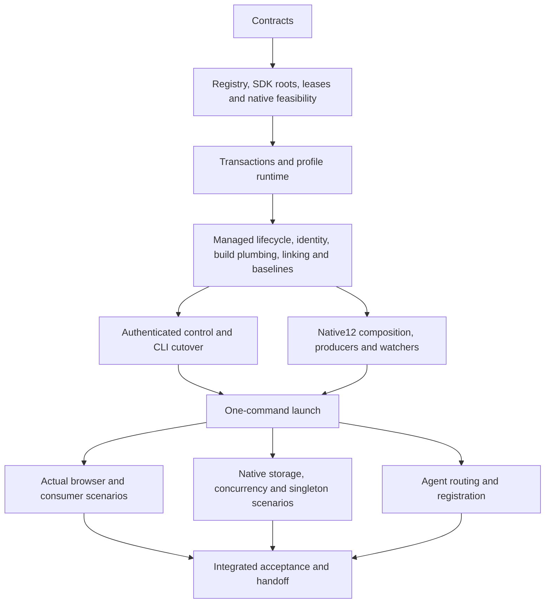

# Agentic development workspace roadmap

This is the durable handoff for the multi-repository workspace work. Use [development workspaces](development-workspaces.md) for current commands, not historical discovery examples. Implementation exists; integrated acceptance is not yet universally green. Source implementation, a successful compiler, an open port and a rendered application are separate facts.

## Decisions

- The host owns `omniview-dev`; marketplace authentication is not a workspace prerequisite. Task wrappers delegate to this CLI rather than starting another Wails/plugin supervisor.
- Register existing normal or bare Git sources once. Each feature gets selected worktrees, an immutable UUID, an editable name/slug and its own profile. Repository names and shell cwd are not authority.
- Generate one **native pnpm 12.14.0 workspace per feature** above its independent Git worktrees. Keep source package manifests and standalone lockfiles as inputs; reconcile compatible locked edges in host → selected UI → stable remaining-source order. Preserve strict recursive peers, frozen installation and reversible ownership. Do not globally link packages or invent a compatible version.
- Use selected worktree-local Go replacements and explicit reviewed SDK source. Never use an ambient parent `go.work`; every Go command uses `GOWORK=off`.
- Separate production/nightly singleton identity from development UUIDs. The same plugin ID can run independently in different profiles; within one profile, select distinct plugin IDs.
- Bind ports through owned leases, retain sticky assignments and inspect actual endpoints. Strict occupied-port requests fail; they do not increment a port or kill its owner.
- Baselines are stopped-source, allowlisted preferences plus inactive install inventory—not recursive copies of live databases, credentials, executables or browser stores.
- Browser server mode and native MCP are different verification surfaces. A successful browser test does not prove WKWebView storage or native pixels.

## Filesystem convention and entry points

Keep canonical clones together, for example `~/Repos/omniviewdev/{omniview,ui,plugin-sdk,omniview-plugin-kubernetes,...}`. Register their actual paths; choose a collection whose generated layout is:

```text
$COLLECTION/
  .omniview-dev/                 # private registry, journals and ownership
  workspaces/<feature>/
    workspace.json
    omniview/
    ui/                         # only when selected
    plugin-sdk/                 # only when selected
    <selected-plugin-repos>/
```

Repeat plugin selections for multiple plugins. The registry maps repository IDs; committed `plugin.yaml` defines plugin IDs. Profiles normally live outside source at `~/.omniview-dev/profiles/<UUID>`; an explicitly validated custom state root is supported. Use `workspace paths`, not guessed sibling paths, before editing a feature.

Current setup/build rules:

- The fixed isolation SDK is a reviewed local-source prerequisite until its real release is published. Supply `SDK_SOURCE` when bootstrapping the CLI; do not pretend the older declared published SDK contains the new APIs.
- Build runtime before Vite-plugin shim generation/checking. Generate Wails bindings only with `task bindings`.
- An already-running agent may not see a newly installed Homebrew pnpm. Resolve the existing formula to its canonical native executable; the [bootstrap instructions](development-workspaces.md#bootstrap-the-local-cli-and-sources) show the session-only environment selection. No global reinstall, link or shell configuration change is required.
- Use `.agents/skills/omniview-workspaces`, `omniview-repo-map` and `omniview-instance-verification`. [Registration and handoff](development-agent-skills.md) explains Codex/Claude discovery without global instruction copies.

## Repository routing

| Repository | Start here | Responsibility |
| --- | --- | --- |
| `omniview` | `cmd/omniview-dev`, `internal/devworkspace`, `internal/devsession`, `internal/instance`, `internal/devcontrol` | Workspace lifecycle, tooling, process/port ownership, profiles and authenticated control |
| `omniview` | `backend/pkg/plugin`, `backend/pkg/plugin/devserver`, `internal/settings`, `internal/devbaseline` | Existing plugin/provider operations, managed readiness, settings and safe baselines |
| `omniview` | `ui/features/plugins`, `ui/features/instance`, `ui/layouts/core/main`, `e2e/tests/fixtures` | Module selection/inventory, visible identity and actual browser verification |
| `omniview` | `packages/omniviewdev-runtime`, `packages/omniviewdev-vite-plugin`, `Taskfile.yml`, `build` | Runtime exports/bindings, shared dependencies/shims and build/native plumbing |
| `ui` | `packages/base-ui`, `packages/ai-ui`, `packages/editors` | Shared UI components, styling, editors and their public exports |
| `plugin-sdk` | `pkg/sdk`, `pkg/config`, `pkg/state`, `pkg/types`, `settings` | Root/provenance/capability contracts and plugin runtime APIs |
| selected plugin | `plugin.yaml`, frontend package, backend entry and its Go module if present | Genuine plugin capabilities and source; do not assume every plugin has both components |

## Ordered work packets

Packet dependencies constrain implementation and verification; they are not permission for concurrent writers of generated output.

| Wave | Packets | Result / current boundary |
| --- | --- | --- |
| 1 | A01 contracts | Versioned workspace/instance/control identity and strict target resolution implemented |
| 2, parallel | A02 native feasibility; A03 registry/worktrees; A04 SDK isolation; A06 leases/process/discovery | Darwin storage mechanism and concurrent native profiles exercised; actual worktrees, strict port conflict and source/provenance refusal exercised |
| 3 | A05 plugin transactions; A07 runtime profiles | Archive rollback/foreign replacement, same-open archive UI transitions, uninstall inventory and private profiles exercised; final combined lifecycle admission remains tracked below |
| 4, parallel after prerequisites | A08 managed lifecycle; A09 visible identity; A10 build plumbing; A11 local linking; A14 baselines | Genuine plugin readiness, named surfaces, runtime-before-shims, native12 resolution and stopped-source baseline checks exercised; full live consumer propagation remains a gate |
| 5 | A12 authenticated control → A13 CLI/runner cutover | Host/plugin settings, targeting, terminal failures, archive operations and managed commands use existing managers; no second standalone runner |
| 6, parallel with frozen interfaces | A15 build/watch; A15b output ownership; A15c native12 migration; A15d aggregate composition | Ordered producers, reversible staged outputs, actual native12 nested commands and strict peers implemented/exercised; C05 coordinated consumer acceptance remains open |
| 7 | A16 orchestration | Literal `create --start` with host/UI/SDK/Kubernetes/genuine probe exercised, including actual UI and canonical retirement |
| 8, parallel | A17 owned browser/native harness; A18 skills | Six real browser identity/events/settings/target/restart scenarios and native concurrency exercised; client-discovery/model-evaluation limits remain explicit |
| 9 | A19 integrated acceptance/review/handoff | Close remaining scenarios, preserve platform/permission/publication limits, then record final accepted source refs and evidence |

The aggregate-composition work uses C01 package/lock reconciliation, C02 command/tool context, C03 consumer/build integration and C04 ownership/inspection in parallel under frozen APIs; C05 is their coordinated review and real-runtime barrier. A successful install alone cannot close C05.



### Rules for follow-up agents

1. Freeze exported interfaces and ownership before dispatch. Give one owner to shared Task/binding/manifest changes; keep unrelated files out of a slice.
2. Implement independent slices in parallel, but do not run competing builds, formatters, bindings generators or output watchers while source producers are changing.
3. At the wave barrier, the integration owner runs relevant checks and an actual changed-path smoke. Preserve failing-before evidence; do not repeat an unchanged failed scenario merely to confirm it.
4. Every runtime uses an immutable committed host/companion source selection and the actual native pnpm executable. Capture the CLI path once. Never substitute a manually launched Vite server for a managed-instance acceptance claim.
5. Inspect UUID, generation, state root, selected host source and process ownership before control or browser mutation. Never adopt `/health`, an old PID, a guessed port or adjacent discovery.
6. Canonical down must precede source restoration, unlink and removal. Refusal retains journals/unknown bytes; it never authorizes broad cleanup or metadata repair.

## Verification ledger and remaining gates

Accepted local evidence includes:

- Concurrent native A/B/private-production-tagged windows, same Kubernetes ID from different sources, a second genuine SDK plugin, warm restart, private storage markers and stale-target rejection. Native DOM/input/CoreGraphics evidence is **not** pixel capture.
- Actual two-plugin one-command browser launch; six identity/event/settings/custom-root/sticky-restart browser scenarios; strict occupied-port refusal leaving the foreign listener unchanged.
- Stopped baseline import with unchanged source bytes, running-source rejection and inactive inventory that does not execute unknown binaries.
- Genuine foreign archive rejection preserving installation bytes/inodes, durable records, live backend and caller archives. Serialized dev → installed A2 → installed A1 changes the same-open module/UI and retains settings; renamed/rebound B retains UUID/state and counter across restart.
- Real Darwin `P_WEXIT`/`PROCARGS2 EINVAL` regression before/after retained kernel-exit observation; actual readonly Go-cache retirement with unchanged foreign symlink target; Windows/Linux cross-compilation and Linux process-lifetime checks. Cross-compilation is not platform GUI verification.
- Actual Homebrew native12 runtime → shims → host/E2E builds and managed nested scripts with spaced paths/arguments and a conflicting inherited manager marker.

The latest combined runtime-admission source at this checkpoint is host `c5e1c1a0327f768677390fc12b15ba4edfc2ac3b`, UI `c71831890e5c869ff9bbf92ac12a0bb7bec29d3b`, SDK `d32a524bc89659260c6045062035ce05dc138ff4` and Kubernetes `5df15b06b80790c3a8e9255d300f40795fde9bef`. Test-only plugin sources are genuine fixtures, not released packages or synthetic ready/RPC responses.

Remaining order:

1. **Parallel actual scenarios:** full optimized and live-Vite host/Kubernetes/probe CSS/component/runtime-export/SDK edits, failed/repaired builds and cross-profile isolation; mixed UI-only/backend readiness and state-preserving HMR; corrected new-fixture up/restart/down/retirement; explicit production/same-profile duplicate refusal. Do not manually reload away a refresh failure.
2. Correct any observed failure at its causal boundary, with regression evidence and targeted review. Then rerun the affected real scenario on a new immutable cohort; do not relabel older evidence as current.
3. Reconcile the final scenario ledger: commands, source refs, UUIDs/generations, actual endpoints, observed result, artifacts/platform and limits. Keep compiler success distinct from connected RPC/controller readiness and actual module bytes.
4. Publish the **real** fixed SDK and compatible package/plugin releases in dependency order before claiming normal production/release consumption. No fake SDK version or legacy MUI/shared-dependency shim is an acceptable substitute.
5. Supply Windows/Linux native GUI runners and authorized pixel capture if those platform/pixel claims are required. Unavailable hardware/permissions remain explicit gates, not passes.
6. Finish the final independent containment/baseline/auth/process review and update this checkpoint plus operational docs from observed results.

One before-fix diagnostic supervisor remains quarantined in its original private collection: its old command-completion loop blocks canonical down and holds a lock. The unknown partial aggregate lock and live-writer proof are deliberately not adopted or cleared. A read-only exact-identity Mach task-authority probe returned `KERN_FAILURE`; a debugger label alone does not prove safe termination authority. Fresh corrected collections and replay are independent. Do not describe this retained fixture as repaired or canonically removed.

Development-profile isolation does not sandbox HOME, kubeconfig, cloud credentials, terminals or remote clusters. Baseline preferences and a DEV badge never authorize production-cluster mutation.

## Wails research relevant to this design

- [Server builds](https://v3.wails.io/guides/server-build/) provide the real HTTP binding/event surface used by owned Playwright contexts. An asset-only Vite preview lacks that backend and is only a bootstrap diagnostic.
- [Application MCP](https://v3.wails.io/guides/mcp-service/) is explicit native tooling: compile/tag and authenticate it, inspect advertised endpoints, and verify native identity. It does not establish native pixel permission or browser equivalence.
- [CLI MCP](https://v3.wails.io/guides/cli/#mcp) is a separate project lifecycle service, not the application control API.
- [Single-instance support](https://v3.wails.io/guides/single-instance/) supplies the production application mechanism; UUID-specific development profiles and supported native storage are separate requirements.
- Pinned beta29 browser source reconnects its event socket but does not itself reload changed page assets. Actual Vite/browser refresh must be observed, not inferred from a reconnected socket.
- [Vite dependency optimization](https://vite.dev/config/dep-optimization-options) distinguishes live excluded ESM worktrees from nested CommonJS dependencies. Optimizer output must remain classified as generated dependencies, not be recompiled by React Compiler.

Operational contracts: [worktrees](development-worktree-lifecycle.md), [profiles](development-instance-profiles.md), [linking](development-package-linking.md), [watch/output ownership](development-watch-graph.md), [control/settings](development-control.md), [baselines](development-baselines.md), [native toolchain](development-native-toolchain.md), [skills](development-agent-skills.md).
