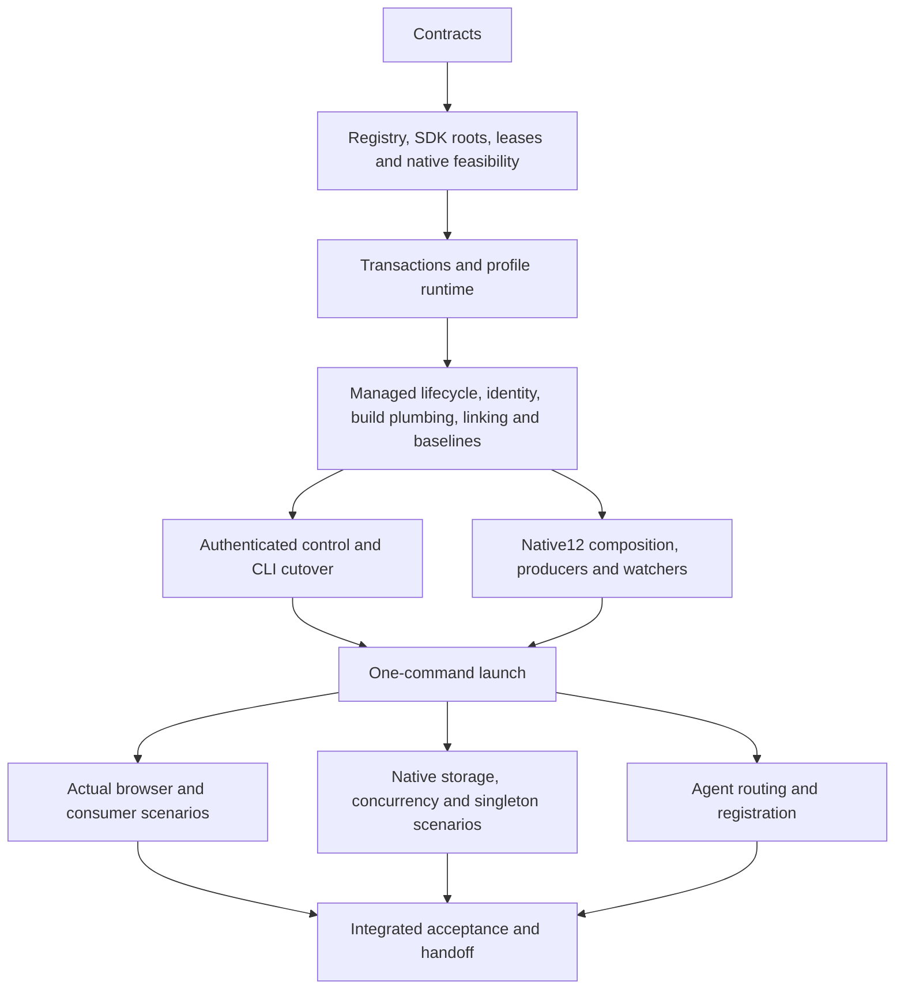
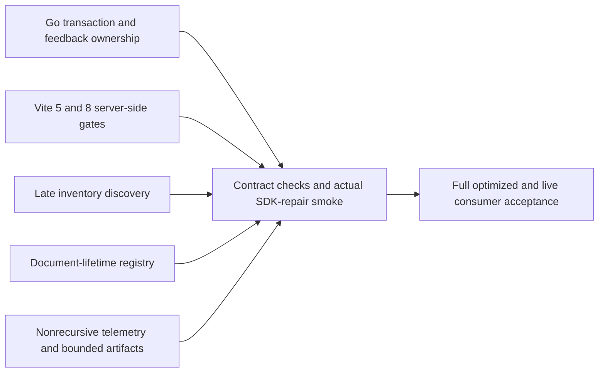

# Agentic development workspace roadmap

This is the durable handoff for the multi-repository workspace work. Use [development workspaces](development-workspaces.md) for current commands, not historical discovery examples. Implementation exists; integrated acceptance is not yet universally green. Source implementation, a successful compiler, an open port and a rendered application are separate facts.

## Decisions

- The host owns `omniview-dev`; marketplace authentication is not a workspace prerequisite. Task wrappers delegate to this CLI rather than starting another Wails/plugin supervisor.
- Register existing normal or bare Git sources once. Each feature gets selected worktrees, an immutable UUID, an editable name/slug and its own profile. Repository names and shell cwd are not authority.
- Generate one **native pnpm 12.14.0 workspace per feature** above its independent Git worktrees. Keep source package manifests and standalone lockfiles as inputs; reconcile compatible locked edges in host → selected UI → stable remaining-source order. Preserve strict recursive peers, frozen installation and reversible ownership. Do not globally link packages or invent a compatible version.
- Use selected worktree-local Go replacements and explicit reviewed SDK source. Never use an ambient parent `go.work`; every Go command uses `GOWORK=off`.
- Separate production/nightly singleton identity from development UUIDs. The same plugin ID can run independently in different profiles; within one profile, select distinct plugin IDs.
- Bind ports through owned leases, retain sticky assignments and inspect actual endpoints. Strict occupied-port requests fail; they do not increment a port or kill its owner.
- Baselines are stopped-source, allowlisted preferences plus inactive install inventory—not recursive copies of live databases, credentials, executables or browser stores.
- Browser server mode and native MCP are different verification surfaces. A successful browser test does not prove WKWebView storage or native pixels.

## Filesystem convention and entry points

Keep canonical clones together, for example `~/Repos/omniviewdev/{omniview,ui,plugin-sdk,omniview-plugin-kubernetes,...}`. Register their actual paths; choose a collection whose generated layout is:

```text
$COLLECTION/
  .omniview-dev/                 # private registry, journals and ownership
  workspaces/<feature>/
    workspace.json
    omniview/
    ui/                         # only when selected
    plugin-sdk/                 # only when selected
    <selected-plugin-repos>/
```

Repeat plugin selections for multiple plugins. The registry maps repository IDs; committed `plugin.yaml` defines plugin IDs. Profiles normally live outside source at `~/.omniview-dev/profiles/<UUID>`; an explicitly validated custom state root is supported. Use `workspace paths`, not guessed sibling paths, before editing a feature.

Current setup/build rules:

- The fixed isolation SDK is a reviewed local-source prerequisite until its real release is published. Supply `SDK_SOURCE` when bootstrapping the CLI; do not pretend the older declared published SDK contains the new APIs.
- Build runtime before Vite-plugin shim generation/checking. Generate Wails bindings only with `task bindings`.
- An already-running agent may not see a newly installed Homebrew pnpm. Resolve the existing formula to its canonical native executable; the [bootstrap instructions](development-workspaces.md#bootstrap-the-local-cli-and-sources) show the session-only environment selection. No global reinstall, link or shell configuration change is required.
- Use `.agents/skills/omniview-workspaces`, `omniview-repo-map` and `omniview-instance-verification`. [Registration and handoff](development-agent-skills.md) explains Codex/Claude discovery without global instruction copies.

## Repository routing

| Repository | Start here | Responsibility |
| --- | --- | --- |
| `omniview` | `cmd/omniview-dev`, `internal/devworkspace`, `internal/devsession`, `internal/instance`, `internal/devcontrol` | Workspace lifecycle, tooling, process/port ownership, profiles and authenticated control |
| `omniview` | `backend/pkg/plugin`, `backend/pkg/plugin/devserver`, `internal/settings`, `internal/devbaseline` | Existing plugin/provider operations, managed readiness, settings and safe baselines |
| `omniview` | `ui/features/plugins`, `ui/features/instance`, `ui/layouts/core/main`, `e2e/tests/fixtures` | Module selection/inventory, visible identity and actual browser verification |
| `omniview` | `packages/omniviewdev-runtime`, `packages/omniviewdev-vite-plugin`, `Taskfile.yml`, `build` | Runtime exports/bindings, shared dependencies/shims and build/native plumbing |
| `ui` | `packages/base-ui`, `packages/ai-ui`, `packages/editors` | Shared UI components, styling, editors and their public exports |
| `plugin-sdk` | `pkg/sdk`, `pkg/config`, `pkg/state`, `pkg/types`, `settings` | Root/provenance/capability contracts and plugin runtime APIs |
| selected plugin | `plugin.yaml`, frontend package, backend entry and its Go module if present | Genuine plugin capabilities and source; do not assume every plugin has both components |

## Ordered work packets

Packet dependencies constrain implementation and verification; they are not permission for concurrent writers of generated output.

| Wave | Packets | Result / current boundary |
| --- | --- | --- |
| 1 | A01 contracts | Versioned workspace/instance/control identity and strict target resolution implemented |
| 2, parallel | A02 native feasibility; A03 registry/worktrees; A04 SDK isolation; A06 leases/process/discovery | Darwin storage mechanism and concurrent native profiles exercised; actual worktrees, strict port conflict and source/provenance refusal exercised |
| 3 | A05 plugin transactions; A07 runtime profiles | Archive rollback/foreign replacement, same-open archive UI transitions, uninstall inventory and private profiles exercised; final combined lifecycle admission remains tracked below |
| 4, parallel after prerequisites | A08 managed lifecycle; A09 visible identity; A10 build plumbing; A11 local linking; A14 baselines | Genuine plugin readiness, named surfaces, runtime-before-shims, native12 resolution, stopped baselines and actual shared consumers exercised |
| 5 | A12 authenticated control → A13 CLI/runner cutover | Host/plugin settings, targeting, terminal failures, archive operations and managed commands use existing managers; no second standalone runner |
| 6, parallel with frozen interfaces | A15 build/watch; A15b output ownership; A15c native12 migration; A15d aggregate composition | Ordered producers, reversible outputs, strict native12 peers and full live/optimized two-profile CSS/runtime/SDK failure-recovery acceptance pass |
| 7 | A16 orchestration | Literal `create --start` with host/UI/SDK/Kubernetes/genuine probe exercised, including actual UI and canonical retirement |
| 8, parallel | A17 owned browser/native harness; A18 skills | Owned browser matrix and native concurrency exercised; versioned skills/registration implemented; platform/pixel and fresh-client/model-evaluation limits remain explicit |
| 9 | A19 integrated acceptance/review/handoff | Local functional matrix and independent containment/quality review complete; final source cohorts/evidence recorded; external gates below |

The aggregate-composition work uses C01 package/lock reconciliation, C02 command/tool context, C03 consumer/build integration and C04 ownership/inspection in parallel under frozen APIs; C05 is their coordinated review and real-runtime barrier. A successful install alone cannot close C05.



### Rules for follow-up agents

1. Freeze exported interfaces and ownership before dispatch. Give one owner to shared Task/binding/manifest changes; keep unrelated files out of a slice.
2. Implement independent slices in parallel, but do not run competing builds, formatters, bindings generators or output watchers while source producers are changing.
3. At the wave barrier, the integration owner runs relevant checks and an actual changed-path smoke. Preserve failing-before evidence; do not repeat an unchanged failed scenario merely to confirm it.
4. Every runtime uses an immutable committed host/companion source selection and the actual native pnpm executable. Capture the CLI path once. Never substitute a manually launched Vite server for a managed-instance acceptance claim.
5. Inspect UUID, generation, state root, selected host source and process ownership before control or browser mutation. Never adopt `/health`, an old PID, a guessed port or adjacent discovery.
6. Canonical down must precede source restoration, unlink and removal. Refusal retains journals/unknown bytes; it never authorizes broad cleanup or metadata repair.

## Verification ledger and remaining gates

Accepted local evidence includes:

- Concurrent native A/B/private-production-tagged windows, same Kubernetes ID from different sources, a second genuine SDK plugin, warm restart, private storage markers and stale-target rejection. Native DOM/input/CoreGraphics evidence is **not** pixel capture.
- Same packaged production-tagged binary launched twice against one private production root: the second exits `1` on the canonical root lock before application/MCP/plugin state, while the first native window, bindings and storage marker remain unchanged. Same-profile development `up` exits `4` (`workspace_running`) without replacing UUID/generation/process identity. This is not a newly exercised different-root Wails-channel gate.
- Actual two-plugin one-command browser launch; six identity/event/settings/custom-root/sticky-restart browser scenarios; strict occupied-port refusal leaving the foreign listener unchanged.
- Stopped baseline import with unchanged source bytes, running-source rejection and inactive inventory that does not execute unknown binaries.
- Genuine foreign archive rejection preserving installation bytes/inodes, durable records, live backend and caller archives. Serialized dev → installed A2 → installed A1 changes the same-open module/UI and retains settings; renamed/rebound B retains UUID/state and counter across restart.
- Real Darwin `P_WEXIT`/`PROCARGS2 EINVAL` regression before/after retained kernel-exit observation; actual readonly Go-cache retirement with unchanged foreign symlink target; Windows/Linux cross-compilation and Linux process-lifetime checks. Cross-compilation is not platform GUI verification.
- Corrected fresh-profile create/up/restart/down/unlink/remove all succeed using the installed Homebrew pnpm. Restart preserves UUID and sticky endpoints, replaces host generation/process, and brings the genuine backend plugin through all four stages; final retirement leaves no recorded process, listener, socket root, profile, state, capability or source branch.
- Actual Homebrew native12 runtime → shims → host/E2E builds and managed nested scripts with spaced paths/arguments and a conflicting inherited manager marker.
- Genuine mixed UI-only/backend launch reports UI-only build/RPC/controller stages as not applicable. In live-host mode its actual Vite `js-update` changes rendered markup with the same document and counter, no page errors and unchanged backend generation; retirement succeeds. The captured renderer is React DOM 19.2.4 development (`bundleType: 1`).

The first final-integration cohort uses host `ac0fbd81913c749294e2999ea02a75ef031f1679`, UI `c71831890e5c869ff9bbf92ac12a0bb7bec29d3b`, SDK `d32a524bc89659260c6045062035ce05dc138ff4` and Kubernetes `5df15b06b80790c3a8e9255d300f40795fde9bef`. Both full consumer scenarios fail real automatic-feedback gates: live mode repairs the SDK/backend graph but leaves its consumer on Chromium's error document; optimized mode passes host/probe CSS updates but loses Kubernetes navigation after host replacement. Test-only plugin sources are genuine fixtures, not released packages or synthetic ready/RPC responses.

Follow-up unavailable-runtime-context recovery at host `48054a0ebdb3b367cdf05a187bbf5455a409e66e` passes 156 runtime tests, 354 host plugin tests, runtime → shim → host builds and E2E type checks. An actual single-plugin optimized host rebuild replaces the process/document, serves new host markup and leaves the plugin clickable without manual reload; retirement succeeds. That run observed no missing-metadata response, so unavailable-context recovery in the full two-plugin cohort remains a separate gate.

Optimized UI-only refresh failed despite delivered Vite component updates with no page errors; its captured renderer is production React DOM (`bundleType: 0`). Host `4c391a26416b3fec04c85023e876e0a2d239435f` supplies automatic full reload for plugin JavaScript updates, retaining ordinary CSS HMR and live-host Fast Refresh. Actual browser markup now updates with a new document and no page errors; its final backend snapshot caught an in-flight graph build, so graph convergence remains separate.

Actual native optimized-host verification also observes automatic updated markup, document replacement and a usable button, with native process/service identity and opaque generation unchanged. Down → unlink → remove all succeed, including exact-UUID native-store retirement and exact source restoration. No manual navigation/reload after the edit, pixel capture or permission request; native CSS HMR/live-frontend mode are not newly exercised by this run.

The earlier containment wave passes the full Go suite and seven affected race-enabled packages. Real Go compilation/publication regressions prove confirmed stop, retry, reentrant stop and ordered reload/error reporting; actual Go module resolution rejects an unselected reviewed SDK. An actual production executable rejects twelve stable/nightly claimed-root, ancestor, descendant, symlink, physical-case-alias and prospective reserved-channel selections without changing existing bytes/modes; canonical retirement succeeds. Final targeted source reviews report no findings. Production override protection combines physical custom-path identity with an explicit case-insensitive reservation of default profile labels, rather than pretending all filesystems share case semantics.

The feedback correction passes 26 actual Vite 5/8 network and native-authority-subprocess regressions, 157 runtime tests, 462 affected host tests and ordered runtime → shims → host/E2E builds under actual pnpm 12.14.0. Windows/Linux ARM64 CLI and both test binaries compile; nonroot, offline, read-only Linux runs exercise real authority, FIFO refusal, incomplete-publication retry and owned-process retirement. Final post-correction Go verification passes the full tagged suite (37 `ok` results plus 11 packages without test files) and all eight affected race-enabled packages. The earlier Darwin race failure remains recorded separately, not retroactively relabeled as success.

A controlled TCP-linger fixture reproduces the Darwin boundary: an unreaped zombie leader coexists with an exiting non-zombie descendant, and group signaling reports `EPERM` before descendant cleanup completes. The correction waits for independent whole-group terminal proof within the existing bound, without extra signals or accepting exit flags as completion. The new race-enabled regression and both fresh original host-crash/authenticated-stop cases pass.

The first feedback-corrected cohort is host `917445d90b3e313b98ed577263035ed7a40cad93`. Its focused live run reaches real SDK failure/repair, fresh host/plugin readiness and automatic document replacement without a Chromium error page, but expires a five-second post-replacement shell assertion before cold browser bootstrap finishes. Its unbounded error attachment also exceeds JavaScript string limits; this is not final acceptance.

The telemetry-safe cohort is host `9d9e78ae3873b6a6c80f56fe5158d72edd3cd826`, with the same pinned companion refs. Prior C05 artifacts expose an asynchronous diagnostics-log → patched-console → diagnostics-log loop during backend loss. Its failing-before/passing-after regression preserves local error reporting without resending bridge failures; fourteen telemetry tests and the host build pass. Browser artifacts now aggregate bounded records with explicit overflow (four artifact regressions plus E2E types pass). The focused actual live scenario passes real SDK failure, document preservation, repair, fresh host/both-plugin generations and automatically rendered updated host/plugin settings labels, with zero page errors and successful fixture teardown. Full optimized/live two-profile consumer checks remain separate gates.

The telemetry-safe full optimized run passes initial two-profile isolation and actual host/probe/Kubernetes CSS propagation, then fails the new runtime-export action: the host button still executes the original handler, while Probe reports a missing named shim export. A separate actual optimized probe establishes that the published runtime and shim both contain the new export. Its automatic document replacements occur before the replacement host starts; the graph-ready browser still exposes the original runtime namespace, and neither real plugin recovers within the bounded browser-bootstrap observation. This rules out stale published shim output for that probe, but does not yet identify the failed final reconnect/reload boundary. Backend readiness and an earlier document change are not proof that the replacement host was consumed.

The full live two-profile scenario passes against this cohort with actual pnpm 12.14.0: both real plugins render and interact; mandatory identity survives optional-header hiding; settings persist only in A; selected UI CSS and newly added shared runtime exports reach host/Kubernetes/probe consumers while B remains unchanged; invalid SDK compilation preserves the current document and reports failure; repair replaces the host and plugin generations and renders rebuilt settings; explicit restart preserves state and rotates generation; canonical fixture retirement succeeds. Its bounded browser report has no page errors or overflow. This is live-mode acceptance, not an optimized-mode pass.

The retained-inode correction is host `60d9180cee9a82aa4d0d37aa10bd2498ba4d537e`. Matching the supervisor's actual positional-write/conditional-truncate publication makes the real Vite 5/8 release and pending-HTTP tests fail with a directory watcher; watching the owned file makes all 32 Vite-package cases pass, including the native authority subprocess. Runtime → shim/Vite-plugin builds and browser-harness types pass. An actual optimized application probe now passes: the host process changes, both reconnects receive 204, the browser automatically consumes a new document and shim with the new export, and host/probe buttons execute the revised runtime function with no page errors or manual reload. Full corrected live/optimized two-profile checks remain separate gates. The first corrected optimized attempt fails during default-profile launch before the scenario begins; its redacted error does not establish a cause, so the diagnostic run preserves structured private CLI failure data.

The full live scenario also passes with the retained-inode correction and browser-readiness harness `23ba7aae8a1b72948bee81e1f12f77734b093776`, retries disabled. This run explicitly verifies document preservation during SDK failure, automatic repair, both plugin generations, state-preserving restart and unchanged B. Its retained descriptor artifact records A `769911fc-bb90-4506-96b5-db9e402e4184` at browser port 23929 and B `cb4f9ccb-410b-4ac0-b4d3-9af53b05073e` at port 27026; repaired A uses a fresh host process, restart rotates its generation, and B's original process/generation remain identical. Browser artifacts contain no page errors or overflow; canonical teardown completes.

The full optimized scenario passes with the same corrected runtime and harness, retries disabled. A `071bae3c-210f-4c5f-83bd-8e2fabb19000` uses browser port 22878; B `8a58786a-ca7d-41a9-8c22-a80fc9f04328` uses port 32188. Actual new shared exports, SDK failure/document preservation/automatic repair, state-preserving restart, stale-generation rejection and unchanged B all pass, with no page errors or artifact overflow and successful canonical teardown. The temporary diagnostic wrapper forwarded the immutable real CLI's results without retries and is removed. The earlier default-profile `launch_failed` remains unclassified because its underlying detail was not retained; the successful diagnostic run captures only the expected failed-instance inspection. No speculative bootstrap cause or separate fix is claimed.

The maintainability cutover uses production/harness `0f981a3cd06d6907ae13ee7bd769f68948c82e0f` and reviewed SDK `3368c2b412a0c1608a244bce6cb614f2749b95a7`. Both complete live/optimized two-profile, two-plugin consumer scenarios pass with test retries disabled and the original two-minute browser-export deadline retained. The six authenticated browser lifecycle scenarios also pass while running alongside those consumer modes. Producer freshness observes actual published runtime bytes; graph phase and authenticated descriptor admission are verified in the same bounded attempt.

Real Task create/list/inspect/paths/edit/up/down/remove passes with a spaced collection path and a Unicode instance name; the actual Wails browser surface confirms the selected identity. A separate real feature proves SDK derivation without caller SDK/module flags, rejects a conflicting SDK and missing explicit manifest, and still rejects an invalid UUID through the full CLI validator. Both disposable features retire canonically. The complete Go suite passes 37 packages plus 11 without tests; standard vet and source-only formatting pass. Broad Go style lint remains advisory, not a clean-full-policy claim.

One earlier maintainability live run ended in `graph:error`; the underlying error text was not retained before successful arena retirement. Subsequent same-production and final strict consumer passes do **not** classify that earlier failure, and no speculative production fix is claimed. Failure artifacts now retain bounded public graph errors and managed lifecycle stages/errors before teardown, excluding error details, raw logs and tokens. A duplicate-extension-registration console error also exists in the earlier accepted `60d918` live artifacts; this cleanup does not claim to repair that pre-existing HMR boundary.

Remaining external gates:

1. Publish the **real** fixed SDK and compatible package/plugin releases in dependency order before claiming normal production/release consumption. No fake SDK version or legacy MUI/shared-dependency shim is an acceptable substitute.
2. Supply Windows/Linux native GUI runners and authorized pixel capture before making those platform/pixel claims. Cross-compilation and native DOM/geometry checks are not substitutes.
3. Exercise actual supported-client discovery and fresh-model skill evaluations beyond the locally checked commands and versioned evaluation cases before claiming those integrations.
4. Retire the historical quarantined fixture only with independently established safe authority; its retained unknown outputs and ownership boundary remain described below.

### Automatic-feedback correction dependency order

The first cohort left producer feedback enabled across backend replacement. Client HMR callbacks are not a cross-version cancellation mechanism: Vite 5 does not await them, Vite 8 awaits without providing a veto, and their reconnect probes differ. The correction holds navigation-affecting Vite messages and reconnect probes at the server boundary before any backend-affecting producer publishes, while keeping ordinary HTML/modules available for real host readiness probes. Only the exact owned generation's private, integrity-checked feedback state can release one deliberate reload after backend/plugin readiness; failed builds retain the hold.

Two independent rendered-consumer corrections are also required: discover late managed inventory on the real postpublication `plugin/dev_install_complete` event, and retain the extension registry for the document lifetime across live runtime HMR. Neither an initially successful partial inventory nor a Vite-ready status proves every plugin record has published.



One before-fix diagnostic supervisor remains quarantined in its original private collection: its old command-completion loop blocks canonical down and holds a lock. The unknown partial aggregate lock and live-writer proof are deliberately not adopted or cleared. A read-only exact-identity Mach task-authority probe returned `KERN_FAILURE`; a debugger label alone does not prove safe termination authority. Fresh corrected collections and replay are independent. Do not describe this retained fixture as repaired or canonically removed.

Development-profile isolation does not sandbox HOME, kubeconfig, cloud credentials, terminals or remote clusters. Baseline preferences and a DEV badge never authorize production-cluster mutation.

### Local artifact index

These are nonsecret records from this verification machine, rooted at `/private/tmp/omniview-current-verify.zTGCdd`; they are not checked-in fixtures or portable source paths. Refer to each record's source selection and limits rather than treating all runs as one cohort.

| Scenario | Record relative to the verification root |
| --- | --- |
| Concurrent native A/B/private production-like control | `managed-native-acceptance/final-evidence.json` |
| Explicit production/development duplicate refusal | `native-singleton-acceptance/summary.json` |
| Same-open archive replacement, rename/rebind, foreign rejection and uninstall | `plugin-transaction-acceptance/promoted-acceptance-summary.json` |
| Corrected fresh lifecycle and complete retirement | `plugin-transaction-acceptance/lifetime-final-proof.json` |
| Live-host UI-only Fast Refresh | `frontend-only-hmr-live-proof.json` |
| Optimized browser automatic markup update; later graph snapshot still building | `frontend-only-hmr-optimized4c39-proof.json` |
| Optimized native automatic reload and usable button | `native-hmr4c39-acceptance/summary.json` |
| Single-plugin embedded host replacement | `metadata-replacement-proof.json` |
| Actual production claimed/reserved-root ingress refusal | `production-claim-smoke-proof.json` |
| Actual nonroot Linux case-sensitive profile controls | `linux-profile-containment-proof.json` |
| Windows/Linux ARM64 contract cross-compilation | `final-cross-compile-proof.json` |
| Quarantined diagnostic owner's denied task authority | `plugin-transaction-acceptance/retained-task-authority-proof.json` |
| First failed consumer cohort input selection | `e2e-sources-ac0fbd.json` |
| Feedback ownership/native authority and historical Darwin failure | `feedback-contract-proof.json` |
| Actual Darwin exiting-descendant RED/GREEN and independent cleanup | `darwin-retirement-proof.json` |
| First feedback-corrected immutable consumer inputs | `e2e-sources-917445.json` |
| Accepted runtime cohort and pinned companion inputs | `e2e-sources-60d918.json` |
| Retained-inode release RED/GREEN and actual automatic new document | `retained-inode-release-proof.json` |
| Full corrected live consumer matrix | `live-consumers-60d918-proof.json` |
| Full corrected optimized consumer matrix | `optimized-consumers-60d918-proof.json` |

The failed first-cohort runs retain stage receipts, screenshots and browser-error records beneath `playwright-optimized-ac0fbd/` and `playwright-live-ac0fbd/`; these are failures, not final acceptance. The live error record is large: inspect bounded projections rather than loading it wholesale, and distinguish failure-stage observations from teardown noise. Linux profile tests actually ran nonroot with a read-only root filesystem, no network and private tmpfs; Windows runtime and both platforms' GUI/storage claims remain unexercised.

## Wails research relevant to this design

- [Server builds](https://v3.wails.io/guides/server-build/) provide the real HTTP binding/event surface used by owned Playwright contexts. An asset-only Vite preview lacks that backend and is only a bootstrap diagnostic.
- [Application MCP](https://v3.wails.io/guides/mcp-service/) is explicit native tooling: compile/tag and authenticate it, inspect advertised endpoints, and verify native identity. It does not establish native pixel permission or browser equivalence.
- [CLI MCP](https://v3.wails.io/guides/cli/#mcp) is a separate project lifecycle service, not the application control API.
- [Single-instance support](https://v3.wails.io/guides/single-instance/) supplies the production application mechanism; UUID-specific development profiles and supported native storage are separate requirements.
- Pinned beta29 browser source reconnects its event socket but does not itself reload changed page assets. Actual Vite/browser refresh must be observed, not inferred from a reconnected socket.
- [Vite dependency optimization](https://vite.dev/config/dep-optimization-options) distinguishes live excluded ESM worktrees from nested CommonJS dependencies. Optimizer output must remain classified as generated dependencies, not be recompiled by React Compiler.

Operational contracts: [worktrees](development-worktree-lifecycle.md), [profiles](development-instance-profiles.md), [linking](development-package-linking.md), [watch/output ownership](development-watch-graph.md), [control/settings](development-control.md), [baselines](development-baselines.md), [native toolchain](development-native-toolchain.md), [skills](development-agent-skills.md).
