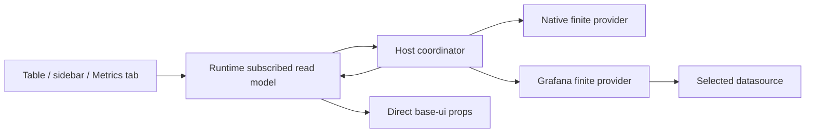

# Clean metrics integration: SDK → host → IDE

Status: independently reviewed design; no known contract blockers. Implementation and performance remain unverified. No implementation or merge performed.

## Decision

One host-owned coordinator collects metrics. Plugins execute finite batches. Runtime exposes one subscribed read model. Owning views pass prepared values directly to base-ui components.

Do not transplant the first implementation's JavaScript scheduler, Go scheduler, legacy hooks, and custom chart components together. Preserve its security and matching invariants, not its layers.

A single transport-to-public-runtime projection is necessary: SDK units are enums and timestamps are wire values; base-ui consumes discriminated units and epoch milliseconds. Do that once per changed snapshot, shared by consumers. No per-provider UI adapters, compatibility wrappers, presentation logic in Go, or SDK dependency on React/base-ui.

## Pinned evidence cohort

Created with `omniview-dev workspace create metrics-clean-integration-20261105` in the registered collection. Independent source worktrees; no running user workspace changed.

| Repository | Pinned commit                              |
| ---------- | ------------------------------------------ |
| Host       | `256b330f5ffc9c8b2ca5ae4af631432fe93433a4` |
| SDK        | `f50ed752ea02235110aa652cb56c1475b21e4eb6` |
| Kubernetes | `c3078cc615ce8b0be8a9cea350d80fd44016e0ff` |
| UI         | `ff51436114d4e00fa2f59f1900d675d74836b11e` |

UI PR [#113](https://github.com/omniviewdev/ui/pull/113) was open when pinned. Do not merge it automatically. Reference-only external-provider implementation: workspace `metrics-provider-implementation-20261104`; its additional files are not assumed present in these mainline checkouts.

## Existing ownership and problems

Paths are relative to the named repository. Line numbers describe the pinned cohort.

| Owner                    | Evidence                                                                              | Consequence                                                                                                                                          |
| ------------------------ | ------------------------------------------------------------------------------------- | ---------------------------------------------------------------------------------------------------------------------------------------------------- |
| Runtime query hook       | `omniview/packages/omniviewdev-runtime/src/hooks/metric/useResourceMetrics.ts:79-157` | React Query polling, separate identities, ignored supplied step/cancellation signal, broad previous-data retention                                   |
| Runtime stream hook      | `.../useMetricStream.ts:79-176`                                                       | Listener installs after subscription; pending-start/unmount fences missing; initial-event loss/orphan risk is source-derived, not runtime-reproduced |
| SDK default stream       | `plugin-sdk/pkg/v1/metric/manager.go:515-714`                                         | Per-subscription tickers, independent of frontend query polling                                                                                      |
| Host                     | `omniview/backend/pkg/plugin/metric/controller.go:395-680`                            | QueryAll fanout, background UI query context; existing reference admission and connection-generation fences must survive                             |
| Pod table                | `kubernetes/ui/src/hooks/usePodMetricsBatch.ts:24-122`                                | Already batches through empty-ID LIST; not per-cell GET. Missing values become zero; source merging is positional                                    |
| Pod sidebar              | `.../Pod/PodMetricsSection.tsx:192-241`                                               | Separate current/history polling; history bounds initialize once                                                                                     |
| Native metrics           | `kubernetes/pkg/plugin/metric/handler.go:310-378`                                     | Uses receipt time instead of actual metrics-server timestamp/window                                                                                  |
| Reference implementation | Runtime `resourceSetScheduler.ts`, host `coordinator.go`                              | Duplicate scheduling/caches, metric-set-sensitive keys, repeated native LIST across independent chunks                                               |
| Reference Grafana        | `internal/builtinplugins/grafana/config.go`, `query.go`                               | Recreates HTTP transport and closes idle connections per query; no useful pooled polling lifetime                                                    |
| Presentation             | Pod/Node sections, ResourceMetricsPage, MetricUsageCell                               | Duplicate extraction/formatting, custom charts/details, invented CPU/memory capacity bounds                                                          |

## Contract and responsibility boundaries

### SDK: semantic data and finite execution

Proposed contracts, not existing exports:

- `MetricDescriptor`: namespaced semantic ID `(resource-owner plugin, resource type, metric key)`, label, explicit physical unit/base, measurement meaning/window, supported shapes, dimensions, default display hint.
- `MetricSourceRef`: provider plugin + named provider connection ID + datasource UID/kind. Resource-owner connection is separate. Display names never route work.
- `MetricMapping`: source-specific query and structured public-field bindings, output identity/dimension labels, explicit normalization/reducer, mapping revision. Separate from semantic descriptor.
- `QueryResources`: resolved source, admitted finite targets, metric/mapping IDs and effective revision, instant or range evaluation. Each target has an opaque correlation token plus canonical identity and approved projections. Caller tokens are not cache identity or authority.
- `MetricResult`: target token, semantic metric ID, declared dimensions, explicit status, numeric value/series, actual sample time/window if known, warnings. Labels/provenance live once per series/result, not every point.
- Capabilities describe the selected source and metric: current/range support, required identity fields, dimensions, batch/expression limits. Capability does not promise that a particular exporter series exists.

Reuse resource-v2 reference admission, leases, owner/source generations, invocation principals, catalog fences, and transport ownership. Provider gets its own connection credentials only. External providers receive approved projections, not full resource documents or resource-owner credentials.

Identity admission does not authorize or fetch resource bodies. Resolve mapping projections through an owner-authorized, generation-fenced reader over existing observations/shared owner cache; reference `metric/projection.go` defines this boundary. Resource-owner policy explicitly approves fields and caller read authority; schema presence alone is not approval. Never trust caller-supplied field values or fall back to per-target GET. Missing/stale required projections return `invalid_context` before dispatch. Include referenced-field digest and incarnation in query validity; recheck changed projections before publication. Rebuild the provider execution context with only the selected source connection credentials, rather than forwarding the owner's plugin context.

Native and external providers implement the same finite capability. Do not make Grafana implement fake unsupported legacy query/stream methods. Keep independently required nonresource metric operations separate; inventory all SDK/host/plugin/tool consumers before deleting legacy APIs. Add a negotiated finite-resource RPC capability and migrate the selected cohort together; incompatible plugin/host versions fail explicitly rather than using a hidden adapter. Generate Go and runtime request/response declarations from the owning contracts; do not hand-copy request DTOs.

### Units, times, and result meaning

- Normalize physical quantities once at provider boundary: CPU cores, bytes, seconds, count, percent/ratio with explicit distinction, and base-unit rates. Legacy millicores/scaled bytes migrate explicitly; do not guess KB versus KiB.
- Preserve measurement semantics: native CPU window average and a five-minute PromQL rate are not identical measurements merely because both use cores.
- Distinguish `ok`, `missing`, `unsupported`, `denied`, `invalid_mapping`, `ambiguous`, and `failed`. Partiality and delayed freshness are independent dimensions. Zero is only an explicitly measured zero.
- Separate source sample timestamp, evaluation timestamp/domain, fetch completion, cache reuse deadline, and freshness policy. Unknown observation time stays unknown; never replace it with receipt time.
- PromQL evaluation timestamps do not prove raw scrape freshness. Preserve real source timestamps where available; otherwise report unknown sample age, not an invented five-minute expiry.
- Complete historical windows do not become stale merely because their end is yesterday. Live freshness applies to live measurements; historical completeness is separate.
- Metrics-server uses its actual API timestamp/window and supports current only. Do not invent historical series or represent local polling history as provider history.
- Standardize live skew/grace policy once; cache reuse expiry never directly becomes a stale badge. A refresh in progress does not mean stale.

First slice requires scalar and numeric-series shapes. Histogram/state/SLO components are not reasons to invent SDK shapes or fake measurements. Add distribution/state semantics only with real producer data and an owning consumer; never manufacture histogram counts from percentiles.

### Host: routes, admission, one coordinator

Host owns global defaults, sparse resource-connection overrides, effective route resolution, persisted presentation preferences, authorization, scheduling, bounded work/cache, and publication fencing. SDK does not own preference records.

Query lifecycle:

1. Admit each subscriber's canonical resources, resolve source and mappings, capture authority generations.
2. Canonicalize metric sets; share exact and covered metric/resource subsets. Union pending compatible targets within a bounded collection window. Never broaden requested history for all table rows just to reduce call count.
3. One coordinator owns due times, in-flight work, retained snapshots, and eviction. Runtime has no network polling/retry/cache scheduler; providers have no duplicate subscription ticker.
4. Table current CPU/memory and matching sidebar current reads share work. Sidebar range is a separate query unless the same domain/step and authority are demonstrably covered. No claim that instant and history always become one call.
5. Group by source and query compatibility. Host partitions logical work; provider may split for backend expression/byte limits, not apply a second arbitrary target-count chunker. Native collection groups kind/namespace and reuses one LIST within that admitted execution instead of repeating LIST per generic chunk.
6. Reference-count interest. Leaving one view does not cancel remaining readers. Last interest cancels upstream context. Manual-only interval zero does not auto-retry. Different interval subscribers share collection without timer starvation or redundant work.
7. On owner/source/credential/mapping change, retire only affected work and fence late completion before cache insertion and delivery. Re-admit each subscriber at delivery, including cached delivery. Unrelated connections remain warm.
8. Bound targets, metrics, query bytes, returned series/points/bytes, queue length, partitions, concurrent work, and retained time windows. Over-limit behavior is explicit; never degrade to one query per resource. Initial limits are conservative configuration, not performance claims.

Coverage is a set of canonical `(resource identity + incarnation + route, semantic metric, source lane)` pairs within a compatible authority/evaluation partition. It is not an exact key containing two independent sets. Maintain a coverage index for cached and in-flight pairs. Union pending requested pairs, not their Cartesian product. A provider may inherently scan extra data, but this never grants delivery/cache authority for extra pairs. Assign execution-local target tokens and retain their canonical-identity map. Before each delivery, intersect with that observer's requested pairs, re-admit them, and rebind that observer's correlation tokens. Unknown/duplicate execution tokens are rejected; subscribers never receive another observer's tokens or unrelated table rows.

Native API work has a real limitation: a namespace LIST may return all namespace metrics even for 24 selected Pods. Do not claim scan cost independent of namespace inventory. Use verified server pagination/selectors where supported, stream/filter ingestion, response-byte and scanned-object/page budgets, deadlines and cancellation. Do not assume metrics-server honors `limit`/`continue`. If supported limits are unavailable, bounded streaming namespace scanning is explicit overfetch, measured separately from admitted targets. Exceeding budget reports incomplete/truncated results; unseen targets are not proven missing. Never silently issue individual GETs to escape the limit.

Manual Refresh bypasses completed cache and requests fresh execution, but joins a compatible in-flight execution rather than duplicating it. Each subscriber has its own due deadline; a covered completion satisfies its demand. The earliest unsatisfied deadline schedules shared work. Subscription churn cannot postpone existing deadlines; interval-zero creates initial/manual demand only and never automatic retries. Reopening after a pause performs one due execution, not catch-up polling. All network scheduling remains host-owned.

The compatibility partition includes principal/authority generation, owner connection, provider connection generation, datasource UID/kind, source-scope/route generation, and evaluation/window/step semantics. Individual coverage entries carry canonical resource incarnation, metric ID, that metric's effective mapping/descriptor revision, and referenced-parameter/projection digest. Coverage is indexed inside the partition, not folded into an exact metric-set key that would prevent subset sharing. Do not key by caller token, result order, display name, full mutable resource document, or unrelated resource-version changes.

Relative query identity uses duration/step policy, not a new wall-clock start/end key each poll. Host resolves an aligned moving domain at execution. Absolute identity includes fixed bounds and step. Incremental overlapping range refresh is an optimization to measure after the correct bounded full-window path; no new delta protocol in the initial cutover.

Observation control is explicitly session-addressable before Open returns: key every operation by authenticated frontend session generation plus client token. Runtime installs its shared event router and registers that token first. `Open(token, spec)` validates/registers a bounded pending observation and returns an admitted initial snapshot without starting collection. Once the response is handled, idempotent `Attach(token)` crosses the publication barrier and starts shared interest. `Close(token)` cancels pending or active interest and is valid before acknowledgment; it never needs a returned server ID. Late Attach cannot resurrect a closed token. A bounded cancellation tombstone plus enforced Open deadline prevents Close-before-registration races; the host also generates a fresh observation generation for output fencing. Pending registrations expire, session disconnect retires them, tokens are not reused, and updates carry monotonic sequence/generation. Reuse the existing activity frontend Attach/session-ownership pattern rather than inventing an unrelated lifecycle.

Headless finite reads use the same coordinator with bounded caller context. Wails cancellation must connect to controller work, not stop at a cancellable JavaScript promise. Provider context is coordinator-owned while shared interest exists.

### Grafana and mapping validation

Keep Grafana in-tree initially, registered through the same provider boundary as an extension. Keep HTTP clients/transports per provider connection generation; retire on save/delete/shutdown. Test capability discovery against the selected datasource, not merely Grafana health.

Resolve the first non-inherited choice in this order. `native` is a selectable value at each level, not an unconditional override:

| Priority | Choice and lifetime                                                             |
| -------- | ------------------------------------------------------------------------------- |
| 1        | Saved view source choice, durable per owner plugin + connection + resource type |
| 2        | Connection binding, including explicit per-metric route override                |
| 3        | Explicit global default for this semantic metric/resource type                  |
| 4        | Declared native default, only when all higher levels inherit                    |

An explicit external view choice therefore beats a native connection default; an explicit native view choice beats an external connection default. Query/mapping overrides apply only to their full selected source identity. Draft preview does not change routing. Supplement keeps source lanes distinct; replace-mapped gives external ownership only for mapped metrics and native ownership for unmapped metrics. Missing/denied/failed selected external data does not silently become native success. Conflicting equally applicable defaults produce ambiguity, never first-binding selection.

Global definitions and per-source mappings remain separate. Sparse connection overrides inherit future global edits unless that field was explicitly overridden. Omitted, empty, and reset-to-inherit are distinct operations. Deleting a selected provider/datasource leaves a visible broken selection until corrected.

Public source scope is a validated record keyed by owner plugin/connection plus full `MetricSourceRef`, separate from the resource connection's display name/ID. It maps approved public connection identity/metadata to the source's cluster discriminator labels. Scope digest participates in query partition and revisions. Shared/multi-cluster datasources require sufficient disjoint cluster scope before dispatch. A datasource without cluster labels is usable only through an explicit single-owner isolation declaration; it cannot bind multiple owners as if names alone were unique. Preview can validate configured labels/matches, but does not cryptographically prove that a user-entered cluster label denotes the intended cluster. Scope configuration requires authorized owner/source selection, and any scope edit fences old work.

Mapping editor validates public schema field paths and required metadata, query syntax, metric units, declared output dimensions, and exact identity joins. Structured field bindings permit approved scalar transforms only; no executable templates. Escape literal regex values and PromQL strings separately. Query preview uses admitted sample targets and reports no-match/duplicate/missing-label results before save. Supported mappings must compile to bounded vectorized resource-set queries; reject an unbatchable mapping for resource-set use instead of silently issuing per-object requests.

Join results by the exact requested identity tuple, including namespace/cluster where needed. Reject duplicate requested projections and duplicate result dimension tuples. Filter extra regex cross-product matches; cap backend/output cardinality. Missing identity fields fail before network dispatch and never broaden a selector. Stable series identity derives from semantic metric, source lane, and sorted declared dimensions—not response index or incidental exporter labels. Preserve resource incarnation so a recreated Pod cannot inherit an old Pod's cached value.

Incarnation fencing guarantees that old cached/in-flight results cannot reach a recreated resource. It cannot prove historical attribution when backend labels omit UID. Prefer UID-aware selectors; otherwise declare name-scoped provenance and validate measurement-window/time bounds against authoritative creation metadata. Do not claim UID-bound history or silently combine old/new incarnations when the backend cannot establish that distinction. Canonical reference identity fields can be projected without fetching bodies; additional field paths require an authorized owner observation and fail explicitly when unavailable.

### Runtime and direct UI

Runtime owns a single public metrics API, generated transport calls, session event routing, and one shared immutable read model per coordinator snapshot. Prepare epoch-ms points, base-ui-compatible units, stable series IDs, null gaps, provenance and status once. No imports of generated binding paths in owning views. Source-specific normalization never appears in Kubernetes UI.

Views compose `MetricPanel`, `MetricValue`, charts, `MetricDetails`, `CapacityBar`, legend and range/display controls directly. Use base-ui formatting for table text. Do not split formatted strings into values/units or invent capacity bounds; absent real limits means unknown capacity. Keep resource data untouched so metrics collection cannot damage Pod container readiness indicators, row selection, or focus.

Retain mounted compatible charts during refresh and pending time-range/step changes. Keep the old displayed domain associated with old data until the replacement arrives; target selection can show pending state without relabeling old points. Range/step is query identity, not authority: changing it need not blank the plot. Resource/source/mapping/permission changes clear incompatible values and metadata immediately. A completed empty/missing/denied response replaces retained values. Failed compatible refresh keeps old sample times plus a compact failure notice; it never advances freshness. Notify expiry-driven presentation changes without creating a second network scheduler.

Compatible-transition retention has one owner: the runtime observation holds one immutable `displayedSnapshot` plus `pendingQueryIdentity`. Host retains reusable query results; views do not build another cache. While replacement loads, base-ui receives `kind: 'data', updating: true` and the displayed snapshot's original domain. Authority invalidation clears displayed and pending content synchronously. Presentation-only freshness notification may update this snapshot without scheduling network work.

Do not add base-ui API features speculatively. Current components cover this slice; linked-emphasis callbacks/external legend placement require a concrete product consumer before extension.

## Settings and persistence

Global settings own named Grafana connection cards, credential flow, datasource catalog, global metric mappings, and explicit persisted defaults. Credentials remain private provider-connection storage.

Kubernetes's connection settings mount a typed host contribution slot. The generic slot renders registered React component types, including memo/lazy objects; it does not switch on plugin ID/resource kind. The owning view supplies resource-owner identity, approved public connection metadata, resource types/catalog revision, and admitted preview targets. Host metrics contribution owns source selection and sparse mapping overrides; native discovery settings remain Kubernetes-owned. Logs can later reuse connection organization with a separate capability; no generic signal framework now.

| Preference                                             | Durable scope                                                                                |
| ------------------------------------------------------ | -------------------------------------------------------------------------------------------- |
| Metric IDs/order, layout, display mode, time selection | Resource-owner plugin + resource type; shared across resource instances and metrics surfaces |
| Hidden series, details expansion                       | Same profile + metric/stable series identity                                                 |
| Explicit source choice                                 | Owner plugin + connection + resource type                                                    |
| Global default/mappings                                | Host provider configuration                                                                  |
| Connection mapping overrides                           | Owner connection binding                                                                     |
| Hover/cursor/keyboard anchor                           | Mounted view only                                                                            |

Persist both relative duration and explicitly applied absolute time domains. A brush is transient until applied as a time selection. Restart must not silently reset a chosen absolute range. Relative selections remain relative; refreshing an absolute range does not advance its bounds.

Extend existing host durable storage, not Kubernetes-specific localStorage. Schema-version records, validate without destructive reset, preserve temporarily unavailable metric IDs, and surface write failure. Existing durable destination wins during migration. Migrate reference presentation/source keys only after a successful durable write; translate `bars` to `sample-bars`, duration strings to validated milliseconds, and preserve explicit native versus inherited source choice. Do not migrate credentials through preferences or overwrite native `cluster_overrides.metricConfig`.

Presentation migration is independent of source authority migration. Import legacy source identifiers only through normal host owner/source authorization and scope validation, resolving the full source identity. Dangling/unavailable legacy choices remain unresolved records, never active routes or a reason to silently inherit native. A durable destination wins; successfully persist before removing origin-local keys. Migration cannot magically read another browser origin's localStorage. All durable records are profile/principal-scoped; versioned partial writes prevent one window's time-range update from overwriting another window's metric order.

## Cutover/deletion inventory

Delete only after all actual consumers migrate in the selected release cohort. Confirm references across runtime, providers package, plugins, dashboards, overview, tools and examples before removing exports.

- Resource uses of `QueryAll`, empty-ID batch expansion, positional provider merging, and per-resource fallback GETs.
- `useResourceMetrics` polling and resource uses of `useMetricStream`; SDK default polling for the migrated resource path. Preserve separately required nonresource operations until migrated to their intended contract.
- Reference JS `ResourceSetScheduler`, duplicate JS result cache/retry/coalescing, and duplicate provider target-count chunking.
- Pass-through host `AdapterV1` after the controller consumes the final interface directly; no compatibility re-export.
- Handwritten transport request DTOs and stale `omniviewdev-providers/internal/metric/Client.*` generation after verifying remaining consumers.
- Mixed semantic/query `MetricDefinition`, SDK-owned persisted binding policy, generic `Signal`, implicit first-binding selection, and Grafana fake unsupported legacy methods.
- Pod/Node legacy extraction/formatting/chart conversion, ResourceMetricsPage duplicate composition/query paths, custom Details/CSS/buttons/time dropdowns, invented table bounds, and receipt-time sample stamps.
- Kubernetes metric preference localStorage after durable migration; native query-ID prefixes after explicit semantic-ID migration.
- Unused legacy metrics chart exports only. Do not delete shared chart directories: ScorecardChart still needs DonutChart. Migrate dashboard/overview range types before deleting their contracts.

Keep reference admission, connection leases, principals, wire-ID and generation fences, lifecycle retirement, and the Kubernetes client cache. A client cache is not a duplicate metric-result scheduler.

## Measured investigation evidence

1. Existing real-cluster `hack/metrics-lab/verify.py --context kind-kind --timeout 8` passed: actual Ready Nodes, two Ready application Pods, CPU/memory/network, KSM requests/limits/restarts, real filesystem writes, cAdvisor/KSM provenance. CPU throttling honestly reported unavailable. This directly queries Prometheus; it is not proof of IDE/Grafana/SDK integration or large-cluster throughput. No cluster configuration changed and no credentials were printed.
2. Ran the production reference `ResourceSetScheduler` with a controlled executor. Identical metric sets shared one dispatch. Reordered equivalent metric sets produced two dispatches; CPU-only plus CPU/memory also produced two. This proves scheduler key behavior only, not backend request counts or live-provider performance. No fixture UI or fabricated measurements were exposed.
3. All additional race/cancellation concerns above are source-derived risks unless explicitly reproduced here. No permanent tests or production files were changed for these probes. No new server launched.

## Implementation sequence

Use three logical implementation issues under one new integration epic; relate, do not reopen, the completed external-provider epic #388.

1. **Native vertical cutover:** freeze/generate finite contracts and negotiation; implement coordinator/runtime observation transport, minimal native CPU/memory finite execution with real timestamps/current-only capability, and minimal direct base-ui table/sidebar consumers with durable presentation profile. Prove one real native shared collection path, cancellation, admission and range-unavailable behavior. This issue is end-to-end, not a backend scaffold waiting for later issues.
2. **Grafana + connection routing:** add in-tree finite Grafana provider/client reuse, deterministic source/scope selection, batch mapping validation, sparse configuration, global cards and typed connection settings contribution. After phase one's contract freezes, provider execution and settings UI can proceed in parallel; merge only when real Grafana CPU/memory works through the same table/sidebar path.
3. **Complete IDE cutover:** migrate remaining Pod/Node/tab/dashboard consumers and legacy preferences, expand real supported metric coverage, finish stable refresh/range interactions and caller deletion. Remaining UI consumers and provider mapping coverage can proceed in parallel against the frozen contract, followed by integrated native/Grafana proof.

Each issue must record status and evidence. Implement contracts/coordinator first; never merge a fake/no-op provider or unsupported-method scaffold. No autonomous merges. Use narrow PRs; no repository-wide formatting.

## Acceptance gates

- **Real vertical slice:** Pod CPU/memory table and sidebar share compatible current work; actual native metrics-server and actual Grafana datasource paths both exercised. Current lab lacks metrics-server, so native test setup is an explicit fixture prerequisite, not a claimed completed proof.
- **Count the right layer:** record observations, host executions, provider RPCs, backend HTTP/API calls, and native objects scanned separately. For 24 same-namespace Pods/two default mappings within one chunk, Grafana uses two PromQL queries rather than 48; native uses one grouped LIST when the namespace fits a verified page/budget. Pagination can legitimately add LIST calls. Opening a compatible sidebar adds no duplicate current query. History can legitimately add range queries.
- **Coverage:** permuted metric/resource sets and covered subsets reuse flights/cache; different source, range, step, or authority never alias. No cache key contains display names or full mutable object bodies.
- **Large clusters:** exercise hundreds of nodes/thousands of Pods, including a 20,000-Pod inventory. Requested pairs and retained data follow active visible/selected demand and configured bounds. Native namespace scanning can still grow with inventory; measure that overfetch and enforce page/object/byte limits rather than claiming otherwise. Do not fetch full-history for every table row. Record actual memory/CPU/latency; limits are not benchmarks.
- **Identity:** same Pod name in two namespaces/clusters, recreated UID, shuffled results, undeclared labels, duplicate dimension tuples, malformed tokens, null gaps, and missing projections never misdeliver or become zero.
- **Lifecycle:** delayed/out-of-order completion, close-before-ack, double-start, option change, final unsubscription, hidden windows/columns, disconnect/reconnect ABA, credential/mapping rotation, cached-delivery re-admission, bounded cancellation and eventual cleanup.
- **Freshness:** healthy Grafana with old or unknown source data; long refresh; old native timestamp; complete historical range; expiry without new network response. No refresh-boundary stale flip-flop or receipt-time renewal.
- **Stable UI:** retain same card/SVG/focus through compatible refresh/range/step changes; preserve null gaps, color, selected series and details. Clear denied/incompatible data and metadata immediately. Native unavailable history is honest. Container readiness indicators remain unchanged.
- **Settings:** Grafana connections A/B with identical datasource UIDs remain isolated; global edits affect inherited connections only; sparse reset restores inheritance; failed/deleted explicit source never silently falls back. Save/test preview detects missing/ambiguous labels and query errors.
- **Persistence:** selection/order/layout/display and both time-selection modes survive resource/tab changes and host restart; source choice stays connection-scoped; failed saves are visible; legacy migration is repeatable and non-destructive.
- **Release:** generated bindings (host via `task bindings`), runtime/provider public exports, all affected plugin consumers, contract checks and docs updated. Runtime builds before Vite plugin. Actual browser/native IDE proof and screenshots posted before PR/merge; any new mock HTTP server must support Tailscale securely. No stale legacy exports or suppressed checks remain.

## Independent quality review

Three parallel source investigations informed this proposal. Two independent reviewers then raised five architecture and six security-contract findings, including overlapping delivery-projection concerns. All findings were resolved before their final review: canonical pair coverage/token rebinding, native API overfetch limits, single-owner transition retention, refresh/deadline semantics, real end-to-end phase boundaries, authoritative projections, session-addressable observation lifecycle, explicit source precedence, source-scoped cluster bindings, and separately authorized source migration.

Both reviewers returned no remaining concrete blockers in the revised design. This is design approval, not evidence that unimplemented code is correct or that scale targets are achieved. The later cache-partition clarification preserves subset indexing; the incarnation note explicitly limits claims when backend history has no UID labels.
