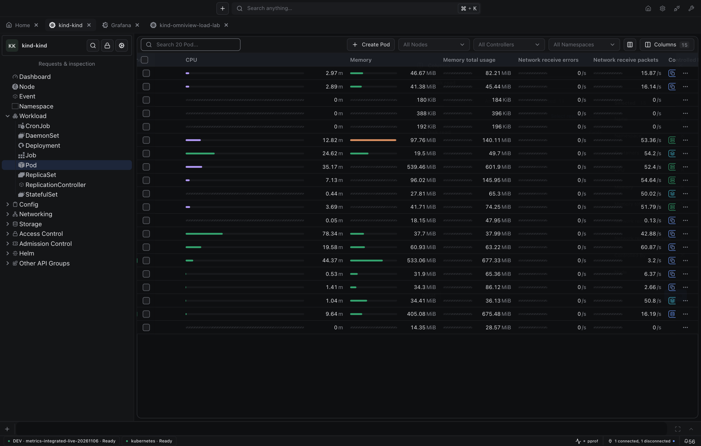

# Metrics visual repair

[Original V01–V11 audit](metrics-visual-consistency-audit.md) remains unchanged. Its seven screenshots are frozen at `1c44975c`.

| Approved panel | Actual IDE after repair |
| --- | --- |
|  |  |

## Findings → fixes

| ID | Fix | Owning layer / component |
| --- | --- | --- |
| V01 | Restore inline utilization bars with real owner-supplied bounds. | Kubernetes tables → base-ui `MetricCell` |
| V02 | Restore 4px-high tracks and 12px neutral values; horizontal/vertical stories; unknown bounds stay hatched. The follow-up below makes horizontal tracks responsive. | base-ui `MetricCell`, `CapacityBar`, `MetricValue size="xs"` |
| V03 | Reuse Area / Line / Bars / Value segmented controls, in approved order. | Kubernetes composition → `MetricDisplayPicker` |
| V04 | Remove unexplained reorder arrow. | Kubernetes composition |
| V05 | Show admitted cluster/namespace/Pod identity chips, separate from series dimensions. | Runtime readonly references + resource-owning views |
| V06 | Resolve friendly connection/datasource names through shared metadata caches; hide advanced attribution under Diagnostics. | Runtime presentation hooks + `MetricDetails` |
| V07 | Collect one current batch and one history batch; prefer current values and show both sample rows without invented expiry. | Kubernetes composition + existing host coordinator |
| V08 | Move value/plot rhythm into `MetricPanel.value`; preserve axis/footer gutter and single-line byte units. Expanded details no longer stretch neighboring cards. | base-ui panel/plot styling + owning grid layout |
| V09 | Apply Button gap and icon-size tokens to Menu/Popover triggers across sizes. | base-ui core primitives |
| V10 | Use actual provider icons and concise source names. Grafana now advertises its own icon metadata. Inherited selection shows the resolved source without changing saved routing. | Provider metadata + generic runtime/picker + `MetricDetails.sourceIcon` |
| V11 | Replace browser temporal inputs with shared calendar/time fields in a roomy popup. Validate complete drafts, preserve untouched precision, support keyboard entry, and keep empty optional fields neutral. | base-ui `TimeRangeControl`, `DateTimePicker`, `DateField` |
| V12 | Remove leftover consumer chip/button/popup chrome and density overrides. Reuse existing Chip, Button, and Popover APIs; keep only layout and data-marker CSS. | Kubernetes composition → existing base-ui primitives |

## See it

- [Actual IDE](http://127.0.0.1:34836/)
- [MetricPanel story](http://127.0.0.1:23680/?path=/story/metrics-components-metricpanel--details-expanded&globals=theme:void)
- [MetricCell stories](http://127.0.0.1:23680/?path=/story/metrics-components-metriccell--horizontal&globals=theme:void)
- [Date/time story](http://127.0.0.1:23680/?path=/story/metrics-components-timerangecontrol--open-calendar-and-time&globals=theme:void)
- [Narrow byte-axis story](http://127.0.0.1:23680/?path=/story/metrics-components-timeserieschart--bytes-narrow&globals=theme:void)

[Actual table](../evidence/metrics-visual-repair-20261106/after-pod-table.png) · [Native Nodes](../evidence/metrics-visual-repair-20261106/after-native-nodes.png) · [316-Pod native cluster](../evidence/metrics-visual-repair-20261106/after-native-pods.png) · [Date/time popup](../evidence/metrics-visual-repair-20261106/after-time-range.png) · [Calendar/time columns](../evidence/metrics-visual-repair-20261106/after-calendar-time.png)

[Shared-control metric picker](../evidence/metrics-visual-repair-20261106/after-metric-picker.png)

## Verification

| Surface | Passed tests |
| --- | ---: |
| base-ui | 1,837 |
| Runtime | 464 |
| Host frontend | 1,518 |
| Kubernetes frontend | 1,741 |

Native TypeScript source/test checks, production bundles, runtime shim checks, and Grafana Go provider tests passed. Base-ui lint/formatting is clean. Existing unrelated host/plugin warnings remain; existing host/plugin suites each skip three tests.

Actual refresh retained all three chart nodes across 20 sampled frames. An uncached six-hour → one-hour change retained them across 270 frames. Chart count stayed three; height stayed 162px; vertical position stayed fixed. Pod switching and reload retained display/range/layout/details choices. Native verification used four Ready Nodes and a 316-Pod cluster with 30 mounted rows / 60 metric cells. Green container indicators remain visible.

[Machine-readable checks and limits](../evidence/metrics-visual-repair-20261106/verification.json). Unknown source timestamps remain unknown. Native current values do not become synthetic history. Earlier upstream request-count evidence is not a new throughput claim for this visual repair.

## Prevent drift

- Add missing shared capability in base-ui before composing it in host/plugin views. Consumer layout is allowed; local chrome/theme substitutes are not.
- Scoped lint guards reject native control substitutes in repaired metric consumers and browser temporal inputs in shared metrics components. They are not a repository-wide legacy-UI migration.
- Keep per-component stories and actual IDE screenshots. Mocked orchestration checks do not establish visual fidelity.
- Inspect all CSS consumed by a changed view, including unchanged files. Shared primitives are not enough if consumer classes override them.
- Compare against the frozen reference before requesting review. Record component, owner, code revision, and exercised behavior—not only a passing build.
- Exercise real punctuation-bearing column IDs and collision lookalikes. Measure inner content widths, not only outer header/cell boxes.

Code: base-ui `c9f94e6`, host `087a17fc`, Kubernetes `e13d8d6`. SDK remains `fe479313e4aa0be678e995d11e449af1f5baa26f`.

**Shipping hold:** user audit approval, then normal base-ui patch and compatible SDK/host-runtime publication before updating the Kubernetes minimum/lockfile. No merges, releases, or CI workflow changes.

## Resizing and loading follow-up

| Finding | Fix / owner |
| --- | --- |
| Adding metric columns broke layout. Latest upstream still had the bug. | Shared `DataTable` encodes arbitrary IDs into collision-free CSS variable keys. Colons/dots no longer invalidate widths. Declared flex bases, a visible-column width floor, and a full-width content slot preserve sizing and horizontal scrolling. Callers keep their original IDs. |
| Bar length followed content width; value and unit appeared disconnected. | Shared `MetricCell` fills the column and reserves one combined value slot. Number/unit gap is 2px. Narrow cells hide the track; values never wrap. |
| Pending cells were blank; loading transitions needed polish. | One shared skeleton per pending cell. Cards reserve value/chart geometry, including when current data arrives before history. Background refresh retains supplied data. |

[Responsive states](http://127.0.0.1:23680/?path=/story/metrics-components-metriccell--responsive-widths-and-states&globals=theme:void) · [Dynamic table regression](http://127.0.0.1:23680/?path=/story/components-datatable-resizing--dynamic-columns&globals=theme:void) · [Loading transition](http://127.0.0.1:23680/?path=/story/metrics-components-metricpanel--initial-to-data&globals=theme:void)

Browser measurements: ordinary and virtual rows had zero header/body alignment error after scrolling. Punctuation-bearing IDs and an underscore-lookalike control kept distinct widths; the table exposed 880px through a 518px viewport. Byte values from zero through GiB kept the same track and value-slot widths. Loading cells kept 21px height and used one skeleton each. Initial/data cards both measured 398×342px.

The actual IDE rendered five metrics across 20 Pods: 100 cells, all with nonzero width and zero header/body alignment error. CPU and memory drags expanded tracks by exactly 80px and 40px while the shared value slot stayed 83.14px wide. Adding Disk read showed 20 single-skeleton cells; each stayed 152×15.75px when the actual `0 B/s` value arrived.

The browser regression checks actual geometry, not copies of internal CSS variables. Narrow tracks remain screen-reader accessible. A separate shared Skeleton specificity bug prevented the OS reduced-motion rule from winning; browser verification now reports `animation: none` under reduced motion.

[Follow-up screenshots and verification](../evidence/metrics-responsive-followup-20261106)

Follow-up code: base-ui `e40982f`, Kubernetes `0dc6757`. The general table bug is included in the existing unmerged shared-UI draft #114; rebasing onto current main alone would not fix it.
