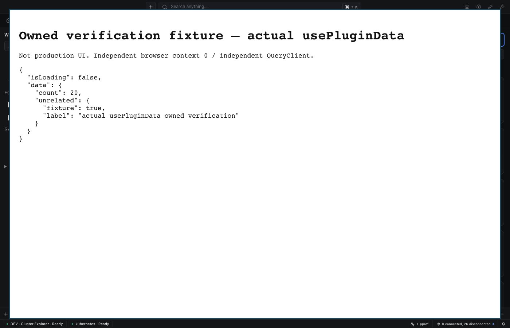
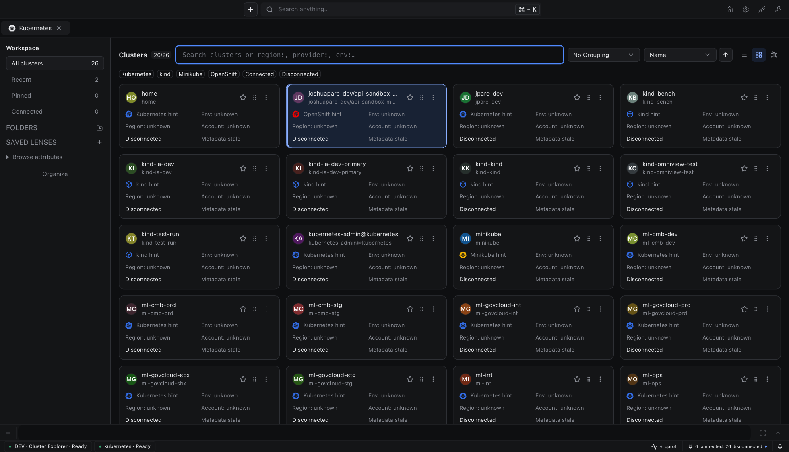
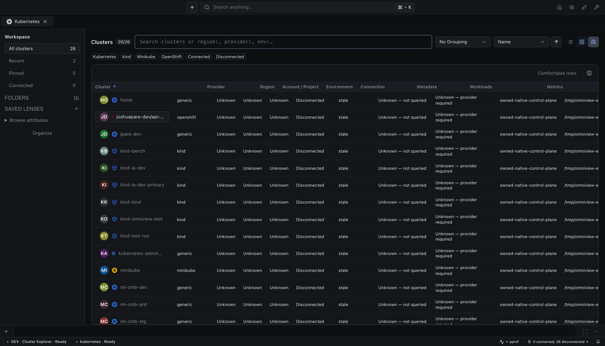

# Cluster explorer: shared plugin-data consistency

Tracking: [#389](https://github.com/omniviewdev/omniview/issues/389), [#390](https://github.com/omniviewdev/omniview/issues/390), [delivery board](https://github.com/orgs/omniviewdev/projects/14).

## Contract

Functional `usePluginData` updates use a fresh backend snapshot and compare-and-swap, not a window-local cache as the authority. The backend serializes snapshot comparison and writes. Updaters must be pure and may run again after a conflict, with an eight-attempt bound. Exhaustion rejects explicitly; it does not silently discard a write.

Data writes create a temporary file before renaming it over committed JSON. A write or replacement error leaves the previous committed value in place; temporary files do not appear as data keys.

Literal replacements retain last-write-wins behavior and do not require reading old JSON. Failed optimistic writes restore the prior cached value or the supplied default. An absent key and stored JSON `null` have distinct revisions.

## Exercised verification

- Go data-controller race tests passed. A failed-before/passed-after regression verifies that replacement does not mutate a previously opened committed snapshot.
- Eight runtime regressions passed, including a failed-before/passed-after unreadable-data literal reset.
- Real generated bindings in two independent browser contexts rejected stale revisions, preserved twenty increments and unrelated nested fields, and distinguished null from absence.
- A disposable counter survived an actual host-generation restart and was then deleted.
- A second live probe mounted the actual served `usePluginData` hook in two independent React roots and QueryClients. Twenty simultaneous functional increments preserved nested fields; backend and disk agreed. Literal replacement and cleanup passed.

The screenshot is a labeled temporary verification consumer, not production UI. No store mock, fabricated write failure, raw credential publication, or active-profile corruption was used. A tight unsynchronized stress loop could exhaust the documented conflict bound; the error surfaced explicitly.

## Release compatibility

Base UI 0.14.0, ai-ui 6.1.8 and editors 6.1.8 form the UI cohort. The consuming runtime must declare the matching Base UI peer and ship with a host that implements the snapshot/CAS bindings. Build runtime before Vite-plugin shims. Workspace source links do not establish published-package compatibility.

Runtime, providers, and Vite-plugin 0.29.0 were published from immutable producer `72b906d1474e6b2bd2701ce13afe1f6169f5b68f` (`npm-v0.29.0`) by [release run 41839949260](https://github.com/omniviewdev/omniview/actions/runs/41839949260). All three public npm version records identify that producer in `gitHead` and include integrity and provenance-attestation metadata.

Kubernetes 0.16.0 requires host 0.29.0. Development and nightly builds used source compatibility baseline 0.29.0 so the same minimum-version gate admitted this source capability cohort. The standalone artifacts used released SDK 0.14.6; the workspace verification used SDK `6ce85c8b42cab1547396217510196b29e63ffe55`. Current workspace E2E resolves the SDK commit from host `go.mod`, uses UI packages from the host lockfile, and uses Kubernetes from the host gitlink. Local workspaces observe their linked SDK checkout revision and source digest.

## Integrated explorer cohort

The Kubernetes gitlink at that time selected merged explorer `695c8d328031755f3b29d8be0f33ea3ad09af1fe` ([plugin PR 207](https://github.com/omniviewdev/omniview-plugin-kubernetes/pull/207)). Its reviewed source `ed76f0165c955a043ad1d8e09c2d64032c384c15` passed [registry-cohort CI 41848898158](https://github.com/omniviewdev/omniview-plugin-kubernetes/actions/runs/41848898158): frozen installation, lint, native TypeScript, 1,720 tests with three skips, 18 New York age-clock regressions, and production build. Standalone Go build and eleven tested packages passed against released SDK 0.14.6.

The canonical real-plugin consumer scenario exercises initial search focus and keyboard field completion, then verifies the probe's shared runtime state. It no longer depends on the explorer's removed `All Clusters` subtab.

Authenticated source generation `a4f3a0cb-4b68-4404-ac40-fda140048fb1` reported ready builds, current dependencies and served source, and connected HMR. Search autofocus and keyboard card selection were observed. Earlier live review-fix scenarios verified Settings navigation, lens-name focus, direct Cards/Table opening, empty-scope recovery, repeated folder moves, deleted-folder lens fallback, and fixture cleanup.

These are actual development IDE captures, not mocks or packaged-desktop captures. All 26 aliases target one owned real Kubernetes API with four namespaces, zero Nodes, and no scheduler. Metadata hints do not establish cloud ownership or workload health. Native MCP confirmed initial search focus, but hidden-window action automation stalled; native-window actions and OS dialogs remain unproved. The plugin's [release evidence](https://github.com/omniviewdev/omniview-plugin-kubernetes/blob/695c8d328031755f3b29d8be0f33ea3ad09af1fe/docs/releases/0.16.0.md) records the full theme, sizing, density, responsive, organization, and restart scenarios.

## Universal macOS runner

PR, stable-release, and nightly universal-build jobs use the existing Homebrew verification baseline, `macos-15-intel`, after macOS 26 ARM and Intel requests failed before any step started ([#400](https://github.com/omniviewdev/omniview/issues/400)). They explicitly select `/Applications/Xcode_26.3.app/Contents/Developer`, which GitHub documents with the [macOS 26.2 SDK on its macOS 15 Intel image](https://github.com/actions/runner-images/blob/main/images/macos/macos-15-Readme.md#xcode).

The build recipe remains unchanged: compile arm64 and amd64, combine them with `lipo`, and verify both slices. Release signing, notarization, and stapling remain required. Only desktop runner/toolchain selection changes; the reusable Ubuntu npm producer, its source, dependencies, and commands remain unchanged.
