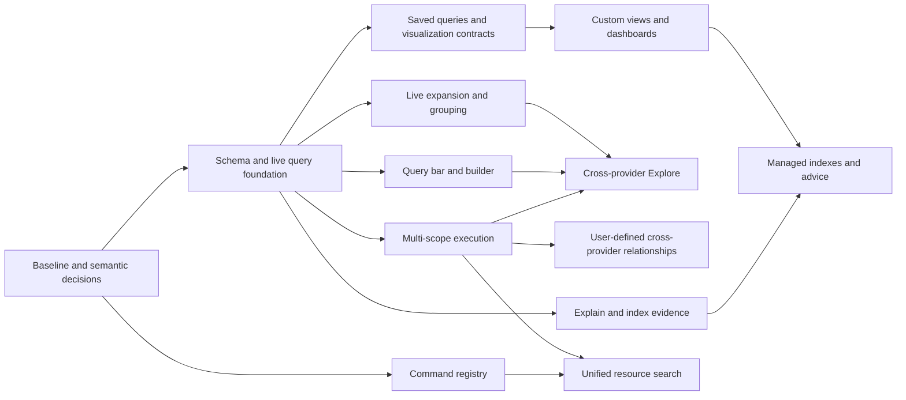

# Resource intelligence and customizable IDE roadmap

Date: 2026-10-17
Status: proposed product roadmap; not an approved implementation specification.
Companion: [Agent work packages](2026-10-17-resource-intelligence-work-packages.md).
Execution: [Contract readiness](2026-10-17-resource-intelligence-contract-readiness.md), [complete launch schedule](../superpowers/plans/2026-10-17-resource-intelligence-launch.md), [P00 baseline plan](../superpowers/plans/2026-10-17-resource-intelligence-baseline.md). Accepted architecture is not proof of frozen DTOs or completed product implementation.

Remote delivery tracking: [organization project](https://github.com/orgs/omniviewdev/projects/13), [parent roadmap issue](https://github.com/omniviewdev/omniview/issues/78), and [all packet issues / launch ordering](2026-10-23-resource-intelligence-remote-index.md). This publishes tracking, not approval of frozen contracts or completion of implementation.

Execution update: P00/C00 and P44 are accepted; P02's [real resource baseline and cleanup receipts](../../bench/app/README.md) are accepted through [PR134](https://github.com/omniviewdev/omniview/pull/134). P04's full host/SDK/Kubernetes C02 acceptance is merged through [PR136](https://github.com/omniviewdev/omniview/pull/136); [issue #83](https://github.com/omniviewdev/omniview/issues/83) is closed. P42's feature-local C11 command/provider implementation is accepted through [PR139](https://github.com/omniviewdev/omniview/pull/139), with [reviewed actual-header/native-service evidence](2026-10-25-global-command-search-acceptance.md). P43 resource search remains held by P35's authoritative query service. P01's reviewed design/spike is merged with production numeric admission still blocked. P18's portable browser evidence is merged through [UI72](https://github.com/omniviewdev/ui/pull/72), with native accessibility and production gates open. Reuse the [implemented UI/editor subsets](2026-10-17-resource-intelligence-work-packages.md#execution-reconciliation--2026-10-22); the [readiness ledger](2026-10-17-resource-intelligence-contract-readiness.md#6-ui-execution-reconciliation--2026-10-22) governs their remaining consumers. The product sequence below remains unchanged.

## 1. Recommendation

Build one host-owned resource query/read model for filtering, live child views, grouping, saved queries, dashboards and Explore. Design its contracts for the target product rather than fitting them into existing SDK types. Reuse sound algorithms, components and lifecycle mechanisms; replace public contracts and delete legacy paths where they obstruct correctness, provider neutrality or maintainability. Keep UI primitives in the UI repository and resource semantics at explicit host/SDK boundaries.

**Product invariant:** Omniview is an infrastructure IDE for Kubernetes, AWS, GCP, Azure, OCI, Docker/Podman, Proxmox, and other resource providers. Kubernetes is the first production integration and one optimization target, not the core data model. Single-provider use of any conforming plugin must work before multi-provider Explore ships.

**Compatibility policy:** backwards compatibility with current resource SDK/RPC/runtime APIs is not a requirement. Prefer a coordinated breaking cutover over permanent adapters, aliases, duplicated engines or weakened semantics. Preserve user-owned data and product capabilities through explicit migration; preserving behavior does not mean preserving API shape, bugs or undocumented defaults. Deprecating an old surface without removing its replacement-era callers is not completion.

Ship useful increments in this order:

1. Establish the baseline and non-Kubernetes corpus, then approve and implement the new identity, query, capability/schema and provider-source contracts. Negotiate a new resource protocol major and migrate affected plugins/consumers before release.
2. Deliver a provider-neutral query bar and visual builder, validated early with non-Kubernetes providers and integrated into the existing Kubernetes view as the first production example.
3. Deliver lazy live child tables, arbitrary expanded visualizations, and efficient grouping.
4. Deliver saved parameterized queries, configurable components, user-defined views, and dashboards.
5. Deliver multi-connection/provider Explore, user-defined relationships, global search integration, and measured index management.

Do not build a general database, low-code application platform, full plugin permission system, or AI orchestration framework as prerequisites. Those would delay the first useful resource workflow. Preserve explicit extension seams for them now.

## 2. Scope and evidence rules

This is a decomposition and sequencing document, not forty-eight detailed implementation specs. Each work package requires a focused design/implementation plan before an implementation agent edits code. Contracts, dependencies, ownership and observable acceptance are launch inputs; proposed API names are not claims that they already exist.

Research covers the host checkout, `ui/main`, the sibling SDK checkout, and the sibling Kubernetes plugin. The host resolves SDK **v0.5.0** and Kubernetes resolves **v0.4.0**, confirmed independently with `GOWORK=off go list -m -json github.com/omniviewdev/plugin-sdk`. The SDK source checkout is not automatically the source used by either consumer. Worktree/source selection must be explicit.

Current-state findings are source-inspection evidence unless explicitly described as an exercised command. Static risks are not reproduced bugs. No product behavior, build success, throughput, or latency is certified by this roadmap. Older March graph design documents describe earlier drafts and must not override current source.

The existing [agentic workspace discovery](../superpowers/specs/2026-10-17-agentic-workspaces-discovery.md) and [workspace implementation plan](../superpowers/plans/2026-10-17-agentic-workspaces.md) already address isolated development instances and cross-repository linking. Reuse that effort; do not create a second workspace orchestrator here. The documents are proposals, not evidence that their changes have landed.

### 2.1 Existing capabilities and baseline gaps

Paths below are relative to `omniview/` unless prefixed with a sibling repository. `SDK@0.5.0` means the actual Go module dependency, not the sibling SDK checkout. Findings are static; investigate/reproduce before treating a suspected failure as an accepted bug.

| Area | Evidence | Roadmap consequence |
| --- | --- | --- |
| Typed queries already exist | SDK@0.5.0 `pkg/v1/resource/types.go:218-249,344-443`; `resourcer.go:88-114`; host `backend/pkg/plugin/resource/controller.go:517-545` | Existing Find is evidence, not the canonical future API. Replace its namespace-bound request, untyped predicate values, limited path/collection model and provider-dependent execution contract with the P01 query design and P45 provider boundary. |
| Kubernetes query execution is incomplete | `../omniview-plugin-kubernetes/pkg/plugin/resource/resourcers/base.go:167-227`; wildcard `pattern_resourcer.go:112-164` | Generic List/Find discard inputs. P10 migrates acquisition/native pushdown directly to the new contract; do not first build a full old-Find implementation that the cutover will delete. |
| Schema APIs exist but are not connected for querying | SDK@0.5.0 `resourcer.go:107-114`, `interfaces.go:49-55`; Kubernetes `connection_provider.go:467-482,503-620` | Reuse schema sources, not necessarily RPC envelopes. P07 defines the authoritative resource catalog/schema/capability model; query and document-editor clients derive their projections. Replace conflicting discovery paths rather than retaining duplicated truth. |
| Dynamic resource discovery is not full live support | Kubernetes `discovery_provider.go:21-73`, `resourcers/pattern_resourcer.go:49-65,112-164`; SDK `resourcer_registry.go:233-249` | Preserve actual GVK→GVR/plural/scope mapping; dynamic fallback is not a watcher. P08/P11 are explicit CRD-completeness work, not a hidden Pod-query prerequisite. |
| Frontend identity/cache shapes diverge | Runtime `hooks/resource/useResources.ts:71-80,147-194`, `useResource.ts:57-69`, `useEventBatcher.ts:44-81,119-141`, `useResourceActions.ts:111-119`; host table `ui/components/tables/Resources/index.tsx:69-70` | P03 replaces identity/key conventions; P15 migrates the default table to the new runtime/read path. Reproduce the affected behavior, but do not implement a short-lived old-listener repair before deleting that listener. |
| Subscription gating is useful but coarse | `backend/pkg/plugin/resource/subscriptions.go:5-65`, `sink.go:66-148`; runtime `useResources.ts:124-132,160-194` | Existing gate is plugin/connection/type-ref-counted; List and subscription setup have no shared watermark. P12/P14/P15 supply the live-query contract rather than adding more local filters. |
| Metadata and object retention are different | `backend/pkg/plugin/resource/registry/entry.go:5-21`, `sink.go:79-110,151-178`; SDK `proto/v1/resource/watch.proto:10-42` | Registry retains metadata, not resource bodies. Host currently reconstructs metadata from Kubernetes-shaped raw JSON because separate metadata does not survive watch transport. Fix transport, then design bounded object retention. |
| Graph engine and ownership paths exist | Host `graph/graph_indexer.go:23-77,145-235`, `graph/graph.go:314-337`, `graph_service.go:19-87`; Kubernetes `resourcers/relationships.go:16-25,114-161` | Reuse graph traversal and Deployment→ReplicaSet→Pod edges. Fix plugin-scoped declaration lookup before cross-provider work; current extractor targets stay in the same plugin/connection. |
| UI primitives are not missing wholesale | `../ui/main/packages/base-ui/src/components/data-table/{types.ts:18-64,DataTableBody.tsx:9-61,DataTableVirtualBody.tsx:200-319}`; `packages/editors/src/components/code-editor/CodeEditor.tsx:61-139,353-407` | Tree/nonvirtual arbitrary expansion and Monaco integration exist. Virtual arbitrary detail, grouping, query-language adapters, and combined live-render evidence are gaps. Host resource table also owns its own raw TanStack/virtualizer path, so library changes alone do not deliver the feature. |
| Contributions and user layouts are distinct | Runtime `extensions/registry.ts:17-124`, `types/extensions.ts:14-116`; host `ui/features/extensions/dashboard/extensions.ts:4-16`, `ui/hooks/homepage/useHomepageCardSettings.ts:4-80`, `ui/pages/dashboard/index.tsx:1-10`, `ui/federation/index.tsx:19-72` | Extend the current registry. Dashboard page is a placeholder; homepage preferences are real but not a saved-view system. Old custom-cell federation returns empty content; P26 cuts it over before configurable renderers depend on it. |
| Global search and security need real boundaries | `ui/layouts/core/main/Header/areas/HeaderSearchArea.tsx:9-20`; runtime `hooks/resource/useResourceSearch.ts:43-85`, `api.ts:1-22`; `ui/features/plugins/adapters/importPlugin.ts:13-61` | Header search is presentation-only; current resource search fans out List. Plugins share raw clients and JS realm. Add a real command/search layer, but do not claim secure plugin isolation from wrapper APIs. |
| Development sources differ from consumers | Host `package.json:29-31`; `../ui/main/packages/{base-ui,editors}/package.json:1-3`; host/plugin Go module resolution | Inspected UI source versions are 0.4.2/3.0.2 while host requests 0.4.3/3.0.3. P00 verifies exact sources/exports; do not edit a stale source base and assume it represents installed behavior. |

Runtime paths in this table are under `packages/omniviewdev-runtime/src/`; host graph paths are under `backend/pkg/plugin/resource/`. The UI row's editor path is also relative to `../ui/main/`.

## 3. Architecture choices

| Approach | Strength | Cost/risk | Recommendation |
| --- | --- | --- | --- |
| Filter independently in every React view over provider lists | Small first UI change | Repeated scans, full-object IPC, inconsistent semantics, expensive subscriptions, poor agent reuse | Do not make this the shared architecture |
| Host-owned query service over a shared live resource read model; provider capabilities where useful | Reuses watch/graph foundations; one semantic contract for humans and tools; incremental delivery | Must get snapshot/watch ordering, memory ownership, and scope isolation right | Recommended |
| Adopt an embedded general-purpose database and dashboard language first | Mature query/index capabilities may help later | Persistence of sensitive objects, write amplification, language/editor integration, and a much larger initial cutover | Evaluate only if measured workloads defeat the simpler read model |

### 3.0 Architecture-first breaking decisions

Recommendation: **targeted foundational replacement**, not a compatibility-first extension or a rewrite of every subsystem. Compatibility-first extension inherits constraints before proving they fit; blanket rewrite discards working code without evidence. P01/P45 establish the new boundaries; P47 migrates/removes public legacy surfaces and P46 enforces admission/release compatibility.

| Area | Evidence / constraint | Proposed decision and removal boundary |
| --- | --- | --- |
| Host query API | Find is provider-owned (`SDK types.go:218-249`); the text shortcut receives only query and limit (`controller.go:144-179`) | Replace Find/List-search and underspecified Search(query,limit) with a versioned QuerySpec/result/status contract. Text, predicates and scope compose explicitly; final ordering/paging cannot disappear during native search. Source enumeration remains a different operation. |
| Query representations | String paths, `interface{}` values, limited scalar/set conventions and one-level-nesting comment (`types.go:389-443`) | Replace FilterExpression as the public ceiling. Select typed field/path/array/literal/parameter semantics. A language parser AST, logical IR and physical plan may differ: these are compiler stages, not competing engines. |
| Provider API | Resourcer requires six CRUD/Find methods (`resourcer.go:14-32`), capability derivation marks all six true (`resourcer_registry.go:260-277`), and host interfaces import v1 DTOs (`backend/pkg/plugin/resource/provider.go:7-24`) | Require a resource catalog, then independently supported enumeration/get/native-query/update/mutation/action capabilities. A get-only or native-query-only type need not fake list/CRUD. Separate neutral domain contracts from versioned/generated DTOs, sharing genuinely identical types; one RPC service can dispatch optional operations. |
| Identity and types | SDK keys require `group::version::kind` (`types.go:15-59`); registry concatenates slash-delimited identity (`registry/entry.go:5-21`) | Replace core identity with opaque type IDs, structured refs/scopes and unambiguous encoding. Provider API/schema versions are separate metadata. GVK conversion stays in Kubernetes; no permanent legacy-key shim. |
| Acquisition/live consistency | Separate List/type-watch RPCs lack a shared snapshot boundary (`watch.proto:10-76`) | Define a new source protocol with finite page/coverage guarantees and optional snapshot-plus-update sessions. Carry metadata outside bodies, distinguish source tokens from host epochs, and replace old List+type-event stitching for migrated reads. |
| Schema/queryability | Raw resource schemas, filter fields, editor wrappers and action helpers have distinct roles | Keep the roles, but one resource catalog owns schema identity/revision. Derive editor/filter projections with explicit execution-support overrides. Field existence, language accessibility and native pushdown support are different facts. Replace scope/type-deficient discovery signatures. |
| Runtime/legacy bridges | Wails-v2 calls remain in `packages/omniviewdev-providers/internal/resource/Client.js:5-26`; aliases in runtime `models.ts:85-104`; raw barrel `api.ts:2-19`; legacy federation/contributions remain | Publish intentional resource/query/operation/model contracts, keep host transport internal, retire `@omniviewdev/providers`, old namespaces/enum aliases and legacy contribution normalization after migration. Keep active non-resource operations and the real linked-resource drawer. API pruning does not secure shared-origin JavaScript. |
| Graph/UI/extensions | Graph traversal, current contribution registry and optimized components are substantial | Keep sound algorithms; allow breaking ref/path/config/render contracts. Rekey graph storage/descriptors instead of retaining ambiguous identifiers. One contribution registry/semantic authority does not require one immutable historical class or AST. |

P01's executed comparison supports the user-accepted CEL direction. Keep the checked CEL AST/program internal to the host query envelope and logical/physical plan; add bounded builder/pushdown forms only where needed, not a second universal expression IR. Never force CEL into legacy Find.

The [comparison evidence](../superpowers/specs/2026-10-17-query-language-comparison.md) does not certify production integration. Concrete profile/functions, wire/numeric/schema/completion contracts and bounded-execution performance remain gates; record failures and revise affected design rather than treating acceptance as proof.

The shared read model is not a requirement to mirror every account or fetch every object before querying. P13 chooses bounded local, native or hybrid execution under declared capabilities and coverage. If an exact result needs an unavailable/over-budget scan, report a resource/capability limit or explicit partial result, never silently crawl an entire cloud account. A native-query-only type can expose its supported query subset without pretending to support enumeration.

P45 delivers a usable new-major SDK/host resource boundary, not declarations-only scaffolding. P05/P07 add source sessions/schemas; P03/P12/P13/P15 migrate identity, ingestion, execution and runtime. P10 migrates Kubernetes directly. P47 removes old public surfaces; P46 checks plugin contracts before evaluation/activation and verifies the compatible release set. Separate reviewable packets, one release gate: no giant flag-day code PR and no permanent dual-stack product.

Any indispensable temporary migration adapter is private, has a P47 removal owner and is deleted before M1 ships. Do not ship bidirectional translators solely for old APIs. User configuration uses explicit one-way migration with backup/rollback-safe writes; never silently discard unconvertible settings or saved views.

### 3.1 Core boundaries

- **Plugin SDK:** provider-declared resource/schema capabilities, metadata fidelity, optional provider query/value-discovery capabilities, and transport contracts. Plugins do not own the meaning of the universal query language.
- **Kubernetes plugin:** OpenAPI/CRD schema acquisition, provider-native identity/metadata, relationship declarations, and supported selectors. Kubernetes-specific logic stays here, not in generic host fallbacks.
- **Host Go services:** schema catalog, resource read model, query compilation/evaluation, query leases, bounded key/value discovery, grouping, relationship adapters, and query/index inspection.
- **Host runtime package:** thin typed transport/observer adapter; apply bounded host-ordered result frames, forward intent/cancellation and expose fine-grained rendering subscriptions. No JavaScript resource evaluator, semantic query cache/planner or inventory reconciliation.
- **UI packages:** input/editor, suggestion presentation, generic table/layout/rendering and viewport primitives. Resource consumers disable client-side filtering/sorting/grouping and consume engine-prepared windows.
- **Host application:** resource-query UX, scope controls, view/dashboard presentation and command interactions. Go services own variable/config semantic validation, dependency evaluation, persistence/migration, search ranking and shared execution.

#### Thin-client invariant

The user requires pragmatic thin clients: portable resource semantics and measured end-to-end performance, not zero JavaScript or a backend call per interaction. The host owns authoritative query results, acquisition, coverage/access checks and inventory-dependent computation. UI/CLI/agent clients must not implement another engine to obtain correct behavior.

Bounded local presentation work is appropriate on already-delivered data: editing/token display, keyed bookkeeping, UI caches, small static-command matching, cached suggestion narrowing, formatting and interactive graph layout where justified. Never treat a locally filtered partial window as a complete query or fetch whole inventories merely to duplicate engine work. JS workers/WASM may support measured presentation needs, not replace host semantics. Optimize latency/CPU/heap/wire cost together; non-visual clients require no viewport.

Reviewed foundation decisions are recorded in [the foundation design](../superpowers/specs/2026-10-17-resource-foundation-design.md). Its reviewed identity/access separation supersedes earlier connection-based address wording; concrete interfaces remain under design review.

#### Provider-neutrality rules for every core work package

| Concern | Core contract | Provider-owned specialization |
| --- | --- | --- |
| Resource type and identity | Plugin/provider, host-resolved backing AuthorityID, opaque type ID, exact provider-declared identity scope and opaque object ID. Connection identifies an access route, not resource identity; equality never alone authorizes body/cache sharing. | ARN/OCID/full resource name, cluster+namespace+name, daemon+container ID, or node+VM ID mappings |
| Scope | Explicit provider-declared dimensions and IDs; no fixed cluster→namespace hierarchy or assumption that a connection equals an account/region. Scope affects identity only where the provider declares it. | Accounts, projects, subscriptions, compartments, regions/zones, clusters/namespaces, local/remote engines, nodes/pools |
| Incarnation and version | Optional provider-supplied incarnation and revision tokens, distinct from host snapshot epochs/revisions. If source recreation/order cannot be established, report that limitation and resnapshot; never invent a UID or global source ordering guarantee. | Kubernetes UID/resourceVersion, cloud version/etag where available, container IDs and adapter-specific change tokens |
| Source capability | Finite paginated snapshots and optional native-event/provider-managed-refresh sources. Snapshot-only providers remain queryable with explicit freshness/manual-refresh state; never advertise unsupported real-time behavior. | Informers/watch, daemon events, supported cloud change feeds, or provider-managed polling with declared coverage |
| Schema | Optional static/bundled/generated/discovered schemas with source and revision. No OpenAPI, CRD discovery, apiVersion/kind, or live schema endpoint requirement. Missing schema reduces hints, not basic resource access. | Kubernetes OpenAPI/CRDs; cloud API models; container/VM structs or authored JSON Schema |
| Query fields and facets | Arbitrary typed paths/maps/arrays; no required `metadata`, `spec`, `status.phase`, labels or owner references. Common facets are explicit mappings with documented missing/duplicate/multivalue semantics. | Kubernetes label maps, cloud tag arrays/maps, container labels, or VM tags with no loss of native representation |
| Relationships | Directed typed resource references, provenance, cardinality and optional traversal; no universal ownership tree or selector language. | Owner-reference/label selectors, VM→host placement, instance→network/disk attachments, container→image/network links |
| Operations and permissions | Discover read/list/query/mutation/action capabilities per provider/resource. Read-only, no-watch, no-schema and no-server-filter providers are valid. Preserve provider error details without hardcoding Kubernetes RBAC semantics. | Cloud IAM, Kubernetes RBAC, daemon privileges, hypervisor permissions and provider-specific actions |
| UI and persistence | Generic resource/table/field/query/config contracts; adapter-declared identity, scope labels and renderers. Saved queries/views/indexes retain provider and schema provenance. | Pod-specific columns, rollout behavior and Kubernetes shortcuts live in plugin integrations |

P44 supplies small **verification-only provider fixtures**, not new AWS/GCP/Azure/OCI/container/Proxmox product plugins: a flat paginated cloud-style resource with tag arrays and opaque IDs, an event-driven container-style resource, and a snapshot-only hypervisor-style resource with numeric local IDs. They deliberately lack Kubernetes metadata/namespace/UID/GVK conventions. P01–P07 and subsequent generic data/UI packets use applicable cases through actual SDK/gRPC/host paths, not frontend mock rows. Static snapshots, partial pages, no schema, unsupported operations, and provider errors must remain truthful.

Provider-neutrality is an early M0/M1 gate, not a P35/P38 follow-up. P13 must not depend on the Kubernetes adapter migration P10; P20 must not depend on Kubernetes schemas P09; arbitrary expanded visualizations must not depend on Deployment integration. P08–P11 remain provider-only; P22/P25 expose generic relationships/child views with Kubernetes examples.

### 3.2 One read path; distinct costs

A provider source acquisition (snapshot and optional updates), a shared host query evaluation, an IPC result stream, and a mounted React visualization are different lifetimes. A collapsed child should release its query lease and stop receiving/rendering results. It need not stop a provider event/refresh source still required by another view or the graph. A snapshot-only provider requires neither a fake watch nor an automatically created poller.

A new query lease returns a consistent initial result plus subsequent membership/content changes when the provider supports updates. An update can enter a predicate, leave it, remain in it, or move groups. Deletes, resource recreation when detectable, disconnects, refresh/relist, and plugin reloads have explicit semantics. Host epoch/revision plus reset/resnapshot behavior orders host observations; it does not manufacture source-wide consistency or replay. Expose snapshot-only, eventual-consistency and unknown-incarnation limits honestly.

Queries share work only when semantics, resource scope, variables, schema versions, result shape, and authorization context match. Sharing raw source ingestion does not imply every consumer receives the same projection. Do not create one provider watch or copy of the entire object set per panel, group, or expanded row.

Retain at most one host-owned object representation per active resource identity where practical, with immutable/versioned access and bounded lifetime. The existing graph metadata registry is not automatically a full-object query store. Decide active-scope hydration and eviction before retaining all resources globally. Do not persist raw resource bodies by default; they can contain credentials or other sensitive data.

### 3.3 Schemas, keys, and values are different services

P07 defines the authoritative resource catalog/schema contract from product requirements, not old RPC signatures. Normalize its supported representation into fields/types/docs/nullability/enums/arrays/maps with provenance/revision; accept bundled/discovered schemas. Editor associations and queryability restrictions are derived projections, not independent schema truth. OpenAPI conversion stays in its provider adapter; no CRD/GVK requirement.

**Field completion:** walk schema segments such as Kubernetes `spec.con`, cloud `network.interfaces`, container `State`, or hypervisor `hardware.cpu`, including nested arrays and quoted map keys. Paths come from the selected resource schema, not built-in field-name rules. Return only the next useful tier, with replacement ranges and type-aware operators. Do not flatten every resource schema into one giant completion list.

**Dynamic key completion:** map keys such as label/tag names may come from observed data rather than declared properties. Return scope-qualified, bounded, paginated/prefix-searchable keys.

**Value completion:** first use schema enums/booleans, then bounded distinct observed values under the current resource scope and applicable predicates, then an optional provider capability if local data is incomplete. Responses identify provenance, freshness, completeness/truncation, and permissions. An empty/partial cache must not be presented as all possible values.

Never transmit a full resource list to the frontend simply to populate a dropdown. Cancel stale requests and reject late responses using scope, cursor context, schema revision, and request generation. Exclude sensitive fields from discovery; field names, counts, and suggestions can leak data too.

### 3.4 Language and editor: decide early, not by familiarity

CEL is accepted as the initial resource predicate language following the executable comparison. Do not add jq/JMESPath/JSONPath modes in parallel. The table below records evaluated alternatives/roles, not an unresolved request to choose several languages.

| Candidate | Suitable role | Main question before adoption |
| --- | --- | --- |
| CEL | Typed predicates, bound variables, compile-once/evaluate-many | Can resource schemas/maps/array predicates and cursor-tolerant completion be exposed ergonomically? |
| JMESPath | JSON selection, filters, and projections | Do missing/null and projection semantics match resource membership and builder round-trips? |
| RFC 9535 JSONPath | Standardized object selection | Is a selection language sufficient for the product's predicate, variable, and grouping model? |
| jq | Powerful transformations and streams | Is the extra language surface worth sandboxing/cost controls, multi-result semantics, and harder builder round-trips? |
| Small purpose-built filter syntax | Very approachable resource filtering | Can the maintenance burden of a language/parser/editor be justified against existing implementations? |

**Implementation rule:** complete the [proposed CEL profile and confirmation gates](../superpowers/specs/2026-10-17-resource-foundation-design.md#14-proposed-cel-predicateprofile-contract) against target semantics, builder needs, limits and planning—not legacy Find. Pipeline: text or bounded builder input → CEL parse/resolve/check → host query plan with safe source pushdown/residual work → snapshot/live result. Keep the internal CEL representation distinct from the host's non-expression planning model.

The versioned QuerySpec covers scope, bound typed parameters, predicates/expressions, result shape, ordering and limits. Field references distinguish object members, quoted keys and array traversal/quantification. Explicit typing, cost/nesting limits and null/missing semantics replace historical restrictions. Compile reusable programs once; do not require each provider to implement the human query language.

Parser AST, logical IR, physical plan and provider-native selectors may differ with explicit lowering/equivalence contracts. Builder and text share semantics, not necessarily identical syntax trees. Bind variables as values, persist format/language versions, and warn without data loss for expressions not representable in builder. No second independent evaluator or divergent old-Find compatibility language.

P18 compares a Monaco-backed compact input with a lighter existing editor/input on actual host focus, overlay, keyboard, accessibility, startup, and memory behavior; P19 implements the selected adapter. Existing Monaco availability is a reuse opportunity, not proof that one Monaco instance per table row/panel is cheap. Mount editors on demand. Token coloring is not a parser: incomplete input needs error-tolerant cursor context as well as authoritative executable validation.

### 3.5 Relationships, grouping, and customization

- Reuse the relationship graph. Schema tells us which fields exist; it does **not** prove that equal strings denote a valid relationship. Relationships require provider descriptors or explicit user rules, cardinality, scope mapping, and explainable provenance.
- Generic child membership follows declared relationships or explicit queries. Deployment→ReplicaSet→Pod ownership is a Kubernetes adapter case; VM→disk/host or container→network/image must work without owner references. Preserve provider identity/scope, optional incarnation and relationship provenance.
- A grouped table is one logical live result partitioned into groups, not one full upstream scan/subscription per group. Maintain group membership incrementally; virtualize visible groups/rows and bound expansion depth and concurrent child queries.
- A visualization consumes a resource/object selector or query result plus declarative field bindings. Begin with existing table, key/value, stat/card, list, and relationship visualizations where available. No user-supplied JavaScript evaluation is needed.
- A saved view is a versioned layout plus component IDs, field bindings, query references, and variables. Persist reusable user-defined component presets separately from their instances in views. These are user configurations, not executable plugin code. Reuse existing extension/component mechanisms; distinguish plugin-defined renderers from user-authored configurations.
- Dashboard/query variables have types, defaults, allowed values/constraints, dependency ordering, and cycle detection. A variable change replaces affected query leases atomically enough to avoid mixing old and new scopes.
- Cross-provider Explore starts as a bounded union of resource sets with provider/connection/type provenance, optional normalized label/tag facets, and type-specific field sections. It does not require arbitrary joins. User-defined cross-provider links arrive separately.

### 3.6 Future compatibility without implementing the future

| Future capability | Required seam now | Explicitly not part of the initial release |
| --- | --- | --- |
| ABAC and plugin install/update consent | Host-owned caller/subject context; scope and operation checks at the service boundary; permission-aware cache keys and discovery; structured denied/partial states; query handles owned by their caller | Full policy language, install/update consent UI, plugin sandbox, or a claim that plugins are isolated |
| AI/MCP discovery and mutation | Transport-neutral query/schema/error contracts; pagination, cancellation, limits, provenance, revisions; separate read and mutation boundaries | New MCP product server or autonomous mutation workflows |
| Safe future agent writes | Reuse CRUD/actions with explicit target scope, permission check, version/precondition and confirmation/audit hooks | Treating a query or a dashboard binding as executable write authorization |
| Unified search/commands | Search-provider and command registrations independent of React screens; typed navigation/action results; cancellable resource search through the same query service | Indexing every secret/body field or a second global resource engine |
| Plugin developer experience | Capability discovery, example plugin integration, schema/query documentation, generated transport types, explicit unsupported behavior | Requiring each provider author to implement an editor/parser or all query operators |

**Security limit:** in-process/shared-origin plugin frontend code and user-privileged native plugins may bypass a cooperative service API or reach external credentials directly. A caller ID supplied by plugin JavaScript is not authentication. P04 must document trustworthy vs untrustworthy call paths and reserve a host-issued context; genuine hostile-plugin isolation requires a later trust-boundary/sandbox design. Do not advertise ABAC protection before that work exists.

## 4. Release gates and dependency timeline

The companion backlog is the authoritative package dependency list. This diagram shows product milestones, not every package edge.

| Milestone | User-visible exit | Work packages | Parallel work that is safe after contracts freeze |
| --- | --- | --- | --- |
| M0: evidence and contracts | Baseline, non-Kubernetes corpus, architecture/language decisions, usable new-major provider boundary, identity/schema/source contracts | P00–P07, P44–P45; begin independent P18, P23, P26, P42 when ready | Corpus/design/profiling and UI can overlap; core consumers wait for P01/P45; serialize SDK generation |
| M1: useful query experience | Generic query UI/builder plus Kubernetes integration; migrated callers, legacy surfaces removed, incompatible plugins refused clearly | P09–P10, P12–P21, P46–P47 | Adapters/core/UI proceed behind frozen contracts; admission and removal gate the release, not generic core on Kubernetes |
| M2: rich live resource tables | Provider-neutral child tables and custom expanded views, Deployment example, grouped rows; released child work; Kubernetes dynamic-resource completeness gate | P08, P11, P22–P30 | Relationship adapter, grouping engine, generic expansion UI, visualization registry on distinct ownership paths |
| M3: configurable views | Save typed variable queries; reuse components; arrange/reopen views; cross-provider dashboard panels share query work | P31–P35 | Saved-query state and visualization contracts first; multi-scope service can develop earlier; storage/layout/runtime follow actual dependencies |
| M4: global exploration | Multi-cluster/account/provider Explore, explicit cross-provider rules, resource search and navigation | P36–P38, P43 | Scope-union core P35 is reusable groundwork; rule authoring and search adapter follow service freeze |
| M5: measured scale management | Explain costs; inspect index footprint; create/drop/rebuild selected indexes; per-view suggestions | P39–P41 | Explain starts after evaluator; management/advice wait for representative workload evidence |

M1 is the first public capability release; M2 and M3 can release independently when their gates pass. P35/P39 and command work need not wait for all dashboards. P08/P11 gate live Kubernetes CRD claims only; P09/P10 gate the Kubernetes schema/query integration, not generic core delivery. Other conforming plugins do not wait for P35 cross-provider union to use single-provider querying. Launch a package as soon as its own predecessors and ownership gates pass.

### Planning envelope, not an estimate of agent speed

Calendar commitments are not grounded until P00/P02 and the first query slice reveal integration and performance costs. Use three sustained lanes: **data/SDK**, **runtime/host UX**, **UI/provider integration**, plus one integration owner. More agents do not create more independent merge capacity in the same files.

For capacity planning only, S is 1–3 engineer-days, M 3–6 and L 6–10 including review/smoke evidence. These are unvalidated assumptions, not forecasts. The 48-packet program includes a breaking provider-protocol foundation, runtime/legacy cutover and admission gate. Re-estimate after P01/P45 and the first end-to-end query; do not hide migration cost in prior estimates. Workspace work, publishing, native checks and spike outcomes can extend the critical path.

Prioritize M1, M2, and M3 over advanced indexes and cross-provider rule authoring if capacity is constrained. That is release ordering, not deletion of the requested later capabilities.

## 5. Agent execution model

1. Choose exact repository bases and isolated app state using the existing workspace effort or an explicitly verified equivalent. Never let two agents operate on the user's production state or same working files.
2. Finish a package's focused design and agree its request/result/error contracts. A feature branch per packet; coordinate cross-repository changes as an explicit release set.
3. Assign one owner for each shared seam: SDK/protobuf/generated code, host ingestion/read model, query evaluator/scheduler, runtime cache/hooks, UI component exports, view/config schema, and global shell registrations.
4. Parallelize disjoint files behind frozen contracts. Do not start downstream implementation against guessed signatures. A consumer may design its surface while its predecessor runs, but production implementation waits for the contract artifact.
5. Each packet includes deterministic behavioral evidence where appropriate, actual API/UI smoke evidence, and its documentation/example update. Do not make a final giant integration PR.
6. Integration owner lands upstream changes, regenerates bindings with `task bindings`, builds runtime before Vite-plugin shims, integrates consumers, and executes the milestone scenario. Keep host/plugin shared dependency lists synchronized if their shared exports change.
7. Review correctness and scope first, then security/cancellation/performance and UX. A packet is not done because a mock accepted the same request it was sent.

Do not blindly dispatch the complete M0 or M1 rows in parallel. Use the finer dependencies and collision rules in the companion. Never run multiple code generators against the same checkout. Existing user edits are not cleanup targets.

## 6. Performance and acceptance contract

P02 records hardware, native/browser runtime, corpus shape, event distribution, retained object sizes, warm/cold distinction, and subscription fan-out. Reuse existing render/app benchmarks, but their fake Wails backend does not measure real Go/IPC/provider costs (`bench/app/README.md:19-34`). Add a real end-to-end path for the resource-query workload.

Proposed workload tiers to calibrate, not current capability claims:

| Tier | Resource population | Interaction/load scenario |
| --- | --- | --- |
| Everyday | 5,000 objects with mixed flat cloud, nested Kubernetes, container and VM payloads | Type/pick filters, scroll, update matching and nonmatching objects; exercise map and array tag representations |
| Busy | 50,000 objects across provider-declared scopes | Group results, 10 expanded child views, 12 panels with some identical queries, sustained 100 observed updates/s where supported |
| Stress | 100,000 heterogeneous objects, high-cardinality facets and paginated/eventually consistent sources | Bounded completion, cancellation, refresh/relist, bursts, eviction and index rebuild; report source limitations separately from host costs |

Provisional interaction goals: cached field suggestions within 50 ms p95, bounded local value suggestions within 150 ms p95, warm query changes visible within 200 ms p95, and smooth 60 Hz scrolling without query work on the React render path. P02 must validate or revise these on named hardware before treating them as release thresholds. Do not imply measured compliance. Establish CPU, memory, object duplication, IPC bytes/update, and update-to-paint budgets from that baseline rather than inventing a universal MB limit.

Every relevant milestone exercises: update enters/leaves filter; group changes; delete/recreate; array/map/absent/null semantics; connection loss/relist; permission denial/partial scope; component unmount/reopen; fast query edits and cancellation; shared consumers; and no leaked leases or stale results. Group/child/panel cardinality must not multiply upstream full scans or duplicate source watches unintentionally.

Every generic packet inherits the provider-neutrality rules above and uses applicable P44 fixtures. M0/M1 require non-Kubernetes conformance; no acceptance gate may be satisfied only by objects containing `metadata.name`, namespace, UID, `spec`, owner references, or informer events. Later UI, saved-view, graph, search and index packets must retain this coverage. Kubernetes optimization is allowed behind an explicit provider capability/adapter; it cannot change generic semantics or become the mandatory fallback.

## 7. Non-goals and design gates

- Full ABAC, plugin consent UI, hostile-plugin isolation, and production AI/MCP mutation tooling are future projects. Their contracts are considered now, not silently implemented here.
- Arbitrary joins, time-series retention, arbitrary user code, a Grafana clone and automatic index creation are not initial requirements. Measured embedded storage remains an option, not something forbidden by loyalty to the current memory store.
- No blanket rewrite without evidence, and no compatibility veto on better resource/query/identity/schema contracts. Keep sound implementations while replacing constraining interfaces and deleting superseded paths.
- P01 owns query/language/IR; P45 new-major provider boundary; P03/P04 identity/trust; P05 source sessions; P07 schemas/capabilities; P12/P14 consistency; P18 editor; P32 saved format; P40 index lifecycle; P47 public legacy cutover; P46 admission/release compatibility.
- Product review is needed before executing this roadmap: recommended first release, query-language ergonomics, customization scope, and release priorities. This document does not authorize code changes or commit to a calendar date.

## 8. Primary external references

- [CEL overview](https://cel.dev/overview/cel-overview): expression environments, parse/check/evaluate, compile once/evaluate many. Its performance descriptions are not an Omniview benchmark.
- [JMESPath specification](https://jmespath.org/specification.html): JSON result model, missing-value behavior, expression grammar, filters/projections.
- [RFC 9535 JSONPath](https://www.rfc-editor.org/rfc/rfc9535): standardized JSON selection syntax and semantics.
- [jq manual](https://jqlang.org/manual/): stream/filter/transformation model and language surface.
- [Grafana Prometheus query editor](https://grafana.com/docs/grafana/latest/datasources/prometheus/query-editor/): builder/code modes, autocomplete, query hints, and tiered metric/label/value exploration. Borrow interaction patterns, not Prometheus-specific semantics.
- [Monaco completion provider](https://microsoft.github.io/monaco-editor/typedoc/interfaces/editor_editor_api.languages.CompletionItemProvider.html): trigger characters, lazy resolution, and cancellation. Confirm APIs against Omniview's pinned Monaco version during P18/P19.
