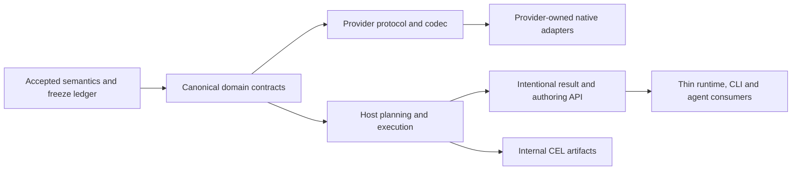

# Resource intelligence contract readiness

Status: implementation-planning ledger. Accepted semantics are not frozen production DTOs; executed throwaway probes do not complete implementation packets. This ledger supplies the entry gates for the [launch plan](../superpowers/plans/2026-10-17-resource-intelligence-launch.md) and [P00 baseline plan](../superpowers/plans/2026-10-17-resource-intelligence-baseline.md). The [48-packet backlog](2026-10-17-resource-intelligence-work-packages.md) remains authoritative for feature scope/dependencies.

Remote tracking (2026-10-23): [delivery project](https://github.com/orgs/omniviewdev/projects/13), [parent roadmap](https://github.com/omniviewdev/omniview/issues/78), and [complete issue index / maintenance rules](2026-10-23-resource-intelligence-remote-index.md). All 48 packets have repository-owned issues and native blockers; three separate UI-quality followups do not certify their related production packets. Project readiness remains manually reviewed. Reviewed planning/specification sources and all six evidence archives are published at immutable [commit 0fbaace](https://github.com/omniviewdev/omniview/tree/0fbaace31aacfcb1041c4a6240e7525a67d11bcd/docs); publication is not production contract freeze or implementation acceptance.

## P00 execution acceptance — 2026-10-23

[C00 selected-source receipt](2026-10-17-resource-intelligence-baseline.md) is accepted after independent technical review: actual selected SDK behavior in host and Kubernetes processes, actual selected UI source in both browser consumers, inspected React/runtime/UI singleton identities, genuine native-pnpm protocol evidence and exact restoration/controlled shutdown. This supersedes the historical planning-only C00 status below, not its preserved observations. Browser-only limits, failed automatic CSS refresh ([#118](https://github.com/omniviewdev/omniview/issues/118)) and marketplace DNS failure remain explicit. C00 alone released P44/P04/P18 for their own acceptance; it did not freeze production contracts. The independently accepted C02 receipt is recorded below.

## 1. Decisions already accepted

- Provider-neutral resource identity uses provider, backing AuthorityID, opaque type, exact identity scope and native ID. Connection is an access route; equal addresses do not authorize body sharing. Incarnation and native revision are optional, separate facts.
- Host services own acquisition, query semantics, membership/order/groups, discovery and expensive inventory work. Bounded client presentation/cache/editor mechanics remain legitimate. No second client query evaluator.
- CEL is the initial predicate language; checked AST/programs remain internal. Host plans own non-expression semantics and safe native pushdown. No old Find/FilterExpression compatibility ceiling or second universal expression evaluator.
- Typed parameter declarations and tagged values preserve exact integers/time across JSON. Presence, nullability, union alternatives, representation coverage and authorization remain distinct.
- One phased source stream/generation separates initial snapshot from optional changes; native continuity is not inferred from contiguous frame counters. Reset requires explicit generation/recovery handling. No mandatory watch/poller, replay log or public resume service.
- Result leases deliver bounded host-ordered projections and atomic transitions, not raw events that clients reinterpret. Source and result generations are independent; slow-consumer recovery need not reopen shared acquisition.
- The numeric dependency strategy is upstream-first. A temporary reviewed/pinned patch is a separately approved contingency, not an adopted fork. Do not replace native equality with a host engine or ban useful dynamic queries to hide unsafe comparisons.
- Foundational breaking changes are allowed. Migrate useful callers/configuration and retire obsolete contracts before release; no permanent public dual stack. Full ABAC/consent, hostile-plugin isolation and AI mutation tooling remain future projects, with the required context/error seams preserved now.

Authoritative details: [foundation](../superpowers/specs/2026-10-17-resource-foundation-design.md), [CEL comparison](../superpowers/specs/2026-10-17-query-language-comparison.md), [binding/schema contract](../superpowers/specs/2026-10-17-cel-binding-schema-contract.md), [source/result contract and vertical evidence](../superpowers/specs/2026-10-17-source-session-contract.md).

## 2. Verified baseline facts in this planning pass

Only read-only source/module/path resolution ran here. No build, install, generator, host/plugin launch or test suite was run as part of this planning pass.

| Surface | Manifest/source evidence | Observed resolution | Consequence |
| --- | --- | --- | --- |
| Host Go | `omniview/go.mod`: Go 1.26.0, SDK v0.5.0 | `GOWORK=off go list -m -json github.com/omniviewdev/plugin-sdk` resolves module-cache v0.5.0; installed toolchain go1.26.1 | Editing sibling SDK does not currently affect this consumer |
| Kubernetes Go | `omniview-plugin-kubernetes/go.mod`: Go 1.25.0, SDK v0.4.0 | Same command from plugin resolves module-cache v0.4.0 | Host and provider do not yet share a selected SDK source |
| SDK checkout | `plugin-sdk/go.mod`: module github.com/omniviewdev/plugin-sdk, Go 1.25.0 | Exists, but neither preceding module resolution selects it | P00 must establish actual local-source reachability, not rename a version |
| Host UI | `package.json`: base-ui ~0.4.3; editors/ai-ui ~3.0.3 | Readable installed manifests are base-ui 0.4.2; editors/ai-ui 3.0.2 | Existing install cannot be treated as satisfying current manifests |
| Runtime UI peer | `packages/omniviewdev-runtime/package.json`: base-ui ~0.4.3 | Installed base-ui 0.4.2 | Resolve one coherent peer/source cohort before shared-instance claims |
| UI source | `ui/main/packages/base-ui/package.json`: 0.4.2; editors/ai-ui source 3.0.2 | Root/ runtime base-ui and root editors realpaths resolve into host `.pnpm` artifacts, not directly into ui/main | Matching source/package version strings are not live-link proof; materialized-source provenance also needs a receipt |
| Candidate managed UI source | `workspaces/agentic-workspaces/ui/packages/{base-ui,editors,ai-ui}/package.json`: 0.4.3 / 3.0.3 / 3.0.3 | Manifests satisfy the inspected host's declared UI ranges; selected committed ref and actual linking are not verified | Prefer evaluating this existing compatible source candidate over bumping older checkout versions |
| Candidate managed runtime/plugin | Host runtime and Vite-plugin source manifests are 0.2.1; selected Kubernetes frontend requests both ^0.4.2 | Source versions/ranges inspected, no source-overlay or ABI acceptance run | P00 must prove the reviewed local-source mapping and actual API/shared-instance compatibility; a version string or forced peer bypass is not evidence |
| Managers | Host `packageManager` is pnpm@12.14.0 | Not executed here | Preserve selected repositories' actual manager contracts; do not copy the older workspace plan's pnpm10 assumption |
| Workspace support | Existing plan under `docs/superpowers/plans/2026-10-17-agentic-workspaces.md`; newer source/docs under sibling `workspaces/agentic-workspaces` | Source exists; operational guide documents native12 linking/profiles; no workspace CLI readiness verified here | Reuse its reviewed capability or a verified equivalent; do not reimplement its program in resource packets |

`task dev` in the inspected root runs `ui:update` first. Do not use it as a deterministic baseline smoke or against production state. The current `task perf:app`/`bench/app` uses a fake backend and is not Go/IPC evidence.

Repository-relative paths above are grounded in source inspection. Installed artifact paths are machine-local evidence, not files to commit into portable workspace manifests. Source refs, code identity, local linking receipts and an isolated actual app/plugin smoke are still P00 deliverables.

## 3. Evidence is substantial, but bounded

| Evidence record | Established | Still not established |
| --- | --- | --- |
| CEL/JMESPath comparison | Pinned Go candidate behavior, type/binding/cost/cancellation differences, basis for CEL choice | Production function/profile/dependency admission or full authoring |
| Tagged binding confirmation | Actual JS↔Go↔CEL exact-value admission, finite nullable/collection cases | Uniform static nullable typing and a safe unmodified mixed-numeric profile |
| Catalog/union confirmation | Native CEL provider/adapter, explicit union/presence/coverage semantics and generated guard behavior | Complete JSON Schema/OpenAPI normalization, production cache/dispatch design or actual editor |
| Numeric correction experiment | Small isolated helper/membership correction passes finite oracle and selected upstream packages | Adopted dependency, reviewed upstream release/pin or full conformance/performance |
| Source confirmations | Conditional native-cutover simulator; real bounded TCP lifecycle/cleanup with race-instrumented rerun | Real provider handoff, actual SDK codec or complete negotiation |
| Vertical proof | Source→CEL→host windows, shared acquisition, independent result epochs, consumer-local reset; passive Go/Bun checks | Real Wails/live result network/UI, full query planner, permission changes, large-inventory budgets |

These records and source archives are linked by the authoritative specs. They are not P44's permanent real-plugin conformance suite, P02's production performance baseline, or completion of P45/P13/P14/P15. Do not copy prototype full-map clones, mutable per-value catalog schemas, scheduling barriers or result reset fields as unreviewed architecture.

## 4. Contract freeze ledger

“Freeze” means an identified versioned artifact with exact names/types/encoding, owners, errors, supported/rejected cases and migration effects, reviewed against the actual selected sources. No artifact below is silently declared frozen by this ledger. Later subjects freeze before their first consumer, not all before the first SDK change.

| Gate | Owner / consumers held | Accepted substance | Concrete freeze output and pass condition |
| --- | --- | --- | --- |
| C00 baseline receipt | P00; holds all dependent implementation | Existing source/workspace machinery, no global links/production state | Selected repo IDs/refs/file identities, effective Go module directories and package/peer/live-export receipts; actual isolated host/plugin smoke. Conflicting UI/SDK cohorts refuse readiness |
| C01 identity/authority/scope | P01 + P45; P03/P05/P07 | Address vs access, optional incarnation/revision, exact identity scope vs explicit any/oneOf query scope | One domain definition and Go/protobuf/TS mapping; canonical equality/key encoding, provider authority resolution/retargeting rules and opaque IDs. No separate competing copies of the spec's illustrative aliases |
| C02 invocation/errors/handles | P04 with P01/P45; all host operations | Trusted host context, cancellation, ownership, uniform invalid/unsupported/denied/unavailable/limit/reset errors | [Accepted R4 and named-cohort verification](../superpowers/specs/2026-10-23-trusted-invocation-errors.md), full P04 merged through [PR136](https://github.com/omniviewdev/omniview/pull/136), host `e1e09f2668dc553ee0b4b1960aa92da475bc0254` with SDK8e/Kubernetes a7. Native invocation/AppError, actual SDK→gRPC→host→runtime mapping, owned actions and useful capability/subscription/settings/navigation receipts are accepted. Caller IDs confer no trust; `initial` reserves ownership generation, not revocation or hostile-plugin isolation. Other contract/release gates remain separate |
| C03 provider capabilities/finite read | P45; P03/P05/P07/provider migrations | Required catalog and independently supported operations, no mandatory Find/CRUD/list | New resource-protocol/package ownership and real finite source/Get/catalog operation contracts; unknown vs unsupported vs denied distinct. Get-only/native-query-only/read-only providers work truthfully; actual P44 new-wire smoke |
| C04 source sessions | P05 + P45; P12 | Accepted frame phases/coverage/generation/ownership and bounded recovery | Exact common/source protobuf and handwritten adapter mapping, mode negotiation, frame/decompression/queue budgets, terminal teardown and unsupported DTO behavior; real SDK transport repeats adversarial scenarios. No new temporary List/watch stitching API |
| C05 schema/field model | P07; P09/P11/P16/P17/P27 | Optional bundled/discovered schemas, representations, bounded refs/maps/arrays/null/unions | Declare supported schema dialect/conversion and reduced/unsupported behavior; normalized field/path/capability DTOs and immutable/bounded catalog lifecycle. Resolve overlapping branch dispatch without per-row catalog retention; full schema information does not disappear merely because CEL checking is dynamic |
| C06 CEL implementation profile | P01/P13; predicate consumers | CEL source/profile, host-only checked AST, pure bounded environment, upstream-first numeric strategy | Exact dependency/license/release choice, allowed functions/macros/extensions, limits/cancellation, native type/admission and numeric/nullable guarantees. Re-run numeric/optimized-membership cases on the actual selected pin. SDK providers do not import CEL to implement universal query semantics |
| C07 query/order/page meaning | P01/P13; P14/P17/P29/P31/P35 | Typed bindings, field/projection/order semantics, native/residual equivalence and bounded windows | Versioned QuerySpec and resolved target/variable/path/order/null/tie/page semantics, finite-vs-follow behavior and coverage/errors. Provider pages/cursors are never reused as final result pages/cursors without proof |
| C08 result lease wire | P14/P15 with P04; UI/CLI/agent clients | Host-prepared rows/order, independent epochs, consumer-local recovery | Exact open/row/change/reset/control/close DTOs, lossless values, initial attachment, sequence gaps, stale snapshots, repeated/overlapping reset and slow-consumer lifecycle. Decide next-generation announcement rather than promoting the probe field automatically; actual codec/live bridge must prove the decision |
| C09 authoring | P16/P17/P19/P21 | Host schema/parser/discovery, conditional guarantees and explicit builder guards | Cursor/replacement units, document/schema/access generations, bounded suggestions/facet coverage and cancellation. Current UTF-8 source-offset proposal needs Unicode/code-point/UTF-16 proof. Define descendant path-presence labels, whole-clause NOT vs guarded inequality, supported conversion subset and operator insertion rules |
| C10 visualization/config | P26/P27/P31/P32 | Extend current registry; contribution definitions separate from user instances; typed bound variables | Contribution/render/field-selector contracts; saved query/view versions, migration/unknown-plugin handling and variable dependencies. Freeze before view builder/layout consumers; do not require dashboard formats for the first query release |
| C11 graph/search/index | P22/P37/P38, P42/P43, P39/P40 | Typed links/provenance, command vs resource search, measured optional indexes | Respective feature-local traversal/rule, command/provider and index build/drop/coverage/footprint contracts; no global graph order, global scans or automatic indexes assumed. P42's [feature-local command/provider contract](../superpowers/specs/2026-10-25-global-command-search-contract.md) and implementation are accepted through [PR139](https://github.com/omniviewdev/omniview/pull/139), with [review/runtime evidence](2026-10-25-global-command-search-acceptance.md). This does not freeze P43 resource search or the other graph/index contracts. Freeze each feature-local contract before its implementation |
| C12 runtime ABI/release | P47/P46 with P45 | Clean new-major cutover; old external contracts refused before use; preserve useful workflows/config | Resource protocol vs frontend ABI metadata, exact exported entrypoints/shared maps, selected callers/removal list, one-way migration/rollback safety and compatible release set. Same-realm plugins remain trusted, not sandboxed |

### Accepted C02 startup maintenance

The P04/R4 acceptance above is preserved. [SDK PR17](https://github.com/omniviewdev/plugin-sdk/pull/17), [Kubernetes PR34](https://github.com/omniviewdev/omniview-plugin-kubernetes/pull/34) and [host PR147](https://github.com/omniviewdev/omniview/pull/147) additionally accept actual watch-subscriber readiness and persisted settings after failed startup. Registration acknowledgement is not a resource snapshot, continuity guarantee or replacement for C04/C08.

The reviewed source cohort is host `db1b437e207d184e60182bb677b1b43b40b7114e`, SDK `cae2a08cf2b9ae0be84342462525578c75eecc44`, Kubernetes `6690d9729b409a8302b9ea7897273a2e2341dcdc` and UI `a33879bcdcfc4971c3bcd98f23d657c6f5572307`. The Kubernetes consumer uses the public SDK pseudo-version, not a local replacement.

CI provisioning followups [PR152](https://github.com/omniviewdev/omniview/pull/152) and [PR154](https://github.com/omniviewdev/omniview/pull/154) are merged. PR154's actual Linux application run passed all 86 cases without retries in 535,406 ms, including preparation and cleanup within the unchanged 600,000 ms budget; all five owned cleanup obligations drained. Its merged tree matches the tested source. Numeric precision, native accessibility/input, C08 and coordinated release gates remain separate and held.

### 4.1 Important P45/P05 seam to settle, not postpone

Recommended review decision: use one final finite/source acquisition contract. P45 delivers its real snapshot-only portion plus catalog/Get/independent operation support; P05 adds snapshotAndUpdates coordination, continuity and sharing/flow lifecycle. Unsupported updates remain explicitly unsupported until implemented. Do not build a new finite List transport merely to replace it with SourceOpen in the next packet.

This is a proposed allocation of the already accepted source boundary, **not an approved RPC name/path or a change to the dependency graph**. P01/P45 owners must resolve the domain/IDL split before dispatch. P05 remains a substantive separately reviewable update-session change; P45 must deliver useful real finite reads, not declarations or stubs. Existing native enumeration/get implementations may be retained behind the replacement.

### 4.2 Authority of each representation

Generated files express a reviewed contract; they do not define product semantics by accident. Public resource domain types must not be aliases to an obsolete generated/v1 model. Source protocol, host result API, plugin UI ABI, package release versions and internal CEL cache identity are separate versioning concerns.

## 5. Freeze receipt and no-go rules

Every owner publishes a portable contract receipt alongside its focused spec/plan:

- Gate and P-packet IDs; reviewed artifact paths, schema/protocol version and exact public/domain names.
- Inputs/outputs/error and cancellation semantics, supported/rejected cases and applicable provider-neutral fixtures.
- Domain→Go/protobuf/TS mapping and ownership; imported/generated files; no machine-specific link paths or secrets.
- Actual exercised commands/scenario artifacts and explicit limits, separately from commands still planned.
- Consumer names and exclusive shared-seam owner; migration/removal owner and release gate.
- Status: accepted semantics, freeze-ready for named consumers, implemented-and-smoked, or blocked with an exact unmet prerequisite. Approval of a prototype does not advance all statuses together.

Do not launch production consumers if their inputs are merely illustrative code snippets, pending numeric dependency choices or a generated file from another agent's unlanded checkout. Stop and resolve the affected gate; unrelated ready work may continue.

**Current next launch:** C00/P00, P44, P02, P04 and P42's feature-local C11 are independently accepted: [SDK PR13](https://github.com/omniviewdev/plugin-sdk/pull/13) supplies real current-SDK conformance, [host PR134](https://github.com/omniviewdev/omniview/pull/134) supplies the [available-surfaces baseline and cleanup receipts](../../bench/app/README.md), [host PR136](https://github.com/omniviewdev/omniview/pull/136) completes C02 with merged [SDK14](https://github.com/omniviewdev/plugin-sdk/pull/14) / [Kubernetes32](https://github.com/omniviewdev/omniview-plugin-kubernetes/pull/32) consumers, and [host PR139](https://github.com/omniviewdev/omniview/pull/139) completes P42's [actual header/command-provider acceptance](2026-10-25-global-command-search-acceptance.md). P43 remains held by P35's authoritative multi-provider query contract. P01's [reviewed design/native-CEL spike](https://github.com/omniviewdev/omniview/pull/130) does not resolve the production numeric/profile gate; P45 and its consumers remain held. P18's [portable evidence](https://github.com/omniviewdev/ui/pull/72) leaves native gates open. P23's full host-prepared integration remains held by C08. Production consumers require their own reviewed contract receipts.

## 6. UI execution reconciliation — 2026-10-22

The [work-package execution reconciliation](2026-10-17-resource-intelligence-work-packages.md#execution-reconciliation--2026-10-22) records exact UI-repository-relative source/test/story paths and packet mappings. The integrated UI branch provides controlled table/query/builder/visualization/workspace/inspector components, a Monaco CEL editor, a real Go **fixture-only** CEL development service and a focused LSP adapter. Thirteen composition-only stories were removed; reusable controls, their tests, component-focused stories and the editor workbench remain. This is bounded implementation evidence, not a released host/SDK feature or full packet completion.

| Gate | Evidence and current status | Still required |
| --- | --- | --- |
| C00 / P00 | Independently accepted selected-source proof; UI work alone was not that proof | Reuse the [accepted host/plugin/module/package/browser receipt](2026-10-17-resource-intelligence-baseline.md); downstream contract acceptance remains separate |
| C06 / P01 / P13 | Reviewed P01 design/native-CEL spike merged; integer-only development service remains fixture evidence and typed values never interpolate into source | Production dependency/profile decision, mixed-numeric and optimized-membership guarantees, full admission/cost/cancellation acceptance |
| C09 / P16–P19 / P21 | Editor/focused LSP subset and P18 portable browser evidence implemented: lifecycle/full sync, completion, hover, signatures, pull diagnostics and cancellation; isolated UTF-8/UTF-16 sessions | Production schema/access generations, discovery/permissions, authoring DTO freeze and host integration; P18 native foreground/IME/VoiceOver/AX/clipboard/heap gates remain open. Fixture sessions confer no authorization |
| C10 / P26–P33 | Controlled visualization, field-binding, variable and layout presentation exists | Current-registry integration, authoritative validation, saved versions/migrations and host semantics |
| C01–C05 / C07–C08 / C11–C12 | No production freeze or backend completion established by UI controls | Identity/provider protocol/schema, trusted permission context, query planning/order/page, live lease/codec, graph/index and ABI/release acceptance |

`tools/cel-language-service/README.md` in the UI repository documents the development boundary: no production Wails bridge, provider acquisition, live result subscriptions, arbitrary schema ingestion or nullable/union production coverage. Fixture Pod/cloud/VM evaluations do not satisfy P44's real provider-boundary corpus. Query execution/catalog APIs remain separate from LSP; this adapter is not a query protocol or second evaluator.

No builds/tests or app smokes ran for this documentation reconciliation. Previously reported scoped UI/Go/Storybook checks are not a replacement for C00 or production acceptance. Link-target inspection is recorded below separately from implementation verification.

### Local documentation link receipt

On 2026-10-22, a read-only local check inspected all 28 relative Markdown links across these three roadmap documents in the isolated host checkout, including target-file existence and linked heading anchors. All resolved; missing targets: **none**. This includes the existing foundation, CEL comparison/binding, source-session, workspace discovery/plan, launch and P00 baseline documents. External web URLs were not validated. UI source references above are explicitly UI-repository-relative evidence paths, not host-local Markdown links.
