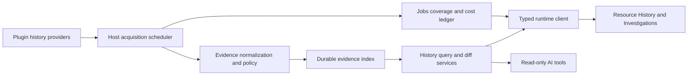

# Historical Resource Context — exploration and implementation plan

Status: proposed architecture, not an implemented or approved contract.

Execution planning: [dependency-ordered work packages, contract handoffs, missing work, and acceptance gates](2026-10-27-historical-resource-context-work-packages.md). H00–H07 below are product milestones; HR00–HR29 in that backlog are assignable packets. All remain proposed until their respective technical acceptance.

Execution evidence: [independent prerequisite receipt and unresolved production gates](2026-10-28-history-prerequisite-execution.md). Audit fixture and standalone driver experiments are not an implemented history feature or a production contract freeze.

## 1. Recommendation

Make **Resource History** a host-owned evidence and investigation subsystem, with optional plugin-supplied history providers. Audit records, Kubernetes Events, observed state changes, and authentication evidence belong in one timeline, but retain distinct semantics and provenance.

Do not implement this as a Kubernetes-only tab, a log-viewer buffer, a browser index, or a mandatory extension of every resource resourcer. A provider may cover an entire authority or many resource types. A resource may receive evidence from several providers.

Build the first complete path with Kubernetes audit JSONL on kind, then EKS CloudWatch audit and authenticator sources. Include Kubernetes Events and prospective status/spec observations in the initial delivery. Preserve extension seams for CloudTrail, other resource plugins, native diff rendering, and read-only AI tools.

The most important invariant: **“No matching evidence” does not mean “nothing happened.”** Every result must expose its searched scope, time coverage, permissions, source limitations, and missing representations.

## 2. Repository findings and constraints

### Current code versus accepted direction

The host and sibling Kubernetes repository both resolve `github.com/omniviewdev/plugin-sdk v0.7.0` from the Go module cache. This was checked with `GOWORK=off go list -m -json github.com/omniviewdev/plugin-sdk` in both repositories. Editing a sibling SDK checkout alone does not change either consumer.

The Resource Intelligence roadmap already assigns canonical identity, host-owned query semantics, CEL predicates, acquisition sessions, result leases, schema discovery, and index management. Reuse those contracts rather than establish a competing system. Their documented acceptance is not proof that every roadmap packet is implemented.

| Existing surface | Evidence | Implication |
| --- | --- | --- |
| Canonical identity and query direction | `2026-10-17-resource-intelligence-contract-readiness.md`, sections 1 and C03–C12 | Use provider/AuthorityID/type/scope/native ID; connections remain access routes. Reuse typed values and host query semantics. |
| Kubernetes capability registration | `../omniview-plugin-kubernetes/pkg/plugin/resource/register_v1.go:19–60` | Add provider capability through SDK/plugin lifecycle, not React registration. |
| Kubernetes cloud hints | `../omniview-plugin-kubernetes/pkg/plugin/resource/connections.go:414–489` | Existing EKS detection extracts region/profile/role and sometimes account. It does not establish verified cluster identity or log access. |
| Kubernetes Events | `../omniview-plugin-kubernetes/pkg/plugin/resource/resourcers/pod_resourcer.go:214–274` | Pod lookup uses UID; current event result loses native event identity and list continuation. Historical ingestion needs richer evidence and paging. |
| Other workload Events | `../omniview-plugin-kubernetes/pkg/plugin/resource/resourcers/health_assessors.go` | Several selectors use name/kind, not incarnation. Do not copy that ambiguity into durable history. |
| Kubernetes watch | `../omniview-plugin-kubernetes/pkg/plugin/resource/resourcers/base.go` | Existing informer callbacks are observed current state, not a complete audit log. |
| Event sync policy | `../omniview-plugin-kubernetes/pkg/plugin/resource/register_v1.go:88–94` | Core Events use `SyncNever`; history needs explicit scoped acquisition, not an assumption that existing sync retains Events. |
| Resource navigation | `ui/providers/RightDrawerProvider.tsx:240–296` | Current opening path requires live Get. History must open deleted resources and identity-only records. |
| Drawer context | `packages/omniviewdev-runtime/src/context/drawer/types.ts:128–165` | Current resource context lacks historical selection and full canonical identity. Keep live editable data separate. |
| Drawer composition | `ui/components/displays/RightDrawer.tsx`; `ui/federation/LinkedResourceDrawer.tsx` | Compose host History after plugin drawer resolution; generic-only integration misses plugin drawers. Use stable view IDs. |
| Diff | `ui/components/displays/CodeEditor.tsx` | Monaco diff exists. Historical evidence, reconstruction, semantic comparison, and explicit empty-side handling do not follow from that. |
| Extensions | `ui/features/extensions/registerBuiltinExtensionPoints.ts`; runtime `types/extensions.ts` | Reuse generic contribution registry for renderers and navigation actions. |
| Current search | runtime `hooks/resource/useResourceSearch.ts`; `ui/features/command-search/types.ts` | Do not extend List-plus-browser-filter into historical search. Coordinate discoverability with P43. |
| Existing storage | Host `go.mod` includes bbolt; `backend/storage/runtime.go` stores informer/client state | Existing runtime storage is not an audit index. Add a feature-owned durable store, not history inside informer caches. |
| Capability admission | `backend/pkg/plugin/loader.go:592–659`; `backend/pkg/plugin/types/external_backend.go` | Add history to SDK capability parsing, discovery, controller routing, and shutdown. Unknown capability strings do not automatically create a host service. |
| Trusted invocation | `backend/pkg/invocation/invocation.go:98–122` | Reuse host-issued invocation admission. Current admission alone does not establish upstream revocation tracking or history-cache access policy. |
| Current metadata/indexing | `backend/pkg/plugin/resource/registry/memory_store.go`; `backend/pkg/plugin/resource/indexer/dispatcher.go` | Current metadata and graph dispatch lack transactional historical evidence/checkpoints. An in-memory flush barrier is not durability. |
| Query prototype | `bench/resourcequeryspike/README.md`; `evaluate.go` | Verification-only prototype, not a production history query service. Preserve its semantic findings without promoting fixture code into infrastructure. |

Detailed Resource Intelligence dependencies: P03 identity; P05 source sessions; P07 schemas; P12 read model; P13–P15 query/results; P26 contributions; P31/P32 saved configuration; P39–P41 index lifecycle; P42/P43 search; P47 ABI retirement.

## 3. Product model

### Resource History

A standard host-provided resource detail view:

- Time-range selector, zoomable timeline, source lanes, and coverage shading.
- Filters for actor, operation, outcome, subresource, evidence type, field path, and text.
- Incremental results, explicit fetching/indexing state, cancel, retry, and older/newer paging.
- Read-only snapshot and diff panels with evidence quality and provenance.
- Follow mode with a visible moving time window and “new events” behavior when scrolling away.
- “Investigate this resource,” “Investigate this actor,” and “Find similar changes.”
- Identity-only navigation for deleted resources. A failed live Get must not erase historical access.
- Separate “this incarnation” and “all incarnations at this address” scopes.

### Investigation workspace

A core full-page workspace, not a crowded drawer:

- Connection/authority/source selection and bounded time scope.
- Search results grouped by resource, actor, operation, or time bucket.
- Event, snapshot, structured change, and related-evidence inspection.
- Pivots across owners/dependents, actors, request IDs, and explicit correlation links.
- Saved queries, pinned evidence, notes, and exportable evidence manifests.
- Background indexing/follow rules and source health inspection.

Example questions:

- Who changed this Deployment image before the rollout failed?
- Which objects had a replica decrease during this incident?
- Which changes did this service account make across namespaces?
- Which denied requests preceded a successful privilege change?
- Which resources contain a particular string in their recorded changes, even if they no longer exist?

### Multiple contexts and fully custom plugin views

History is a headless capability first. The built-in resource timeline and investigation workspace are default consumers, not mandatory presentation containers. A plugin may build an entire custom history experience, including a graph, resource-specific panel, plugin-wide audit screen, dashboard, or mixed current/historical view.

| Context | Initial scope | Example presentation |
| --- | --- | --- |
| Single resource | Canonical resource, optional incarnation | Timeline, domain-native changes, status history |
| Resource set or graph selection | Explicit resource identities or bounded relationship selection | Change overlays, incident subgraph, synchronized time cursor |
| Namespace or cluster/authority | Explicit authority and partition selection | Kubernetes activity and actor investigation |
| Plugin workspace | Explicit resource-provider/source-owner filters and selected authorities | Plugin-native audit/change explorer |
| Global investigation | Explicit selected authorities/providers and time window | Cross-plugin evidence and correlation |

Plugin scope is not an authorization boundary and must not imply scanning every configured connection. Distinguish the plugin displaying the view, the plugin owning a resource, and the plugin supplying evidence. A general graph plugin may display Kubernetes history without owning Kubernetes resources or the underlying audit provider.

Expose a versioned `HistoryContext` carrying canonical scope, time range and time axis, query bindings, selected evidence, comparison endpoints, and a budget-policy reference. Resolve effective access in the host; do not put credentials or client-asserted privileges in this object. Context changes create new query/result generations and cancel superseded consumer interest.

Plugins can use the full typed query, aggregate, payload, comparison, coverage, source-discovery, and job APIs directly. Provide composable host UI components and hooks as optional conveniences, not the only route to data. A custom view can render entirely different layouts while retaining the same evidence IDs and query semantics.

Provide typed navigation intents to open a resource history, plugin view, graph selection, or investigation with preserved time/filter/evidence state. Widening scope requires an explicit context transition and a new cost plan. Never silently broaden a resource query when moving into a plugin view.

Custom views may coordinate a timeline cursor with graph overlays or domain-native panels. “Show state at time T” must declare exact, latest-observed-before, stale, or unknown semantics per resource; temporal graph edges need their own evidence. Current graph relationships must not masquerade as historical topology.

Host APIs enforce budgets and access regardless of renderer. Shared components expose coverage and cost state. Publish presentation guidance and conformance examples for custom views so plugins do not turn incomplete evidence into misleading certainty.

Acceptance: one resource view, one plugin-wide custom view, and one independent general graph consumer use the same services. All preserve scope/time when pivoting, handle deleted resources, and display partial/denied coverage without triggering an implicit cluster-wide scan.

## 4. Architecture and ownership

**SDK:** versioned provider contracts, evidence envelopes, source capabilities, transport, and conformance fixtures.

**Plugin:** source discovery, credentials, backend requests, native filter compilation, source parsing, identity mapping, source-specific recovery, and optional semantic diff hints.

**Host:** authorization context, shared job ownership, budgets, durable commit/checkpoints, normalized indexing, residual query semantics, stable result ordering, coverage, retention, investigation persistence, and exports.

**Runtime:** typed clients and hooks over host-owned sessions; bounded result application and cancellation. No second evaluator or full browser evidence store.

**UI package:** reusable timeline/range/coverage/progress/diff primitives where existing components fit. Product state remains in the host application.

A CloudWatch adapter belongs initially inside the Kubernetes plugin and uses AWS SDK credentials directly. Installing the AWS resource plugin must not be required to investigate EKS. Extract shared backend code only when a second real consumer needs it.

## 5. Contracts to freeze before broad implementation

Names below are proposed operations, not current APIs. Implement exact protobuf/Go/TypeScript DTOs through the SDK's existing versioning conventions.

### Provider and source discovery

| Operation | Input | Output |
| --- | --- | --- |
| `DiscoverHistorySources` | Access route, canonical authority/resource hints, cancellation | Source descriptors plus independent discovery errors and configuration needs |
| `DescribeHistorySource` | Source ID/configuration generation | Capabilities, schemas, retention hints, permissions, supported scopes, cost dimensions |
| `PlanHistoryRead` | Bounded source scope, time range, typed predicate, projection, budget | Native pushdown, residual requirements, expected coverage, estimate quality, warnings |
| `OpenHistoryRead` | Approved plan, bounded limits, opaque recovery state | Sequenced evidence batches, progress, coverage, checkpoints, terminal result |
| `OpenHistoryFollow` | Explicit source scope and continuity requirements | Live evidence plus gap/reset/lag signals; unsupported is valid |
| `ResolveHistoryPayload` | Evidence reference and requested representation | Payload or typed missing/redacted/expired/denied outcome |

Discovery describes possibilities; it must not start paid scans. Capabilities distinguish finite reads, replay, durable checkpoints, sampled follow, native search, payload retrieval, ordering, and completeness. Unsupported, denied, unconfigured, disabled, and temporarily unavailable are distinct states.

Sources declare resource-type coverage, event kinds, field schemas, selectable scopes, timestamp precision, native boundary semantics, maximum payload/batch sizes, retention knowledge, schema/parser versions, and supported credential contexts. Unknown capability remains unknown, not false proof of support.

### Resource binding and actions

A plugin registers history providers once and declares how they bind to authorities/resource types. Runtime discovery resolves actual sources for a connection/resource.

An “audit action” such as **View audit history** is a typed navigation contribution carrying resource identity and initial query scope. It is not a resource mutation action and must not start paid work just to evaluate its visibility.

Optional complete history views, event-detail views, and diff-renderer contributions use the existing extension registry. Plugins may also consume the typed APIs directly without registering a renderer. Backend providers remain usable without plugin React code.

### Evidence envelope

Each normalized evidence record contains:

- Versioned envelope and provider extension schema ID.
- Host evidence ID, native source record ID, source ID, configuration generation, parser version.
- Canonical authority and resource reference(s), optional incarnation and native revision.
- Native operation, normalized operation category, subresource, outcome, and error/code.
- Authenticated principal, effective/impersonated principal, service identity, session/role details when available.
- Event time, request/stage time where present, backend ingestion time, and local observation/index time.
- Source-native correlation keys, audit/request ID, stage, provenance locator, and evidence links.
- Text summary and separately indexed structured fields.
- Optional request, response, patch, snapshot, and attachment references.
- Representation state: `present`, `missing`, `notRecorded`, `redacted`, `truncated`, `expired`, `denied`, or `unsupported`.
- Quality: source-observed versus derived, attribution certainty, identity certainty, and reconstruction limits.

Keep integer revisions and timestamps lossless across Go/JSON/JavaScript. Native resource versions are opaque, not portable integers or global ordering keys.

Do not require every record to reference an object: authentication failures, non-resource API requests, collection requests, and deletecollection operations are legitimate evidence. One record may reference several resources.

### Identity and evidence correlation

Use the accepted Resource Intelligence identity, with access-route provenance and optional incarnation. Kubernetes UID is incarnation, not name. Preserve GVR/subresource and API version separately from a UI resource key; CRDs and conversions must work.

Cluster names, kubeconfig context names, API URLs, and matching resource addresses are not sufficient proof of shared authority or authorization. Cluster recreation must create a new authority generation where detected. For EKS, include verified account/region/cluster identity and creation identity where available.

Deduplicate source deliveries using source generation plus stable native ID. Kubernetes logical requests group by authority, auditID, and stage; retain stage evidence even when rendering one request row. Cross-source audit/observation/authentication records remain separate evidence linked with explicit correlation basis and confidence.

Never collapse records merely because time, actor, and message match. Never infer a definitive IAM actor from a nearby authenticator event alone.

## 6. Evidence meaning and honest diffs

### Four initial evidence families

| Family | What it establishes | What it does not establish |
| --- | --- | --- |
| Kubernetes audit | A recorded API request, actor, stage, and outcome | Every historical object version or complete cluster activity |
| Kubernetes Events | Controller/runtime-reported occurrences and series/count updates | A complete audit trail or one immutable row per occurrence |
| Observed state changes | Snapshots/transitions observed during an active watch | Who caused a change or every intermediate transition |
| EKS authenticator | Recorded authentication context and failures | A specific resource mutation without a defensible correlation key |

Kubernetes Events expire upstream and may be aggregated. Preserve native event UID, count/series, first/last times, reporting identity, and observed revisions. Do not sum repeated cumulative counts as new occurrences or create duplicate rows from legacy/events.v1 representations.

Watch relists produce fresh observations, not proof that every missing transition was recovered. Disconnects and resource-version expiration create coverage gaps. managedFields ownership can support context but does not prove historical human attribution.

### Diff contract

`CompareHistory` takes two explicit evidence-backed snapshot references or a supported patch comparison request. Return structured changes, source references, format/schema, normalization policy, fidelity, missing paths, and warnings.

Offer distinct modes:

1. **Observed state difference:** compare two available snapshots. Explain if intermediate states are unknown.
2. **Requested change:** render recorded request/patch. Label as intent, including failed or dry-run requests.
3. **Verified transition:** only where before/after provenance establishes that relationship.
4. **Unavailable:** explain why no defensible comparison exists.

Kubernetes requestObject precedes admission/defaulting/merging. A patch request is not a complete object. A successful response object may establish an after-state but generally not the immediate before-state. Audit level and policy control payload availability. EKS audit export must not be assumed to contain complete bodies.

Preserve patch media type where known. If patch semantics are unknown, display raw intent; do not guess JSON Patch versus merge versus strategic merge. Do not replay patches onto an arbitrary baseline or manufacture deleted bodies.

Default rendering: deterministic YAML/JSON read-only diff with explicit create/delete empty sides. Normalization hides noisy fields only as a named display policy; keep provenance and redaction markers. Redacted values are unknown, not equal. List order remains meaningful unless schema declares keyed/set semantics.

Plugins may contribute schema-aware matching and native presentation, such as an EC2 instance size/security-group change view. Host-owned structured changes and evidence references remain the canonical machine-readable result. Renderer failure falls back to generic read-only evidence.

## 7. Durable local index

Recommend a feature-owned SQLite store with WAL and FTS5, subject to a focused Go driver/platform/package-size benchmark. Existing bbolt remains appropriate for existing configuration; do not stretch it into ad hoc full-text and relational indexing. No external search daemon or vector store is required initially.

Candidate logical tables:

- `sources`, source configuration generations, and access partitions.
- `evidence`, `resource_refs`, actors, native identifiers, and correlation links.
- Compressed payloads and bounded attachments, content-addressed within security/retention partitions.
- `changes` with indexed field paths and selected typed values.
- Evidence FTS and optional explicitly enabled structured-path indexes.
- `coverage_segments`, acquisition jobs, checkpoints, and cost observations.
- Investigation references and pin manifests, with separately controlled evidence retention.

Index time plus evidence ID; resource/incarnation plus time; actor plus time; source plus native ID; operation/outcome plus time; and changed path plus time. Avoid indexing every dynamic payload leaf. Full-body text indexing is opt-in and subject to redaction/size limits.

Store evidence, derived index entries, and checkpoint advancement in one durable transaction. Commit checkpoints only after all corresponding evidence is durable. A crash after commit may cause replay; idempotent ingestion must handle it. Native page tokens are temporary accelerators, not permanent recovery truth.

Use bounded batches, a bounded writer queue, separate read transactions, lazy payload decompression, and explicit payload/projection limits. Never send full bodies for every timeline row. Incremental derived-index rebuilds report their own coverage and version.

Retention includes age, bytes, source, payload class, and explicit investigation pins. Preserve truthful metadata when payloads expire. Disk pressure must pause acquisition visibly rather than discard evidence while reporting success. Purge updates FTS, payload references, derived changes, coverage, and exports under documented policy. Logical deletion is not a promise of immediate physical erasure from WAL/backups/SSD; document limits and support encrypted storage policy.

### Coverage is a first-class index

A coverage segment is scoped by authority, source/config generation, access partition, predicate/selector fingerprint, evidence family/representation, interval, and acquisition result.

States include not requested, queued, reading, searched-as-of, partial, denied, source-disabled, retention-expired, sampled, gap, and failed. Keep source completeness separate from local scan exhaustion.

A resource-filtered scan cannot satisfy cluster-wide coverage. A write-only scan cannot satisfy a search including reads. Missing bodies cannot satisfy a historical payload-text search. Redacted fields cannot prove negative value predicates. Permission changes invalidate incompatible reuse.

For recent intervals, record the scan observation time and late-arrival uncertainty. EKS delivery is best effort; no fixed overlap can establish absolute completeness. Reconciliation windows reduce misses but do not justify a “complete forever” label.

## 8. Query, paging, and progressive retrieval

Use a versioned `HistoryQuerySpec` aligned with Resource Intelligence query semantics:

- Explicit target: evidence, distinct resources, or structured changes.
- Authority/access scope and source/evidence family selection.
- Explicit bounded time range and selected time axis.
- Typed CEL predicate with declared bindings, free-text search, projection, order, and result limit.
- Finite or follow mode, coverage requirement, acquisition policy, and budget reference.
- Optional snapshot/result generation for stable browsing.

History adds a domain schema and operators; it does not establish a second expression evaluator. Backend pushdown must preserve semantics or be a safe superset with host residual evaluation. Case, null/missing, arrays, exact integers, and timestamps must match the accepted host profile.

Distinguish searchable concepts:

- Evidence text contains a phrase.
- A recorded request touched a field.
- Two observed states show a field changed.
- A confirmed transition changed a value from A to B.

A missing before-value must not satisfy a predicate that requires a known old value. Matching current labels and matching historical labels are separate operations.

### Request lifecycle

1. Normalize identity, access scope, time bounds, and query.
2. Return available local rows and precise coverage immediately.
3. Plan only missing intervals/selectors; explain native versus residual work.
4. Acquire under approved policy, with shared work only across compatible scopes.
5. Commit batches and publish sequenced result/progress updates.
6. Update histogram, facets, and coverage as new evidence arrives.
7. Finish with typed terminal state, scanned-as-of time, remaining limitations, and observed usage.

Use UTC half-open host ranges. Adapters translate native inclusive boundaries and timestamp precision, then residual-filter to exact host bounds. Use opaque keyset cursors over a deterministic total order, not offsets or raw provider tokens.

Offer frozen browsing generations and separate live-result generations. Late arrivals may insert before an existing cursor; never silently claim stable exhaustive paging while mutating that snapshot. Result reset/new-event signals make the change explicit.

Timeline zoom fetches missing buckets only. Brush changes cancel consumer interest in superseded requests; shared jobs stop only when no owner remains. Debounce drags, avoid remote queries per pixel, and do not auto-expand time ranges indefinitely.

Histograms and facets carry exact/partial/estimated labels and their own coverage. A narrow event page cannot produce an exact whole-range histogram. Distinct-resource results retain matching evidence and support historical-only resources; live inventory enrichment is optional.

## 9. EKS and CloudWatch acquisition

### Discovery and configuration

Default source mapping:

- Log group `/aws/eks/<cluster-name>/cluster`.
- Audit stream prefix `kube-apiserver-audit-`.
- Authenticator stream prefix `authenticator-`.

Use known EKS kubeconfig exec arguments and ARN metadata as hints, then validate account/region/cluster/log mapping with available read permissions. Do not assume kubeconfig context or cluster alias is the EKS name. A valid Kubernetes token does not imply CloudWatch permissions.

Support per-connection overrides for cluster identity, account/region, AWS profile/assumed role, log group ARN, stream prefixes, source kind, polling intervals, lookback/reconciliation bounds, retention, and acquisition budgets. Credentials remain in backend SDK providers; never persist temporary credentials in evidence or expose them to React.

Log disabled, log group absent, insufficient IAM, expired credentials, wrong region, and empty searched range need different UI states. Do not automatically enable EKS logging, create indexes/subscriptions, change retention, or provision AWS services.

### Backend selection

**Initial finite reads and durable follow:** paginated `FilterLogEvents` with explicit group, stream prefix, bounded time, and safely compiled JSON filters. It supports progressive page delivery and source event IDs. Exhaust pagination even when a page is empty and a continuation exists. Handle token expiration by replaying a bounded window with deduplication.

**Optional analytical reads:** Logs Insights for appropriate broader queries, aggregation, supported log classes, or demonstrably cheaper indexed access. Surface bytes scanned, query status, truncation, and cancellation through StopQuery. Result limits are not exhaustive acquisition; split ranges or choose another source path when completeness requires it. Bound splitting when timestamps are extremely dense; report irreducible truncation rather than loop forever.

**Optional interactive preview:** StartLiveTail, explicitly labeled as potentially sampled/non-durable. It samples beyond 500 matching events/second, buffers only a bounded backlog, and sessions time out. It cannot be the sole durable index input. Deduplicate/reconcile preview rows when authoritative reads arrive; preview lacks the same stable event ID guarantees.

**Future sustained-volume option:** externally configured CloudWatch subscription delivery to durable storage/streaming infrastructure. This has provisioning, IAM, operational, and cost implications; it is not silently created by the desktop app.

### Durable polling/follow

Maintain an explicit rule owning source scope, selector, interval policy, and budget. Poll bounded windows with overlap and independent reconciliation lookback. Re-discover rotated streams. Persist scan bounds and native IDs, not just the largest event timestamp. Slow/late delivery may place new events behind the latest timestamp.

Pause/resume, laptop sleep, network outages, session expiry, throttling, and plugin restarts produce explicit recovery status. Catch up gaps before claiming the current interval searched. Scope sharing requires proven selector containment, compatible access, and limits; unrelated tabs must not multiply identical backend reads.

## 10. Cost and resource controls

Treat cost as several dimensions, not one fabricated dollar number:

- Logs Insights bytes scanned and regional price assumption.
- Live Tail session minutes.
- Requests, returned bytes, throttling, and local processing.
- Existing ingestion/storage and any separately provisioned subscriptions/index policies.
- Local disk, memory, CPU, and network budgets.

Do not treat server-side filtering or a small result limit as proof of reduced scanned-byte charges. Field indexes can improve equality/IN reads, but indexes only cover eligible ingestions and have their own temporal limits. `filterIndex` can exclude unindexed data; never use it as a completeness-preserving default across unknown coverage.

Policy modes:

- **Local only:** no remote work.
- **Fetch within policy:** bounded on-demand remote retrieval.
- **Preview plan:** return estimates and scope without execution.
- **Approved background rule:** persistent acquisition with explicit ownership and limits.

Safe starting defaults: a short resource-scoped window, no automatic account-wide scan, no paid Live Tail by default, finite request/runtime/local-byte limits, and explicit approval for broader background scope. Exact numerical defaults should follow real cluster measurements.

Show estimate confidence, unknowns, measured usage, and stop reasons. A scan-byte estimate may be unavailable before execution. Cancellation and periodic usage observations are best-effort spend controls, not a hard AWS billing cap. Enforce strict local request/time/byte limits where measurable and reserve shared budget before concurrent work.

Do not hard-code regional rates or assume account free-tier availability. Link to current pricing and record the pricing basis used for estimates.

## 11. Local Kubernetes and kind

Plain Kubernetes does not expose a standard historical audit-query API. Audit requires administrator configuration of a file or webhook backend. A normal kubeconfig alone cannot retrieve old audit files.

Initial local source: user-configured JSONL file/directory, including rotated files and a host-mounted kind audit-log directory. Support import-only and follow modes. Track file identity, byte offset, partial trailing records, rename rotation, copytruncate, duplicates, malformed lines, and truncation gaps. Never advance a durable offset past uncommitted data.

For remote self-managed clusters, administrators must expose logs through a supported backend or explicit collection setup. Do not hide arbitrary shell/SSH execution behind automatic discovery. Keep transport adapters separate from Kubernetes evidence normalization.

Kind fixture setup should mount both audit policy and audit log directory through node and API-server mounts. Configure RequestResponse for selected non-sensitive write targets and Metadata for Secrets/authentication-sensitive endpoints. Pin a tested kind/Kubernetes version and its matching kubeadm configuration format.

The local scenario must create, patch, scale, change status where permitted, generate Events, exercise service-account/impersonation attribution, delete, and recreate an object at the same name. Include a CRD and unknown-body metadata-only case. Verify requested versus persisted differences and secret redaction.

Observational history starts when enabled. It cannot backfill pre-existing status transitions from current objects. Reuse compatible resource acquisition where possible; do not require cluster-wide informers for one resource timeline.

## 12. Jobs, live status, and lifecycle

Separate three things: source health, acquisition job state, and query/result state.

Job states include queued, discovering, planning, waiting for approval, reading, indexing, catching up, following, paused, throttled, budget-stopped, completed, cancelled, and failed. State transitions include reason codes and resumability.

Progress includes active scope, requested/searched/indexed ranges, records fetched/accepted/deduplicated/rejected, bytes, queue pressure, last durable checkpoint, last successful read, ingestion lag, observed usage, and error details. Unknown totals use an indeterminate indicator; do not invent percentages.

UI subscriptions attach using a state snapshot plus sequenced updates or equivalent race-free lease attachment. Gaps reset only the affected consumer. Bound bridge batches and subscriber buffers. Closing a drawer cancels its result interest, not an independently approved background rule.

Host shutdown drains committed batches within a bounded deadline. Plugin uninstall/reload closes owned sessions and marks source availability. Checkpoint compatibility includes provider/parser/config generations. Unsupported upgrades require explicit replay/reindex decisions, not silent cursor reuse.

## 13. Security and privacy

Audit bodies can contain secrets, tokens, user data, and privileged information that live Kubernetes RBAC would not allow the same user to read. CloudWatch authorization and Kubernetes authorization are different security boundaries.

Partition caches and shared jobs by credential/access context and authorization generation. Reauthorize payload reads, exports, and AI access. Define offline-cache policy explicitly: a desktop application cannot automatically know all upstream revocations while offline. Do not imply current authorization when showing approved offline evidence.

Apply source masking and host redaction before durable payload storage, FTS, derived changes, logs, exports, and AI access. Default to excluding Secret bodies and authentication credentials. Preserve explicit redaction markers. An administrator's intentional raw-evidence mode requires a separate policy and clear storage implications.

Use restrictive filesystem permissions, bounded decompression/parsing, safe extension rendering, and no HTML execution from audit text. Existing same-process plugins remain trusted code; this design does not create a sandbox.

Keep operational telemetry payload-free. Record investigation activity and exports without copying sensitive evidence into diagnostic logs. Encryption-at-rest and key handling require a supported driver/OS strategy decision before sensitive production retention; do not claim ordinary SQLite encrypts data.

## 14. AI-friendly contracts

Expose the same headless host services used by UI, not screenshot scraping or React state:

- Discover sources, schemas, supported filters, coverage, and cost capabilities.
- Plan a bounded query without spending.
- Execute approved queries, page results, inspect progress, and cancel.
- Read evidence and compare explicit snapshots.
- Traverse typed related-evidence links.
- Create a saved investigation or add evidence references under user policy.

Results include stable evidence citations, source locators, query/time/access scope, missingness, coverage, derivation version, and cost observations. Every answer can cite recorded evidence instead of guessing completeness or causality.

No arbitrary provider query strings, automatic wider scans, automatic raw-secret access, or mutation tools are required. AI cannot elevate its budget or authorization. Treat resource names, log messages, and request bodies as untrusted data, not instructions.

Embeddings and natural-language-to-query are optional later consumers. Structured field changes, FTS, typed schemas, and evidence links are sufficient foundations now.

## 15. Implementation sequence and acceptance gates

Each packet must deliver usable behavior, not only API scaffolding. Coordinate foundational dependencies with Resource Intelligence rather than block all history work on unrelated visualization/query-authoring packets.

| Packet | Repositories and work | Acceptance gate |
| --- | --- | --- |
| H00: source and contract baseline | Host, SDK, Kubernetes, UI: select coherent source cohort; reconcile RI identity/query/lease APIs; measure real source samples | Real SDK transport preserves identity, timestamps, evidence quality, cancellation, limits, and typed errors. Record selected versions. |
| H01: local audit vertical slice | SDK history capability and context-neutral scope; Kubernetes JSONL adapter; host store/jobs/query; public runtime client; host resource History view and YAML diff | Actual kind mutation appears progressively; survives app restart; opens after deletion; recreate has separate UID; missing-body case is honest; a headless consumer can query without the built-in view. |
| H02: EKS production source | Kubernetes AWS discovery/configuration; FilterLogEvents finite read and durable polling; host budgets/coverage | Actual bounded EKS scan and follow work with default naming and override; rotated streams, delayed arrival, empty page/token, denied IAM, and cancellation behave correctly. Report observed request/byte usage. |
| H03: contextual Kubernetes history | Events ingestion and series normalization; scoped observed spec/status changes; correlation and coverage lanes | One resource timeline shows distinct audit/Event/observation records; watch gap remains visible; initial snapshot is not labeled a mutation. |
| H04: investigations and historical search | Host evidence/change/resource targets; FTS and path indexes; runtime/query UI; command/resource search integration; saved investigations | Actor query and historical field/text query find deleted resources with evidence citations; time brush fetches only missing scope; stable pages handle equal timestamps and late arrivals. |
| H05: semantic diffs and multi-context extension surface | SDK schema/representation hints; host structured comparison; runtime APIs/context/navigation; optional shared UI primitives and full custom views | Resource timeline, plugin-wide custom view, and independent graph consumer share scoped APIs; pivots preserve time/evidence; generic and native diffs retain truthful missing/redacted states. |
| H06: operational hardening | Retention/pins, source diagnostics, recovery, index rebuild/drop, privacy/exports, performance limits | Crash/restart causes no committed loss; disk-full pauses visibly; scope/access changes cannot leak cached data; retention and rebuild preserve accurate coverage. |
| H07: second-provider validation | AWS plugin CloudTrail adapter and native resource diff proof; read-only AI adapter | CloudTrail fits without Kubernetes-shaped identity; bounded headless query/diff returns citations, coverage, and cost with no React dependency. |

Detailed sequencing lives in the execution backlog. Multi-context contracts and direct plugin APIs move into the initial contract/runtime path; H05 validates complete custom consumers and native presentation rather than introducing API access late. H03 adapters and H04 search can proceed independently once their specific shared handoffs exist. H06 requirements apply from H01; final hardening is not permission to defer security or durability. Production predicate execution remains gated by the existing Resource Intelligence safe-query profile and shared compiler/result contracts.

The first release should include H00–H06 for Kubernetes/EKS. H07 validates future extensibility and is a separate delivery, not a hidden prerequisite for the requested initial feature.

### Proposed code ownership

- SDK: a history capability package/protobuf family following existing resource capability conventions; common canonical identity imports, no duplicate identity types.
- Host: `backend/pkg/plugin/history/` for provider/session lifecycle and a feature-local history service/store/query layer. Final layout should follow the current controller/service split after H00.
- Kubernetes: `pkg/plugin/history/` with shared Kubernetes audit normalization and separate JSONL/CloudWatch adapters; registration from `pkg/main.go`.
- Runtime: versioned history types, service wrapper, and hooks; generated bindings via **`task bindings` only**.
- Host UI: `ui/features/history/` and host-composed resource History entry; investigations route and typed search targets.
- UI repository: reusable timeline/coverage/range/semantic-diff primitives only where absent or insufficient.
- AWS plugin: later CloudTrail provider and EC2-native renderer; no initial EKS dependency on that plugin.

### Required behavioral verification

Keep deterministic regression tests for consumer-visible boundaries; prove real source paths separately.

- Identity: same name/new UID, same address/different access contexts, unknown UID, cluster recreation, CRD/subresource.
- Acquisition: replay, duplicate delivery, out-of-order/late events, empty page with continuation, expired tokens, cancellation, rotation/truncation, crash between fetch/commit/checkpoint.
- Query: half-open bounds, equal timestamps, frozen/live generations, safe pushdown/residual equivalence, missing/redacted values, historical versus current labels, incomplete histograms.
- Diff: metadata-only evidence, failed/dry-run write, admission changes, unknown patch type, missing baseline, create/delete, schema-aware lists.
- Follow: sampled preview, slow consumer, sleep/resume, source reset, watch relist/410, permission/credential changes.
- Storage/security: disk limits, retention/pins, parser limits, redaction before FTS, export policy, source unload, cache partitioning.
- Actual UI: resource drawer, deleted-resource navigation, timeline brush, progressive results, follow/new-event behavior, diff panels, source diagnostics, saved investigation.
- Actual infrastructure: pinned kind fixture and an explicitly bounded EKS smoke. Local fixtures cannot prove CloudWatch IAM, pricing usage, throttling, delivery latency, or transport behavior.

Benchmark realistic sparse and dense sources, with documented hardware/data shapes: time to first local row, first remote batch, indexing throughput, peak memory, disk per evidence/payload, scoped text/field query latency, follow lag, cancellation delay, and upstream requests/scan bytes. Set numerical SLOs after baseline measurements, not invented targets.

## 16. Decisions and risks to close early

Recommended defaults, not blockers to further design:

1. Use a host-owned dedicated evidence store and optional history provider capability.
2. Start with SQLite/FTS5; benchmark Go driver, CGO policy, packaged platforms, and encrypted retention before final selection.
3. Default to local/scoped on-demand acquisition; explicit ownership for background rules.
4. Use FilterLogEvents for the initial durable EKS path; qualify alternative methods by capability and observed economics.
5. Keep immutable source evidence separate from derived change/correlation projections.
6. Use accepted RI identity/query/result contracts, with a minimal compatible integration packet if implementation is not yet ready.
7. Make redacted storage the default; define offline authorization and sensitive retention policy before production rollout.

Main product tradeoff: a desktop index exists only while its acquisition owner runs, except for upstream-retained backfill. Always-on, high-volume, compliance-grade collection requires durable infrastructure beyond the desktop. This feature should support investigations without promising to replace an enterprise audit archive.

CloudTrail must retain its own limitations: Event history covers recent management events, not all data events or indefinite history. CloudTrail Lake and trail-backed storage require separate discovery, access, retention, and cost capabilities. A CloudTrail API request is not necessarily an EC2 before/after snapshot.

## 17. Sources and verification limits

Primary external references:

- [EKS control-plane logs, defaults, stream naming, best-effort delivery](https://docs.aws.amazon.com/eks/latest/userguide/control-plane-logs.html).
- [Kubernetes audit evidence schema and request/response semantics](https://kubernetes.io/docs/reference/config-api/apiserver-audit.v1/).
- [Kubernetes auditing, policy, and backend configuration](https://kubernetes.io/docs/tasks/debug/debug-cluster/audit/).
- [CloudWatch FilterLogEvents pagination and source event IDs](https://docs.aws.amazon.com/AmazonCloudWatchLogs/latest/APIReference/API_FilterLogEvents.html).
- [CloudWatch Live Tail sampling, buffering, and session limits](https://docs.aws.amazon.com/AmazonCloudWatchLogs/latest/APIReference/API_StartLiveTail.html).
- [CloudWatch field index scope and temporal limits](https://docs.aws.amazon.com/AmazonCloudWatch/latest/logs/CloudWatchLogs-Field-Indexing.html).
- [CloudWatch regional pricing dimensions](https://aws.amazon.com/cloudwatch/pricing/).
- [kind audit setup](https://kind.sigs.k8s.io/docs/user/auditing/).
- [CloudTrail Event history scope](https://docs.aws.amazon.com/awscloudtrail/latest/userguide/view-cloudtrail-events-console.html).

This exploration inspected host/frontend/Kubernetes source and current primary documentation. Actual commands resolved the selected SDK dependency in both Go consumers. No application changes, cluster queries, browser smoke, cloud spend, or feature tests were run. An attempted in-memory SQLite feasibility probe was aborted by the evaluation tool; it provides no implementation evidence. SQLite/FTS5 remains a recommendation to validate in H00/H01, not a measured repository capability.

Document checks passed: 17 sequential sections, balanced code fences, and nine sampled source-path existence checks. These checks validate document structure and sampled references, not the proposed feature.
