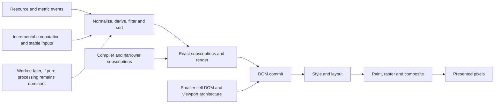

# Renderer performance sprint 2: less work before more architecture

**Decision: exhaust relevant pre-worker improvements first.** Web Workers stay on the radar, behind a measured crossover and lifecycle gate. Their availability is not a decision to adopt them. Grafana is last. This sprint does not change CI or release workflows.

## Start here

| First experiment | Why it is worth testing | Owner | Success is not just… |
|---|---|---|---|
| Record actual compiler coverage and correct subscription boundaries | Compiler is configured across packages, but skips are not recorded; Table v9 needs state-aware nested consumers | Shared UI + host/runtime + plugin build owners | Fewer warnings or a compiler flag being present |
| Narrow table and cell subscriptions | Shared DataTable currently subscribes to all table state; link and custom cells add per-cell observers | Shared UI first, shared runtime next | Lower render counts with stale checkboxes or rows |
| Load heavy features when used | Source imports eagerly reach Monaco, terminal/log tools, icon namespaces and many routes | Host + plugin loader/build contracts | A smaller initial file with a slower or broken first editor/menu open |
| Reduce repeated full-corpus derivation | New data-array identities rebuild row models; facets and dynamic columns scan the corpus | Runtime + owning view + shared table model | A fast visible subset that ignores off-screen matches |
| Reduce rich-cell work and DOM shape | Native trace shows substantial style, paint-property, paint and hit-test activity | Shared UI and typed owning-view slots | Node reuse alone; the previous recycling prototype was slower |
| Isolate sticky/hover/column costs | Row transforms, pinned cells and hover behavior interact with the browser pipeline | Shared DataTable | A CSS counter falling while frame tails worsen |
| Avoid work in hidden views | Hidden drawer panels and shown tabs have different lifecycles | Host/runtime | Hiding pixels while subscriptions and timers keep running |
| Verify exact live-update work | Earlier overloaded baselines captured more events and longer tails | Existing local harness | An attractive percentage from unequal workloads |

These are ranked **experiments**, not promised gains. Source-confirmed structure is not proof of runtime cost. No new speedup is claimed by this research document.

### Reading map

- [Measurement, evidence and no-regression gates](../renderer-performance-research/measurement.md)
- [React Compiler and React rendering research](../renderer-performance-research/react-compiler.md)
- [Browser, virtualization and competitor research](../renderer-performance-research/browser-rendering.md)
- [JavaScript delivery, execution and worker research](../renderer-performance-research/javascript.md)
- [Previous recorded comparisons](../../bench/app/renderer-sprint-metal-evidence-2026-11-10.json)

## Baseline and completed merge tracking

All 26 checks passed and no review threads remained unresolved before the retained changes merged. Admin merge was used with exact reviewed-head matching. These were incremental merges, not a claim that the smoothness goal was reached.

| Repository | PR | Merged baseline commit |
|---|---|---|
| Shared UI | [#125](https://github.com/omniviewdev/ui/pull/125) | `470b8f26aa938d7d4ff53fc694ba7e11cf3424ed` |
| Host/runtime | [#470](https://github.com/omniviewdev/omniview/pull/470) | `601b72904dffccd946fad93a148db56f7568cc4f` |
| Kubernetes | [#230](https://github.com/omniviewdev/omniview-plugin-kubernetes/pull/230) | `a38f8d34ec351cbcbe2165e054d3c7a0aa7307c9` |

The dev CLI created `renderer-research-20261110`, workspace UUID `ef534318-8d35-4d4d-ab2f-b81874ffabe5`, from `origin/main` at these three commits. It is a fresh research workspace; the prior candidate, raw captures and frozen baseline remain untouched. No new native runtime launch or performance recording is implied by workspace creation.

The previous evidence still correctly records `smoothnessBudgetMet: false` and `noRegressionCertified: false`. Do not rewrite historical acceptance flags because a PR merged. The retained candidate's normal-CPU, no-resource-update p95 was 25.95 ms; the existing minimum target is 20 ms. Large throttled stalls remain open.

## What the research already rules out

- **“Turn on React Compiler.”** It is already enabled in the host, runtime, shared UI and Kubernetes builds. Audit actual coverage, version semantics and emitted code instead.
- **“TanStack Table is incompatible with the compiler.”** The [official v9 guide][v9-compiler] explicitly says v9 is compatible. Older v8 `useReactTable` advice must not be copied onto our `useTable` integration. Nested stable core objects still need correct subscriptions.
- **“Virtualization solves data processing.”** Table row models and virtual viewport rendering are separate costs. Virtualization reduces DOM, not full-corpus sorting/filtering by itself.
- **“A worker fixes rendering.”** A worker can move pure processing; DOM, layout, paint and main-thread table integration remain. It can also add input copies, queues and a second corpus.
- **“Freelens has workers, so we need them.”** Source searches of v1.10.3, v2.0.0 and main found no evidence of table-processing workers; editor workers are separate. This is bounded source evidence, not a runtime proof of absence.
- **“Smaller source code means less page JavaScript.”** Dynamic imports may remain eager when the same module is statically imported or shared as a whole namespace. Inspect emitted and executed graphs.
- **“More overscan is free.”** It trades blanking risk against mounted cells, subscriptions, metric demand and native rendering. Preserve the requested buffer until an equivalent no-blank result is demonstrated.
- **“Lower React time means smoother frames.”** Previous native-layout and DOM-recycling experiments lowered selected counters or reused nodes but failed frame gates.
- **“Use the AI skill verbatim.”** Next.js/RSC advice, generic 50 ms budgets and automatic worker thresholds do not define this desktop application's requirements. See the critical appraisal in the measurement note.

## Where work happens

Compiler and delivery work cannot be credited with eliminating browser stages they do not execute. Equally, native cost does not make avoidable JavaScript harmless: both compete for timely updates.

## Concrete source and artifact findings

| Finding | Evidence | Status / uncertainty |
|---|---|---|
| The archived retained-candidate entry is **23,053,929 uncompressed bytes** | Frozen `candidate-metal-review-fixes/dist/assets/index-CBSQkkHf.js`, referenced by its HTML; SHA-256 `5399c1dfe3a5a2fe5dd2a76365d90c2b72068fd3d35064aec8a7c9da02d5082b` | Direct static measurement, not compressed transfer size or execution time; not a new build of this sprint |
| Host production config disables minification | [Host Vite config][h-vite], `build.minify: false` | Confirmed configuration; a minifier experiment must declare the changed build variable rather than bypass comparison guards |
| Monaco initializes eagerly from the host entry | [Entry][h-main] and [bootstrap][h-monaco] | Confirmed imports/initialization; attribute parse/eval and first-use effects before changing lifecycle |
| Icon resolver loads complete Lu/Si namespaces | [Host Icon][h-icon], [shared registry][h-shared], plugin icon/entry paths | Confirmed import topology; host-only changes can merely move the same cost to plugin loading |
| Drawer and route modules are statically reachable | [Drawer panels][h-panels], [host page routes][h-routes], [plugin entry][k-entry] | Confirmed source reachability; emitted/executed bytes must be measured, not inferred from source count |
| Shared table context selects the complete table state | [DataTableContext][u-context] | Confirmed source; narrow selectors must preserve options/data changes and stateful cell correctness |
| Per-cell link/type and custom-cell resolution add observers | [ResourceLinkChip][k-link], [useResourceType][rt-type], [CustomTableCell][h-custom] | Confirmed calls; observer costs and compiler memoization need attribution |
| New table data identities rebuild the core row model | Pinned v9 core model and [plugin row projection][k-rows] | Source-level mechanism; do not “fix” it by retaining obsolete Rows |
| Base UI prebundles table/virtual/dnd internals while the host also shares dependencies | [UI build externals][u-vite], [host registry][h-shared], [plugin shared-package contract][h-shared-list] | Archive/source evidence of separate graphs; current emitted duplicate counts and savings are still unmeasured |
| Sort fast-path certification uses function identity | [Adaptive sorter][u-sort] | Current string/auto sort registries share the local built-ins; no current caller mismatch was established. Cross-copy function-valued sorts are a compatibility audit, not a claimed production bug |
| Some compiler/tooling documentation is stale | UI `docs/TOOLING.md` describes a `use no memo` boundary that source no longer contains | Documentation correctness task; actual skip coverage still needs a logger run |
| Scratch compiler audit found concrete skips and silent non-candidates | [Recorded compiler events](../../bench/app/renderer-research-compiler-2026-11-10.json) and [version-specific analysis](../renderer-performance-research/react-compiler.md) | Isolated Babel pipeline, not actual Vite producer coverage; compilation counts do not establish runtime benefit |
| Pointer state can change hover/hit-test work | [Browser mechanisms and controlled experiments](../renderer-performance-research/browser-rendering.md) | Chromium main-source hypothesis; control pointer position and verify callers in the installed runtime |

## Opportunity catalog

**Priority:** P0 = establish trustworthy attribution/correctness; P1 = first pre-worker experiments; P2 = conditional pre-worker work; P3 = architecture or worker gate; P4 = later diagnostics. **Evidence:** F = source/artifact fact; H = runtime benefit hypothesis; G = correctness/measurement guard. A row may have more than one label.

### Measurement and diagnosis

| ID | Priority | Opportunity | Evidence / next experiment | Reject or withhold when… |
|---|---|---|---|---|
| M01 | P0 | Attribute presented-frame stalls, not only rAF gaps | G: browser frame traces plus separate visual captures; [measurement note](../renderer-performance-research/measurement.md) | Only DOM coverage or FPS estimates improve |
| M02 | P0 | Split fixed-work and fixed-duration replay | F/G: previous sparse windows and event counts differed | Requested/applied work and settle tails cannot be reconciled |
| M03 | P0 | Attribute per-cell and native phases with controlled ablations | H: plain-value versus rich-cell attribution, then add features back | Geometry, data, metric traffic or renderer mode changes invisibly |
| M04 | P0 | Audit compiler coverage in actual producer builds | F/G: configuration has no logger; build scopes differ | Skip/compile counts are inferred from flags or stale artifacts |
| M05 | P0 | Measure eager module evaluation and first-use cost | F/H: large archived entry and static feature graph | Startup wins are paid back as broken or excessive first-use stalls |
| M06 | P0 | Keep independent trials and capture overhead explicit | G: repeated balanced cohorts, ranges and raw receipts | A two-sample screen or correlated frames are presented as certification |
| M07 | P0 | Include native/graphics retention and lifecycle soak | G: repeated open/scroll/hide/close cycles | JS heap falls while native memory, workers, listeners or metric demand leak |
| M08 | P0 | Control pointer position and distinguish hover from wheel targeting | F/H: Blink hover work depends on known pointer state | A harness with an unset/outside pointer stands in for a user hovering rows |
| M09 | P0 | Measure actual WKWebView cadence and native layer behavior | G: Chromium and upstream WebKit source are not installed-runtime evidence | A suspected near-60-Hz policy relaxes gates or triggers a framework fork |

### React Compiler and React boundaries

| ID | Priority | Opportunity | Evidence / next experiment | Reject or withhold when… |
|---|---|---|---|---|
| C01 | P1 | Record compile/skip/error reasons by hot component | F/H: host/UI/runtime/plugin configs already enable compiler | Logging is added to production or compiler-on is counted as full coverage |
| C02 | P1 | Fix valid hook dependency/suppression causes that prevent compilation | F/H: scratch audit recorded suppression and syntax diagnostics | A suppression is removed without preserving effect lifecycle or observing emitted change |
| C03 | P1 | Use v9 narrow owner selectors and inner `Subscribe` boundaries | F/H: [v9 guide][v9-compiler], broad [context][u-context] | Selected state is ignored, or the actual reader can remain cached and stale |
| C04 | P1 | Pass data/options epochs where stable core objects alone are insufficient | G: external data replacement is not necessarily table-state change | Current values, selection, expansion, columns or resource identity stop updating |
| C05 | P1 | Verify compiled library output instead of expecting the host to recompile it | F: linked UI dist is excluded from host compiler scope | Source-only compilation is mistaken for shipped-library coverage |
| C06 | P2 | Preserve useful manual memoization; simplify only redundant cases | H: inspect emitted caches and profile real changes | Custom equality or identity contracts are removed just because compiler exists |
| C07 | P2 | Move expensive pure derivations to stable boundaries | H: data/column/selector identities influence row-model rebuilds | Cache keys omit locale, field definition, source epoch or changed values |
| C08 | P2 | Compare production compiler boundaries with isolated attribution builds | G: test/bench compiler scopes differ across repositories | A jsdom/mock or skipped external plugin source stands in for the full app |
| C09 | P1 | Correct stale compiler guidance and retain an observed coverage receipt | F/G: documented opt-out no longer exists | Documentation claims an unobserved skip policy or a blanket v8 workaround |
| C10 | P1 | Audit time-derived values under compilation | F/G: pinned-compiler snippets cache some wall-clock-derived output | Relative labels freeze or existing ageClock subscriptions are bypassed |
| C11 | P1 | Include silent non-candidate cell renderers in coverage audits | F/G: infer mode does not attempt every inline callback | Renaming/forcing compilation introduces stale row-state reads |
| C12 | P2 | Measure compiler cache/byte overhead before narrow scope changes | F/H: scratch per-file estimates are not bundle deltas | Compiler is disabled broadly or byte savings hide frame/first-use regressions |

### State, subscriptions and data processing before workers

| ID | Priority | Opportunity | Evidence / next experiment | Reject or withhold when… |
|---|---|---|---|---|
| S01 | P1 | Split layout, data/options and interaction state fanout | F/H: [context][u-context] broadcasts complete state | Cell/table features lose a required state dependency |
| S02 | P1 | Share catalog/type lookups at a table or source boundary | F/H: [link cell][k-link] → [type hook][rt-type] per cell | Catalog/source generation or permissions become stale |
| S03 | P1 | Resolve custom-cell contributions once per relevant definition/scope | F/H: [CustomTableCell][h-custom] subscribes/resolves per cell | Live extension registration, removal or error boundaries stop working |
| S04 | P1 | Bring stable action/notification dispatch to generic link cells | F/H: host link cells still read drawer/notification contexts | Row actions use a retired body or obsolete callback |
| S05 | P1 | Partition metric value, status and metadata subscriptions safely | F/H: [table metrics][rt-table-metrics] context changes fan out | Errors, timestamps, units, references or bounds are suppressed |
| S06 | P1 | Reuse stable metric identity/dimension projections | F/H: request-key sorting and result-map construction recur | Fresh source definitions or target incarnations share an invalid cache entry |
| S07 | P1 | Incrementally maintain filter/facet options from admitted deltas | F/H: [filter options][k-filters] scan the corpus on row-array changes | Deletes leave values/counts behind or only visible rows contribute |
| S08 | P1 | Compile/cache column accessors and JSONPath parsing by definition | F/H: [generic definitions][h-definitions] repeatedly evaluate accessors | Complex paths, missing fields, alternatives or schema changes change semantics |
| S09 | P2 | Avoid rebuilding unchanged row-projection containers unnecessarily | F/H: [projection][k-rows], runtime records snapshot | Old TanStack Rows, stale bodies or hidden mutable data are retained |
| S10 | P2 | Batch notifications at existing source boundaries with bounded latency | H: measure wakeups and commits, not a guessed debounce interval | Deletes/invalidation wait, backlog grows, or freshness worsens |
| S11 | P2 | Reduce selection/header full-corpus work without changing query scope | H: select-all/page selection and fresh selector tuples | Off-screen selected rows disappear from actions or counts |
| S12 | P2 | Reuse locale/timestamp/reference formatting work at the right scope | F/H: [metric formatting][u-capacity] and timestamp titles repeat | Full precision, accessibility text or fresh metadata is lost |

### JavaScript delivery, evaluation and hidden execution

| ID | Priority | Opportunity | Evidence / next experiment | Reject or withhold when… |
|---|---|---|---|---|
| J01 | P1 | Defer Monaco initialization until an editor actually needs it | F/H: [entry][h-main], [bootstrap][h-monaco] | Worker environment/shared exports are unavailable when the first plugin editor opens |
| J02 | P1 | Lazy-load terminal, WebGL and log/debug drawer variants | F/H: [drawer panels][h-panels] import them statically | First-open latency or retained-tab behavior regresses |
| J03 | P1 | Split host page routes at existing router lazy boundaries | F/H: [pageRoutes][h-routes] uses static components | Navigation, deep links, error handling or cancellation breaks |
| J04 | P1 | Split Kubernetes resource routes and expensive sidebar content | F/H: [plugin entry][k-entry] statically reaches many modules | Sidebar/route registrations become incomplete or plugin loading changes silently |
| J05 | P1 | Avoid paying for complete icon namespaces on table-only startup | F/H: [Icon][h-icon] plus [shared registry][h-shared] | Opaque plugin icon names or first-use rendering cease to work |
| J06 | P2 | Audit package subpaths, side effects and prebundled duplicates | F/H: [UI externals][u-vite] and host sharing differ | React/plugin singleton identity or peer compatibility is weakened |
| J07 | P2 | Design a declared production-minifier experiment | F/H: [host config][h-vite] has `minify:false` | Comparison guards are bypassed, debugging/source contracts break, or first-use costs regress |
| J08 | P2 | Make lazy JavaScript and CSS boundaries agree | F/H: plugin currently injects combined CSS | Code is deferred but all style cost stays eager, or first paint flashes unstyled content |
| J09 | P2 | Defer heavy syntax/markdown/diagnostic payloads and exports | F/H: source graph includes renderers outside the table's needs | A whole-namespace shared contract is silently replaced with async values |
| J10 | P1 | Pause hidden drawer/view work at real ownership boundaries | F/H: hidden panels remain mounted; Activity has different semantics | State is lost, reopen stalls, or source ownership is retired incorrectly |
| J11 | P2 | Remove avoidable hot console serialization/bridge calls | F/H: console bridge serializes arguments and crosses Wails | Failures are hidden or diagnostics are dropped without an explicit policy |
| J12 | P2 | Yield only independent pure chunks and bound queued work | H: task scheduling can improve input responsiveness | Yielding splits an atomic resource update or simply delays mandatory viewport work |

### Browser work, cell shape and virtualization before workers

| ID | Priority | Opportunity | Evidence / next experiment | Reject or withhold when… |
|---|---|---|---|---|
| R01 | P1 | Measure rich-cell DOM/commit costs by renderer family | F/H: [virtual cells][u-virtual] add wrappers; rich controls add more | A fake plain table is presented as the shipped interface |
| R02 | P1 | Share/defer container and reference tooltip payload work | F/H: plugin container chips build tooltip content and controls | Keyboard, focus, full-value text or active-target ownership regresses |
| R03 | P1 | Explore smaller native/typed primitive cell markup | H: reduce actual elements and attributes, not only React components | Accessibility, theme, precision or visible content is removed |
| R04 | P1 | Attribute hover, hit-testing and decorative content | F/H: [CSS][u-css] has row hover rules and the trace has HitTest work | Hover/focus affordances are simply disabled as a shipping shortcut |
| R05 | P1 | Attribute pinned-cell sticky/shadow costs independently | F/H: [CSS][u-css] pins cells inside transformed rows | Horizontal scrolling, RTL, resizing or layering becomes incorrect |
| R06 | P2 | Add column virtualization only where width warrants it | H: [official examples][virtual-guide] cover both axes | Pinned/hidden columns, header alignment, focus or metric demand becomes wrong |
| R07 | P1 | Compare standard and experimental TanStack virtualizer integration | F/H: official experimental examples use imperative position updates | A scrolling comparator ignores live data or current-row events |
| R08 | P2 | Profile scroll-range publication and forced geometry reads | H: existing immutable snapshot adapter already avoids raw mutable reads | Another rAF or observer layer adds work or delays new rows |
| R09 | P2 | Evaluate overscan policies only with equivalent visible coverage | F/H: current Kubernetes buffer is intentionally 32 | A smaller DOM is bought with black rows, lagging metrics or missing focus targets |
| R10 | P2 | Keep fixed-height paths free of unnecessary measurement | F/G: current implementation already skips row measurement where valid | Wrapping/custom content or expanded details are clipped or mismeasured |
| R11 | P2 | Isolate expensive panels rather than repeat failed per-row containment | H: inspect invalidation scope outside rows | Native paint/layer cost or portal/sticky behavior worsens |
| R12 | P2 | Apply hidden-section content visibility only where geometry remains valid | H: potentially useful for independent off-screen panels | Measurement returns unusable geometry or JS/network work continues invisibly |
| R13 | P3 | Prototype a simpler pinned-pane/positioning architecture if tracing justifies it | H: larger renderer change after local causal ablations | Key/focus/selection/scroll geometry or frame tails regress |
| R14 | P2 | Bound animation/raster work and verify reduced motion | G/H: static unavailable metrics already fixed; inspect actual active animation tracks | Placeholders or decorative transitions mask missing data or recur unnecessarily |

### Backend, plugin and transport work that reaches the UI

Source-read findings from the merged cohort. Every cost is a hypothesis until the experiment in the row runs. Paths: `H` = host `omniview/`, `K` = `omniview-plugin-kubernetes/`.

| ID | Priority | Opportunity | Evidence / next experiment | Reject or withhold when… |
|---|---|---|---|---|
| B01 | P1 | Stop shipping `metadata.managedFields` to tables | F: `K pkg/plugin/resource/resourcers/base.go:117` watch conversion ignores the representation; only the model representation strips it and no table selects it | A projection drops fields an editor, drawer or MCP consumer still needs |
| B02 | P1 | Batch informer changes into one frame instead of one frame per event | F: `K base.go:533` emits per event; `H backend/pkg/plugin/resource/source_view.go:717` emits per frame | Deletes, ordering or snapshot-end semantics change, or latency grows past the measured budget |
| B03 | P1 | Remove discarded encodes and repeated size walks on the emit path | F: `H source_view.go:537` marshals only for `len`; Wails re-marshals the same value per window | Payload bytes, validation or event identity change |
| B04 | P1 | Stop marshal-then-unmarshal round trips while holding the session lock | F: `H source_session.go:872-935` re-decodes the member just encoded; `s.mu` also gates `GetSourceStates` | Validation coverage or record identity weakens |
| B05 | P2 | Size view chunks from ingest-time sizes instead of re-decoding every member per view sync | F: `H source_view.go:304-328` and `:606-720` decode and envelope each member twice per sync | Chunk limits, ordering or per-view isolation break |
| B06 | P2 | Acquire sessions on demand instead of every list+watch type at connect | F: `K native_catalog_assembly.go:65` sets `AcquireOnConnect`; `H connection_updates.go:28-48` opens per-type sessions | Expected tables lose warm data or first-open latency regresses |
| B07 | P2 | Skip graph dirty marking when extracted edges are unchanged | F: `H .../graph/graph_indexer.go:32` always removes and re-adds derived edges; UI refetches on 1 s debounced `graph/CHANGED` | Edge deletions or late relationship arrivals stop invalidating |
| B08 | P1 | Shorten the connect path's repeated catalog validation | F: `H authority.go:132` and `catalog_binding.go:37` re-observe/validate the catalog per type and per target; `controller.go:653` emits status only afterwards | Authority resolution or permission checks become stale |
| B09 | P2 | Use read locks for unchanged binding comparisons | F: `H catalog_binding.go:122` takes the controller write lock for a no-op compare, blocking record observation | Binding swaps can race or be missed |
| B10 | P1 | Stop publishing two full metric snapshots per tick | F: `H backend/pkg/plugin/metric/finite_observation.go:385` publishes a fetching frame carrying old data, then the result | Fetching/error state stops reaching cells |
| B11 | P2 | Cache canonical address keys instead of re-encoding per record per pass | F: `H registry/identity.go:14` validates, sorts and JSON-encodes on every call, reached from store, indexer and row identity | Address identity or incarnation fencing changes |
| B12 | P2 | Reduce metric source scans and serial cluster queries | F: `K pkg/plugin/metric/native.go:337` scans namespaces serially; `prometheus.go:1257` issues ~14-17 serial queries with per-query debug logging | Partial/failed sources become indistinguishable from healthy ones |
| B13 | P2 | Route window-targeted events to their window | F: Wails `transport_event_ipc.go:26` dispatches to every window; JS filters after parsing | Multi-window observers that legitimately need the event stop receiving it |

### Application shell, panels and persistent sessions

| ID | Priority | Opportunity | Evidence / next experiment | Reject or withhold when… |
|---|---|---|---|---|
| A01 | P1 | Coalesce footer connection-status work | F: `H ui/.../useConnectionStatus.ts` recomputes aggregates and a new Map per `source/STATE`; the footer is always mounted | Sync/readiness states stop reflecting actual connections |
| A02 | P1 | Stop computing extension diagnostics snapshots nobody reads | F: `H ui/features/extensions/diagnostics/ExtensionDiagnosticsBridge.tsx` recomputes up to 2000 rows per registry notify while the Inspector is closed | The Inspector loses history it is expected to show |
| A03 | P2 | Release connection-state dialogs and their polling on close | F: `H ui/features/connectionState/ConnectionStateProvider.tsx` never clears `target`; `useSourceStates` polls every 3 s | Reopen loses progress or retry affordances |
| A04 | P1 | Narrow activity/notification context reads to what callers use | F: `H ui/.../AppStatusFooter.tsx` and 8+ providers read full activity context for a count or `notify` | Progress, counts or operation state stop updating |
| A05 | P1 | Remove unread state from drawer context values | F: `H ui/providers/RightDrawerProvider.tsx` includes `isOpen` in the memo; no reader uses it | A consumer actually needs open state |
| A06 | P2 | Stop instantiating full plugin inventory for a boolean dev flag | F: `H ui/hooks/useDevMode.ts` uses `useInstalledPlugins`, multiplying listeners and invalidations | Dev-server or plugin status stops updating |
| A07 | P2 | Avoid whole-snapshot plugin notifications and per-notify router rebuilds | F: `H ui/features/plugins/core/PluginService.ts:1706` nulls the cached snapshot on every notify; `workspaceController`/`tabRouters` rebuild routers per `routeVersion` | Plugin load/unload, dev reload or route registration regress |
| A08 | P2 | Throttle viewport reporting outside drags | F: `H ui/features/windows/viewport.ts:25` reports per resize event | Tear-off hit-testing needs live size |
| A09 | P1 | Defer log search off the keystroke render path | F: `H ui/providers/BottomDrawer/containers/LogViewer/hooks/useLogSearch.ts` scans synchronously during render with a 100 ms budget | Match counts, highlighting or follow behavior break |
| A10 | P1 | Stop full-buffer rescans per streaming frame | F: same LogViewer hooks rescan on eviction and rebuild filtered arrays per version at a 100k cap | Eviction correctness or source filters change |
| A11 | P1 | Release terminal listeners and hidden terminal work | F: `H .../Terminal.tsx:410` discards unsubscribers; theme/resize effects run for hidden terminals | Reattach, resize or theme correctness regresses |
| A12 | P2 | Avoid recomputing Monaco themes and schema registration per mount/toggle | F: `U editors/src/themes/monaco.ts` forces style reads per token; `H ui/providers/monaco/schemaRegistry.ts` re-parses and re-sends the whole schema set | Theming, validation or diff rendering changes |
| A13 | P2 | Collapse duplicate settings snapshot fetches and narrow settings fan-out | F: `R hooks/settings/useScopedSettings.ts` refreshes on commit and again on `settings/changed`; all `useSettings()` readers re-render | Settings freshness across windows regresses |
| A14 | P2 | Gate idle polls and heartbeats on visibility | F: activity heartbeat and development/profiling status polls run while hidden | Status needed while hidden becomes stale |

### Native window and compositing

| ID | Priority | Opportunity | Evidence / next experiment | Reject or withhold when… |
|---|---|---|---|---|
| N01 | P1 | Measure the translucent macOS backdrop against an opaque window | F: `H main.go:827` sets `MacBackdropTranslucent`; H: window-wide blending adds per-frame compositor work | Opaque windows are accepted without comparing recorded frames, or the visual contract is changed without a decision |
| N02 | P2 | Measure `backdrop-filter` overlays in menus, popovers and dialogs | F: `U base-ui/src/components/{menu,popover,alert-dialog}/*.module.css` blur full-viewport backdrops | Overlay dismissal, contrast or focus behavior changes |
| N03 | P2 | Bound always-running pulse animations in shell indicators | F: infinite pulses in `status-dot`, `badge` and `card` CSS driven by footer sync/dev chips | A pulse is the only signal that work is in progress |

### Workers: researched, deliberately gated

The pinned Table **9.3.1** packages export `experimental-worker-plugin`; no dependency upgrade is needed to investigate it. The [official guide][worker-guide] calls it experimental, describes a shadow-table pipeline and compact result permutations, and gives roughly 100,000 rows as a starting heuristic **or fewer rows with expensive functions**. That is neither proof of a 5,000-row benefit nor a reason to dismiss measured expensive processing at 5,000 rows.

| ID | Priority | Opportunity | Evidence / next experiment | Admission gate |
|---|---|---|---|---|
| W01 | P3 | Evaluate the official worker row-model plugin after simpler wins | F/H: [guide][worker-guide] and [example][worker-example] exist in our pinned version | Remaining filtering/grouping/sorting cost is measured; end-to-end gain exceeds startup/copy/rehydration costs |
| W02 | P3 | Audit input cloning versus incremental projection/patches | H: compact output does not imply cheap input | No full-corpus clone on every small patch or metric retarget unless measurements justify it |
| W03 | P3 | Consider parsing, normalization, search indexing or faceting independently | H: these may be better worker targets than already-fast sorts | Pure, serializable work remains dominant after pre-worker optimization |
| W04 | P3 | Fence results by source, corpus, definition and query generation | G: indices must map to the exact current corpus | Late work cannot revive deleted rows, overwrite a newer query or cross an incarnation |
| W05 | P3 | Prove worker loading, failure, scope and teardown in actual plugin architecture | G: Vite/SystemJS/Wails/CSP and worker lifecycle differ from a standalone demo | No silent frozen/unsorted fallback, leaked worker, bare-import failure or hidden restart |
| W06 | P3 | Measure all threads and real crossover, not just main-thread relief | G: CPU slowdown is not a whole-machine emulator | Unthrottled end-to-end latency, total CPU, memory and protected scenarios also pass |

The offloaded stages must form the supported contiguous pipeline prefix. Do not offload sorting behind a main-thread filter in a way that bypasses that filter. The current guide also warns that worker failure can keep last results and that teardown is manual. Those behaviors require explicit ownership/error design before production adoption. DOM virtualization, controls, layout and painting remain on the main thread.

The React `realtime-trading` example's worker generates/coalesces the feed; table filtering/sorting and rendering stay on the main thread. The separate row-model worker example is paginated, not virtualized. Source inspection found full-corpus input cloning on new array identities and pending old permutations that require stronger corpus fencing before use here. See the [worker source audit](../renderer-performance-research/javascript.md#workers-researched-not-selected).

### Later or explicitly out of scope

| ID | Priority | Opportunity | Why not first |
|---|---|---|---|
| D01 | P3 | Server/native query pushdown for datasets that exceed a sensible client budget | Requires query/SDK semantics and whole-corpus behavior, not a UI-only shortcut |
| D02 | P3 | Canvas or hybrid renderer for extreme rich-grid workloads | Major accessibility, interaction, editing and rendering-contract change; not a drop-in optimization |
| D03 | P4 | Local profile export/import UX and reproducible evidence packages | Useful after the local measurement contract; must respect work-policy and sensitive data |
| D04 | P4 | Grafana/Pyroscope/browser continuous profiling integration | Last, after local wins and a separate privacy/retention/credential decision |

## Sprint work packages and gates

| Package | Order | Scope / output | Depends on | Done when |
|---|---|---|---|---|
| [P2-00 / #460](https://github.com/omniviewdev/omniview/issues/460) | First | Re-freeze merged baseline; attribute native frames, main-thread work, module startup and equal live-update work | None | Local receipts identify the dominant cost by scenario, with supported/unsupported signals and no mixed cohorts |
| [P2-01 / #472](https://github.com/omniviewdev/omniview/issues/472) | First | Compiler coverage and v9 subscription correctness | P2-00 | Actual producer compile/skip receipts exist; stale nested-reader cases are protected; no blanket opt-outs or memo removals |
| [P2-02 / #463](https://github.com/omniviewdev/omniview/issues/463) | Pre-worker | Reduce subscription/context and repeated projection/facet/accessor work | P2-00/01 | Paired full-app recordings improve the targeted scenarios while ownership and freshness stay correct |
| [P2-03 / #473](https://github.com/omniviewdev/omniview/issues/473) | Pre-worker | Lazy heavy host/plugin features and shrink eager JavaScript | P2-00 | Startup improves; first editor/terminal/route/icon use and plugin exports stay correct |
| [P2-04 / #462](https://github.com/omniviewdev/omniview/issues/462) | Pre-worker | Rich-cell DOM/payload, hover/pinning and wide-column rendering; coordinate [#464](https://github.com/omniviewdev/omniview/issues/464), [#465](https://github.com/omniviewdev/omniview/issues/465) and [#466](https://github.com/omniviewdev/omniview/issues/466) | P2-00/01 | Presented-frame/viewport evidence improves without blank rows, lost controls or native memory regressions |
| [P2-05 / #474](https://github.com/omniviewdev/omniview/issues/474) | Pre-worker | Hidden-view lifecycle and bounded scheduling | P2-00/02 | Hidden work drops, close releases ownership, and reopen does not regress |
| P2-06 | Conditional later; not queued | Worker crossover and lifecycle spike, using the official example as a reference | Relevant pre-worker work exhausted or ruled out with evidence | The [worker decision gate](../renderer-performance-research/measurement.md#worker-decision-gate-later-not-the-first-implementation) passes; otherwise keep workers unadopted |
| [P2-07 / #461](https://github.com/omniviewdev/omniview/issues/461) | Last | External diagnostics / Grafana design only after local acceptance | Local diagnosis and privacy review | Explicit collection scope, retention and policy approval; no requirement on the optimization sprint |

“Exhausted” means each relevant simpler hypothesis is tested, rejected, already implemented or shown inapplicable. It does not mean rewriting every unrelated component before investigating an expensive remaining pure computation. A competitor's use of workers changes the evidence available, not our acceptance standard.

Every implementation PR must include readable absolute and percentage comparisons, known costs and rejected alternatives. Any repeatable regression in a protected scenario blocks that change. Keep tests behavioral: current records, source transitions, full-corpus queries, keyboard interactions, errors and cleanup. Diagnostic compile/render/call counters belong in local evidence, not permanent implementation-count tests.

## Protect the gains already merged

Preserve immutable body/target sharing, current-row lookup, source-incarnation fences, the opt-in text-sort reuse with native fallback, table-scoped metric inspection roots, active-row action context, keyboard namespace controls, clipboard failure feedback, fixed-height geometry, logical striping, deferred loading pulses and explicit hidden/unavailable metric states. Do not replace any of these with an optimization that merely looks faster because it does less required work.

## Primary source anchors

The research notes contain the broader bibliography and version caveats. Source links below are pinned to the merged baseline rather than a moving branch.

[v9-compiler]: https://tanstack.com/table/latest/docs/framework/react/guide/react-compiler
[virtual-guide]: https://tanstack.com/table/latest/docs/framework/react/guide/virtualization
[worker-guide]: https://tanstack.com/table/latest/docs/guide/worker-row-models
[worker-example]: https://tanstack.com/table/latest/docs/framework/react/examples/web-worker-row-models
[h-vite]: https://github.com/omniviewdev/omniview/blob/601b72904dffccd946fad93a148db56f7568cc4f/vite.config.ts
[h-main]: https://github.com/omniviewdev/omniview/blob/601b72904dffccd946fad93a148db56f7568cc4f/ui/main.tsx
[h-monaco]: https://github.com/omniviewdev/omniview/blob/601b72904dffccd946fad93a148db56f7568cc4f/ui/providers/monaco/bootstrap.ts
[h-icon]: https://github.com/omniviewdev/omniview/blob/601b72904dffccd946fad93a148db56f7568cc4f/ui/components/icons/Icon.tsx
[h-shared]: https://github.com/omniviewdev/omniview/blob/601b72904dffccd946fad93a148db56f7568cc4f/ui/features/plugins/api/shared_dependencies.ts
[h-shared-list]: https://github.com/omniviewdev/omniview/blob/601b72904dffccd946fad93a148db56f7568cc4f/packages/omniviewdev-vite-plugin/src/sharedPackages.ts
[h-panels]: https://github.com/omniviewdev/omniview/blob/601b72904dffccd946fad93a148db56f7568cc4f/ui/providers/BottomDrawer/DrawerTabPanels.tsx
[h-routes]: https://github.com/omniviewdev/omniview/blob/601b72904dffccd946fad93a148db56f7568cc4f/ui/features/workspace/pageRoutes.tsx
[h-custom]: https://github.com/omniviewdev/omniview/blob/601b72904dffccd946fad93a148db56f7568cc4f/ui/components/tables/Resources/cells/CustomTableCell.tsx
[h-definitions]: https://github.com/omniviewdev/omniview/blob/601b72904dffccd946fad93a148db56f7568cc4f/ui/hooks/resource/useResourceDefinition.tsx
[rt-type]: https://github.com/omniviewdev/omniview/blob/601b72904dffccd946fad93a148db56f7568cc4f/packages/omniviewdev-runtime/src/hooks/resource/useResourceType.ts
[rt-table-metrics]: https://github.com/omniviewdev/omniview/blob/601b72904dffccd946fad93a148db56f7568cc4f/packages/omniviewdev-runtime/src/hooks/metric/useTableMetricObservation.ts
[u-vite]: https://github.com/omniviewdev/ui/blob/470b8f26aa938d7d4ff53fc694ba7e11cf3424ed/packages/base-ui/vite.config.ts
[u-context]: https://github.com/omniviewdev/ui/blob/470b8f26aa938d7d4ff53fc694ba7e11cf3424ed/packages/base-ui/src/components/data-table/context/DataTableContext.tsx
[u-virtual]: https://github.com/omniviewdev/ui/blob/470b8f26aa938d7d4ff53fc694ba7e11cf3424ed/packages/base-ui/src/components/data-table/DataTableVirtualBody.tsx
[u-sort]: https://github.com/omniviewdev/ui/blob/470b8f26aa938d7d4ff53fc694ba7e11cf3424ed/packages/base-ui/src/components/data-table/utils/createAdaptiveSortedRowModel.ts
[u-css]: https://github.com/omniviewdev/ui/blob/470b8f26aa938d7d4ff53fc694ba7e11cf3424ed/packages/base-ui/src/components/data-table/DataTable.module.css
[u-capacity]: https://github.com/omniviewdev/ui/blob/470b8f26aa938d7d4ff53fc694ba7e11cf3424ed/packages/base-ui/src/metrics/CapacityBar.tsx
[k-entry]: https://github.com/omniviewdev/omniview-plugin-kubernetes/blob/a38f8d34ec351cbcbe2165e054d3c7a0aa7307c9/ui/src/entry.ts
[k-link]: https://github.com/omniviewdev/omniview-plugin-kubernetes/blob/a38f8d34ec351cbcbe2165e054d3c7a0aa7307c9/ui/src/components/shared/ResourceLinkChip.tsx
[k-rows]: https://github.com/omniviewdev/omniview-plugin-kubernetes/blob/a38f8d34ec351cbcbe2165e054d3c7a0aa7307c9/ui/src/components/shared/table/ResourceTable/rows.ts
[k-filters]: https://github.com/omniviewdev/omniview-plugin-kubernetes/blob/a38f8d34ec351cbcbe2165e054d3c7a0aa7307c9/ui/src/components/shared/table/ResourceTable/filterOptions.ts
