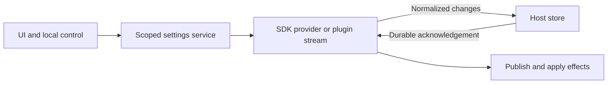

# Settings validation

## Business cases and UX contract

Developers must be able to verify a selected Go executable before saving it. SDK settings register one reusable `Validator` callback returning structured, user-safe results. This is a breaking alpha API cutover: error-returning callbacks must migrate to `settings.ValidationResult`; no compatibility registration path exists. Validation is advisory until save; every save runs validation again, and failed bulk validation changes no values.

Core settings validate changed drafts asynchronously after a short debounce. Each row announces checking, success, or actionable failure. Responses for older drafts, discarded drafts, or another category must never replace current feedback. Save remains available to retry validation, but is disabled while saving. Drafts survive failures. Editing and discard cannot race an in-flight save.

The save action retains its accessible name and exposes busy state until validation and persistence finish. The persistent footer shows Save/Discard for drafts and Done after a successful save; rejected drafts keep their actions and feedback.

An empty Go path retains the existing optional default: automatic discovery in PATH and common installation folders when a build needs Go. Clearing an override succeeds without requiring Go to be installed. This does not claim that automatic discovery has been smoke-tested. Explicit paths reject missing files, directories, and non-executable files, then run `go version` directly without a shell. The smoke command has a five-second deadline and bounded output, and must identify itself as Go. `GOTOOLCHAIN=local` prevents Go toolchain download and `GOWORK=off` avoids ambient workspace selection. No builds or module mutation occurs. Success identifies the version; failures explain selection, execution, timeout, or unexpected output without echoing command output, environment, or submitted values. Sensitive settings always receive generic feedback.

## Expected outcomes

- A reusable structured validator produces success/failure code and message; its failure prevents direct and bulk SDK saves.
- The single registered callback enforces the same constraints during draft evaluation and writes.
- Missing path, directory, non-executable file, nonzero smoke exit, timeout, or non-Go output fails without changing saved values.
- Permission or other filesystem access failures return `unreadable` feedback instead of claiming that the selected executable does not exist.
- A real Go executable succeeds. Empty path succeeds with an explicit automatic-discovery message, even without Go installed.
- Delayed old results cannot overwrite newer drafts. Discard removes feedback. Switching categories with drafts offers Save, Discard, or Cancel; a failed save keeps the current category and draft.
- Save revalidates; replacing a previously valid executable with a failing one cannot bypass enforcement.
- No validation response contains secret input or arbitrary subprocess output.

## Dedicated Settings window

Settings is a non-modal, application-instance singleton owned by
`backend/window.Service`. Startup creates no Settings webview. `OpenSettings`
creates it lazily, then restores, shows, and focuses the same native window.
Closing, Done, and the close shortcut hide it without unmounting its frontend.
Category, search, scroll, validation, and unsaved drafts remain in memory.
Settings is excluded from session restore, workspace tabs, drawers, and transfers.
Application shutdown bypasses the hide-on-close hook.

The native application menu contains **Settings…**, with `CmdOrCtrl+,`.
On macOS it belongs in the application menu; other platforms use the File menu.
The application header's Settings item opens the same singleton. The shortcut
is registered through the native menu, not a frontend opening key listener.
Inside Settings, `Cmd/Ctrl+K` focuses local search and `Cmd/Ctrl+W` hides the window.

Runtime callers should use `openSettings()` from `@omniviewdev/runtime`.
An untargeted first open selects General; later untargeted opens retain location.
For an exact field, use a local target such as:

```ts
await openSettings('/settings?category=terminal&setting=terminal.fontSize');
```

Plugin links use `section=plugins&plugin=<pluginId>&setting=<opaqueSettingId>`.
Encode parameter values with `URLSearchParams`; plugin setting IDs are not
category paths. Repeated explicit requests receive distinct identities and
refocus the field. Location acknowledgements use the accepted request identity
and serialize within the retained webview, preventing older navigation writes
from overwriting later ones. Native entrypoints accept only local Settings routes.
Legacy settings navigation routes through this API without changing workspace
tabs. Normal runtime navigation leaves browser history untouched; a raw hash
assignment already creates a browser entry, which is replaced with the active
workspace route. Dirty navigation and targeted requests share the same guard.
The search shortcut does not move focus outside that guard.

The compact Settings shell uses theme tokens, a 212px navigation column, 29px
navigation rows, 28px form controls, and a persistent footer. Only its caption
regions are draggable. Settings-only chrome avoids duplicate title bars; the
labelled close action remains available. macOS retains its native frame with a
hidden title and hidden window controls: the pinned window library skips native
title assignment for frameless windows, which makes the accessibility title
empty. Other platforms use frameless chrome. Minimum size is 960×600, bounded
by the current screen's work area.

Hidden Settings pauses query focus/refetch work and CSS animations without
destroying state. Reopening refreshes stale active snapshots. Theme previews use
the live theme registry, including user and plugin themes, and retain the existing
immediate theme commit controller. Ordinary fields still use the shared draft form.
AI Tools exposes the same persistent Save/Discard footer for port and preset
drafts. If the port saves but the preset fails, feedback identifies the partial
save and retains only the failed draft for retry.
Search indexes public host and installed-plugin descriptor IDs, labels, and
descriptions only—not values, defaults, options, paths, or custom editor content.

## Plugin field editors

Existing Go SDK descriptors remain the semantic contract. No SDK, proto, or
plugin backend migration is required for a custom visual representation of an
existing field. A string can use a visual chooser while still staging a string.
The host renders descriptor-only plugins without frontend contributions.

Export typed contributions through the existing `extensionRegistrations` entry:

```tsx
import {
  SETTINGS_EDITOR_EXTENSION_POINT_ID,
  type ExtensionRegistration,
  type SettingsEditorProps,
  type SettingsEditorV1,
} from '@omniviewdev/runtime';

function LayoutEditor({
  value, disabled, inputId, labelledBy, describedBy, onChange, registerFocusTarget,
}: SettingsEditorProps) {
  const focusedChoice = value === 'full' ? 'full' : 'modern';
  return (
    <div role="group" aria-labelledby={labelledBy} aria-describedby={describedBy}>
      {(['modern', 'full'] as const).map(choice => (
        <label key={choice} className="layout-card">
          <input
            id={`${inputId}-${choice}`}
            name={inputId}
            type="radio"
            value={choice}
            checked={value === choice}
            disabled={disabled}
            ref={choice === focusedChoice ? registerFocusTarget : undefined}
            onChange={() => onChange(choice)}
          />
          {choice === 'modern' ? 'Modern' : 'Full'}
        </label>
      ))}
    </div>
  );
}

export const extensionRegistrations: ExtensionRegistration<SettingsEditorV1>[] = [{
  extensionPointId: SETTINGS_EDITOR_EXTENSION_POINT_ID,
  registration: {
    id: 'layout-editor',
    label: 'Layout',
    value: { schemaVersion: 1, settingId: 'layout', editor: LayoutEditor },
  },
}];
```

The loader supplies plugin ownership. A contribution cannot create a descriptor
or target host/another plugin's fields. Setting IDs remain opaque, including
dots. Unsupported versions, ambiguous duplicates, missing editors, suspended
imports, and rendering failures use the generic control with the same draft.
An unrelated registry update does not remount the selected editor. Lazy editors
retain generic-control drafts and restore field focus after loading only when
focus has not moved elsewhere. Replacement editors preserve the same contract.

Editor props contain authorized metadata, the effective draft value, dirty and
disabled state, validation, host accessibility IDs, and `onChange`. Metadata does
not expose saved values or defaults. Sensitive snapshots stay redacted. Attach
`registerFocusTarget` to the editable element for exact-field navigation.
The host owns labels, help, validation, restart feedback, drafts, Save/Discard,
durable commits, and cross-window invalidation. There is no editor commit API.
This is an ownership contract for trusted plugin code, not a security sandbox.

Every Settings webview loads plugin contributions independently beneath shared
plugin/settings/theme providers, outside the workspace shell. A failed plugin UI
does not prevent descriptor-based controls. Generic controls preserve scalar and
array values and structured option values; unsupported types show explicit
feedback. Native file selection passes directory/filter hints and enforces
multiple-file and extension constraints. Folder/relative-path constraints require
manual entry because the current host picker API cannot represent them; the UI
does not silently choose incompatible absolute file paths.
Structured option matching ignores object-key order but preserves array order
and value types. Clearing an array field stages an empty array; nonempty text
retains its line boundaries and whitespace.

The canonical application suite builds the workspace probe with a real custom
counter editor. Its persistence scenario stages a custom control change, checks
that the plugin still reports the saved value before Save, and verifies durable
reload plus isolation from another profile.

## Shared settings lifecycle and commits

`backend/pkg/settings.Service` initializes the existing SDK provider after
profile/singleton authority and store migration, before startup consumers run.
`internal/settings.Definitions(isDev)` supplies defaults and category metadata.
Appearance/terminal migrations run during hydration; invalid stored values produce
safe diagnostics without preventing valid siblings from loading.

Telemetry and profiling read this prepared provider. Bootstrap supplies live
effects and scoped change notifications; it does not reload or persist settings.
The plugin controller owns capability connections, schema provenance, and
hydration, not another public settings write API.



The SDK's `CommitSettings(ctx, changes, persist)` owns validation and publication.
It normalizes and validates once before the injected persistence callback.
Host category patches and plugin patches commit atomically in bbolt. Persistence
failure publishes nothing. Prepared values publish without another validation
pass, so no host mirror or pending-publication retry queue is needed.
A missing store permits core startup with defaults but rejects public saves.
Host live effects run in commit order; a later commit cannot be overwritten by
an older telemetry effect.

The public binding exposes only `GetSnapshot`, `Validate`, and `Commit`, with an
explicit `{ kind: "host" }` or `{ kind: "plugin", pluginId }` scope.
Host setting IDs use `category.setting`; plugin setting IDs remain opaque,
including dots. Snapshots include category metadata, saved values, and each
setting's `requiresRestart` and `pendingRestart` flags.
Sensitive values and value-bearing metadata are redacted. Unknown plugin schema
fails closed. Replacement clients invalidate old schema before hydration;
snapshot projection fences schema classification against concurrent reloads.

A rejected commit means preferences were not saved. A successful response is
durable even when `applied` is false or `uncertain` is true; `message` contains
safe application feedback. Forms clear durable drafts and show that warning.
They retain drafts on rejected commits. Theme changes do not roll back a
durably saved preference. No error-message matching determines commit state.
Local control returns the same structured result.

`useScopedSettings` shares the existing React Query cache and one scoped event
bridge per query client. Category views, plugin views, and runtime contexts use
that same client. One form controller owns drafts, validation fencing, save, and
discard. Commits refresh authorized snapshots instead of installing potentially
stale response data. External writes and plugin lifecycle events invalidate the
appropriate scoped queries.

Restart policy belongs to the SDK setting definition through `RequiresRestart`.
Pending state compares normalized saved values with the startup/hydration
baseline. Restoring that value clears pending state. Discard affects drafts only;
refreshing the cache does not reset the baseline.

Profiling is the first host restart-only consumer:
`developer.pprof_enabled` defaults to false and `developer.pprof_port` defaults to
6060, accepting whole-number ports from 0 through 65535. Both are visible in
production. Actual listener facts remain in `HostProfiling.GetStatus()`, separate
from saved settings. Saving never starts, stops, or rebinds the listener.
Invalid recovered profiling preferences fail closed.
`OMNIVIEW_PPROF_PORT` overrides startup behavior without replacing saved values
or their comparison baseline.

`developer.plugin_pprof_enabled` is a separate production-visible, restart-only
toggle, defaulting to false. The plugin manager captures its startup value once
and explicitly supplies each child process's opt-in environment. Every enabled
plugin chooses an ephemeral loopback port. Saving does not mutate a running
process; restart Omniview to apply the preference. The footer reads actual PID,
endpoint, support, and failure state through
`PluginManager.GetPluginProfilingStatuses()`, backed by lifecycle RPCs. A missing
profiling RPC means the plugin needs rebuilding with the updated SDK, not that a
listener is running or that the saved toggle took effect.

### Terminal defaults

New terminal settings use a 12px font. Saved font sizes remain unchanged, and
font size changes apply to open terminals without recreating their sessions.
Reset restores 12px. Until settings load, terminals also use 12px.

An empty Default Shell delegates shell discovery to the backend instead of
forcing Bash or `/bin/sh`. An explicitly saved shell executable remains intact.

Local terminals start in the user's home directory, independent of the app's
launch directory. A missing or inaccessible home fails terminal creation rather
than silently opening at the filesystem root.

The PTY starts with a provisional nonzero grid. After attachment, the terminal
always sends its measured grid, even if fitting before attachment consumed the
resize event. Fits wait for visible layout and run again after font loading,
container changes, and drawer transitions. Backend resize requests are ordered
and coalesce pending sizes so an older response cannot leave the PTY at stale
dimensions. Closing a terminal cancels queued fits and ignores late attachment.

Shell discovery uses `SHELL`, then the account login shell when `SHELL` is absent,
then an installed system fallback. This also applies while registering settings
defaults, before GUI startup. Explicit installed paths and custom symlinks remain
unchanged. Bash, Zsh, Fish, Sh, Dash, Ksh, Nushell, Xonsh, Csh, Tcsh, and
PowerShell use their shell-family-specific interactive login startup.
Unsupported explicit shells fail rather than silently starting a different shell.

Shell frameworks, prompt themes, and environment managers load through the
selected shell's normal startup files; no specific prompt framework is required.
For Bash, a login profile must source `.bashrc` if that is where interactive
customizations live. Fish loads `config.fish`; Zsh loads `.zprofile` and `.zshrc`.

On macOS, startup resolves the interactive login environment before launching
plugins or tools, including when Finder supplies only a sparse `PATH`. Resolution
has a ten-second deadline and bounded output; failure keeps the inherited
environment and emits a generic warning without shell output or secret values.
Host-owned `OMNIVIEW_*`, `PLUGIN_*`, `XDG_*`, `HOME`, temporary roots, and `GOWORK`
remain unchanged, including native-child restoration metadata. Shell startup
files must not require input without a TTY. User shell configuration still
controls the tool `PATH`; GUI startup cannot repair a broken login profile.

#### Verify a production macOS build

Run `task package` from the changed host checkout. This produces the optimized,
production-channel `bin/Omniview.app` with embedded frontend assets, not the
development bundle or a Vite-backed window. The local bundle is ad-hoc signed;
this is not a notarized distribution.

Quit other stable Omniview instances first: the stable-channel singleton can
otherwise activate an older instance instead of running the changed binary.
Open this exact bundle in Finder, not its executable from a terminal.
Verify that new local terminals start at home with the expected shell and tool
`PATH`. Existing shell overrides and font sizes remain unchanged; clear an old
shell override to verify automatic discovery.

Change Terminal Font Size and confirm the open terminal resizes without losing
its session. Relaunch to verify persistence and reset to verify the 12px default.
Resize the drawer, hide and reveal it, and open a fresh terminal to check that
the displayed grid and the shell's reported terminal size agree.

The terminal host fills its panel independently of the grid's intrinsic size.
Keep xterm padding at zero and use the terminal background across the host and
xterm root: whole-cell rounding and the scrollbar must not expose black gutters.
ResizeObserver fits the grid before paint; font and window events share a
cancelable animation-frame fit. Backend resize calls remain serialized.
Check horizontal and vertical dragging, including narrow and fractional panel
sizes. The grid must leave less than one unused row and less than one unused
column beyond the scrollbar, without moving neighboring panels.

## Plugin settings transport

Plugin draft validation executes the registered callback inside the live plugin;
cached schema and saved values cannot execute validators.
Missing plugins and validation transport failures retain drafts and block save.

Plugin saves use one bidirectional transaction stream. The plugin normalizes and
validates a proposal, sends prepared values for host persistence, waits for the
durable acknowledgement, then publishes those prepared values. A failed host
write aborts publication. Connection loss after persistence returns a durable,
uncertain result rather than pretending the save failed or was remotely atomic.
Canceled queued streams release their wait without accumulating blocked handlers.

The old settings setter RPCs are removed. Rebuild host and plugin consumers
against the coordinated SDK contract; there is no compatibility fallback.

## Registering validators

Set `settings.Setting.Validator` to a `func(interface{}) settings.ValidationResult`.
Return `Valid: true` for accepted values, a stable `Code` for programmatic
consumers, and a contextual `Message` safe to display. Failure is the zero-value
`Valid: false`; provide a message explaining how to correct the value. Validators
must not mutate settings and should bound any external command or network work.
`Setting.Validation` and provider `ValidateSetting` evaluate drafts without mutation.
`Setting.Validate` returns an error for rejected writes by delegating to the same
evaluation; it is not another callback. Normal setting writes rerun validation.
Sensitive settings always return generic feedback, regardless of callback content.

## Verification

The host pins the coordinated transactional SDK in `go.mod`. Rebuild plugins
against that contract. Local source selection requires an absolute SDK path;
normal builds use the exact pinned module dependency.

The E2E runner checks out the independently reviewed SDK revision selected by
`OMNIVIEW_RESOURCE_V2_REVIEWED_SDK_REVISION`. Advance this trusted approval and
`e2e/source-cohort.json` together during the coordinated rollout. Updating
`go.mod` alone does not change that independent source selection. Do not weaken
the reviewed-source gate or advance the shared variable before compatible host
and plugin consumers are ready.

```sh
SDK_SOURCE=/absolute/path/to/plugin-sdk
(cd "$SDK_SOURCE" && GOWORK=off go test ./settings ./pkg/v1/settings -count=1)
GO_MODFILE="$(GOWORK=off GOFLAGS= go run ./scripts/hostmod/main.go --root "$PWD" --sdk-source "$SDK_SOURCE")"
GOWORK=off GOFLAGS= go test -modfile="$GO_MODFILE" ./backend/pkg/settings ./internal/settings ./backend/pkg/plugin/settings -count=1
```

Generate frontend bindings with `task bindings SDK_SOURCE="$SDK_SOURCE"`, then run `pnpm exec vitest run ui/pages/settings/CoreSettingsPage.test.tsx ui/pages/settings/PluginSettingsPage.test.tsx ui/pages/settings/SettingsPage.test.tsx` and `pnpm exec tsc --noEmit`. SDK protocol bindings are generated with `make proto` in the selected SDK checkout.

Manual smoke: open Developer Settings, change Go Path to a missing file, and confirm contextual error plus rejected save. Select the absolute path printed by `command -v go`, confirm version success, then save and reload. Clear the path to restore automatic discovery. Select executable scripts that exit 1, print unrelated output, or sleep 30 seconds: each must fail, with timeout feedback within roughly five seconds. Quickly alternate valid and invalid drafts and switch categories during checking; only current draft feedback may appear. Replace a valid executable before save; save must fail and retain the draft.

Plugin smoke: rebuild a plugin against the selected SDK with a registered `Validator` callback returning distinct success and failure codes/messages. Open Settings → Plugins → that plugin. Edit its setting: expect checking followed by the callback's contextual message. Invalid save must retain the draft; valid save must persist across reopening. Quickly change drafts or switch plugins while checking: older responses must not appear. Stop the plugin before save: retain drafts and report unavailable validation. Repeat with a sensitive setting whose callback accidentally includes its input: feedback must stay generic. Older plugin builds without the validation RPC must report unavailable validation, not success.
