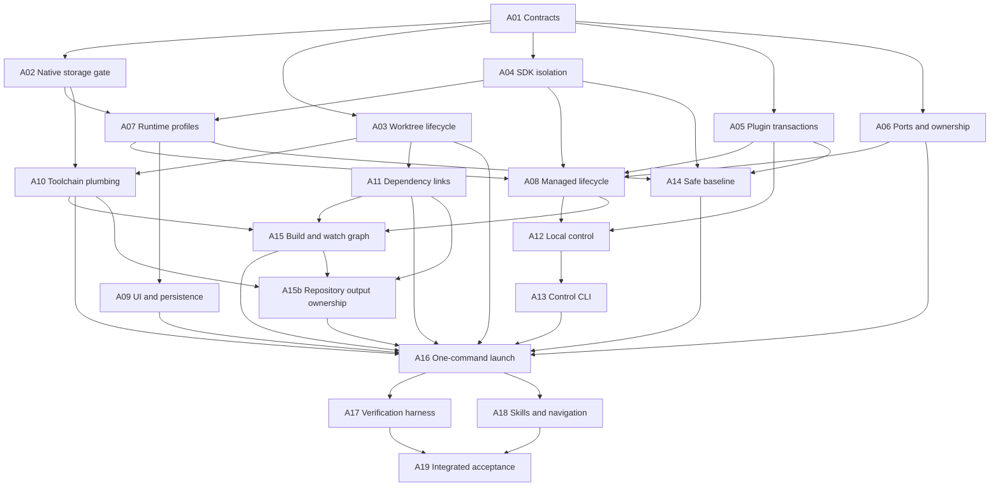

# Agentic Development Workspaces Implementation Plan

> **For agentic workers:** REQUIRED SUB-SKILL: Use superpowers:subagent-driven-development (recommended) or superpowers:executing-plans to implement this plan task-by-task. Steps use checkbox (`- [ ]`) syntax for tracking.

**Goal:** One-command feature workspaces spanning selected repositories and multiple plugins, with identifiable isolated Omniview instances and reliable agent/browser verification.

**Architecture:** A host-owned `omniview-dev` CLI resolves a versioned workspace manifest, creates feature worktrees, applies local dependency overrides, and supervises an isolated profile. A dev-only authenticated local control adapter delegates plugin/settings operations to the host's existing managers. Browser server mode and native MCP are distinct verification surfaces.

**Tech Stack:** Go 1.26; Wails/CLI/frontend runtime 3.0.0-beta.29; Task; repository-pinned pnpm 10.x; Vite 8; React 19; existing bbolt settings and go-plugin RPC; Playwright.

**Spec:** [Discovery, evidence, and proposed design](../specs/2026-10-17-agentic-workspaces-discovery.md).

**Status:** Proposed implementation work packets for review. No product implementation or skills were installed by discovery. Commands shown below are future acceptance contracts unless explicitly identified as existing. Packet A02 and A11 include hard feasibility gates; their outcomes must be integrated before launch promises are made.

## Global Constraints

- Production default state remains `~/.omniview`; packaged nightly default remains `~/.omniview-nightly`.
- Never use `version.IsDevelopment()`, frontend `import.meta.env.DEV`, or the Wails `production` optimization tag alone as profile identity. Packaged nightly and optimized development-profile builds exist.
- Every profile retains a canonical-root flock. Distinct development profiles coexist; duplicate same-profile launch fails safely. Production uses channel-scoped application singleton semantics, independent of dev profiles.
- New profile roots are outside production: `~/.omniview-dev/profiles/<workspaceUUID>/{state,runtime,webview}`. Respect an explicit validated custom root; reject inconsistent manifest/environment selections and overlapping roots.
- No production fallback from local CLI commands. No reads of actual user-state contents in tests. Use temporary HOME/profile fixtures and dedicated test clusters.
- `GOWORK=off` for every Go command/subprocess, including tidy, bindings, plugin builds, task wrappers, and verification.
- Generate bindings only with `task bindings`; one integration owner owns generated outputs. Never invoke raw Wails binding generation manually.
- Preserve separate pnpm workspaces and their declared packageManager versions. No global package links, ambient parent go.work, or machine-specific checked-in absolute paths.
- Keep host/plugin shared-dependency lists synchronized. Do not reintroduce MUI/Emotion/legacy UI or create compatibility shims.
- Build runtime before Vite-plugin shim generation. Preserve runtime subpaths, declarations, CSS exports, host CSS layer ownership, and React/runtime singleton identity.
- Plugins are keyed by plugin ID within an instance. Different plugin IDs coexist; same ID with different source/version requires another instance.
- Local state isolation is not credential/process/remote-resource sandboxing. Never silently replace HOME or auto-connect imported cluster sessions.
- Source registry and existing clones/worktrees remain intact. No force checkout/reset/clean or force removal of dirty/foreign worktrees.
- JSON stdout; logs stderr; versioned errors and stable exit codes. Tokens/secret settings never appear in normal inspect/log output.
- Each subagent owns the files listed in its packet; shared edits have one owner. Skip builds/lints/tests/formatters while parallel edits are in flight; the integration owner runs the relevant verification once at the wave barrier. No bindings races.
- Tests assert consumer-visible invariants/transitions/errors, not source strings/wiring/default copies. Use smoke probes for obvious forwarding. Each implemented packet updates relevant operational docs in the same change.

---

## 1. Design decisions to approve

1. **CLI location:** host `cmd/omniview-dev`, not the marketplace CLI. Avoid mandatory additional clone/authentication. Existing standalone plugin runner workflow converges on the host's managed lifecycle rather than continuing status-only external attachment.
2. **Source layout:** `<root>/workspaces/<slug>/<repo-directory>`; registry supports regular or bare Git sources without relocating existing checkouts.
3. **Identity:** immutable workspace UUID; editable display name/slug; profile ID independent of branch names. Slug is 1–48 lowercase ASCII letters/digits with interior single hyphens.
4. **Linking:** reversible worktree-local pnpm overrides and Go replacements, no global links or super-workspace. Path-link vs file materialization is settled by A11's pinned-version live-dist/peer gate before its implementation is accepted.
5. **Baselines:** offline consistent source initially; safe preferences/install manifest, not recursive state copying. Live main-instance cloning is not promised.
6. **Ports:** sticky assignments plus authoritative discovery; explicit strict/pinned mode. Hashing alone is not collision avoidance.
7. **Native storage:** separately identified packaged apps and supported webview data isolation, proved in A02/A09. Do not declare success based only on different app names.

## 2. File ownership / module map

Paths in the host are relative to `omniview/`; sibling paths are relative to the configured repository root. New paths below are planned, not existing files discovered in research.

| Owner | Files/module | Responsibility |
| --- | --- | --- |
| A01 | New `internal/devcontract/{workspace,instance,control}.go`, contract validation tests; initial CLI dispatch contract | Shared wire/manifest identity, parsers, errors; no native dependencies |
| A02 | Native feasibility artifacts documented in spec; platform probe changes only if needed | Establish supported storage mechanism before persistent UI work |
| A03 | New `internal/devworkspace/{registry,manifest,worktrees,lifecycle,journal}.go`; `cmd/omniview-dev/workspace.go` | Registered Git sources, owned worktrees and manifest lifecycle |
| A04 | SDK `pkg/utils/store.go`, `pkg/sdk/devinfo.go`, `pkg/sdk/plugin.go`, `pkg/config`/lifecycle info where isolation provenance belongs | Root propagation contract and fixed-SDK capability |
| A05 | Host `backend/pkg/plugin/installer.go`, `service_wrapper.go`, state/install operation types; settings wrappers only as necessary | Noninteractive plugin transactions and caller-owned archive semantics |
| A06 | New `internal/devsession/{leases,processes,discovery}.go` | Cross-workspace ports, generations, ownership-safe process control |
| A07 | New `internal/instance`; existing `internal/appstate`, `main.go`, `app.go`, `backend/pkg/plugin/loader.go` environment injection | Runtime identity/root selection, singleton policy, authoritative descriptor |
| A08 | `backend/pkg/plugin/devserver`, loader attachment/readiness callsites after A07; existing runner removal/migration | One managed plugin lifecycle, accurate readiness, dependency watching contract |
| A09 | `ui/layouts/core/main/Header`, footer dev chip, theme/localStorage owners, `index.html`; profile-aware frontend bootstrap | Mandatory visible identity and browser persistence isolation |
| A10 | `Taskfile.yml`, `build/{Taskfile,config}`, platform Taskfiles/plists, dev/release tag policy; Kubernetes Makefile/typecheck/cluster config | Deterministic toolchain and build/launch plumbing |
| A11 | New `internal/devworkspace/links.go`; selected-worktree pnpm/go overrides; dependency diagnostics | Local JS/Go linking and reversible generated changes |
| A12 | New `internal/devcontrol/{server,dispatch,auth}.go`; narrow startup integration handoff | Authenticated local adapter, not duplicated business logic |
| A13 | `cmd/omniview-dev/{instance,plugin,settings}.go` | Scriptable client commands and wait/error/redaction handling |
| A14 | New `internal/devbaseline`; store read-only export helpers; baseline CLI command | Consistent, sanitized source snapshot/import |
| A15 | New `internal/devworkspace/{buildgraph,watch}.go`; UI build-watch scripts/config | Ordered bootstrap and change propagation |
| A15b | Repository producer output journal, staged JS/binding/shim/worker publication, controlled install/cache writers | Safe ownership and restoration before worktree removal |
| A16 | New `internal/devworkspace/{launch,status}.go`; CLI main integration and Task wrappers via A10 interface | One-command orchestration, restart/stop, actual endpoints |
| A17 | `e2e/playwright.config.ts`, fixtures/scenarios, dev verification command/native MCP integration | Identity-checked disposable verification |
| A18 | `.agents/skills`, `docs/development-workspaces.md`, repo map/reference files, registration task | Agent entry points and concise navigation |
| A19 | Integration owner, existing test/CI locations and acceptance evidence | Full concurrency/platform matrix and handoff |

Exported changes require language-server references before edits. Inspect existing operation/state types before creating duplicates; the wire shapes below are canonical, not a demand to add a second internal operation framework.

## 3. Shared interfaces to freeze in A01

### 3.1 Manifest shape

Portable `workspace.json` v1 records intent. `resolved` machine paths and runtime secrets belong in `.local`/profile runtime, not this manifest.

```json
{
  "schemaVersion": 1,
  "workspaceID": "f14566c4-5130-4e3f-aa09-3e49c63b29a6",
  "slug": "resource-graph",
  "displayName": "Resource graph",
  "repositories": [
    {"id": "omniview", "directory": "omniview", "baseRef": "main", "baseCommit": "22e8241a8692b45c496b24aac3a6fb128933cb0e", "branch": "feature/resource-graph-f14566c4"}
  ],
  "plugins": [],
  "links": {"uiRepositoryID": null, "sdkRepositoryID": null, "hostPackages": true},
  "profile": {"kind": "development", "baseline": null},
  "ports": {"policy": "sticky", "overrides": {}}
}
```

This host-only schema example uses the host commit observed during discovery; creation resolves each selected repository's requested ref independently. Additional repo records use the same fields; selecting UI/SDK fills their link IDs, and selecting plugins adds metadata-validated plugin records. Plugin selection is repeatable. UI-only/backend-only plugins do not acquire nonexistent listeners. Package/module mappings resolve from registered manifests, not assumed repository URL names.

### 3.2 Runtime descriptor

`InstanceDescriptor` fields: `schemaVersion`, `workspaceID`, `instanceID` (stable profile identity), `generation` (new for every host launch), `kind`, `channel`, `displayName`, canonical `stateRoot`, host process identity, build version/commit, resolved repo paths/refs/commits, actual `endpoints`, plugin states, readiness, and last structured error.

- `kind`: `production | development`; channel separately `stable | nightly | local`.
- Host process identity: PID, start identity, executable, owner workspace/profile; numeric PID alone is insufficient.
- Endpoints: server/browser URL, Vite URL/HMR URL, native MCP URL, control URL, health URL when applicable. Null/not-applicable is different from not-ready.
- Plugin state: ID/version/source, generation, `mode`, `buildStatus`, `viteStatus`, `rpcStatus`, `controllerStatus`, current operation ID and last error. Readiness is computed from required capabilities.
- `AppService.GetInstanceInfo()` returns a frontend-safe view. Auth token values are never included. Full local discovery has `tokenFile`, not token content, and is private.
- The pre-React identity payload contains only schema/profile ID/display name/kind. It is safely JSON-encoded by the authoritative backend, available before cached theme reads, and agrees with the later descriptor.

### 3.3 Local control envelope

```json
{
  "protocolVersion": 1,
  "requestID": "client-generated-id",
  "workspaceID": "f14566c4-5130-4e3f-aa09-3e49c63b29a6",
  "generation": "current-host-generation",
  "operation": "plugin.dev.link",
  "params": {"path": "/resolved/feature/plugin"}
}
```

Response fields: `protocolVersion`, `requestID`, `workspaceID`, `generation`, `operationID`, `status`, `result`, `error`. Status: `accepted | running | succeeded | failed | cancelled`. Error: `code`, safe `message`, structured nonsecret details. `operation.get` and `operation.wait` refer to the returned operation ID; a wait timeout does not silently cancel an already accepted mutation.

Operation allowlist: instance inspect; installed plugin list/get/install-archive/install-version/uninstall; dev link/unlink/start/stop/restart/rebuild/status/logs; host/plugin settings schema/get/set/bulk; operation get/wait. Use existing manager/provider types internally. No arbitrary method-name, shell, filesystem, or Go-call execution endpoint.

Exit codes: 0 success; 2 usage/invalid request; 3 target missing/ambiguous; 4 ownership/state/port conflict; 5 dependency/compatibility/build/readiness failure; 6 unauthorized; 7 timeout. A cancelled user operation reports its explicit status, not success.

### 3.4 Future command grammar

```text
omniview-dev workspace init --root PATH
omniview-dev workspace create NAME [--repo ID]... [--plugin ID]... [--ref ID=REF]... [--baseline SOURCE] [--start desktop|browser]
omniview-dev workspace list --json
omniview-dev workspace inspect|paths NAME --json
omniview-dev workspace edit NAME [--display-name TEXT] [--add-repo ID] [--remove-repo ID] [--add-plugin ID] [--remove-plugin ID] [--ref ID=REF]...
omniview-dev workspace link|unlink NAME
omniview-dev workspace up NAME --mode desktop|browser [--mcp] [--strict-ports] [--json]
omniview-dev workspace down|remove NAME
omniview-dev instance inspect --workspace NAME --json
omniview-dev plugin list|inspect|install|uninstall|link|unlink|start|stop|restart|rebuild|status|logs --workspace NAME ...
omniview-dev settings schema|get|set|set-many --workspace NAME [--plugin ID] ...
```

Clarifications: `workspace list` takes no NAME. `inspect/paths` require NAME or enclosing context. `workspace init` uses explicit registered-source mappings where default clone layout is not unambiguous. `workspace remove` retains state and branches unless explicit separate purge/delete flags are supplied. `settings set-many` accepts JSON via stdin/file; logs and inspect redact by default.

## 4. Dependency graph and dispatch policy



Dispatch all newly unblocked independent packets together; do not wait for a whole artificial phase when prerequisites are already merged. A01 is a real serial prerequisite. Then A02/A03/A04/A05/A06 are five independent investigations/implementation slices. A10 and A11 become independent as their prerequisites finish; A09 and A14 can run while A08 proceeds. A17 and A18 are parallel after A16. No pair edits the same shared file concurrently.

Integration owner owns CLI root wiring, `main.go` cross-cutting startup changes after A07, Taskfile root integration after A10, generated bindings/runtime bundle/shims, final docs consistency and all running applications. Child branches publish narrow APIs/patches to that owner instead of racing shared wiring. Any API/schema deviation must update A01 before downstream dispatch.

---

## A01 — Freeze contracts and target resolution

**Dependencies:** none. **Owner:** host contract/CLI foundation. **Files:** new `internal/devcontract`, CLI root dispatch/flag parsing; new fixture manifests and relevant developer documentation.

**Consumes:** discovery §3–11. **Produces:** v1 manifest/descriptor/control types above; validation and explicit workspace-context resolution; stable error/exit mapping. Define `OMNIVIEW_WORKSPACE_FILE` as the absolute manifest selector passed to child apps. `OMNIVIEW_STATE_DIR` names the canonical `stateRoot` (`<profileRoot>/state`), never the profile container. Host startup and child processes consume the same resolved descriptor and reject disagreement; runtime and webview paths derive from that profile container, not by appending children to `stateRoot`. Default profile storage and explicit custom binding follow discovery §8 and the current [operational guide](../../development-workspaces.md#settings-baseline-and-custom-state-roots).

- [ ] Encode portable intent separately from local resolved paths/runtime secrets. Enforce UUID, slug, repo uniqueness, plugin-ID uniqueness, path containment and schema-version handling.
- [ ] Resolve explicit `--workspace` first, enclosing manifest second; missing/ambiguous context fails. Do not discover a human production app as a fallback.
- [ ] Register commands against one root parser; leave no accepted no-op/stub commands. Add only working contract/inspect functions in this packet; later packets register actual operations.
- [ ] Publish exact package/API names and JSON fixtures for downstream agents; record repository IDs separately from package/module/plugin IDs.
- [ ] Add behavioral tests: two nested/ambiguous manifests, invalid/nested paths, unsupported versions, duplicate plugin IDs, conflicting env/manifest roots, and secret-free descriptor projection.

**Check:** CLI resolves a synthetic enclosing workspace and reports its ID; same command outside a workspace exits 3, never reports production. Parsing tests exercise valid/invalid user input, not roundtrip-only copies. Contract review is the dispatch gate.

## A02 — Prove native storage and platform identity mechanism

**Dependencies:** A01. **Owner:** native platform specialist. **Files:** inspected Wails options/platform build configuration; isolated probe artifacts and evidence in discovery; upstream Wails patch/pin only if required to meet supported-platform isolation.

**Consumes:** runtime identity schema. **Produces:** exact macOS bundle/data-store, Windows user-data directory and Linux webview identity/storage mechanisms consumed by A07/A09/A10; recorded OS support constraints.

- [ ] Create two throwaway packaged macOS apps from owned temporary paths, each with distinct bundle identifier/display name and temporary state. Do not use production profiles.
- [ ] Exercise actual localStorage/cookies/cache persistence in A/B across restart and compare with a disposable production-like third app. A unique visible name is not proof of unique storage.
- [ ] Confirm Windows `WebviewUserDataPath` routing and Linux data-store behavior on available platform runners. Document platform evidence separately; macOS success is not a claim about other systems.
- [ ] If bundle identity is insufficient, implement/pin supported Wails data-store configuration before accepting the packet. Do not silently fall back to shared storage or claim ephemeral storage preserves persistent UI preferences.
- [ ] Test native MCP against the selected build path and record that DOM snapshots are not pixels. Obtain platform screenshot method for native chrome verification.

**Check:** setting a marker/cache in A cannot be read from B/third app, and survives A's restart as designed. Clean all probe markers/bundles. Native storage support is a **hard gate**, not an optional improvement. Unsupported runner access is reported as missing platform evidence and blocks that platform's release claim.

## A03 — Registered repositories and safe worktree lifecycle

**Dependencies:** A01. **Owner:** workspace filesystem. **Files:** `internal/devworkspace/{registry,manifest,worktrees,lifecycle,journal}.go`, CLI workspace command file.

**Consumes:** manifest/context contract. **Produces:** init/create/list/inspect/paths/edit/remove over real owned worktrees; portable manifests and local Git ownership journal.

- [ ] Initialize source registry with explicit source Git/common-dir + working-tree mappings. Recognize UI `.bare`/`main`; reject ambiguous duplicate historical clones rather than guessing.
- [ ] Implement create under `<root>/workspaces/<slug>`; include host, repeatable selected repos/plugins, explicit per-repo refs, pinned base commits and unique feature branches. Resolve plugin IDs from `plugin.yaml`.
- [ ] Implement idempotent resume after partial creation. Journal owned resources before advancing; rollback only newly created unmodified resources.
- [ ] Implement inspect/paths/list and edit selection/display name. Ref changes that require checkout must reject dirty worktrees. Preserve UUID/profile across rename.
- [ ] Implement removal of stopped owned clean worktrees. Preserve state/branches by default; explicit purge/delete options apply only to proven owned resources and cannot silently delete user commits.
- [ ] Test temporary normal/bare Git repositories, occupied branches, same-origin duplicate sources, paths with spaces, two concurrent features, interrupted create, dirty and foreign worktrees.

**Check:** two features select the same source repos and receive independent worktrees; remove one without changing the other's Git state or canonical directories. Source registry is machine-local and contains no credentials. `create --start` is wired later in A16, not exposed as working prematurely.

## A04 — SDK state-root isolation and artifact provenance

**Dependencies:** A01. **Owner:** SDK. **Files:** SDK store/devinfo/plugin startup and lifecycle/config metadata; SDK tests and docs.

**Consumes:** canonical root env and isolation contract. **Produces:** all SDK-owned state/discovery paths honor `OMNIVIEW_STATE_DIR`, validated root semantics, and an inspectable fixed-SDK isolation capability/provenance for newly built plugins.

- [ ] Introduce one SDK root resolver and migrate store lookup/create/read/delete plus discovery/write/remove paths. Preserve production default only for non-workspace launches; workspace context with missing/conflicting root fails.
- [ ] Validate plugin IDs and reject traversal/overlap/symlink escapes relevant to owned paths; keep public root behavior consistent for all callers.
- [ ] Make discovery creation/removal owner/generation-aware while it still exists; coordinate later managed-runner cutover so obsolete discovery writers are removed, not retained as shims.
- [ ] Record isolation support in SDK lifecycle/build provenance. Artifact compatibility must be established before a legacy binary is allowed to write state; do not start an unknown binary merely to discover after the fact that it is unsafe.
- [ ] Test root selected by env and explicit host launch; sentinel production path untouched through store/devinfo operations and cleanup; wrong-owner generation cannot remove current files.

**Check:** a real throwaway plugin built from this SDK writes only A's selected store while real HOME is unchanged; B's same plugin ID remains independent. Publish the source revision/digest used. Current published marketplace binaries remain unverified until rebuilt/verified, not magically fixed.

## A05 — Noninteractive, transactional plugin operations

**Dependencies:** A01. **Owner:** plugin manager APIs. **Files:** `backend/pkg/plugin/installer.go`, `service_wrapper.go`, installation/state helpers; relevant existing manager/settings tests.

**Consumes:** target/operation/error contract. **Produces:** noninteractive dev-path install/rebind/unlink and installed-plugin operations callable from UI and control adapter; explicit archive ownership; settings operations remain provider-backed.

- [ ] Extract directory-dialog-free `InstallDevPluginFromPath` from current installer; native dialog delegates to it. Preserve build-error pending state honestly instead of returning an apparently successful ready result.
- [ ] Implement explicit rebind of same plugin ID to a different source. Stop/unload prior resources in order; do not accept manager's existing-ID fast path as success for a new path.
- [ ] Distinguish persistent user archive input from caller-owned temporary downloads. Never delete a user-supplied archive on install/error; download callers retain explicit cleanup responsibility.
- [ ] Expose list/get/install-version/uninstall and required lifecycle operations without native dialogs. Use current plugin records/reconciler/persistence, not CLI filesystem writes.
- [ ] Preserve host/plugin settings validation, schema, hooks and persistence. Define safe redaction using Sensitive metadata; unknown-schema plugin values are hidden by default.
- [ ] Add regression coverage: relink A→B source changes, failed build/reload state, persistent archive survival, installed ID conflict, setting validation/secret redaction.

**Check:** a local source path installs without dialog; rebind is visible in DevPath/process state; failed operations have terminal error status and recoverable state. UI and CLI share one transaction. Generated bindings are deferred to integration owner.

## A06 — Sticky ports, process generations and discovery ownership

**Dependencies:** A01. **Owner:** session primitives. **Files:** new `internal/devsession`; lease/discovery fixture tests. Existing backend callers migrate in A08.

**Consumes:** IDs/roles/descriptor. **Produces:** lease allocation/release, strict binding policy, process ownership verification, atomic private discovery publication.

- [ ] Implement locked root registry keyed by workspace UUID/service/plugin ID. Sticky preferred allocation in 20000–44999 by default; configurable range and explicit overrides.
- [ ] Preserve assignments when plugin selection order changes or another plugin is added. Occupied preferred port gets a recorded new assignment unless strict/pinned policy requires failure.
- [ ] Handle child-bind races explicitly: verify readiness/identity after strict bind, bounded allocation retry for automatic policy, no hidden increment and no killing unrelated listener.
- [ ] Persist generation, PID/start identity, executable/role/source identity and a generation-owned process-tree containment primitive: a dedicated Unix session/process group or Windows Job Object. Carry containment identity and lifetime through the journal, launch, verification and cleanup; a recycled numeric group/PID alone is not ownership. After reparenting or supervisor crash, recover only where the platform can still verify that containment and its live members; otherwise report uncertain ownership and refuse signals. Test descendants, detached escape/refusal, leader exit and foreign/recycled identifiers; platform support requires actual evidence.
- [ ] Publish descriptor with restrictive permissions and token-file reference. Remove only own generation's discovery. Support platform-appropriate permissions and process identity checks.
- [ ] Test concurrent allocators, stale leases, unrelated occupied port, strict conflicts, reordered plugins, bind race, PID reuse, wrong-generation cleanup and interrupted atomic writes.

**Check:** two concurrent fixture supervisors receive nonconflicting advertised endpoints; stopping A leaves B and a foreign listener alive. Explain that lease registry is not an OS socket reservation. Never copy these files into a baseline.

## A07 — Runtime profiles, singleton and root propagation

**Dependencies:** A01, A02, A04. **Owner:** host startup. **Files:** `internal/instance`, `internal/appstate`, `main.go`, `app.go`, loader child environment; profile tests.

**Consumes:** manifest/identity, storage mechanism, SDK resolver. **Produces:** resolved immutable InstanceDescriptor, safe state root, `AppService.GetInstanceInfo()`, frontend boot identity, explicit resolved child root.

- [ ] Resolve channel/profile before opening state. Preserve stable/nightly roots; workspace local mode cannot default to either. Canonicalize aliases and reject root conflicts/nesting; validate WithRoot consistently.
- [ ] Retain flock for every profile. Configure production channel singleton with Wails SingleInstanceOptions; dev instances use distinct IDs or no global singleton while retaining per-profile flock. Duplicate handling must not start plugin/settings operations against another profile.
- [ ] Account for current startup ordering: root contention happens before Wails application.New. Do not promise focus/activation on duplicate root unless startup is deliberately reordered and checked. Reordering can use RegisterService before Run, but preserve controller-before-bootstrap service order and asset middleware initialization.
- [ ] Apply A02's native storage/profile settings and profile-local diagnostics/temp/startup report configuration. Runtime descriptor is authoritative, not frontend environment flags.
- [ ] Inject resolved absolute state root and workspace/generation identity into all plugin processes, even when the host root was selected by ldflags/programmatic config. Add compatibility gate for unsupported installed binaries before auto-start.
- [ ] Provide safely encoded boot identity before theme storage access. Expose safe descriptor through AppService; never token contents.
- [ ] Test production/nightly/local classification, two names, duplicate root, canonical aliases, conflicting env, protected production nesting and legacy-plugin rejection. Run process smoke with disposable roots.

**Check:** production-like channel + A + B coexist; duplicate profile/channel launch is rejected without plugin effects. Root locking is never disabled as a workaround. Main.go is handed back to integration owner before A12/A16 wiring.

## A08 — One managed plugin lifecycle with truthful readiness

**Dependencies:** A04, A05, A06, A07. **Owner:** plugin runtime. **Files:** `backend/pkg/plugin/devserver`, loader RPC/lifecycle status integration; runner and external-discovery callsites/docs across host/SDK.

**Consumes:** transactions, resolved root/env, ownership/port primitives. **Produces:** managed per-plugin lifecycle for workspace use, real readiness/operation completion, thin-client migration contract replacing standalone process management.

- [ ] Integrate session leases into managed Vite; propagate strict HTTP/HMR endpoints and selected module/source paths. Remove unsafe stale numeric PID cleanup in migrated paths.
- [ ] Set ready only after capability-required Vite HTTP reachability, actual connected lifecycle RPC, and initialized host controllers. A successful compilation alone is not gRPC connection. UI-only/backend-only fields are not-applicable where appropriate.
- [ ] Resolve Go/pnpm/node from explicit validated toolchain config or PATH; workspace setup must not require GUI entry of developer paths.
- [ ] Make stop/restart/rebuild/rebind operations generation-aware and complete with structured results. Build/reload/Vite/RPC failures remain observable and recoverable.
- [ ] Migrate standalone runner usage to canonical host control via the eventual client command contract. Remove obsolete independent handshake supervision/status-only external attachment and duplicate SDK/runner .devinfo writers once callers are migrated; no preserved false-connected path. Coordinate client implementation with A13 before deleting the old executable entry point.
- [ ] Expose resolved watched Go dependency directories and rebuild hooks to A15, covering SDK folders beyond pkg. Do not add an independent second watcher for the same plugin process.
- [ ] Extend existing lifecycle tests for wrong source fast path, Vite unavailable, RPC unavailable, wrong ID/protocol, controller init failure, build error/recovery, crash/restart and wrong-generation cleanup.

**Check:** real plugin answers capability/health RPC before ready. A dead PID or advertised positive Vite port cannot report ready. Migration removal is finalized with A13; until then old entry points must not be advertised as a safe workspace launch path. Do not claim implementing generic remote Reattach is required for the selected managed architecture.

## A09 — Visible instance identity and frontend persistence

**Dependencies:** A02, A07. **Owner:** frontend identity. **Files:** Header, footer chip, runtime identity hook/context, localStorage owners/theme bootstrap/index.html.

**Consumes:** boot identity/GetInstanceInfo and native store mechanism. **Produces:** `DEV · <displayName>` always-visible indicator, distinguishable title, per-profile browser state, details view with nonsecret repo/state/endpoint information.

- [ ] Replace generic DEV-only chip with runtime identity. Keep an accessible mandatory region outside hideable user header areas and exclude it from drag/double-click maximize behavior as appropriate.
- [ ] Set native/browser document title consistently; native bundle display identity comes from A10. Color may aid recognition but text is required; production is not branded as a workspace.
- [ ] Namespace all app-owned storage, including pre-React theme hints, homepage cards, drawer geometry and table preferences. Do not migrate unscoped production values into every development profile implicitly.
- [ ] Verify native/browser storage directories as well as key names. Persist selected preferences through the correct profile across restart, including first paint.
- [ ] Keep repository/path details available without requiring a long path permanently in the header; no secret settings/token display.

**Check:** A/B can set different themes/cards/drawer/table preferences and restart independently. Indicator remains visible with header areas hidden and optimized frontend build. Browser screenshot plus native chrome observation required; DOM/source assertions alone are insufficient.

## A10 — Deterministic build plumbing and safe task entry points

**Dependencies:** A01, A02, A03. **Owner:** toolchain/build config. **Files:** host root/common/platform Taskfiles, build config/plists; Kubernetes Makefile/UI scripts/hack config; UI optional devtools configuration.

**Consumes:** profile/native identity and source registry. **Produces:** task build/tag/env plumbing, workspace-aware native bundles, no startup dependency upgrades, configurable auxiliaries.

- [ ] Make UI registry updates explicit; remove automatic ui:update from normal dev startup. Keep documented maintenance target for intentional package upgrades.
- [ ] Enforce GOWORK=off in every Go task/subprocess. Compose EXTRA_TAGS without losing production/server/mcp/devcontrol tags and forward matching flags to Taskfile binding generation. Test actual task-based MCP build, not only a direct go build.
- [ ] Compile dev control only with an explicit development tooling tag. Stable/nightly release workflows must not inherit mcp/devcontrol through ambient developer environment. Keep channel metadata independent of build optimization and nightly telemetry flags.
- [ ] Generate workspace-specific dev bundle identifier/name using A02's proven strategy; do not mutate the production plist. Keep output/bin/cache locations inside selected feature checkout/profile.
- [ ] Add wrappers building/running the host-owned CLI; A16 supplies final command orchestration. Root wrapper wiring has one owner. Preserve task bindings as sole generator entry point.
- [ ] Parameterize Kubernetes install root, use resolved state env, and prevent direct production install from workspace tasks. Make typecheck fail on errors before Vite build. Parameterize kind name/kubeconfig/80+443 ingress and Storybook ports when those optional tools are requested.
- [ ] Make React DevTools script opt-in/configurable instead of unconditional localhost:8097. Do not require optional tooling for application readiness.

**Check:** dry run and actual isolated task build include requested mcp tag; a production release build excludes control/MCP routes. No pnpm update/lock upgrade at launch. Kubernetes workspace install resolves only its target profile. Platform commands quote paths with spaces. Update README/plugin-development commands.

## A11 — Reversible local package and Go linking

**Dependencies:** A03. **Owner:** dependency resolution. **Files:** `internal/devworkspace/links.go`, diagnostics; fixture manifests; only owned feature-worktree overrides during use.

**Consumes:** selected source/package/module map and journal. **Produces:** link/unlink plus inspectable effective resolution for every selected consumer.

- [ ] Probe pinned pnpm 10.34.7/10.6.2 using disposable copies/fixtures. Establish path-link override behavior for dist JS/CSS/declarations, UI workspace peers and host/plugin consumers. Test atomic dist-file replacement, not just in-place writes. Choose one protocol and document evidence; do not equate link creation with live consumption.
- [ ] Apply explicit overrides for base-ui/ai-ui/editors to host, host runtime package dependencies and selected plugin frontends. Map runtime/providers/Vite-plugin packages and all runtime subpaths as needed without flattening workspaces.
- [ ] Verify effective React/runtime identity and host CSS cascade. If path links cannot satisfy peers/live outputs, resolve that gate with an explicit file/materialization strategy before accepting the packet; never suppress peer/duplicate-instance errors.
- [ ] Apply worktree-local SDK replace to host and every selected Go plugin consumer. Preserve existing user replacements or report conflict. Inspect with `GOWORK=off go list -m -json github.com/omniviewdev/plugin-sdk` from each consumer.
- [ ] Record original/applied file content and tool-owned edits for pnpm config/lockfiles and Go mod/sum. On unlink, restore only tool-owned unchanged changes; conflict rather than overwriting user edits. Canonical source repos are not edited.
- [ ] Report resolved paths/versions/module replacements and incompatibilities. Do not accept older sibling version numbers as proof a published range consumed local changes.

**Check:** inspect resolves every selected consumer to its feature paths, not main/registry; re-link is idempotent; unlink restores owned changes and preserves subsequent user edits. A different root with spaces works. Local SDK compatibility is exercised in A15, not assumed here.

## A12 — Authenticated development control service

**Dependencies:** A05, A07, A08. **Owner:** local control adapter. **Files:** `internal/devcontrol`; integration owner adds startup registration without concurrent main.go edits.

**Consumes:** existing manager/provider operations and actual lifecycle status. **Produces:** narrow v1 loopback control protocol, operation wait/get, private token/discovery, strict instance-generation targeting.

- [ ] Bind loopback only; use an OS-assigned control port and per-generation high-entropy bearer token. Validate host/origin and require auth on reads and mutations; no wildcard CORS/unauthenticated local browser trust.
- [ ] Decode only allowlisted operations and typed params, preserving existing business validation/errors. Check workspace ID/generation before any state mutation.
- [ ] Route plugin/dev/settings operations to existing managers/providers. Long operations have IDs and real completion semantics, cancellation only when supported, and bounded log reads.
- [ ] Redact sensitive/unknown values and auth headers/errors. Store token privately, return token-file location in local discovery, and never print it in ordinary JSON/logs.
- [ ] Ensure host lifecycle stops listener and removes only own discovery. Compile-time disabled path exposes no endpoint in production release.
- [ ] Test unauthorized reads/mutations, hostile origins/Host, stale generation, unknown operation, malformed input, timeouts during accepted mutation and shutdown ownership.

**Check:** a real client round-trip changes a validated nonsecret temporary setting and reads persisted result; wrong generation/token cannot mutate. Avoid a permanent mock echo/wiring test as evidence of backend behavior.

## A13 — Instance/plugin/settings CLI and runner cutover

**Dependencies:** A12; A08 coordinates final obsolete-runner removal here. **Owner:** local CLI client.

**Consumes:** discovery/control protocol. **Produces:** working instance/plugin/settings command groups, noninteractive JSON and wait behavior, replacement for standalone plugin runner.

- [ ] Implement explicit target resolution; validate descriptor identity and liveness rather than trusting an open /health port. Never choose production implicitly.
- [ ] Implement installed plugin list/get/install-version/install-archive/uninstall, dev link/unlink/start/stop/restart/rebuild/status/logs with path flags and structured results.
- [ ] Implement host/plugin settings schema/get/set/set-many via existing providers. Type values from JSON/stdin, redact sensitive values by default, and make any explicit sensitive access deliberate and nonlogging.
- [ ] Implement wait/timeout, stable exit codes, stderr diagnostics and JSON-only stdout. Support machine-readable partial operation status on timeout.
- [ ] Migrate documented standalone `omniview-plugin-dev` workflows/callers to the client commands and remove superseded nested runner module/process implementation and status-only external paths. Do not ship a second build supervisor or obsolete alias/shim.
- [ ] Keep marketplace CLI auth/profile/plugin list semantics unchanged. Add deterministic CLI integration scenarios for wrong target, failed build/recovery, settings validation, multi-plugin addressing and archive preservation.

**Check:** CLI manages two different plugins in one disposable instance with no dialog and no marketplace login. Same plugin ID is rejected twice in one target but works in another instance. All advertised commands operate; no placeholder commands.

## A14 — Safe baseline export/import

**Dependencies:** A04, A05, A07. **Owner:** state snapshot/import. **Files:** `internal/devbaseline`; settings read-only helper; baseline command.

**Consumes:** profile validation, compatibility/install transactions, root lock. **Produces:** offline baseline snapshot/import and install manifest, stage/finalize transaction and nonsecret provenance.

- [ ] Require stopped source and acquire its flock; reject live source rather than opening/copying live bbolt. Use read-only bbolt access, not current writable recovery Open. Legacy migration occurs on private staged copy only.
- [ ] Export explicit allowlisted preferences and plugin IDs/versions. Exclude telemetry auth/enablement, credentials, connections/autoconnect, sessions, unknown plugin values/data, live dev paths and browser/native stores.
- [ ] Reject symlinks and overlapping/aliased roots. Exclude runtime/PID/devinfo/token/cache/log/lock files unconditionally. Independent destination files, never source-state hardlinks.
- [ ] Import into new stopped development destination under private staging; validate then atomic finalize. Record exclusions/source identifier/version without settings secrets.
- [ ] Restore installs through canonical operations/verified artifacts; keep unsupported binaries inactive, selected dev sources map only to destination feature worktrees. No auto-start before isolation compatibility gate.
- [ ] Test source bytes unchanged, busy source, corrupt DB, staged crash, malicious symlink, PID/PGID files, copied dev paths, secret exclusion, source/destination aliases, plugin incompatibility and successful independent settings use.

**Check:** seed A from disposable production-like fixture; A gets chosen preferences/install inventory but no live process records/credentials or source worktree linkage. Starting A cannot kill fixture source/sibling processes. User command explains source must be stopped; no claim of live cloning.

## A15 — Build order, local compatibility and watch propagation

**Dependencies:** A08, A10, A11. **Owner:** build/watch graph; managed plugin watcher integration via its published hooks. **Files:** `internal/devworkspace/{buildgraph,watch}.go`, UI build-watch scripts; selected plugin build compatibility fixes.

**Consumes:** effective linked paths/toolchain, capability-aware plugin manager and resolved module graph. **Produces:** bootstrap/watch graph that makes real edits visible without registry publication.

- [ ] Install each selected JS root with its declared pnpm version. Validate dependency/bootstrap errors explicitly; do not hide them behind successful Vite exit.
- [ ] Build base-ui → ai-ui/editors, providers/runtime → Vite-plugin shims, then selected plugin UI/backends and host. Parallelize unrelated nodes only; no simultaneous writers to runtime bindings/shims/dist outputs.
- [ ] Run isolated local-SDK builds of host and all selected plugins, including Kubernetes. Fix real API compatibility errors caused by supported SDK selection within these callers; do not assume v0.4/v0.5 compatibility or bypass errors.
- [ ] Watch UI library source to dist, host package exports to runtime/shims, and resolved SDK dependency directories including settings/log/proto. New source directories and module/manifest changes invalidate the graph.
- [ ] Trigger one rebuild/reload per affected plugin through managed hooks. SDK changes affecting host cause owned host rebuild/restart; do not touch fake source stamp files or run competing plugin watchers.
- [ ] Configure Vite allowed filesystem roots/optimizer/HTTP/HMR endpoint from selected workspace. Prove source versus dist consumption and CSS updates; no reliance on fallback WebSocket discovery.
- [ ] Report build/restart completion and errors through operation state so an agent can wait for live feedback.

**Check:** edit a selected UI component/CSS, runtime export and SDK method in disposable worktrees; observe intended host and two selected plugins update/rebuild, while a second workspace remains unchanged. Verify one React/runtime instance. Rebuild recovery after syntax error must return to ready; no false-success typecheck. Remove throwaway probe edits before delivery.

## A15b — Producer-scoped repository output ownership

**Dependencies:** A10, A11, A15 producer conventions; may proceed alongside A16's supervisor implementation against frozen APIs. **Owner:** A15 output journal and producer adapters; A10 Task destination forwarding; A16 actual process/cache writer lifetimes; integration owner canonical removal wiring.

Actual implementation inspection exposed an initial plan gap: ignored dist/node_modules plus tracked generated bindings/shims/worker output were not owned by the workspace generated ledger. Successful builds must not make safe removal impossible, and unknown files must never be broadly adopted or deleted.

- [ ] Implement external UUID-scoped durable private publication/restoration journal, exact selected targets and retained path identity.
- [ ] Stage JS and source-generated outputs, preserve sourcemap depth, compare expected/current HEAD and working bytes before publication; refuse human edits/unknown outputs.
- [ ] Restore current committed generated source and remove only unchanged known generated outputs; preserve user commits and fail closed on foreign replacements or interrupted unknown writers.
- [ ] Account for every pnpm install/reinstall and long-lived Vite/config-loader cache writer, with actual lifetime ownership rather than stale hashes.
- [ ] Keep `task bindings` as sole generator entry with explicit staged output; keep the actual host source separate from prepared native bootstrap output.
- [ ] Wire restoration under stopped lifecycle/profile guards before normal source-clean checks; keep irreversible native removal after every canonical refusal preflight.

**Check:** actual fresh bootstrap/unlink/remove succeeds without broad ignored exemptions; unknown ignored files, edited generated source and replaced directories are refused unchanged; current committed source survives; partial publication/restoration is retryable. Full contract: `.superpowers/sdd/2026-10-17-agentic-workspaces/repository-output-ownership.md`.

## A16 — End-to-end one-command workspace launch

**Dependencies:** A03, A06, A09, A10, A11, A13, A14, A15, A15b. **Owner:** orchestration/integration.

**Consumes:** all lifecycle/link/build/profile/control contracts. **Produces:** create --start, up/down/edit/restart/inspect with authoritative endpoint/generation readiness and Task wrappers.

- [ ] Wire create → link → bootstrap → optional baseline → profile launch → managed plugin setup → readiness. Resume recorded partial operations without resetting user work or starting duplicates.
- [ ] Support desktop and browser modes; native MCP is opt-in authenticated dev tooling. Browser mode uses server URL, not bare Vite URL, with optional FRONTEND_DEVSERVER_URL for hot assets.
- [ ] Pass one profile/root/toolchain/port context to host, plugin builds and optional tools. Resolve final browser/Vite/HMR/MCP/control/RPC addresses from actual ready processes and publish inspect JSON.
- [ ] Stop/restart only owned generations, including process trees. Host or child crash yields truthful status and recoverable up; no registry lease is a license to kill another process.
- [ ] Implement edit add/remove plugin/repo reconfiguration transaction, preserving unaffected assignments/profile/state; enforce duplicate-plugin and dirty-worktree rules.
- [ ] Finish Task wrappers and human-readable startup output: workspace name/ID, source directories, state root, endpoint instructions and readiness. `--json` remains machine-readable.
- [ ] Update operational docs with one-command examples and explicit credential/cluster boundaries. Document production/native/server differences and unsupported plugin reporting.

**Check:** from a fresh registry, one command creates a host+UI+SDK+multi-plugin feature and starts it; inspect supplies an agent-ready endpoint. A second feature starts concurrently; down/remove of one does not affect the other, canonical repos or production-like instance. No manual developer-settings dialogs, global links or guessed ports required.

## A17 — Disposable browser and native verification harness

**Dependencies:** A16. **Owner:** verification tooling. **Files:** e2e config/fixtures/scenarios, instance verification command; CI operational instructions.

**Consumes:** actual descriptor/operation state and orchestrator. **Produces:** verification selects intended instance, clean browser state, real backend round-trips and separate native checks.

- [ ] Replace fixed 34115 baseURL/health assumptions with target descriptor resolution. Never reuse an arbitrary /health listener; compare UUID/generation. Default to an owned disposable server/profile and browser context.
- [ ] Do not let existing restoreSettings/closeTerminals fixtures operate on a human workspace unless explicitly requested. Separate destructive test setup from observational attach checks.
- [ ] Add meaningful scenarios for visible identity, settings isolation, baseline exclusions, two profiles, same plugin ID across profiles and multiple plugin UIs. Use real bindings where proving integration; distinguish mocked UI scenarios.
- [ ] Add browser screenshot/console/network capture, Vite-HMR source-edit scenario and operation wait. Triage observed preview warning/custom.js HEAD/optional DevTools errors instead of suppressing all warnings/failures.
- [ ] Provide native MCP attach from private descriptor/token, require target window and generation, and exercise DOM/input/bound-method/event behavior. Pair native chrome/storage checks with actual pixel capture; screenshot_dom alone is insufficient.
- [ ] Ensure CI cleanup owns process trees and leases and produces artifact paths. Document unsupported native APIs in server mode and macOS/Windows/Linux evidence boundaries.

**Check:** verification refuses wrong endpoint/generation; browser test changes A but not B; native MCP reaches A's actual WebView. CI-owned server cannot collide with a developer's running workspace. Tests and artifacts establish actual user-visible behavior, not source text assertions.

## A18 — Agent skills, concise repo routing and registration

**Dependencies:** A16. **Owner:** agent UX/documentation. **Files:** `.agents/skills/{omniview-repo-map,omniview-workspaces,omniview-instance-verification}/SKILL.md`, focused references/evals, `docs/development-workspaces.md`, supported-client registration task. A19 integrates skill evaluation with A17's completed harness; skill authoring and harness implementation can proceed in parallel.

**Consumes:** implemented CLI contract, repo map and verified launch surfaces. **Produces:** versioned discoverable skills using real commands and authoritative inspect, not machine-local conventions.

- [ ] Follow skill-creator/writing-skills workflows at authoring time. Keep trigger descriptions specific; body concise; move per-repo details to references loaded only for the relevant task.
- [ ] Repo-map skill routes component/style → UI, SDK/RPC/root → SDK, host state/settings/window/plugins → host, Kubernetes provider resources/auth/Helm/frontend → plugin. Always resolve feature worktree paths before source search.
- [ ] Workspace skill covers create/resume/select/edit/up/inspect/down/remove, repo/plugin/ref selection, local-link diagnostics, dirty-removal refusal and no production fallback.
- [ ] Verification skill distinguishes browser server, bare Vite preview and native MCP; requires correct descriptor/generation, screenshot/evidence limits and safe cluster context. Explain secrets/remote side effects.
- [ ] Add one registration/installation command for supported agent clients without overwriting unrelated user skills/config. Client adapters point to canonical versioned content; no duplicated instructions maintained by hand.
- [ ] Evaluate fresh-agent prompts with/without skills: create UI+SDK+two-plugin feature; resume without duplicate worktrees; find appropriate repo for three issue types; diagnose stale endpoint/link; refuse dirty removal/production fallback; verify without opening real cluster connections. Produce human-reviewable transcripts/evaluation output.

**Check:** agent uses supported single commands, reports correct feature paths/endpoints and can verify the target without hidden parent-directory knowledge. No invented commands, absolute machine paths, or requirement to read whole repositories. Retain only useful stable references, not discovery transcript dumps.

## A19 — Integrated acceptance and final review

**Dependencies:** A17, A18; all previous packet checks accepted. **Owner:** integration lead, independent review after functional smoke.

- [ ] Run production-like packaged app plus two named development desktop apps concurrently. In A/B run same Kubernetes plugin ID with different sources; include a second different real plugin in A. Select a registered compatible second plugin, or create a genuine minimal SDK example plugin fixture, not a mocked connection.
- [ ] Demonstrate isolated settings/install/uninstall/store/discovery/log/native/browser preference behavior; source production-like profile unchanged. Confirm imported inactive incompatible plugins do not execute.
- [ ] Exercise baseline while source running (clear rejection), stopped import, duplicate profile launch, occupied port/strict override, bind race, same-ID relink, build failure/recovery, host/plugin crash, stale discovery/PID, down/remove with another workspace still active.
- [ ] Demonstrate local UI CSS/component/runtime-export changes and SDK changes flowing to intended host/multiple plugins without publication. Confirm other feature worktree unchanged and link rollback preserves user edits.
- [ ] Exercise wrong control token/origin/generation, redaction, JSON output/exit codes, settings bulk validation, caller archive preservation and artifact compatibility errors.
- [ ] Run targeted existing regression suites and smoke scenarios once edits are quiescent; then normal project checks. Host commands include `GOWORK=off go build .`, `GOWORK=off go test ./... -count=1`, `task bindings` and relevant UI/e2e tasks. Run SDK/selected plugin module checks separately with their pinned toolchain; removed nested runner tests migrate to behavioral CLI/lifecycle coverage rather than disappearing unexamined.
- [ ] Record macOS/Windows/Linux supported-platform storage/singleton/process evidence. Do not describe unavailable platform checks as passing. Required platform failures block those claims.
- [ ] Request independent security/quality review of root containment, baseline copying, auth/targeting and process ownership; address evidenced findings and rerun affected verification.
- [ ] Deliver user docs, skill registration, minimal examples, actual verification evidence and explicit remote-credential/cluster limits. No obsolete CLI paths, dead external-attach code, fake readiness, unfinished flags or undocumented manual setup steps.

**Acceptance output:** a scenario ledger identifying commands, workspace IDs/generations, actual endpoints, observed results, screenshots/artifact locations, platform, and limits. No claim that tests alone prove native visual behavior.

---

## 5. Requirements traceability

| User outcome | Work packets | Evidence required |
| --- | --- | --- |
| Production singleton with concurrent dev instances | A02, A06, A07, A10, A16, A19 | Production-like + A/B native concurrency; duplicate rejection |
| Easy visible workspace identification | A07, A09, A10, A17 | Mandatory named indicator, native/browser titles, screenshots |
| Fully isolated settings/data/install state | A04, A06, A07, A09, A14, A19 | Same plugin IDs across profiles, filesystem and webview checks |
| Copy baseline settings/installs | A05, A07, A14 | Consistent stopped-source import, exclusions/source preservation |
| Multi-repo feature worktrees and local versions | A03, A10, A11, A15, A16 | One-command create, resolved package/module paths, live edits |
| Multiple plugins developed in parallel | A03, A05, A08, A13, A15, A16 | Two different plugins in A, same ID independently in B |
| Deterministic/usable ports without clashes | A06, A08, A10, A16 | Sticky allocation, actual endpoint discovery, strict conflict behavior |
| Human/agent lifecycle and plugin/settings CLI | A03, A12, A13, A14, A16 | Noninteractive JSON, validation, auth, wait/errors, no dialogs |
| Browser visual verification and future E2E | A10, A16, A17 | Real server bindings, identity-checked disposable context, screenshots |
| Wails MCP/native verification and limitations | A02, A07, A10, A17 | Task-based mcp tag, native DOM/input, separate native pixel/storage checks |
| Agent repo-navigation/start-work skills | A18 | Fresh-context evaluation and registration |
| Ordered execution with maximal safe parallelism | A01 + dependency graph | Frozen contracts, ownership boundaries, unblocked batch dispatch |

## 6. Research limitations carried into execution

Discovery proved concurrent empty-profile server processes, one real UI settings write isolated from another backend, native MCP DOM/input, and Vite-proxied browser rendering/backend access. It did not prove packaged multi-instance native storage, linked-library source-change HMR, SDK compatibility with selected Kubernetes code, standalone external backend attachment, multiple real plugins, production import, Windows/Linux behavior, or the full existing test suite.

These are explicit work-packet acceptance gates above, not silently deferred deliverables. Do not begin by running the current `task dev` in a new worktree: today it still defaults to production state and upgrades UI dependencies. Implement/verify the profile and linking prerequisites first.

## 7. Approved pnpm12 execution amendment

The user selected stock native **pnpm12.14.0**, prior pnpm10 release-age behavior (`minimumReleaseAge: 0`), and a **single managed pnpm workspace per feature** after actual cross-root peer incompatibility was established. Complete A15c (native12 migration) and A15d (aggregate composition) before A16/A17 final acceptance.

The authoritative [pnpm12 feature composition plan](2026-10-17-pnpm12-feature-composition.md) replaces independent-root JS installation with packets C01–C04 in parallel under frozen interfaces, followed by C05 coordinated review/runtime proof. It preserves separate Git worktrees/Go modules/profiles and all original removal, live feedback, multi-plugin, native and browser gates. No strict-peer relaxation, global linking, pnpm fork or downgrade is authorized.

Current standalone12 source installs/builds and named native/browser identity proofs are recorded in the integration evidence, not inferred to complete the aggregate managed path. Historical discovery limitations and old per-root pnpm10 assumptions above must not override this approved amendment.
