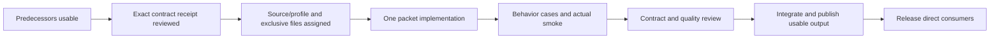

# Resource Intelligence Launch and Contract-Freeze Implementation Plan

> **For agentic workers:** REQUIRED SUB-SKILL: Use superpowers:subagent-driven-development (recommended) or superpowers:executing-plans to implement this plan task-by-task. Steps use checkbox (`- [ ]`) syntax for tracking.

**Goal:** Turn the accepted resource-intelligence architecture into independently reviewable implementation packets with verifiable predecessor contracts, safe parallel ownership and a complete feature launch order.

**Architecture:** Keep the existing 48 P-packets and their dependency graph. Land verified baseline and contract receipts before production consumers; use one integration owner for shared SDK/codegen/runtime seams and independent workers only for disjoint ready slices. This plan orchestrates the program; it is not permission to implement all packets or to treat temporary probe code as product code.

**Tech Stack:** Host Go 1.26.0 module / observed Go 1.26.1 toolchain; selected SDK/provider modules currently Go 1.25.0; actual repository pnpm contracts (host 12.14.0); Wails 3.0.0-beta.29; existing gRPC/protobuf, React 19, base-ui/editors/ai-ui and TanStack components. CEL direction accepted; production dependency/profile remains a gate.

**Spec:** [Foundation](../specs/2026-10-17-resource-foundation-design.md), [binding/schema decisions](../specs/2026-10-17-cel-binding-schema-contract.md), [source/result and vertical evidence](../specs/2026-10-17-source-session-contract.md), [contract-readiness ledger](../../roadmap/2026-10-17-resource-intelligence-contract-readiness.md), [48-packet backlog](../../roadmap/2026-10-17-resource-intelligence-work-packages.md).

## Global Constraints

- `GOWORK=off` for every Go command/subprocess, including dependency selection, builds, tests and generators that invoke Go.
- Generate Wails bindings only with `task bindings`; one integration owner owns generated outputs. Build runtime before Vite-plugin shim generation/verification.
- Keep host/plugin shared-dependency lists synchronized; preserve one React/runtime instance and CSS ownership. Never reintroduce MUI/Emotion/legacy UI dependencies.
- Use reviewed isolated worktrees/profiles and the existing workspace effort or a verified equivalent. No global links, ambient parent go.work, production state, default remote connections or destructive user-worktree cleanup.
- Provider neutrality and pragmatic thin clients apply to every packet. Kubernetes remains an adapter, not a schema/identity/acquisition fallback.
- Breaking API changes are allowed; migrate all selected callers and remove superseded paths before release. No permanent public compatibility stack or new mandatory CRUD/watch methods.
- No production implementation against guessed signatures. A reviewed semantic sketch is not a frozen public DTO. Record exact inputs/outputs/errors/ownership before downstream coding.
- Permanent tests cover consumer-visible behavior/boundaries/transitions, not copies, source text, forwarding echoes or incidental defaults. Actual API/UI smoke is required; fake backends and replay probes keep their limits visible.
- No builds/tests/lint/formatters/codegen while peers mutate shared integration files. Packet owner coordinates before/after evidence and final smoke; the integration owner owns wave regeneration/build checks.
- Do not commit or merge in this planning pass. Later packet commits include only their owned changes, no attribution trailers; existing user changes remain untouched.

---

## 1. File structure and authority

| Artifact / repository area | Responsibility | Status |
| --- | --- | --- |
| `docs/roadmap/2026-10-17-resource-intelligence-work-packages.md` | Stable P IDs, hard dependencies, per-feature deliverable/exclusions and brain-dump coverage | Existing, authoritative |
| `docs/roadmap/2026-10-17-resource-intelligence-contract-readiness.md` | Accepted vs frozen vs implemented state, C00–C12 receipts, observed baseline and freeze decisions | Planning artifact |
| This plan | Launch gates, ownership locks, review/release sequencing | Orchestration, not 48 code-ready task specs |
| `docs/superpowers/plans/2026-10-17-resource-intelligence-baseline.md` | Exact next P00 verification/linkage procedure and literal first assignment | First executable packet plan |
| Future packet-focused spec/plan, named by its P owner | Exact code paths, signatures, regression cases and actual verification for that packet | Required before its implementation, not pretended complete now |
| SDK `pkg/v1/resource`, `proto/v1/resource`, handwritten `plugin/` adapters | Current registered generation and migration evidence | Existing; not the chosen new-major destination |
| SDK `pkg/resource`, root `proto/*.proto` | Older resource generation | Existing legacy; do not accidentally extend it |
| Host `backend/pkg/plugin/resource`, `backend/pkg/apperror` | Current ingestion/service/errors/graph seams | Existing implementation to preserve or replace intentionally |
| Host `packages/omniviewdev-runtime`, Vite plugin and `ui/components/tables/Resources` | Runtime/caller migration, shared exports and actual default table | Existing, coordinated ownership |
| UI source `ui/main/packages/{base-ui,editors,ai-ui}` | Reusable components, worker/editor/table contracts | Existing checkout; P00 resolves compatible source and actual consumption |

Proposed new-major SDK/domain/IDL and query-runtime file names are selected by C01/C03/C04/C07/C08, not invented here. This avoids an apparently precise plan that sends agents into a third accidental resource generation. Existing file paths above are observed ownership evidence, not automatic permission to preserve their public shapes.

## 2. Current launch decision

**Launch only P00 first, under the integration owner.** Its initial audit observed module-cache SDK v0.5.0 in the host, v0.4.0 in Kubernetes, and installed UI artifacts behind manifest requirements; these are historical observations, not a claim about every current checkout. Workspace implementation has since merged in [host PR57](https://github.com/omniviewdev/omniview/pull/57). Select its current reviewed committed sources and prove the actual P00 cohort/linking/host-plugin acceptance; publication and the workspace merge do not themselves pass C00.

No language/source experiment needs repeating merely to select CEL again. Re-run a specific corpus when its actual dependency/codec/contract changes, or when a new implementation invalidates an evidence assumption.

### Task 1: Deliver P00 baseline receipt

**Files:** read the exact source list and commands in the [P00 plan](2026-10-17-resource-intelligence-baseline.md). Create only its baseline report/private verification artifacts unless an independently approved baseline integration change is required. Do not implement resource features during this packet.

**Consumes:** user-provided repository locations, current manifests, existing workspace/profile/linking contract, safe selected-source refs.

**Produces:** C00 receipt with real selected-source resolution, manager/peer/export identity, isolated host/plugin smoke, caller/removal ownership map and exact blockers. No new product API.

- [ ] Run the P00 plan inline; complete the reachable audit even if linkage prerequisites fail.
- [ ] Demonstrate actual SDK source consumption in both Go consumers and coherent UI/runtime consumption in host and selected plugin. Do not certify linkage from matching version strings.
- [ ] Review source/peer/isolation evidence and record whether C00 passed. Missing prerequisites block P00 completion; they do not authorize an old/new adapter or fabricated Kubernetes fixture.
- [ ] Publish the receipt and only then release dependent work/design assignments.

### Task 2: Dispatch the first genuinely independent slices

**Consumes:** passed C00; per-packet files and exclusions in the backlog. **Produces:** P44 reusable corpus/baseline evidence; P04 invocation/error seam; P18 measured editor choice. Each is separately reviewed, not a single foundation PR.

- [ ] Assign P44 to conformance ownership, P04 to host trust/error ownership and P18 to editor feasibility ownership.
- [ ] Give each its exact source roots and separate profile/state. P44 uses current SDK for baseline evidence; captures unsupported legacy behavior rather than inventing GVK/namespace/UID fields or fixing old Find just to pass.
- [ ] P04 freezes C02 against current `apperror`, service and SDK context reconstruction before implementation. Preserve useful operations; same-origin plugins remain trusted.
- [ ] P18 compares existing host Monaco wrapper and library CodeEditor/lightweight primitives on actual surface. It owns no resource evaluator or schema fetcher.
- [ ] Partition SDK Session/context changes from fixture files; one SDK integrator merges any shared seam. Review before/after behavior, actual smoke and docs at each packet boundary.

### Task 3: Freeze only the contracts needed by the next consumer

**Files:** readiness ledger C01–C09; focused specs/receipts produced by the named P owners; current SDK/host service/domain/codec paths identified in section 1. New production filenames are part of each approved receipt, not missing symbols left for an executor to guess.

**Consumes:** C00, P44 corpus and accepted semantic specs for P01; P04's reviewed C02 decisions before invocation/error integration or P45 readiness. **Produces:** P01 exact contract ownership and C01/C03/C06/C07 receipts; P04 owns C02, jointly reviewed with P01/P45 before P45 consumes it. Later source/schema/result/editor receipts precede their consumers.

P01's hard blockers remain P00 and P44, as in the backlog/native graph. P01 may draft and confirm pure query/identity/value semantics while P04 proceeds, using only an opaque host-issued invocation-context slot, propagated cancellation and the existing `apperror` categories as provisional design inputs. P01 must not invent actor authentication, ownership rules, machine error codes or production C02 DTOs. P04 owns those decisions; jointly reconcile/freeze C02 before any production invocation integration. P45 already depends on both P01 and P04, so this handoff adds no hidden P04 hard edge to P01. The frontier table is not a serial barrier.

- [ ] Contract owner consolidates exact identity/authority/scope, capability, parameter/value, failure and acquisition DTOs. Specify field presence, lossless Go/protobuf/TS mapping and canonical encoding once.
- [ ] Resolve the P45/P05 finite-source allocation explicitly: prefer P45 real snapshot-only behavior on the final source boundary, P05 optional update coordination. Do not create a temporary replacement List endpoint. Review exact allocation before coding.
- [ ] Resolve actual CEL dependency/profile admission and numeric patch ownership. Accepted upstream-first strategy is not approval to adopt a patched module or submit an external PR.
- [ ] Preserve schema/representation availability and nullable/union guarantees; keep P07 normalization/field-model details separate from the minimal P45 catalog wire where possible.
- [ ] Freeze query/result semantics before P13/P14 and the actual result/control DTO before P15. Resolve reset target, lost-control/duplicate/overlapping recovery and row/value limits from production codec requirements, not by copying probe fields.
- [ ] Freeze authoring DTOs before P16/P19 integration: cursor/range units, document/schema/access generations, partial/conditional checking and supported guards. No general flow-sensitive CEL checker is required.
- [ ] Review each receipt with its producers and immediate consumers; only those named consumers become eligible. Unrelated feature contracts do not block earlier useful finite reads.

### Task 4: Implement and integrate packets by readiness, not by table row barriers

- [ ] Follow the 14 dependency frontiers below. Start a packet when its own predecessors, receipt, source/profile and ownership locks pass—even if an unrelated packet in an earlier frontier remains in progress.
- [ ] Write the packet's focused implementation plan with exact selected files/symbols and consumer-visible cases before edits. The P00 plan is concrete now; this orchestration document is not a substitute for P45/P13/UI code plans against frozen interfaces.
- [ ] Prefer the M1 query/compatibility path over early index/relationship advice merely because those nodes are topologically eligible.
- [ ] Integrate provider-neutral current behavior before claiming provider-specific production support. P08–P11 do not become generic core prerequisites.
- [ ] Each packet supplies usable behavior, actual smoke and caller/docs cutover. No declarations-only, mock-only or wiring-only “completed” packet.

## 3. Complete earliest-start frontiers

These are dependency frontiers computed from all 48 authoritative packets / 113 hard edges. They are not dates, estimates, mandatory global barriers or authorization to launch every listed agent simultaneously. Contract/ownership/verification gates can delay a packet without delaying unrelated ready work.

| Frontier | Packets becoming eligible after their own predecessors | Work type / priority |
| --- | --- | --- |
| F0 | P00 | Baseline/source/link/isolation gate |
| F1 | P44, P04, P18 | Neutral corpus, trust/errors, editor decision; separate owners |
| F2 | P01, P02, P42 | Contract freeze, real performance baseline, command/settings/navigation palette |
| F3 | P45, P19, P23 | Usable SDK/host boundary, editor adapter, table live-render contract |
| F4 | P03, P05, P07, P24 | Identity cutover, source updates, schema catalog, virtual arbitrary expansion |
| F5 | P06, P10, P12, P16, P26 | Graph declaration fix, Kubernetes migration, read model, completion, renderer cutover |
| F6 | P08, P09, P13 | Kubernetes discovery/built-in schemas; generic query compiler |
| F7 | P11, P14, P17, P39 | Dynamic Kubernetes support, live leases, keys/values, explain/inventory |
| F8 | P15, P22, P29, P35, P40 | Runtime client, relationships, grouping, multi-scope union; indexes only when measured need is established |
| F9 | P47, P20, P25, P27, P30, P37, P43 | Legacy ABI retirement, query bar, child tables, visualization contracts, grouped tables, same-provider rules, resource search |
| F10 | P46, P21, P28, P31, P38 | Compatibility admission, builder, non-table expansion, saved queries/variables, cross-provider links |
| F11 | P32 | Versioned saved-view documents/migrations |
| F12 | P33, P36, P41 | Component/layout builder, Explore, view-specific index advice |
| F13 | P34 | Live dashboards over saved layouts/variables and shared/federated execution |

**Coverage retained:** schema/query completion/builder; live child and arbitrary expanded views; host grouping without per-group acquisition; configurable component/views/dashboards/variables; multi-account/provider Explore and user links; explain/index footprint/management/advice; command/settings/navigation and resource search. Full future ABAC/consent/hostile isolation and AI mutations remain seam constraints rather than unrequested implementations. The backlog's brain-dump coverage ledger is unchanged.

## 4. Lane capacity and actual edit locks

Use one integration owner plus sustained data/SDK, runtime/host-UX and UI/provider lanes. Add workers only for disjoint ready slices; a larger agent count does not create more merge capacity in common files.

| Exclusive seam | Observed collision paths | Owner / scheduling rule |
| --- | --- | --- |
| SDK domain/IDL/codegen | `pkg/v1/resource/{config,provider,controller,resourcer_registry,types}.go`, handwritten `plugin/{client,server,convert}.go`, common/resource/lifecycle protos and generated outputs | P45 SDK integrator selects new-major destination and owns common freeze; P05/P07 can develop disjoint accepted source/schema files, but central registration/exports/generation are integrated serially |
| Invocation/errors | Host `backend/pkg/apperror`, resource service/controller/wrappers; SDK Session/PluginContext/interceptors | P04 owner freezes provenance/propagation. Resource routing IDs are not actor authentication. Shared bridge changes land before source/schema consumers extend them |
| Host ingestion/identity | `backend/pkg/plugin/resource/{controller,sink,provider,types,adapter_v1}.go`, registry/indexer/graph | P03 migration vs P05 transport vs P12 store needs named file partition; never run them blindly against the same controller/sink |
| Query service | New compiler/planner/lease/discovery files selected in C07/C08/C09 | P13/P14 query integrator partitions P16/P17/P29/P35/P39/P40 after API freeze; one semantic evaluator |
| Runtime public/model/cache | `packages/omniviewdev-runtime/src/{api,models,index}.ts`, `hooks/resource`, generated bindings | P03 identity precedes P15; P47 removes old exports. Feature agents consume the adapter rather than edit core hooks independently |
| Default host resource table | `ui/components/tables/Resources`, `ui/hooks/resource/useResourceDefinition.tsx` | P15/P20/P23/P24/P25/P30 share one adapter owner. Library work does not automatically update this raw TanStack implementation |
| Library table internals | `ui/main/packages/base-ui/src/components/data-table` | P23 precedes P24; serialize shared virtual-body/type/context changes with P30 unless an explicit file partition is reviewed |
| Editor/workers | Host `ui/providers/monaco`, `ui/components/displays/CodeEditor.tsx`; UI editors code-editor/setup sources | P18 decision before P19. One initializer/worker ownership decision; no parallel global MonacoEnvironment edits |
| Kubernetes resource registration | `pkg/plugin/resource/register_v1.go`, generated registration, connection/schema/discovery/base/pattern/Helm resourcers | Provider integrator owns P10 common cutover; partition P08 discovery and P09 schemas afterward; P11 consumes both. Preserve exec/log/network/metric registrations |
| Shared exports/release | `ui/features/plugins/api/shared_dependencies.ts`, Vite `src/sharedPackages.ts`, shim generators, root manifests/locks/Taskfile, npm workflows | One integration owner: Wails task only; runtime build before Vite shims; synchronize native ESM and packaged SystemJS checks |
| Fixtures/performance/state | P44 native-shape corpus; host bench/scripts; selected private profiles | One fixture owner; feature cases extend the same meanings. P02 distinguishes actual Go/IPC/paint from fake backend and never commits secrets/profile tokens |
| Registry/saved formats | Current runtime/host extension definitions and user view/query configuration | P26/P27 establish contributions; P31/P32 versions/migration before P33/P34. Separate contribution removal from user-state retention |

No two agents run `make proto`, `task bindings`, installs, shim generation or shared export rewrites in the same worktree. Separate source worktrees do not make incompatible generated outputs or unreviewed API signatures safe to merge.

## 5. Review and merge gates

- Contract review checks every acceptance criterion and exclusion, provider-neutrality, result/source distinctions, nullable/numeric semantics, cancellation/ownership and migration effects.
- Quality review checks correctness/security, bounded work/retention, meaningful regression cases and client computation placement. Receiving feedback follows verification, not automatic suggestion implementation.
- The integration owner runs coordinated regeneration/build/smoke once after the relevant edits settle. Preserve genuine failure evidence; do not re-pin wording/default/source tests or introduce suppressions to turn a failed contract green.
- Public API changes require reference/caller inspection using available language tooling before edits. A package is incomplete while selected callers, examples, generated code or release metadata still refer to removed contracts.
- Do not merge temporary source links, paths, tokens or prototype executables into product code. Dependency receipts and profile runtime data stay private; portable contract/behavior evidence belongs with the packet.

## 6. Verification entrypoints and limits

These commands are observed existing entrypoints, **not verification executed in this planning pass**. Run them only in the selected isolated checkout when their packet changes the surface; use its effective managed module/package environment.

| Surface | Command / working directory | Important condition |
| --- | --- | --- |
| Host backend | `GOWORK=off go build .`; scoped `GOWORK=off go test ./backend/pkg/plugin/resource/... ./backend/pkg/apperror/... -count=1` | Does not replace real host/SDK scenario; use effective SDK source resolution |
| SDK | `GOWORK=off go test ./pkg/v1/resource/... ./pkg/sdk ./pkg/interceptors -count=1` | Existing paths; update invocation when the reviewed new-major destination exists. Include actual gRPC codec tests, not only plugintest direct-controller helpers |
| SDK generation | `GOWORK=off make proto` | Existing Makefile wraps buf generation; state-changing, single owner, actual required tool availability checked first |
| Kubernetes | `GOWORK=off GOEXPERIMENT=jsonv2 go build -o bin/plugin ./pkg`; scoped resource/Helm suites | Binary main is `./pkg`, not repo root. Fake-client tests are not a live-cluster or codec proof |
| Wails bindings | `GOWORK=off task bindings` in selected host | One owner; may tidy modules and rewrite generated files |
| Runtime then Vite | `pnpm --filter @omniviewdev/runtime run build`, then `pnpm --filter @omniviewdev/vite-plugin run build` | Run under the selected managed pnpm context; shim generation reads runtime exports |
| Runtime checks | `pnpm --filter @omniviewdev/runtime run typecheck`; packet-specific runtime Vitest cases | Test behavioral result application, not mock forwarding/source strings |
| Host UI | `pnpm test` narrowed to affected cases; actual browser/native smoke through selected profile | A replay script does not establish paint/focus/IME/overlay/scroll correctness |
| UI packages | base-ui/editors package build/typecheck/test scripts in selected UI | Storybook source alias is not proof host uses the same dist; editor/AI Storybooks share default port 6007 |
| Existing app benchmark | `task perf:app` / `node bench/app/run.mjs` | Fake in-page backend: not Go/IPC measurements; retain only the renderer/shell evidence it actually supplies |

Do not invoke Kubernetes `make generate` as a check: it clones API sources, rewrites registration and runs fixers. Do not run root `task dev` as a reproducible smoke: it upgrades UI patches before launch. Managed workspace bootstrap/profile commands are covered by P00 and their existing operational guide, not reinvented here.

## 7. Release gates and scope preservation

- **M0:** actual baseline/corpus/performance and accepted usable SDK/domain/source/schema prerequisites; no mock-only declaration of readiness.
- **M1:** generic query experience and builder, selected Kubernetes integration, runtime/caller migration, P47 legacy retirement and P46 incompatible-plugin refusal. Do not ship an old-plugin fallback or omit active logs/exec/metrics/network/settings workflows.
- **M2:** related live tables/arbitrary expansion/grouping and claimed Kubernetes dynamic support under their actual gates.
- **M3:** saved variable queries, versioned configurable components/views/layouts and live dashboards. Multi-scope groundwork can precede the final dashboard UI.
- **M4:** Explore, cross-provider rules/links and unified resource search; no Kubernetes prerequisite in generic consumers.
- **M5:** explain, footprint/management and advice from measured workload evidence. Explain may start early; expensive index implementation is not automatically high priority.

Feature completion and release permission are separate: generic SDK/query work does not depend on Kubernetes implementation, but the advertised M1 release must pass both its generic and selected-provider criteria. No feature in the original coverage ledger is dropped or silently converted into a future non-goal.

## 8. Immediate handoff

The next execution is P00 using its detailed plan, not a batch of 48 coding agents. After C00 passes, dispatch P44/P04/P18 together with separate file/profile ownership. P01/P02 and ready command work follow their actual predecessors; P45 follows usable contracts/context/corpus. The first production query slice then advances by P03/P05/P07 → P12 → P13 → P14 → P15, alongside independently ready editor/provider/UI work and final ABI/admission gates.

This plan is complete as a launch/contract-freeze runbook. Later code-packet plans are deliberately gated on exact contracts and current source: there is no claim that all future feature implementations are already code-ready or that elapsed time can be inferred from an agent count.
