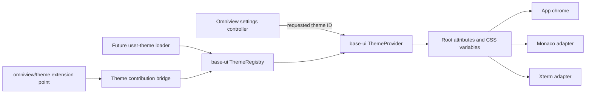

# Production Theme System Design

**Date:** 2026-10-15
**Status:** Approved in design review
**Repositories:** `omniviewdev/ui`, `omniviewdev/omniview`

## Goal

Replace Omniview's `dark | solarized` adapter with one production theme system that:

- ships nine first-party themes, with Void as the fresh-install default;
- uses one selected theme across app chrome, Monaco, and Xterm by default;
- retains explicit editor and terminal overrides;
- has one durable preference source and correct first paint;
- accepts validated plugin themes with ownership and unload cleanup;
- leaves a stable boundary for future user-authored/imported themes.

## Decisions

1. `@omniviewdev/base-ui` owns the reusable theme engine and built-in catalog.
2. Omniview owns persistence, settings UX, startup policy, and plugin contribution bridging.
3. The backend `appearance.theme` setting is the only durable selected-theme preference.
4. LocalStorage is a versioned first-paint cache, not a second preference store.
5. Theme selection applies and persists immediately. A failed save rolls back the visual selection.
6. The first-party catalog contains Dark, Light, High Contrast Dark, High Contrast Light, Obsidian, Carbon, Void, Solarized Dark, and Solarized Light.
7. Void is the fresh-install default.
8. Plugin support is part of the first implementation. Marketplace browsing and user-theme editing/import UI are not.
9. Built-ins use static CSS. Runtime themes add validated CSS custom-property overrides at the root.
10. The existing `colors` / `syntax` / `terminal` definition split is replaced by one generated token map.

## Current-State Findings

The UI package already contains most of the rendering foundation:

- seven built-in theme selectors in `packages/base-ui/src/theme/styles.css`;
- `ThemeProvider`, `themeRegistry`, and reactive registry-list hooks;
- Monaco and Xterm adapters in `packages/editors/src/themes`;
- Solarized Dark and Light examples in the showcase.

The desktop app bypasses that model:

- `ui/theme/AppTheme.tsx` maps every setting except `solarized` to `dark`;
- `ui/theme/solarized.ts` registers one app-local partial theme;
- `internal/settings/appearance.go` statically exposes only `default` and `solarized`;
- `AppTheme` maintains `ov-theme-variant` while `base-ui` independently supports `ov-theme-mode`;
- `index.html` and its loading surface are hardcoded dark;
- the legacy Monaco wrapper always activates `brilliance-black`;
- the terminal uses an independent hardcoded theme catalog;
- plugin-owned themes registered directly with the singleton would survive plugin unload.

The shared engine also has contract defects that must be corrected rather than carried forward:

- registry mutation, active selection, DOM mutation, and persistence are coupled;
- the provider is uncontrolled and requires an app-level synchronization effect;
- `ThemeDefinition.terminal` cannot contain a value because generated `TerminalTokenKey` is `never`; actual terminal and ANSI tokens use the `color.*` namespace;
- built-in IDs are duplicated manually across TypeScript and CSS without a contract check;
- editor theme observation is based only on `data-ov-theme`, which is insufficient as an explicit active-theme signal;
- existing theme tests pass but emit React `act()` warnings;
- the Omniview theme test cannot start because the root repository lacks its configured `jsdom` dependency.

## Scope

### In scope

- Base UI theme schema, generated token metadata, registry, provider, hooks, and built-in palettes.
- Complete Solarized Dark and Solarized Light first-party themes.
- Coherent editor and terminal surfaces for all built-ins.
- Omniview selected-theme persistence, migration, first-paint cache, and immediate settings control.
- Plugin theme extension point and owner-aware cleanup.
- Application-theme defaults plus explicit Monaco/Xterm overrides.
- Tests, browser/desktop smoke checks, package docs, changesets, and app documentation.

### Out of scope

- Marketplace catalog/search/install UX.
- A visual theme designer.
- Paste/import/export/edit/delete UI for user themes.
- Importers for VS Code, JetBrains, TextMate, or terminal-specific theme formats.
- Cloud synchronization of theme preferences.
- Arbitrary layout, typography, spacing, or executable CSS supplied by themes.

The registry and serialized definition are designed so user themes can be added later without a second format or engine.

## Architecture



### Repository responsibilities

#### `omniviewdev/ui`

`@omniviewdev/base-ui` owns:

- the serializable theme schema;
- built-in IDs, metadata, and static CSS palettes;
- generated token keys and value-kind metadata;
- definition validation;
- owner-aware registration and reactive snapshots;
- resolution of requested IDs to active entries;
- root attribute and custom-property application;
- React provider/context/hooks.

`@omniviewdev/editors` owns:

- converting active CSS tokens into Monaco theme data;
- converting active CSS tokens into Xterm theme data;
- rebuilding editor/terminal themes when the resolved active theme changes.

#### `omniviewdev/omniview`

The desktop app owns:

- the `appearance.theme` setting and migrations;
- optimistic selection, persistence, rollback, and user notification;
- first-paint bootstrap cache;
- the Appearance theme picker;
- the `omniview/theme` extension point and bridge;
- adapting legacy Monaco/Xterm callsites;
- independent editor/terminal override settings.

## Theme Catalog

The built-in IDs are stable persisted API:

```ts
export type BuiltInThemeId =
  | 'void'
  | 'dark'
  | 'light'
  | 'obsidian'
  | 'carbon'
  | 'solarized-dark'
  | 'solarized-light'
  | 'high-contrast-dark'
  | 'high-contrast-light';
```

The picker order is intentional and independent from registry insertion order:

| Order | ID | Appearance | Required behavior |
|---:|---|---|---|
| 1 | `void` | dark | Fresh-install default; warm-neutral chrome and aligned editor/terminal surfaces |
| 2 | `dark` | dark | Existing complete default-dark palette |
| 3 | `light` | light | Existing complete default-light palette |
| 4 | `obsidian` | dark | Existing cobalt/slate chrome and aligned editor/terminal surfaces |
| 5 | `carbon` | dark | Existing achromatic chrome and aligned editor/terminal surfaces |
| 6 | `solarized-dark` | dark | Complete Solarized chrome, editor, syntax, terminal, and ANSI palette |
| 7 | `solarized-light` | light | Complete Solarized chrome, editor, syntax, terminal, and ANSI palette |
| 8 | `high-contrast-dark` | dark | Existing complete high-contrast-dark palette |
| 9 | `high-contrast-light` | light | Existing complete high-contrast-light palette |

User themes will be grouped after built-ins. Plugin themes are grouped after user themes and sorted by display name. A requested but unavailable ID is rendered as one disabled `Unavailable: <id>` row so the preference is visible rather than silently rewritten.

Built-ins remain CSS selector blocks. This preserves static component CSS and makes switching a bounded root update. The default token block must also match `:root[data-ov-theme='dark']`, so every catalog entry has an explicit selector contract without duplicating dark token values. Obsidian, Carbon, and Void may intentionally share the proven default-dark syntax/ANSI ramps, but each must override editor/terminal background, foreground, cursor, selection, and border values needed to match its chrome. Solarized Dark and Light must be full themes, not showcase-only partial overrides.

Every built-in has catalog metadata for `id`, `name`, `appearance`, `description`, and ordering. `color-scheme` is derived from `appearance`; no behavior checks theme IDs directly.

## Serializable Theme Definition

The external format is versioned from its first supported release:

```ts
export interface ThemeDefinitionV1 {
  schemaVersion: 1;
  id: string;
  name: string;
  base: BuiltInThemeId;
  author?: string;
  version?: string;
  description?: string;
  tokens: Partial<Record<ThemeTokenKey, string>>;
}

export type ThemeDefinition = ThemeDefinitionV1;
```

A custom theme always extends one built-in. Missing tokens inherit from that built-in's static selector, including tokens introduced by future Base UI versions.

A plugin extension contribution uses the same payload without a global `id`; its extension registration ID is the local theme ID. The host derives the persisted ID as:

```text
plugin:<percent-encoded plugin ID>/<percent-encoded contribution ID>
```

Future user themes use `user:<stable UUID>` IDs. Built-ins retain their short IDs.

### Generated token catalog

The existing token generator becomes the single source for both key types and runtime metadata:

```ts
export type ThemeTokenValueKind = 'color' | 'font-style';

export interface ThemeTokenMetadata {
  cssVariable: `--ov-${string}`;
  valueKind: ThemeTokenValueKind;
}

export const THEME_TOKEN_METADATA: Readonly<
  Record<ThemeTokenKey, ThemeTokenMetadata>
>;
```

Themeable `--ov-color-*` variables, including editor, terminal, ANSI, tabs, gutters, and component semantic colors, use `color.*` keys. `--ov-syntax-*` variables use `syntax.*` keys. Syntax style variables are classified as `font-style`. There is no separate terminal section and no `TerminalTokenKey`.

Non-theme structural variables—spacing, size, radius, duration, font family, and layout—are excluded from the external schema.

## Validation and Security

Registration validates before mutating registry state:

- `schemaVersion` is exactly `1`;
- `id` is non-empty, at most 256 characters, and contains only ASCII letters, digits, `.`, `_`, `~`, `%`, `-`, `/`, and `:`, allowing stable percent-encoded owner IDs;
- `name` is non-empty and at most 80 characters;
- `author` is at most 120 characters;
- `description` is at most 500 characters;
- `base` is a registered built-in ID;
- every key exists in `THEME_TOKEN_METADATA`;
- the number of entries cannot exceed the generated key count;
- every value is at most 256 characters;
- color values pass browser color syntax validation;
- font-style values use a fixed whitelist of supported Monaco style combinations;
- URL-bearing, declaration-bearing, and arbitrary stylesheet values are rejected.

The accepted definition is cloned and deeply frozen. Callers cannot mutate registry state through retained object references.

Validation errors are typed and include a machine code plus field path:

- `unsupported_schema`
- `invalid_id`
- `invalid_metadata`
- `unknown_base`
- `unknown_token`
- `invalid_value`
- `duplicate_id`
- `reserved_id`
- `owner_mismatch`

A malformed plugin contribution is logged with plugin ID, extension-point ID, and contribution ID. It is excluded without crashing the provider, removing unrelated themes, or failing an already-running plugin surface.

Custom themes can set only known custom properties through `style.setProperty`. They cannot insert selectors, declarations, scripts, or arbitrary CSS. Invalid values never reach the DOM.

## Registry Contract

The registry is a catalog, not a persistence or DOM service.

```ts
export type ThemeOwner =
  | { kind: 'builtin'; id: 'base-ui' }
  | { kind: 'plugin'; id: string }
  | { kind: 'user'; id: string };

export interface ThemeRegistrySnapshot {
  version: number;
  themes: readonly ThemeSummary[];
}

export interface ThemeRegistry {
  register(definition: ThemeDefinition, owner: ThemeOwner): () => void;
  unregister(id: string, owner: ThemeOwner): void;
  unregisterOwner(owner: ThemeOwner): void;
  get(id: string): RegisteredTheme | undefined;
  has(id: string): boolean;
  getSnapshot(): ThemeRegistrySnapshot;
  subscribe(listener: () => void): () => void;
}
```

Built-ins are registered during registry creation with the `builtin/base-ui` owner and cannot be removed or replaced. Custom IDs cannot collide with built-ins or another owner. The disposer returned from `register` is owner-bound and idempotent.

A snapshot changes identity only when catalog content changes. `useThemeList` consumes it with `useSyncExternalStore`; there is no permanent module-scope subscription or mutable snapshot cache outside the registry.

The package continues to export one shared default registry because Omniview plugins consume the host's shared Base UI module. `ThemeProvider` accepts an injected registry for tests and isolated applications.

The following responsibilities are removed from registry methods:

- active selection;
- localStorage;
- `document` mutation;
- React state.

## Provider Contract

The provider uses a controlled selected ID:

```ts
export interface ThemeProviderProps extends PropsWithChildren {
  registry?: ThemeRegistry;
  themeId: string;
  fallbackThemeId?: BuiltInThemeId; // defaults to "void"
  onThemeChange(id: string): void;
  root?: HTMLElement;
  initialDensity?: ThemeDensity;
  initialMotion?: ThemeMotion;
}
```

Theme selection is controlled. Density and motion retain provider-local state initialized by `initialDensity` and `initialMotion`; their setters remain valid and they perform no persistence.

The exposed context distinguishes preference from rendered state:

```ts
export interface ThemeContextValue {
  requestedThemeId: string;
  activeTheme: ThemeSummary;
  isFallback: boolean;
  setTheme(id: string): void;
  density: ThemeDensity;
  motion: ThemeMotion;
  setDensity(value: ThemeDensity): void;
  setMotion(value: ThemeMotion): void;
}
```

Resolution rules:

1. If `themeId` exists, it is the active theme and `isFallback` is false.
2. If it does not exist, the registered `fallbackThemeId` is active and `isFallback` is true.
3. Registration of the requested ID causes the provider to resolve it automatically.
4. Removal of the active custom theme immediately resolves the fallback without changing the requested ID.

The provider applies root state in `useInsertionEffect`, before child layout effects rebuild Monaco or Xterm:

- built-in: `data-ov-theme="<id>"`, no custom marker, no injected overrides;
- custom: `data-ov-theme="<base>"`, `data-ov-theme-custom="<id>"`, validated inline overrides;
- all themes: root `color-scheme` from resolved appearance;
- density/motion: their existing root attributes.

The applier tracks only properties it injected and removes that exact set before applying the next custom theme or a built-in. It does not clear unrelated inline styles.

The provider performs no storage or network I/O. An unhandled listener cannot prevent other registry subscribers from receiving updates.

## Omniview Controller and Settings UX

`AppThemeController` replaces `AppTheme`'s conversion and synchronization effect. It runs inside `SettingsProvider` and `ExtensionProvider` and wraps the themed application.

The backend setting changes to:

- key: `appearance.theme`;
- type: text;
- default: `void`;
- no static `Options`, because valid installed choices are runtime registry data;
- validation: non-empty theme-ID-shaped string, allowing an unavailable extension ID to survive restart.

The Appearance page renders a dedicated theme control for this key. It uses the reactive registry snapshot rather than the generic backend option list.

Selection flow:

1. Reject a disabled/unavailable row.
2. Save the previous requested ID.
3. Set controller state to the selected ID immediately.
4. Call `SettingsProvider.SetSetting("appearance.theme", selectedId)`.
5. On success, reload/update settings context and refresh the first-paint cache.
6. On failure, restore the previous ID and use the existing settings error notification path.

The theme field is excluded from page-level draft/save handling. Other Appearance settings retain existing draft semantics.

## First Paint and Persistence

`appearance.theme` in the backend store is authoritative.

`ov-theme-bootstrap-v1` is a cache containing only a schema version and known built-in ID. It never stores plugin code or arbitrary third-party token payloads.

Startup behavior:

1. `index.html` declares `data-ov-theme="void"` and uses Void-compatible loading colors.
2. A small synchronous pre-React bootstrap reads the cache.
3. If the cache has version `1` and one of the nine built-in IDs, it sets `data-ov-theme` and `color-scheme` before application CSS paints.
4. Invalid, unknown, custom, or malformed entries are ignored and Void remains active.
5. Settings load asynchronously and the controller reconciles to the backend value.
6. A selected plugin theme uses Void until the plugin contribution registers, then activates automatically.

After a successful built-in selection, the cache records that ID. After a successful custom selection, the cache records Void as the safe startup fallback. This intentionally trades exact first paint for custom themes against stale third-party data and additional cache-version complexity.

Obsolete keys `ov-theme-variant` and `ov-theme-mode` are removed after migration. The Base UI provider no longer reads or writes them.

## Migration

Backend migration is idempotent and runs before the controller commits a preference:

| Persisted backend value | Canonical value |
|---|---|
| `appearance.theme = default` | `void` |
| `appearance.theme = solarized` | `solarized-dark` |
| known canonical ID | unchanged |
| unknown ID | preserve requested ID; render fallback until available |

Legacy frontend keys are first-paint inputs only. Before settings load, `ov-theme-variant = solarized` maps to a Solarized Dark paint hint, `ov-theme-variant = default` maps to Void, and a known built-in in `ov-theme-mode` maps to that built-in. Once the backend value loads, it wins unconditionally and both legacy keys are deleted. Legacy frontend keys never write or replace the durable backend preference.

## Plugin Theme Extension Point

Core registers one multiple-value extension point:

```text
omniview/theme
```

Its value is `Omit<ThemeDefinitionV1, "id">`; the standard extension contribution registration supplies the local ID and display label.

`ThemeContributionBridge` subscribes to the extension-point store and diffs contributions by `(plugin ID, contribution ID)`. For each addition it:

1. derives the canonical global ID;
2. validates and registers the definition with `{ kind: "plugin", id: pluginId }`;
3. records the returned disposer.

For each removal it calls the disposer. Plugin unload/reload already removes extension contributions, so no direct plugin cleanup API is required. A bridge unmount disposes every registration it owns.

Duplicate canonical IDs are impossible across different plugin IDs. Duplicate contribution IDs within one plugin are rejected by the existing extension-point store before reaching the bridge.

## Editor and Terminal Integration

The selected application theme controls chrome, Monaco, and Xterm by default.

### Shared editors package

`@omniviewdev/editors` consumes the Base UI resolved active theme/version through its existing peer dependency instead of observing only `data-ov-theme` mutations. On change:

- Monaco rebuilds and redefines the Omniview theme from current computed tokens, then reapplies it;
- Xterm assigns a new theme generated from current computed tokens;
- a custom-to-custom switch with the same base still triggers both updates.

### Omniview legacy surfaces

All legacy Monaco callsites—including editor, diff, and linked-resource views—must stop hardcoding `brilliance-black` or `vs-dark`. They use the shared token adapter when `editor.theme = application`.

The terminal retains its existing explicit palettes. Its setting changes from `default` to the canonical sentinel `application`. When selected, initial construction, connection placeholders, errors, and live terminal options all use `buildXtermTheme()`. A named explicit terminal palette continues to bypass the application theme only for terminal surfaces.

Add/normalize `editor.theme = application`. Existing explicit Monaco themes remain optional overrides. The application default is always `application` for both editor and terminal.

## Error and Fallback Behavior

| Condition | Behavior |
|---|---|
| Unknown requested ID at startup | Render Void, preserve requested ID, show unavailable row |
| Requested plugin theme registers later | Activate automatically |
| Active plugin theme unloads | Remove overrides, render Void, preserve requested ID |
| Theme save fails | Roll back visual selection and leave cache unchanged |
| Invalid plugin definition | Exclude contribution; structured diagnostic; no app crash |
| Duplicate/reserved ID | Reject registration with typed error |
| Invalid cached value | Ignore cache and render Void |
| Invalid custom token value | Reject definition before DOM mutation |
| Registry listener throws | Report error and continue notifying remaining listeners |
| SSR/no document | Resolve context and registry state without DOM writes |

## Performance Requirements

- Built-in switching changes root attributes and a bounded set of inline properties only.
- Component styles remain static CSS; components do not serialize or register styles during render.
- Registry snapshots are stable between mutations.
- Provider context values are memoized and change only for requested/active theme, density, or motion changes.
- Monaco/Xterm rebuilding occurs only when their effective application theme changes, not on unrelated settings or registry additions.
- Theme validation and cloning happen at registration, never per component render.
- No polling or broad document mutation observer is used.

## Accessibility and Visual Requirements

- High Contrast Dark and Light retain dedicated complete palettes.
- Catalog tests calculate contrast for critical foreground/background pairs: at least `4.5:1` for standard text, `3:1` for non-text controls and focus indicators, and `7:1` for primary text in both high-contrast themes.
- The picker exposes selected, unavailable, and disabled states through semantic controls and keyboard navigation.
- `color-scheme` matches the resolved theme so native form controls and scrollbars choose the correct appearance.
- Reduced-motion and density behavior remain independent and unchanged by theme selection.

Wails beta.29 exposes macOS appearance as a creation option but no runtime appearance setter on `WebviewWindow`. Remove the forced `NSAppearanceNameDarkAqua` creation option so native hidden-inset chrome follows the operating system instead of contradicting light application themes. Web content and native form controls follow the resolved root `color-scheme`. Dynamic native-titlebar appearance is not added through unsupported platform-specific code.

## Verification

### `omniviewdev/ui`

1. Schema/generator tests cover every generated key, CSS-variable mapping, and value kind.
2. Validation tests cover every error code, bounds, unknown keys, invalid values, clone/freeze behavior, and reserved IDs.
3. Registry tests cover ownership, owner-bound disposal, atomic owner removal, deterministic ordering, immutable built-ins, stable snapshots, and listener isolation.
4. Provider tests cover controlled selection, fallback, late registration, unload fallback, insertion-time DOM state, exact stale-property cleanup, SSR, Strict Mode, and density/motion independence.
5. Tests emit no React `act()` warnings.
6. Built-in contract tests assert exactly nine metadata entries and matching CSS selectors.
7. Computed-style tests assert required chrome/editor/terminal tokens for every built-in.
8. Contrast tests cover critical text/surface pairs and high-contrast palettes.
9. Editor integration tests prove custom-to-custom switching with the same base rebuilds Monaco and Xterm.
10. Showcase browser smoke opens the theme picker and exercises all nine built-ins across chrome, editor, and terminal surfaces.
11. Package typecheck, test, build, and changeset checks pass.

### `omniviewdev/omniview`

1. Add the configured `jsdom` dependency so theme integration tests run.
2. Migration tests cover every legacy mapping, precedence, idempotence, and key cleanup.
3. Controller tests cover initial settings hydration, immediate apply, successful persistence/cache update, failed-save rollback, and unavailable IDs.
4. Picker tests cover dynamic additions/removals, ordering, selection, and unavailable rows.
5. Extension bridge tests cover plugin add/reload/unload, invalid contributions, and isolation between owners.
6. Legacy Monaco/Xterm tests cover application inheritance and explicit override isolation.
7. Browser smoke verifies first-paint attributes, all nine choices, and computed Monaco/Xterm colors.
8. Desktop smoke runs the Wails app, switches dark/light/Solarized themes, restarts, and verifies first paint plus persistence.
9. TypeScript build, focused frontend tests, Go tests, and the app build pass with repository-required commands.

## Rollout and Cutover

1. Implement Base UI schema, registry, provider, built-ins, tests, docs, and changeset.
2. Implement Editors active-theme consumption, tests, docs, and changeset.
3. Build Base UI before Editors and publish compatible package versions.
4. Update Omniview package versions.
5. Add the controller, startup cache, migration, dedicated picker, and extension bridge.
6. Migrate every Monaco and Xterm callsite.
7. Regenerate Vite shared-package shims if the Base UI export surface changes; keep the host and Vite plugin shared package lists synchronized.
8. Remove app-local Solarized registration, ternary conversion, obsolete storage keys, dead Redux theme definitions, static Appearance options, hardcoded editor themes, and superseded provider APIs.
9. Run browser and desktop smoke verification after automated checks.
10. Update theming/plugin-development documentation with the versioned contribution format.

The cutover has no compatibility shim. Every in-repository caller moves to the controlled provider and new schema in the same release sequence.