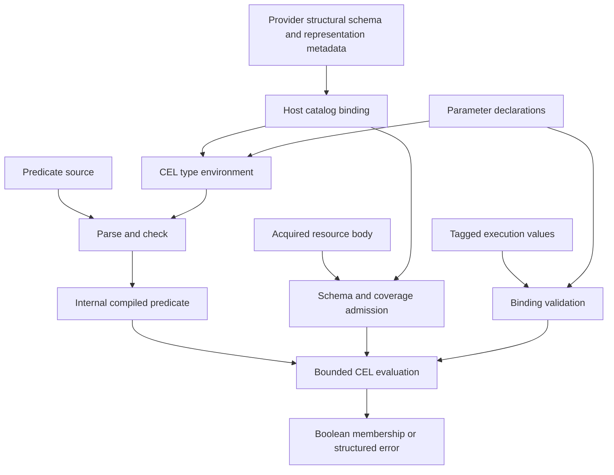

# CEL binding and schema-admission contract

Status: user-approved design direction and confirmation scope. Both isolated harnesses executed and independently rerun; transport and bounded schema-adapter feasibility established, but unrestricted dynamic numeric semantics and uniform nullable checking remain unresolved. Not a production implementation or frozen generated ABI.

Related: [foundation](2026-10-17-resource-foundation-design.md), [language evidence](2026-10-17-query-language-comparison.md).

## 1. Decision and alternatives

Use typed declarations and tagged execution values. Plain JSON loses numeric intent/precision; public CEL/protobuf evaluator values unnecessarily couple callers and saved queries to evaluator internals. One host-owned catalog-backed type provider/value adapter supplies CEL checking and admission. Do not generate resource-specific Go structs for each schema or claim untyped maps provide static catalog checking.

The resource predicate profile is `omniview.resource-predicate.v1`; source uses `resource` as its body root and declared parameter identifiers directly. Provider identities, scopes, authorization, acquisition and result-window semantics remain outside CEL. Schema structure is provider-owned; no Kubernetes-specific field is required by the core.

## 2. Proposed wire DTOs

```typescript
type ScalarType = "bool" | "string" | "int64" | "uint64" | "double" | "timestamp";

type BindingType =
  | { kind: ScalarType }
  | { kind: "list"; element: BindingType }
  | { kind: "map"; value: BindingType }
  | { kind: "nullable"; value: BindingType };

type BoundValue =
  | { kind: "null" }
  | { kind: "bool"; value: boolean }
  | { kind: "string"; value: string }
  | { kind: "int64"; value: string }
  | { kind: "uint64"; value: string }
  | { kind: "double"; value: number }
  | { kind: "timestamp"; value: string }
  | { kind: "list"; value: BoundValue[] }
  | { kind: "map"; value: Record<string, BoundValue> };

type ParameterDeclarations = Record<string, BindingType>;
type ExecutionBindings = Record<string, BoundValue>;
```

Map keys are strings. Declarations are saved independently from execution values. Profile support for these variants must be confirmed before advertising them; shape approval is not evidence that CEL nullable/collection checking or transport already meets the contract.

## 3. Admission invariants

- Every declaration requires a binding; unknown bindings fail. Explicit nullable values do not make parameters optional.
- Integer strings are canonical base-10 with checked signed/unsigned 64-bit ranges, without whitespace, exponent notation, fractions or rounding. Signed zero is encoded as `0`, not `-0`.
- Double means finite IEEE-754 binary64, never an exact-integer substitute. Unsafe cross-domain comparisons remain blocking confirmation cases.
- Timestamps require an RFC 3339 timezone, normalize to an instant, and reject unsupported precision/range instead of truncating.
- Validate list/map contents recursively against declarations, including empty collections; bound payload bytes, cardinality, nesting and declaration complexity. Numeric budgets are experiment settings until measured for the product.
- No implicit string-to-number, scalar-to-list or null-to-missing conversion. Exact decimal arithmetic is not supported by double and needs separate evaluation before any promise.
- Unknown tags, malformed objects and duplicate/ambiguous definitions must not become silently accepted alternative representations.
- Reject parameter names colliding with `resource` or reserved CEL identifiers. Never interpolate binding values into expression source.
- Programs can be reused across values; result sharing must additionally include bound values and access context.

## 4. Catalog-backed checking and runtime admission



| Case | Required treatment |
| --- | --- |
| Known object property | Schema-aware field/type checking |
| String-keyed map | Key lookup, not fabricated fixed properties |
| Optional absent property | Preserve absence/presence checks |
| Explicit null | Preserve null separately from absence |
| Field omitted by representation | Hydrate or report unavailable coverage, never infer resource absence |
| Union or uncertain structure | Preserve uncertainty; explicitly document dynamic checking |
| No schema | Bounded dynamic evaluation without claiming static guarantees |
| Body contradicts schema | Admission failure, not coercion |
| Recursive schema | Referenced/lazy resolution with traversal limits, not whole-graph expansion per edit |

A partial-schema adapter must state its admitted subset and reject or explicitly retain dynamic semantics for other shapes. It must not silently drop unsupported branches. The harness catalog fixtures are a candidate integration model, not evidence that the future product catalog is already implemented.

## 5. Parallel confirmation and integration order

1. Binding/numeric harness: actual JS serialization → Go JSON admission → pinned real CEL → serialized result consumed by JS. Cover boundary integers, mixed comparisons, timestamp normalization, nulls, nested and empty collections, malformed/wrong/missing/extra bindings and injection strings.
2. Schema harness: catalog-shaped cloud/container/VM/Kubernetes/discovered-schema fixtures → actual CEL type provider/value adapter → checker and evaluator. Cover correlation, maps, null/absence, unions, recursion, malformed bodies and incomplete representations.
3. Parent verifies commands/results, records failures without weakening expected semantics, and archives reproducible source/pins/results. These harnesses are independent after this shared contract.
4. Resolve numeric-domain and nullable/type-provider findings before freezing DTO/profile implementation. Real Wails bindings, editor completion, acquisition/update sessions, native provider equivalence and production budgets are later distinct gates—not proven by these experiments.

No product sources/dependencies or production credentials are needed for these confirmation harnesses.

## 6. Executed confirmation evidence

Two agents implemented independent throwaway harnesses. The parent rebuilt/reran both sequentially and inspected their measured outputs. Direct dependency: `cel.dev/cel-go v0.32.0`; Go `go1.26.1`; the binding driver's actual Bun executable reported `1.1.20`.

| Harness | Executed path | Observed result | Meaning |
| --- | --- | --- | --- |
| Bindings | Bun JSON serialization → Go admission/CEL subprocess → Bun assertions | 124 control checks, zero unexpected assertion failures, evaluator exit 0 | Includes five deliberately reproduced unsafe mathematical results; not 124 requirements passing |
| Schema | Catalog-shaped fixture → custom CEL provider/adapter → real checker/evaluator | 75 observations, zero assertion failures | Includes deliberate dynamic numeric failure cases and expected rejections; not a complete schema normalizer |

Reproduction source, fixtures, exact module checksums and measured outputs: [confirmation evidence archive](2026-10-17-cel-confirmation-evidence.zip). SHA-256: `15ea5f99b1a0f6ba8c095c130e02d1db510bf9382e51272061251e402962d9b5`. Archive integrity was checked with `unzip -t`. No binaries/caches are included.

After extraction, run from `bindings/`:

```sh
test "$(bun --version)" = "1.1.20" && GOWORK=off go build -o evaluator . && bun run driver.ts
```

Run from `schema/`:

```sh
GOWORK=off go mod download && GOWORK=off go run .
```

The archived `report.md` files describe each individual control and limitation. Sources remain experimental evidence, not product dependencies or ready-to-integrate adapter code.

### 6.1 What the experiments establish

- Exact tagged int64/uint64 values survive the actual JS/Go serialized boundary and CEL roundtrip, including values above 2^53 and their range limits.
- Recursive typed admission handles exercised lists/maps, empty collections, explicit null, malformed/duplicate JSON, missing/extra bindings, input bounds and malicious strings without source substitution.
- Timestamp normalization preserves exercised nanosecond precision and rejects excess precision instead of allowing Go's parser to truncate it.
- A bounded catalog-shaped provider/adapter supplies real static field/type checking without per-resource Go structs. Cloud tags, container maps, VM objects, Kubernetes nested arrays, discovered nullable/union fields and recursive references exercise the same generic path.
- Complete absence, explicit null and unavailable summary fields stay distinct. The same guarded tag predicate gives false for complete absence and a hydration-needed error for incomplete coverage. Dynamic lookup retains admitted objects and does not bypass the exercised coverage checks.
- The schema adapter is 497 lines / 13,352 bytes including fixture schema DTOs, validation, registration, admission and runtime value traits. This demonstrates finite feasibility, not production complexity/performance.

### 6.2 Blocking constraints

**Exact transport does not establish safe mixed numeric evaluation.** Dynamic double `9007199254740992` compares equal to exact int64 `9007199254740993`; ordering also loses the distinction. `CrossTypeNumericComparisons(false)` rejects exercised statically known mixed-domain operations but does not prevent dynamic runtime comparisons. Explicit `dyn(...)` can erase otherwise useful catalog type checking.

The binding harness demonstrates conservative checked-AST admission rejecting exercised dynamic equality/order/membership/indexing paths. That is not a replacement evaluator, but it also rejects useful dynamic string operations. It is evidence for a possible restricted profile, not approval to make schema-absent providers unusable. A safe, useful dynamic numeric policy remains an implementation gate; do not silently ship the broad restriction.

**Nullable is not uniformly statically checked.** Primitive nullable wrappers retain useful base-type checking but do not provide flow-sensitive null safety. Nullable timestamp/list/map and unions use explicitly documented `dyn` in these harnesses. Strict host value admission remains possible; unknown-field/operator errors can move to runtime at those boundaries.

**Partial presence constrains optimization.** CEL's optimized `FieldType.IsSet` callback returns only bool, so it cannot signal hydration-needed. The schema adapter leaves fast callbacks unset and uses CEL's generic `FieldTester`/`Indexer` path, which can propagate errors. No performance comparison was run. Incomplete arbitrary maps are conservatively rejected for hydration; per-key completeness and acquisition scheduling were not implemented.

### 6.3 Next decisions and remaining gates

Retain CEL and the tagged public binding direction; do not freeze the unrestricted profile or claim uniformly static schema typing. The subsequent [numeric-profile investigation](#7-numeric-profile-investigation) found a bounded dependency-level correction that preserves exercised dynamic queries without a host replacement evaluator. Prefer pursuing that correction upstream. It is experimental evidence, not production approval for a patched dependency; the unmodified pinned implementation retains the blocker.

Document nullable/union checking guarantees explicitly and carry them into editor diagnostics/builder guards. Then integrate the two boundaries in one provider-neutral vertical slice; the harnesses were independent, not a combined proof of query planning or acquisition.

Still unproven: real product catalog normalization (including full JSON Schema/OpenAPI unions), Wails/generated bindings, source/update ordering, authorization/cache invalidation, provider pushdown, incomplete-input completion, production cancellation/cost configuration, performance budgets and end-to-end UI. The finite probe budgets are not recommended product defaults.

## 7. Numeric-profile investigation

Status: isolated hook/dependency experiments executed and reproduced from the archived source. The user accepted the upstream-first numeric strategy after reviewing the findings. No product dependency changed, no upstream issue/PR submitted, and no temporary fork adopted.

### 7.1 Supported hooks are not a complete scalar-only fix

An ordinary equality overload override received zero calls: CEL's equality interpreter node directly invokes native value equality. A supported `CustomDecoratorV2`/`NewCall` scalar guard intercepted the exercised direct operators, but native collection equality/membership and optimized sets still reached unsafe numeric behavior. This does not prove that every possible decorator design is impossible; it shows why a scalar-only guard is insufficient.

A recursive host equality/membership implementation or aggregate prewalk would add semantic, traversal and cost-accounting work. Do not introduce that second authority just to avoid a small dependency correction.

### 7.2 Narrow dependency experiment

In a temporary copy of `cel.dev/cel-go v0.32.0`, change only:

1. Two numeric helpers in `common/types/compare.go`: range-check before safe double-to-integer truncation, compare the integer parts exactly, then resolve fractional difference only when the integer parts agree. These helpers use primitive operations, not arbitrary-precision runtime arithmetic.
2. Two conditions in `interpreter/decorators.go`: optimized constant-set membership adds a double alias for an integer only when conversion preserves equality.

Changing the helpers alone left an actual optimized-membership failure; both paths must agree. No host AST rewriting, custom interpreter, provider-specific behavior or resource prewalking was needed by this experiment.

| Final experiment | Expression observations | Wrong mathematical boolean results | Runtime rejections | Expected checker rejections |
| --- | --- | --- | --- | --- |
| Upstream module plus scalar hook | 64 | 13 | 24 | 0 |
| Experimental dependency change, native evaluator | 64 | 0 | 0 | 0 |
| Experimental change plus checked mixed-ordering option | 72 | 0 | 0 | 4 |

Expression observations include optimization off/on and dynamic strings/maps, correlated arrays, scalar and nested equality, list/map membership, uint64 boundaries, fractions, short-circuiting and explicit lossy conversion. The last row contains 68 evaluated boolean outcomes and four expected compile rejections; it is not 72 successful evaluations.

An independent exact-rational oracle checked 100,816 forward/reverse ordering/equality outcomes over boundary tables and deterministic PCG samples, including signed/unsigned extremes, nextafter neighborhoods and infinities. The experimental helpers had zero oracle pair failures. Arbitrary precision is used only in the probe oracle. These are finite checks, not exhaustive floating-point/full-CEL conformance or performance proof.

### 7.3 Preserve CEL checking and conversion distinctions

`CrossTypeNumericComparisons(true)` enables checked heterogeneous ordering; it does not enable known int/double equality. Both `1 == 1.0` and the exercised large mixed literal equality remain checker errors. Dynamic numeric equality can evaluate across domains. Preserve these documented boundaries in diagnostics/builder output rather than promising uniform mixed-type static equality.

The proposed correction compares actual binary64 values against exact integers without first rounding the integers. It does not provide decimal arithmetic or recover precision lost by the provider/client. Explicit user conversion such as `double(exactInteger)` remains potentially lossy by design.

CEL's [approved numeric comparison proposal](https://github.com/cel-expr/cel-spec/wiki/proposal-210) describes continuous-number-line runtime comparisons while preserving parametric equality checking. The [upstream master helper file](https://raw.githubusercontent.com/cel-expr/cel-go/master/common/types/compare.go) inspected during this investigation still converted integers to doubles; this does not establish the state of every release/branch.

### 7.4 Evidence and recommendation

[Source, changed dependency files, pins, stage outputs and reproduction script](2026-10-17-cel-numeric-evidence.zip). SHA-256: `ccaff9c9d255ba956b8c7cfe8cb863f65bd641f3a474993490f7670a70c3cf6d`. The parent extracted this archive into a fresh temporary directory and successfully ran `sh reproduce.sh`, reproducing the final counts and both native regression packages. The archive contains no full dependency checkout, binaries or caches.

`GOWORK=off go test -mod=mod ./common/types ./interpreter -count=1` passed in the isolated changed dependency. The initial command without `-mod=mod` failed dependency setup because of an incomplete vendored tree; explicit module resolution remedied that setup issue. No full dependency/host suite or performance benchmark was run.

**Accepted strategy:** pursue the narrow helper/membership correction upstream rather than introduce a host equality engine or blanket dynamic-comparison ban. If an upstream release cannot meet the product schedule, consider only a pinned, reviewed, bounded temporary dependency patch with conformance tests, update/removal ownership and measured performance. Acceptance does not authorize adopting a fork or submitting an external issue/PR. Production profile implementation remains gated on a verified dependency/pin strategy and broader conformance; nullable/union, authoring, source and product-integration gates remain separate.

## 8. Accepted nullable/union semantics and authoring guarantees

Status: the user accepted this semantic/authoring boundary and authorized its confirmation probes. It is not a production implementation, frozen authoring DTO, full schema-dialect normalizer or new flow-sensitive checker. Executable findings are recorded separately below.

### 8.1 Decision and alternatives

Keep provider data structurally faithful, validate it on the host, retain schema detail for authoring, and state precisely where CEL checking becomes dynamic.

| Approach | Tradeoff | Decision |
| --- | --- | --- |
| Reject nullable complex types/unions | Simplifies checking but excludes ordinary provider data and discovered schemas | Reject as the general product policy |
| Preserve schema/value semantics; combine available CEL checking with strict admission and explicit authoring guards | Useful across providers; some errors remain runtime errors | Accepted direction |
| Build flow-sensitive union/null type checking around all CEL constructs | Potentially stronger diagnostics, but creates a second language-analysis system with substantial maintenance | Do not make this a foundation requirement |

This section concerns resource-field schemas, not federation/joins or a new union-valued parameter DTO. Nullable bindings retain the approved explicit-null rule; no parameter omission/default semantics are introduced.

### 8.2 Presence, nullability, type alternatives and coverage are independent

An optional field may be absent. A nullable field may contain null. A union admits alternatives. None of these says whether an acquired summary actually contains enough information to resolve the field. Required schema fields still need acquisition coverage before evaluation.

| Observation | Meaning | Predicate/builder treatment |
| --- | --- | --- |
| Known present, non-null | Actual value can be validated and used | Apply supported operations to its admitted type |
| Known present, null | Actual null, permitted only when schema/declaration allows it | `has(...)` is true; null tests are distinct from value operations |
| Known absent | Complete representation or explicit known-absence metadata establishes absence | Presence tests are false; unguarded text retains CEL missing-access behavior |
| Unavailable in representation | The source did not supply the information needed to decide | Hydrate through the plan if supported and bounded; otherwise expose coverage/unsupported/partial/error policy |
| Access denied | Authorization failure, not a field value or absence fact | Follow denial/privacy policy; do not disclose the protected value through suggestions or defaults |

The host must not convert the last two cases into absent, null, zero, empty string or nonmatch. CEL's own boolean/error rules still apply to arbitrary text; do not rewrite errors into false or promise imperative left-to-right short-circuit behavior for every CEL boolean combination.

No new sentinel values are inserted into provider bodies. Representation completeness and access context remain out-of-band. Hydration happens through acquisition/planning, never an IO-producing CEL field getter.

### 8.3 Union admission preserves the provider's declared meaning

- Keep original object/map/list shapes. Do not wrap values in invented `{kind, value}` resource envelopes merely to make unions easy for CEL. Tagged parameter transport is a separate boundary.
- Preserve schema-dialect semantics: an any-of union requires at least one valid branch; an exclusive one-of requires exactly one. Do not normalize both into first-match dispatch.
- Any-of validation may stop after a proven valid branch when no other result requires further validation, but that does not authorize discarding alternatives from the schema, selecting a narrower authoring schema, or changing the resource representation.
- An overlapping exclusive one-of is invalid unless the provider's actual dialect specifies different semantics. Do not pick the first branch or add a discriminator that the provider did not declare.
- A declared discriminator can accelerate candidate selection only when the adapter can preserve the original constraints; it is not a substitute for validating the selected shape.
- Bound reference resolution, branch count, recursion and validation work. Inability to establish validity within supported rules/budgets yields an explicit unsupported/limit/reduced-validation outcome according to the adapter contract, never a claim that all constraints passed.
- Schema-known object branches retain closed/additional-property rules. Maps retain arbitrary-key semantics. An unsupported constraint must not be silently dropped to make a union validate.
- Unknown-schema branches remain explicitly dynamic. Unsupported schemas, unavailable schemas and intentionally absent schemas retain their distinct catalog states.

Schema revisions and representation bindings key reusable validation/type environments. Do not re-resolve a complete schema graph for every predicate evaluation or keystroke.

### 8.4 Checking guarantees and client boundary

Retain the full resolved schema for host completion even when its CEL binding must use `dyn`. A dynamic checker boundary does not mean the provider supplied no schema.

Proposed authoring summary (not a frozen wire DTO):

```typescript
type FieldAuthoringGuarantees = {
  celChecking: "static" | "partial" | "dynamic";
  presence: "required" | "optional" | "unknown";
  nullable: "yes" | "no" | "unknown";
  applicability: "unconditional" | "conditional";
};
```

These describe the effective field path, including ancestor conditions; they do not certify that the current observation is hydrated or authorized. Static checking means the declared CEL type can reject incompatible field/operation uses, not that presence, null dereferences or resource values are statically proven safe. Partial identifies paths where only some schema/type facts survive into CEL checking.

The host supplies these facts, conditional applicability, supported operators, precise insertion edits and builder guard structure from the same revision-bound schema binding. The client renders them and manages editing; it does not walk schemas or implement union narrowing.


- Primitive nullable wrappers retain the checking actually available in CEL; do not claim flow-sensitive non-null proofs.
- Nullable object/list/map/timestamp and union paths may use an explicitly dynamic binding initially, as exercised by the harness. Host admission still validates their declared shape; typo/operator checks can move to runtime.
- Completion shows branch-specific fields as conditional and indicates the relevant branch/type/discriminator condition. It must not flatten alternatives into apparently unconditional fields.
- A literal discriminator comparison in the editor does not imply general CEL flow-sensitive narrowing. Targeted authoring hints may use recognized cursor context, but must not claim stronger executable checking.
- Common fields can be suggested together only when path/type/applicability facts are compatible; incompatible alternatives stay visible as alternatives rather than being silently merged.
- Map-key/value suggestions are access-scoped, bounded observations, not a proof that a key exists for every matching resource.

### 8.5 Builder semantics

- Offer separate “is absent”, “is present”, “is null” and “has a non-null value” clauses when schema/accessibility permits them. Null means present-and-null; it does not match absent/unavailable data.
- Value predicates on optional/nullable paths include presence/non-null guards for each affected ancestor, gating branch-specific operations. Positive value clauses define known absent/null as nonmatching; explicit state clauses and negation retain their distinct semantics below. Unavailable information is not known absence.
- Branch-specific operations require an explicit supported type/discriminator condition. Use native CEL constructs; no universal union-cast helper or hidden schema-dependent text rewriting.
- Build guards and predicates together as one semantic clause. Grouping/negation must preserve that meaning: a user negating a value condition may include absent/null observations, while a separately guarded “present value does not equal” condition excludes them. The UI must distinguish these operations.
- Never coalesce absent/null/unavailable states to an invented value to simplify controls.
- Recognize code-mode expressions only within the supported builder subset. Preserve advanced expressions unchanged when reverse conversion is unsupported; no lossy rewrite or second evaluator.

The precise generated forms and native CEL error/negation behavior require executable confirmation before builder implementation. These rules define the intended supported-clause behavior, not proof that the current seven AST roundtrips implement it.

### 8.6 Confirmation and work boundaries

Reuse the existing fixture-backed schema adapter, not real cloud credentials or Kubernetes-specific core logic. Required confirmation before dependent implementation claims:

1. Confirm optional/nonnullable, required/nullable and optional/nullable fields across present values, null, known absence and incomplete representations; include nested nullable ancestors and maps/lists.
2. Confirm disjoint and overlapping any-of/one-of schemas, declared discriminators, nullable complex branches, wrong-shaped payloads and bounded recursive references. Preserve unsupported constraints explicitly.
3. Execute proposed builder clauses through native CEL and verify their truth/error results under grouping and negation, including literal values equal to possible defaults, empty collections and correlated array elements.
4. Confirm host authoring responses preserve conditional applicability/checking guarantees through document/schema revisions, Unicode edits and stale responses. Verify the actual editor surface when P19 exists.

P07 owns normalized schema fidelity and validation admission; P13 owns compile/evaluation and coverage policy; P16 owns host language-service metadata; P19 renders it; P21 owns supported builder clauses and conversion. Freeze their shared contract first; schema-admission and host authoring probes can then run independently against shared fixture expectations. The combined builder→CEL path is a subsequent integration check, not something inferred from either probe alone.

## 9. Executed nullable/union confirmations

Status: two independent throwaway probes executed by agents and rerun by the parent, plus a parent-owned catalog-retention smoke. These support the accepted semantic boundary; they are not production implementations or proof that all later authoring/source gates are closed.

### 9.1 Observed results

| Probe | Observations | Interpretation |
| --- | --- | --- |
| Explicit union/schema admission | 131, zero unexpected assertion failures | 68 feature successes, 46 expected rejections, 17 documented limitations |
| Structured builder clauses through native CEL | 269, zero unexpected assertion failures | 224 boolean results, 33 hydration-needed errors, three other native errors, five admission rejections, four unsupported-clause rejections |
| Parent repeated-admission smoke | 1,000 identical overlapping-union admissions | Catalog metadata entries grew from 3 to 1,003; prototype retention constraint |

The admission probe extends the earlier catalog adapter with explicit anyOf/oneOf counting, actual discriminator constraints and branch-local closed/typed-additional-property rules. Overlapping object alternatives retain runtime access to branch-local/nested fields instead of selecting a narrower first branch. Original resource data shapes are retained.

The builder probe deliberately uses the unchanged earlier adapter for disjoint primitive/object alternatives. Its supported structured clauses generate native CEL rather than another evaluator. Optional/nonnullable, required/nullable and optional/nullable paths, known absence versus summary coverage, nested ancestors, map/list paths, false/zero/empty values, grouping and same-element array correlation received their asserted outcomes.

The union probe's initial two harness assertion failures remain archived. One incorrectly added `!= null` to a statically nonnullable string, producing a genuine checker rejection; the corrected value clause omits that unsupported guard and a separate diagnostic case preserves the rejection. The other depended on incidental validation-order wording rather than whether an unsupported legacy union was rejected. Adapter/fixtures/pins were unchanged during those assertion corrections. Final passing counts do not erase those findings.

### 9.2 Confirmed value-clause distinctions

| Available path state | Positive equality to a matching non-null value | NOT whole positive equality | Present non-null inequality |
| --- | --- | --- | --- |
| Present matching value | true | false | false |
| Present different value | false | true | true |
| Present null | false | true | false |
| Known absent | false | true | false |
| Unavailable, standalone clause | hydration-needed error | hydration-needed error | hydration-needed error |

Generate null guards only where the schema/CEL binding supports them. A generic `field != null` template for every field is not valid CEL authoring.

Native Boolean/error controls also confirm that an unavailable-field error can be masked by a decisive false conjunction or true disjunction in either operand position. Those results are CEL semantics, not evidence that coverage or authorization succeeded. Failed input admission remains a separate pre-evaluation failure. Host planning/admission must own source coverage and permission policy rather than infer either from a final Boolean.

### 9.3 Constraints carried into implementation

- **Bound catalog lifetime:** the overlap prototype adds a per-value merged schema to `catalog.names`. The parent smoke measured 1,000 retained entries after 1,000 repeated admissions. Do not promote that implementation. Production schema/type catalogs must remain revision-bound; runtime dispatch views must be lifetime-bound or reuse bounded structural metadata. No heap/RSS, latency or concurrency benchmark was performed.
- **Do not equate branch identity with validity:** the builder's disjoint object guards use explicit runtime branch type metadata; the new admission prototype reconciles overlapping object alternatives. These independent prototypes were not integrated. Do not assume a single branch-type equality implements membership in overlapping anyOf alternatives. Production authoring must use validated conditions or declare the supported subset.
- **Name descendant path semantics explicitly:** this builder's `present` means terminal reachability; an absent/null ancestor makes the descendant path not present, not a present-null terminal. That is a probe convention, not a frozen UX label or a claim that null physically contains an absent child property.
- **Preserve known checking limits:** nullable complex values/unions remain dynamic at CEL checking. Correct value admission does not establish flow-sensitive null/union safety or static typo checking after those boundaries.
- **Keep unsupported coverage/shapes explicit:** incomplete unions/maps/lists conservatively require hydration in the admission experiment; per-key/index/branch completeness and mixed object/map/dynamic union dispatch are not established. This is a bounded fixture dialect, not full JSON Schema/OpenAPI normalization.

### 9.4 Reproduction and next boundary

[Probe sources, fixtures, module pins, expected/actual outputs, initial failures and retention smoke](2026-10-17-cel-nullable-evidence.zip). SHA-256: `299fcdd55915e3dd32f60b9818b656db4ecd11e93905d11bbd53452af3c4f4b8`. Archive integrity passed `unzip -t`; no executables/caches are included.

After extraction, run `GOWORK=off go run .` separately from `admission/` and `builder/`. From `admission/`, run `GOWORK=off go run adapter.go extensions.go retention_probe.go` for the parent smoke. Its build constraint excludes the alternate main from normal package execution. `parent-verification.md` records interpretation and exact limitations.

Carry these constraints into P07/P13/P16/P21. Host conditional-authoring DTOs, document/schema revision handling, stale-response rejection, actual editor interaction and code-mode reverse conversion remain implementation gates. The integrated builder→new union adapter path is still unproven. Do not require a new flow-sensitive CEL type system to proceed; the next core contract focus is source-session ordering, coverage and reset behavior, while numeric dependency readiness remains a separate gate.
