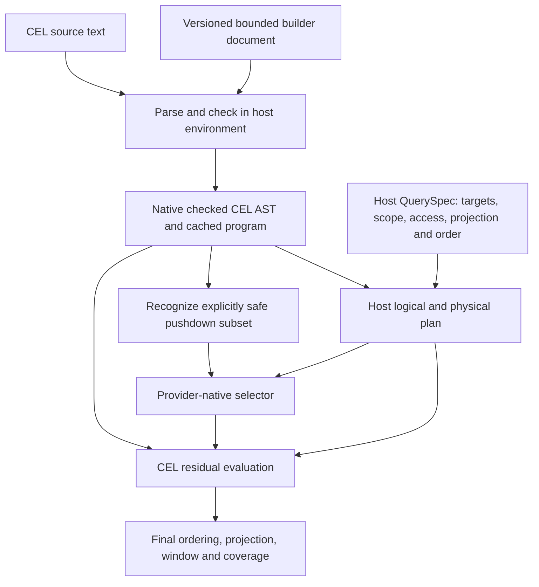

# Query language comparison: CEL versus JMESPath

Date: 2026-10-17 (verification timestamps in the evidence are UTC and may fall on October 18).
Status: CEL language direction accepted by the user; internal native checked-AST direction retained. Production profile, schema/binding/wire contracts and integration validation remain open gates. No product dependency changed.
Context: [reviewed foundation](2026-10-17-resource-foundation-design.md), especially sections 7–13.
Reproduction: [source, fixtures, pinned modules and measured outputs](2026-10-17-query-language-evidence.zip). SHA-256: `1771a69c0b383e835dad876867d67e59ef057504fdbbb739e594fd4680dbc5a5`.

## 1. Accepted language direction

Use **CEL as the initial host-side resource predicate language**, with the canonical Go implementation tested here, **`cel.dev/cel-go v0.32.0`**, subject to final dependency/license/release review. Do not ship JMESPath as a second initial language merely because it is faster on this small predicate workload.

Use CEL's native checked AST/program **internally for expression semantics**. Keep targets, authority/scope/access, projection, global ordering, windows, coverage and lifecycle in the host QuerySpec/logical plan. Introduce a bounded builder/pushdown representation only where required; do not implement a second universal expression interpreter or flatten arbitrary CEL into the old Find tree.

This refines the earlier provisional preference for a separate logical IR. The experiments demonstrate enough native CEL AST functionality to avoid assuming another full expression representation is necessary. A host query plan still exists; an execution plan is not a competing language evaluator.

Why: the exercised CEL implementation provides correlated collections, presence checks, declared parameter types, exact signed integers, timestamps, AST inspection/serialization and actual evaluation cost/cancellation mechanisms. Tested JMESPath implementations handle JSON selection well and evaluate the primary predicate more cheaply, but their numeric and execution-control boundaries require additional evaluator work for this product. The community fork improves bindings/AST access without resolving those blockers.

The user accepted CEL as the direction after reviewing this evidence. That acceptance does not complete P01 or imply a schema-aware IDE is delivered. Schema admission, incomplete-draft authoring, numeric wire policy, builder UX, bounded production execution and real provider equivalence remain confirmation gates; material failures must be reported rather than hidden to preserve the choice.

## 2. What actually ran

Two implementation agents independently built throwaway Go modules using one parent-defined corpus. Parent independently computed expected IDs, checked the source harnesses, rebuilt both executables and reran them **sequentially** after both agents completed.

| Candidate | Exact tested module | Role |
| --- | --- | --- |
| CEL | `cel.dev/cel-go v0.32.0` | Canonical implementation; historical google module is now compatibility-only |
| JMESPath upstream | `github.com/jmespath/go-jmespath v0.4.0` | Established Go release |
| JMESPath community | `github.com/jmespath-community/go-jmespath v1.1.1` | Material alternative with lexical bindings and accessible AST |

Machine: Apple M5 Max, Mac17,6, darwin/arm64, 18 logical CPUs, 128 GiB RAM; Go 1.26.1. Binaries report GOMAXPROCS 18. This is one machine, not supported-platform performance proof.

Parent commands, executed in the respective isolated module directories:

```sh
# CEL; temporary caches were used by its worker and retained for verification.
GOWORK=off \
  GOMODCACHE=/tmp/omniview-query-spike.DEcsXr/cel/.modcache \
  GOCACHE=/tmp/omniview-query-spike.DEcsXr/cel/.gocache \
  go build -o cel-probe . && ./cel-probe

# JMESPath; both implementations are exercised by one executable.
GOWORK=off go build -o probe . && ./probe
```

Observed parent stdout / exit status:

```text
CEL v0.32.0: 63 observations; 0 assertion failures; results.json written
[exit 0]

wrote results.json; engines=2 corpusRows=5
[exit 0]
```

Parent additionally checked every JMESPath recorded semantic control, timed match count and safe/unsafe pushdown control, and CEL's assertion count/timed matches. A recorded pass can mean an expected limitation was observed; it is not a claim that every product feature passed. The evidence preserves unsupported/unsafe observations.

No product modules/lockfiles, runtime services, actual providers, clusters or credentials were changed. No product suite, UI, IPC path or native rendering was exercised. Probe code is archived for reproduction, not installed as product code or permanent tests. Agent reports in the archive contain earlier exploratory timings; **the archived results.json files and this record contain the sequential parent rerun**.

## 3. Shared semantic evidence

Five native-shaped fixture resources cover cloud tag arrays, quoted map keys, container fields, node-local VM identity/hardware and Kubernetes nested containers. Decimal strings preserve fixture identifiers; a separate raw JSON numeric probe tests precision rather than counting string comparison as integer support.

| Requirement | CEL v0.32.0 | JMESPath upstream / community |
| --- | --- | --- |
| Same-element tag correlation | Correct: cloud-a, not false-positive cloud-b | Correct in both |
| Nested correlated arrays and quoted keys | Correct; additional two-level correlation control | Correct fixed interface/container/key cases |
| Missing versus explicit null | Explicit `has` guards distinguish them; absent unguarded field errors | Parent `keys` presence test distinguishes them; plain lookup collapses missing into null |
| Parameter binding without source substitution | Declared int/string variables and activation values; malicious string remains data | Safe resource/parameters input envelope works; standard has no lexical variables; community public interpreter supports real lexical bindings |
| Wrong binding type | Tested numeric use errors; host input validation still required | Tested numeric mismatch yields null/no matches, not static type diagnostic |
| Exact large integer semantics | Native int64/literal distinction works with safe admission | Both tested evaluators collide on numeric literals beyond IEEE754 exact range; UseNumber/int64 are not full supported numeric domains |
| Timestamps | Native parse/compare and malformed-input error exercised | No native timestamp functions/type in tested default implementations |
| Schema checking | Actual hand-declared Go struct registration rejects invalid fields/types | No static schema/type environment in tested APIs |
| Incomplete-draft completion | Not supplied by exercised direct APIs | Not supplied by exercised direct APIs |
| AST access and same-version serialization | Visitor/type/macro/source metadata and checked-protobuf reload exercised | Upstream fields opaque; community visitor works but raw JSON roundtrip changes evaluation |
| Bounded builder roundtrip | Seven cases in a deliberately small subset; comprehension rejected | Narrow equality/conjunction subset and escaping control; general reverse conversion not proved |
| Cost/cancellation | Real runtime cost limit and context cancellation in comprehensions exercised | No evaluator context/cost hooks found in pinned public API/source |
| Final order/page and pushdown safety | Correct host final window; native Lists extension also exercised separately | Correct collection sorting/slice; both mutate sort input slice |

### 3.1 Numeric admission is a required host contract

Raw JSON numbers `9007199254740993` and `9007199254740992` collide when decoded into float64 before either evaluator sees them.

CEL additionally demonstrated that both rounded doubles compare equal to a high int64 binding in the tested mixed-type comparison. Choosing CEL **does not fix unsafe JSON decoding**.

Executed CEL safe paths: `json.Decoder.UseNumber` directly through its default adapter, and range-checked Int64 admission. Both returned true/false for the high/low values. Distinct large integer literals remain distinct; overflow/out-of-range conversion produces errors. The adapter tries Int64 before falling back to double, so blindly using UseNumber is not a complete arbitrary-precision policy.

Recommended initial policy to specify before implementation: preserve numeric lexemes; admit declared exact signed integers via range checking, keep opaque IDs as strings, and prevent unsafe implicit double/int comparisons for exact fields. Decimal/fraction precision, uint64 boundaries, protobuf Struct and JavaScript wire handling remain untested. Do not claim arbitrary precision or round unsupported values silently.

JMESPath's standard does not mandate every implementation defect observed here. The conclusion applies to **these pinned Go evaluators**: large numeric literals collide; ordering with preserved json.Number/int64 yields null and numeric functions reject those domains. Choosing them would require additional numeric implementation work or a materially narrower product contract.

### 3.2 Authoring and schema integration are not solved

CEL dynamic map checking accepts typo fields and returns no AST for a trailing dot. Native Go struct registration demonstrates useful typed checking, but is not an adapter for provider JSON Schemas, unions, optional/null fields, recursive references or heterogeneous target schemas. Neither language produced IntelliSense suggestions in the experiments.

Required host work: cursor-context recovery, bounded schema navigation, execution-support overlay, suggestion edits/ranking, precise field applicability and validated input admission. Local editor mechanics/cached presentation remain permitted under the pragmatic client principle.

Diagnostics use different offset conventions: exercised CEL source offsets are Unicode scalar/code-point based; JMESPath syntax offsets are UTF-8 byte based. Neither provides universal full editor replacement/error spans. Specify an explicit wire convention and conversion to editor UTF-16 positions; do not forward offsets unlabelled.

CEL text retains its actual error semantics: missing unguarded keys error rather than silently becoming nonmatches. Builder-generated predicates can emit explicit presence guards. Heterogeneous targets and error/partial-result handling must be specified consistently; do not add hidden per-provider exceptions.

### 3.3 Control guarantees have limits

CEL CostLimit(100) stopped a million-element comprehension at cost 101. ContextEval with interrupt frequency 1 honored cancellation before/during that comprehension. A pre-canceled scalar `true` nevertheless succeeded: host request preflight cancellation is still necessary. Parser size/recursion limits rejected bounded excessive examples. Static estimation without cardinality hints returned an effectively unbounded maximum, not a useful admission estimate.

Runtime cost is not a hard wall-clock/memory guarantee and does not bound provider RPCs or custom blocking functions. Resource size, acquisition, concurrency, parse and delivery budgets remain host responsibilities. The benchmark's cost-tracked mode is not identical to a complete production cost-limit/context configuration.

JMESPath cancellation/cost absence is API/source evidence, not an executed stop-success. Between-row cancellation and outer budgets would not interrupt a costly individual evaluation. We did not abandon goroutines and call that cancellation.

## 4. Sequential parent performance observations

Primary workload: one compiled same-element `env=prod` predicate, cycling the same five decoded fixtures; 5,000 warmup evaluations; three timed runs at 5,000 and 50,000 evaluations. Each run produced exactly 1,000 / 10,000 matches. CEL uses guarded `exists`; JMESPath uses guarded tag filtering/count. Library adaptation is included; decoding and prebuilt CEL activation construction are excluded.

These are **repeated evaluations over five fixtures**, not 50,000 distinct inventory objects. No per-provider/IPC/render costs, concurrent query throughput or latency percentiles are measured. Collection sort/page is a separate semantic probe, not part of this timing.

Go automatic-N allocation benchmarks from the parent rerun:

| Configuration | Eval ns/op | Allocs/op | Bytes/op | Parse + check/compile ns/op |
| --- | ---: | ---: | ---: | ---: |
| CEL default, uninstrumented | 208 | 3 | 144 | 35,809 |
| CEL cost-tracked | 616 | 14 | 641 | Same compiled expression; instrumentation configured during program construction |
| JMESPath upstream | 108 | 2 | 44 | 2,466 |
| JMESPath community | 182 | 3 | 92 | 4,927 |

Allocation counts use integer per-operation reporting and can truncate fractional mixed-workload counts. CEL check-only on a preparsed AST measured 10,145 ns/op; program construction from checked AST 1,641 ns/op. Cold environment startup is not measured. Raw per-run durations, iteration counts and dependencies are in the evidence.

JMESPath wins this small default predicate benchmark. CEL cost tracking has material overhead and allocation pressure; performance work must not use the default fast path as a proxy for bounded production execution. These costs favor compile/program reuse, shared evaluation, native/index candidate reduction and realistic profiling—not removing safety controls to achieve a benchmark number.

## 5. Expression/plan boundary



Proposed concrete direction:

1. Public QuerySpec stores expression source/language/environment version or a versioned structured builder input, plus host-owned query concerns. Do not expose a library Go type as the universal public SDK request.
2. Checked AST/programs are internal compiled artifacts. Retain source and pin environment/extensions. Same-version protobuf reload passed; arbitrary cross-version cache compatibility and trusting imported checked ASTs did not. Recheck untrusted/imported expressions.
3. Builder documents are UI/authoring configuration lowered to CEL; they are not a second evaluator. The executed subset does not yet include a user-friendly correlated-array builder. Advanced expressions stay code-only until a lossless conversion exists.
4. A small normalized planner/pushdown subset may be introduced where necessary. Any unsupported AST remains intact as a cost-bounded host residual or the operation is rejected. No approximation, string-matching pushdown, forced old Find tree or universal IR project.
5. Provider-side selectors execute under declared equivalence/capability rules; providers do not implement CEL merely to enumerate resources. Get-only/native-query-only resource constraints stay explicit.
6. Initial resource predicate output should be boolean, not arbitrary CEL result truthiness. This is a recommended product contract, not a claim that a complete host query service was implemented here. Global sort/page/group/projection remain host contracts; CEL Lists extension availability does not define their policy.

### Example expressions actually evaluated

The spike uses `r` for a dynamic resource and separately declared `environment` / `cpuMinimum` variables. Those spellings are probe conventions, not final public API naming.

```text
has(r.tags) && r.tags.exists(t, t.key == "env" && t.value == environment)

has(r.hardware) && has(r.hardware.cpu) && r.hardware.cpu >= cpuMinimum

has(r.nullable) && r.nullable == null
```

Both experiments simulated safe candidate-prefilter/residual equivalence and detected an unsafe limit-before-residual/order transformation. They used different small counterexamples; these are not a cross-language randomized conformance suite or actual Kubernetes/cloud API proof. Null/missing sort policy, ties, complete builder combinations and authorization equivalence remain unproved.

## 6. Decision scope and next work

Accepting CEL advances language selection only. It does not approve every extension, wire shape, arbitrary expression surface or serialized AST as public API. The subsequent [approved binding/schema design and executed confirmations](2026-10-17-cel-binding-schema-contract.md) establish bounded transport/adapter feasibility but retain a blocking dynamic mixed-numeric profile decision and nullable static-checking limits. Resolve those before freezing the profile; concrete builder/field-path guarantees, source-session proof and a provider-neutral integrated vertical slice remain distinct work.

Before production cutover:

- Define exact signed/floating/decimal/uint numeric policy through the real wire/client path.
- Implement schema/type admission and incomplete-draft completion against the real resource catalog, not hand-declared Go probe structs.
- Define safe environment/functions, limits, per-request cancellation preflight and production instrumentation; benchmark that exact configuration.
- Specify boolean membership, missing/error behavior, heterogeneous type applicability and deterministic null/tie ordering.
- Exercise source/session continuity, native-provider pushdown, coverage and real end-to-end Go/IPC/client workload.
- Review library license/dependency maintenance, checked-artifact trust, cache invalidation and supported environment versions. Module age/activity is not a support guarantee.

JMESPath remains a viable JSON extraction/transform tool in other contexts. This experiment does not justify adding it as a second Omniview query mode or rejecting all future JMESPath implementations forever.

## 7. Reproduction and primary references

Unpack the evidence ZIP into an empty directory, preserving `corpus.json` above `cel/` and `jmespath/`. From each module directory, run `GOWORK=off go mod download`, `GOWORK=off go build -o probe .`, then `./probe`. CEL's executable name can be arbitrary. Downloads must resolve the pinned modules; normal Go caches or private GOMODCACHE/GOCACHE may be used. Execute candidates sequentially. Results files are overwritten by a new run; keep archived measurements separately if comparing. No caches or binaries are in the archive.

- [Canonical CEL source v0.32.0](https://github.com/cel-expr/cel-go/tree/v0.32.0), [module release metadata](https://proxy.golang.org/cel.dev/cel-go/@v/v0.32.0.info), [historical module migration notice](https://github.com/google/cel-go#readme).
- [CEL AST/I/O](https://github.com/cel-expr/cel-go/blob/v0.32.0/cel/io.go), [program/context implementation](https://github.com/cel-expr/cel-go/blob/v0.32.0/cel/program.go), [cost/parser options](https://github.com/cel-expr/cel-go/blob/v0.32.0/cel/options.go), [native type integration](https://github.com/cel-expr/cel-go/blob/v0.32.0/ext/native.go).
- [JMESPath specification](https://jmespath.org/specification.html), [upstream v0.4.0 API](https://github.com/jmespath/go-jmespath/blob/v0.4.0/api.go), [upstream parser/AST](https://github.com/jmespath/go-jmespath/blob/v0.4.0/parser.go), [upstream evaluator](https://github.com/jmespath/go-jmespath/blob/v0.4.0/interpreter.go).
- [Community v1.1.1 parser/AST](https://github.com/jmespath-community/go-jmespath/blob/v1.1.1/pkg/parsing/parser.go), [bindings](https://github.com/jmespath-community/go-jmespath/blob/v1.1.1/pkg/binding/binding.go), [interpreter](https://github.com/jmespath-community/go-jmespath/blob/v1.1.1/pkg/interpreter/interpreter.go).

Pinned source files and the candidate reports identify the APIs used. All performance claims above come from local execution, not upstream marketing figures.
