# Resource foundation design

Date: 2026-10-17
Status: conceptual foundation reviewed through section 12; CEL accepted as the language direction following the executable comparison. Concrete contracts, integration confirmation, source-session proof and production budgets remain required before implementation.

Related: [Product roadmap](../../roadmap/2026-10-17-product-roadmap.md) and [work packages](../../roadmap/2026-10-17-resource-intelligence-work-packages.md).

## Review status

The user accepted conceptual sections 1–12 and the CEL language direction supported by the comparison. Host QuerySpec/planning owns non-expression concerns; CEL checked AST/programs remain internal expression artifacts. Illustrative types are not frozen wire contracts. Profile/functions, schema admission, binding/numeric transport, completion and source-session guarantees still require concrete design and verification.

## 1. Accepted conceptual boundary: identity versus access

A connection is a route and credential context used to observe or operate on infrastructure. The same backing resource may be accessed through several connections. A connection may also reach multiple resource authorities. Connection ID is therefore not a permanent component of canonical resource identity.

Resource identity distinguishes provider, backing authority, opaque resource type, provider-declared identity scope and opaque native object ID. Query scope is separate: not every filterable dimension participates in identity. Native API versions, schema revisions, resource incarnations and source revisions are separate concepts.

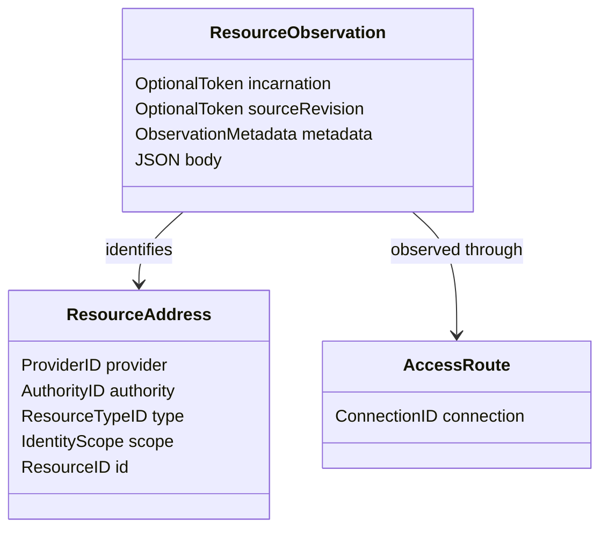

These are conceptual type names, not frozen SDK/protobuf definitions. They supersede the roadmap's earlier treatment of connection ID as an intrinsic component of resource identity; the roadmap and packet contracts must be reconciled when the reviewed foundation is consolidated.

### 1.1 Equality does not grant observation sharing

Two observations may identify the same resource while differing in visibility, projection, source guarantees, schema or freshness. Resource/graph reference identity is distinct from cache/materialization eligibility. Never merge differently authorized bodies merely because addresses match.

- The host owns invocation and lease context; a caller-supplied plugin ID is not an authenticated principal.
- Provider-owned source revisions are opaque and are not host observation sequences.
- A named resource can retain its address after recreation while its incarnation changes, if the source can identify that change.
- Missing incarnation information must remain an explicit limitation; do not invent a UID.
- Provider-native IDs preserve meaning and precision. Numeric IDs may use canonical strings instead of lossy JavaScript numbers.
- Providers may describe Kubernetes namespaces, cloud accounts/regions, container engines or hypervisor-local scopes. None is universally required.

### 1.2 Initial system responsibility map

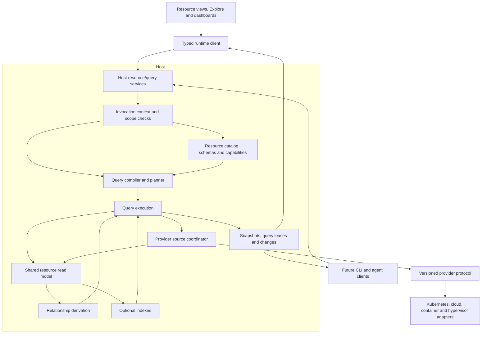

The responsibility map is proposed architecture, not a claim of existing code or approval of every engine interface. Providers own native acquisition/identity mapping and supported operations; the host owns universal query semantics and execution placement; runtime observes results rather than evaluating queries again. Graphs and indexes are derived structures, not alternative sources of truth. The read model is not a mandate to mirror entire accounts.

Existing shared-origin UI plugins remain trusted code under the current execution model; the context boundary above does not establish hostile-plugin isolation.

## 2. Accepted authority-resolution model

Providers identify backing authorities; the host assigns and persists canonical AuthorityIDs. An authority is a resource identity domain, not a permission grant. A connection may resolve several authorities.

```typescript
type AuthorityResolution =
  | {
      kind: "identified";
      nativeKey: string;
      displayName: string;
    }
  | {
      kind: "connection-local";
      bindingKey: string;
      displayName: string;
      reason: string;
    };
```

This illustrates the accepted distinction, not a frozen wire schema. Native keys are provider-defined stable backing-system identifiers, independent of credentials/display names. Binding keys identify source bindings within a connection where cross-connection identity is unavailable.

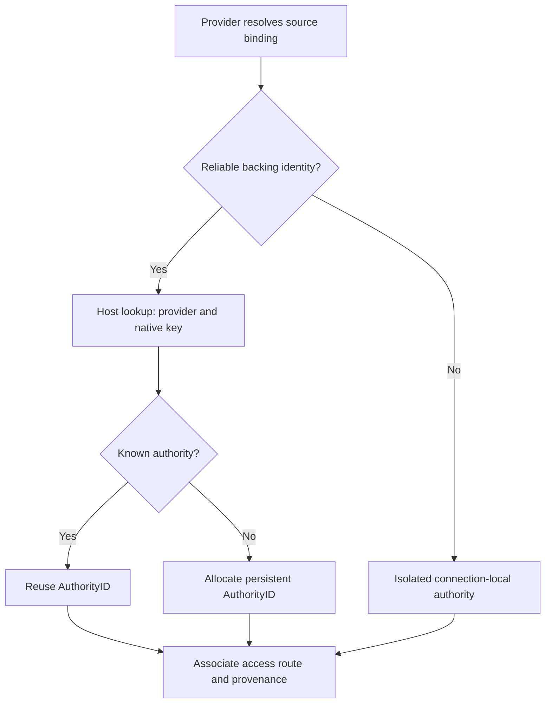

- Hostnames, endpoint URLs, display names and credential hashes alone do not prove authority equality.
- Explicit configured identity is distinguishable as a user assertion, not misrepresented as provider-verified identity.
- Changed credentials change access context, not automatically authority; invalidate affected visibility-sensitive observations.
- Retargeting resolves a new backing authority and ends old acquisitions; it does not rename the old authority.
- Do not silently rekey saved references. Verified mappings may support explicit migration; unresolved references retain explanatory state.
- Connection-local identity does not prove backing-system continuity across reconnects. Refresh observations and expose uncertainty when continuity cannot be verified.
- Equal authorities/resource addresses do not authorize body/cache merging.

## 3. Accepted scope semantics

Identity scope is an exact provider-declared tuple. Query scope is an explicit selection over provider-declared dimensions. Neither is authorization, and neither requires a universal hierarchy.

```typescript
type ScopeDimensionDefinition = {
  id: string;
  displayName: string;
};

type ResourceTypeIdentity = {
  dimensions: readonly string[];
};

type IdentityScope = {
  values: Readonly<Record<string, string>>;
};

type ScopeConstraint =
  | { dimension: string; match: "any" }
  | {
      dimension: string;
      match: "oneOf";
      values: readonly string[];
    };

type QueryScope = {
  constraints: readonly ScopeConstraint[];
};
```

Illustrative types describe accepted semantics; they are not frozen wire definitions. QueryScope applies within a selected provider/authority/type target. Multi-target queries compose these selections separately.

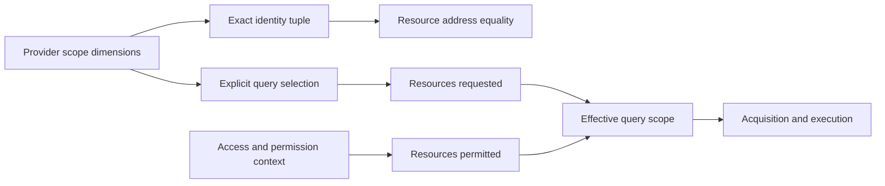

### 3.1 Equality and validation

- Scope dimension order does not affect identity; normalize once at boundary admission, not on every lookup/render.
- Native ID/scope values are case-sensitive unless provider-declared normalization says otherwise.
- Missing required or unexpected identity dimensions are invalid addresses, not wildcards or ignored fields.
- Empty identity scope is valid when the type declares no identity dimensions.
- Empty query `oneOf` matches nothing. It never means all.
- Explicit query `any` stays within the selected target and permitted access context; it does not enumerate unrelated authorities/connections.
- Missing query constraints remain unresolved until a documented default is applied and represented explicitly. Do not silently widen.
- Unknown dimension IDs return structured errors.
- Providers choose one stable addressing convention per type; the host never infers scope by parsing IDs.
- Navigation may present provider-specific hierarchies; core identity/query semantics do not require a universal hierarchy.
- Labels/tags/body fields remain predicates/facets unless explicitly declared as source-scope dimensions.
- Selection does not grant access; fewer returned resources do not alone establish inventory completeness.

## 4. Accepted provider capability model

Provider operation support, host ability to plan a particular request, and invocation authorization are separate facts. A resource catalog does not imply enumeration, mutation, native querying or update support.

| Capability | Meaning |
| --- | --- |
| Enumerate | Acquire resources under declared scope/pagination/coverage rules |
| Get | Fetch one resource by address |
| Native query | Execute an explicitly supported provider-native query subset |
| Updates | Deliver changes under a declared source-session contract |
| Create / update / delete | Independently supported mutations with operation-specific semantics |
| Actions | Discover and invoke named provider operations |

```typescript
type CapabilitySupport<T> =
  | { state: "supported"; contract: T }
  | { state: "unsupported"; reason: string }
  | { state: "unknown"; reason: string };
```

Operation contracts differ; do not replace them with one generic flag bag. Descriptions are qualified by provider/type/authority/access route/scope/configuration as applicable, and have revision/invalidation semantics.

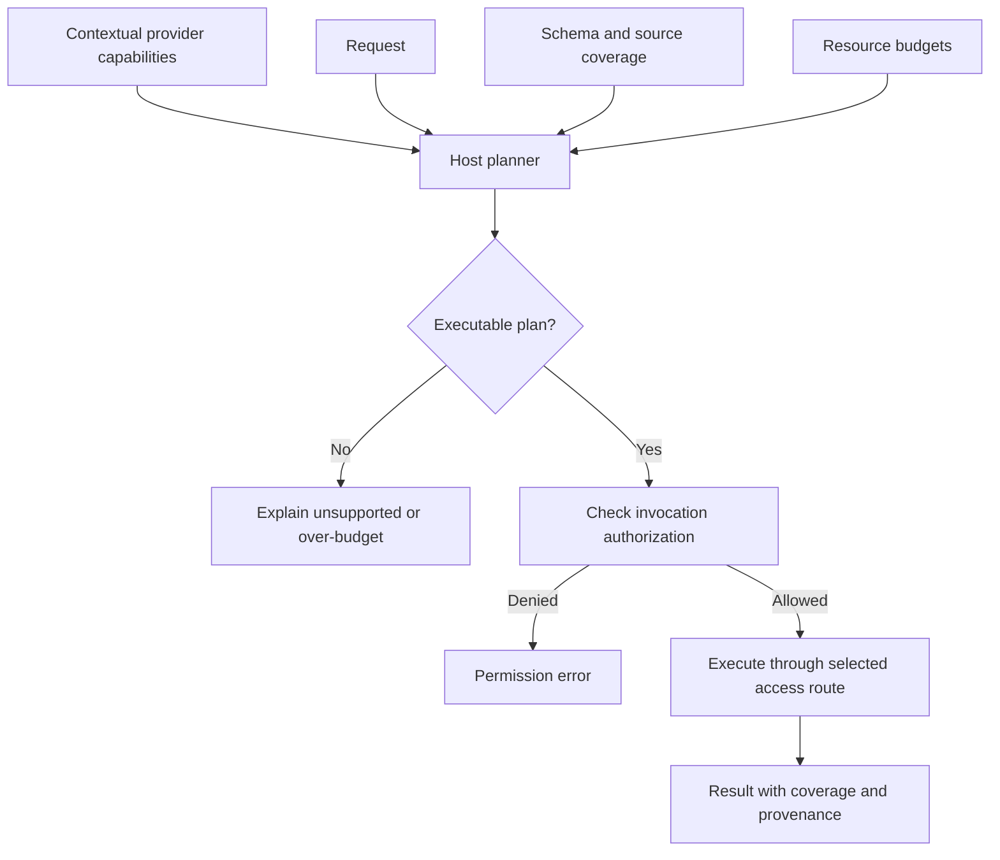

Discovery/acquisition are authorized too; planning does not fetch protected data just to determine executability.

- No true-by-default CRUD support, fake methods or support inferred from structural schemas.
- Unknown discovery is neither confirmed support nor authoritative permanent lack of support.
- Provider support is not a permission grant; retain unsupported/denied/unavailable/discovery-incomplete distinctions.
- Native querying describes an exact subset, not universal host-language support.
- Host query executability is request-specific, including residual evaluation, coverage and budgets.
- Plans bind relevant schema/capability revisions; known incompatible changes invalidate them before execution.
- Pushdown plus residual evaluation is valid only when the acquired candidate set satisfies required semantics within budget. Otherwise return a limitation rather than a falsely complete result.

## 5. Accepted source acquisition lifecycle

Source sessions acquire provider observations through an access route. Query leases maintain particular query results. Compatible leases may share a session only when access/visibility, scope, projection and source guarantees permit it. Sessions do not imply a complete infrastructure mirror.

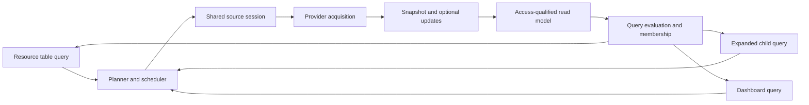

- Snapshot mode acquires a requested set, reports coverage and finishes. Refresh is explicit.
- Snapshot-plus-updates establishes initial observations then follows changes under declared guarantees.
- Snapshot-only providers need no fake watch or automatic host poller. Provider-managed polling may expose updates with explicit freshness/consistency.

The user accepted the [concrete source-session semantic boundary](2026-10-17-source-session-contract.md). Its [executed probes](2026-10-17-source-session-contract.md#8-executed-source-session-confirmations) establish conditional native-cutover and bounded loopback-transport feasibility, including expected weak-source counterexamples. They do not freeze the SDK ABI or prove actual provider/SDK/query-result integration.

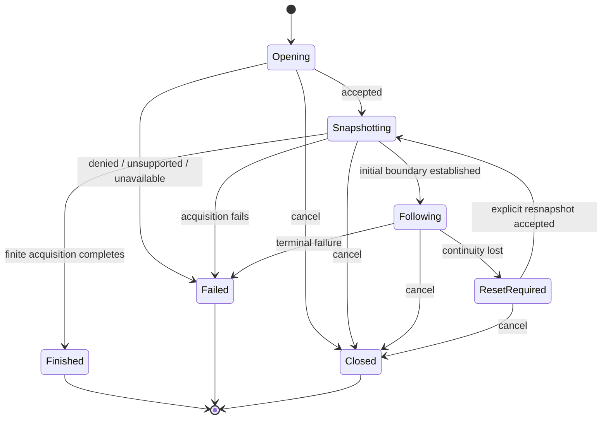

### 5.1 Coverage

```typescript
type SourceCoverage = {
  enumeration: "exhausted" | "partial" | "unknown";
  consistency: "pointInTime" | "bestEffort" | "unknown";
  limitations: readonly string[];
};
```

Illustrative shape: enumeration exhaustion is scoped to the source request and access semantics, not unrestricted infrastructure visibility. Partial means the required set was not fully acquired; unknown means completeness cannot be established. Point-in-time consistency requires an actual source guarantee; best-effort observations can reflect different moments. Last-page arrival does not prove point-in-time consistency. Limitation reporting must not disclose protected resource names/counts.

### 5.2 Ordering and lifecycle invariants

- Coordinate initial pages and changes where supported so older pages cannot overwrite newer observations. If the source cannot close this window, report best-effort rather than inventing a gap-free snapshot.
- Host observation ordering is distinct from opaque source revision tokens.
- Known lost continuity produces an explicit reset; do not quietly continue an apparently complete live result.
- Source pagination is not final query pagination after filtering/sorting.
- Cancellation releases interest; stop shared acquisition only when remaining consumers no longer require it.
- Native-query-only sources may acquire bounded results rather than inventory. Their coverage/update semantics stay explicit; they are not automatically reusable complete inventory.

## 6. Accepted catalog, schema and representation model

One authoritative resource catalog owns type/identity definitions and available representations. Resolved structural schemas feed query completion, builder controls, validation and document-editor integration. They do not by themselves establish native query support or authorization.

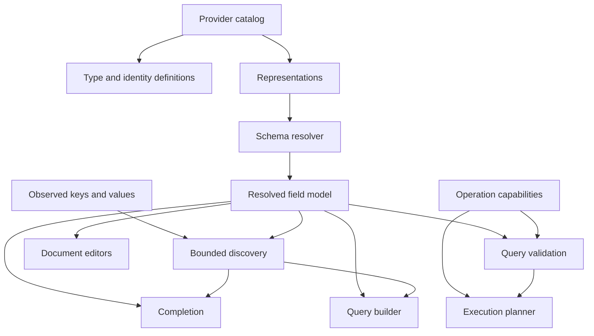

### 6.1 Representation is not identity

The same address may have different API/document representations and schemas. These do not automatically create different resources/graph nodes or authorize cache-body interchangeability.

```typescript
type RepresentationBinding = {
  representationId: string;
  schema?: { id: string; revision: string };
};

type SchemaAvailability =
  | { state: "available"; id: string; revision: string }
  | { state: "notProvided" }
  | { state: "unavailable"; reason: string };
```

An observation carries or inherits its representation binding. A field missing from a summary projection is not necessarily absent in the resource. The planner must establish that acquired representations contain required fields. Schema revisions identify schema definitions, not source cursors, resource updates or host sequences.

Not-provided schemas permit basic reads and applicable runtime validation. Unavailable schemas retain a retrieval/resolution/permission failure state; do not cache them as permanent schema absence.

### 6.2 Structural fidelity and ownership

- Preserve fixed object properties, typed maps, array elements, required/optional and null/missing distinctions, unions, enums, descriptions and recursive references.
- Resolve branches lazily with bounds; never flatten all reachable fields for each completion request.
- Union suggestions state conditional applicability rather than claiming every alternative's fields always exist.
- Adapters declare schema dialect/conversion rules. Unsupported constructs yield explicit reduced-validation diagnostics, not silent flattening.
- Providers supply native/bundled schema sources; the host resolves/caches by representation, revision and relevant access/scope context.
- Editors, query validation and builders derive from the same resolved structure.
- Structural field existence, query-language accessibility and provider-native execution are separate facts; native restrictions are an explicit capability overlay.
- Observed keys/values supplement authoring, not authoritative schema definitions.
- Schema names/descriptions/suggestions may be sensitive; discovery follows access boundaries.

## 7. Accepted query request and compilation boundary

A query specifies the desired result, not a provider fetch strategy. The host validates/plans bounded native, local or hybrid execution. CEL is the accepted language direction; exact logical representation and implementation profile remain subject to their confirmation gates. Existing Find is not the public contract.

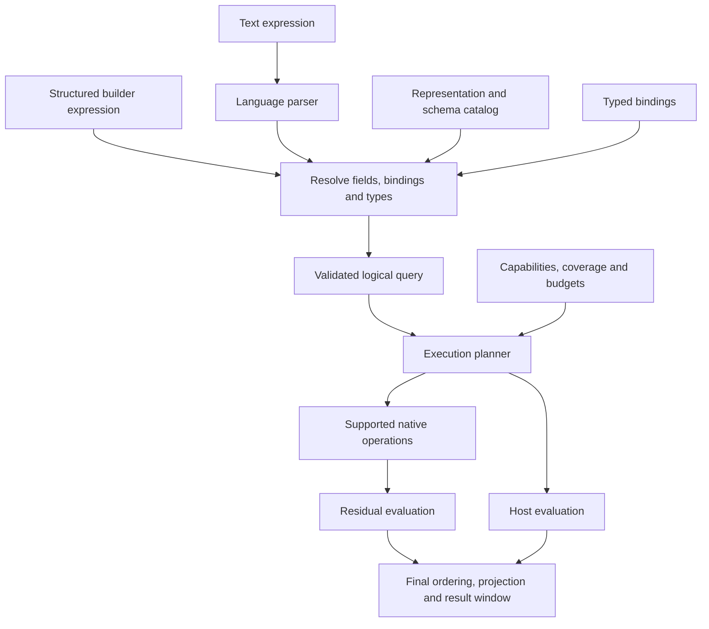

Push ordering/projection/limits down only when equivalent. Native candidate limits before residual filtering can discard required results.

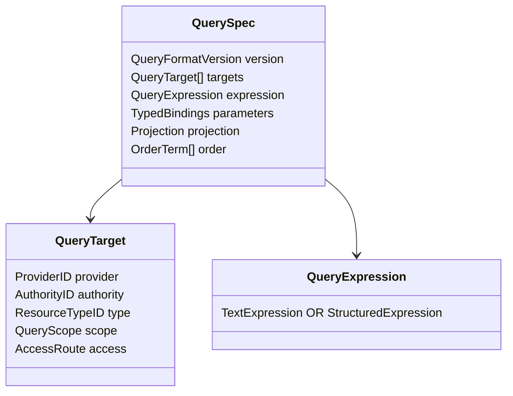

Conceptual names are not complete wire definitions. Multiple targets mean explicit union, not implicit joins/all-connection search. Text/builder inputs declare versions and resolve to shared semantics, not necessarily identical syntax trees. Parameters are typed bound values with agreed precision/time semantics, never string substitution.

Explicit union preserves one observation row per resolved target and resource membership, even when compatible targets reach the same `ResourceAddress`. The host-issued row key includes stable target membership identity as well as resource/incarnation identity; it is not an address-only deduplication key. Each row retains its own target provenance, representation and requested projection. Differing projections remain separate rows; no last-writer selection or field-wise body enrichment is allowed. A future deduplicating union would require a separately explicit, access-safe reconciliation contract, not an implicit optimization of this union.

- Projection describes output; execution may privately acquire other fields needed by predicates/order.
- Ordering defines null/missing and deterministic identity tie-break behavior, not incidental arrival order.
- Resolve documented defaults before planning and expose the effective request; missing scope/targets never silently broaden.
- Host invocation context is not a caller-supplied trusted principal in QuerySpec.
- Access routes participate in execution/sharing eligibility, not permanent resource identity.
- Finite execution delivers a bounded result/page; query leases maintain bounded result windows under supported observations.
- Delivery cursors/handles are not source cursors, predicates or saved-query meaning.
- Continuation binds effective query/order/access context and result-generation guarantees; invalidation/reset is explicit.
- Resolve targets/scope, parse, resolve fields/representations, validate bindings/types/semantics, and plan within budgets/access constraints. Schema heterogeneity/unknown fields do not silently remove predicates.
- Expression source text is distinct from resource free-text search. Any search predicate has explicit composition/matching semantics; no constraint-dropping shortcut.

## 8. Accepted result delivery and query leases

Deliver a bounded initial result and optional ordered result changes. Apply changes atomically within a generation and reset explicitly on lost continuity.

Resource address, result row key and provenance are distinct. A row key identifies membership in a particular result, not necessarily a unique resource address. Different access-qualified observations must not silently merge into a richer body; grouped rows need not be resources.

Finite delivery includes generation, bounded keyed rows/provenance, qualified coverage, optional supported continuation and optional exact/estimated/unknown counts. Page length does not establish total count or completeness. Continuations state their stability guarantees and invalidate explicitly when those guarantees fail.

The [executed bounded vertical proof](2026-10-17-source-session-contract.md#9-executed-integrated-source--cel--result-window-proof) connects TCP source ingestion, real CEL, host-ordered windows and passive Go/JavaScript consumers, including source and consumer-local resets. It supports this boundary without freezing its prototype result/control DTOs or proving the actual SDK/runtime/UI implementation.

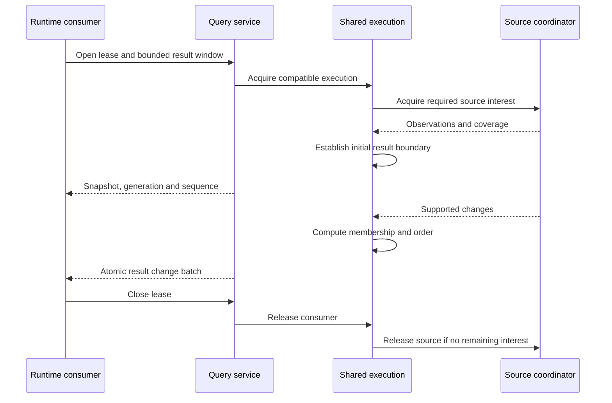

Establish the ordered delivery channel before publishing initial data; no independent snapshot-then-listener race. Transport choice does not weaken that guarantee.

- Result transitions are inserts, changed projections, predicate exits, deletions and atomic order/window/group changes—not raw provider events.
- Clients receive resulting order; they do not independently sort/filter to reconstruct it.
- Prefer changed-row replacement projections, removals and explicit order edits or bounded-window replacement initially. Arbitrary deep patches require measured justification.
- Sequences are ordered within a generation, not provider revision tokens; reject superseded lease/generation frames.
- Gaps mark a result unsynchronized and require explicit reset; bounded buffer overflow cannot silently drop changes or grow memory indefinitely.
- Snapshot-only sources expose freshness/refresh state, not invented real-time delivery.
- Access/permission-context changes invalidate affected results/sharing. Protected data cannot remain visible under an ordinary stale-data retention policy.

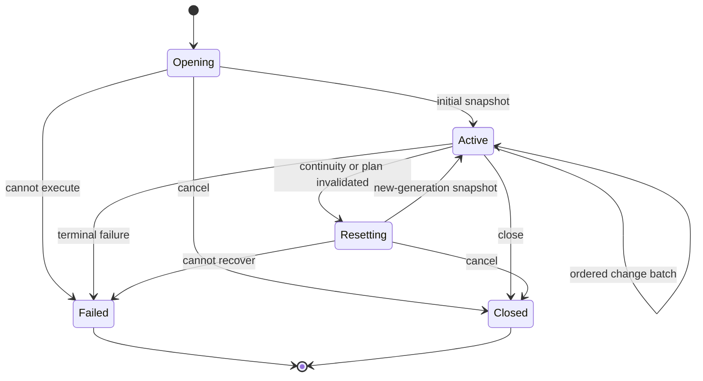

## 9. Accepted pragmatic client-computation principle

The user requires performance-optimized, portable behavior across UI, CLI and agent clients—not a blanket prohibition on JavaScript or a backend round trip for every interaction. The host is authoritative for resource/query semantics and expensive inventory-dependent work. Clients must not need another query engine to reproduce correct results.

- Host: authoritative parsing/type checking/planning/evaluation, resource result membership/order/grouping, source acquisition, coverage, access checks, graph derivation, indexes and execution sharing.
- Client: input/focus/cursor/drag/scroll state, viewport measurement/virtualization, bounded keyed updates, selection state, formatting and responsive presentation.
- Bounded local work on already-delivered data is allowed where semantics stay explicit: editor token display, cached suggestion narrowing, small static command-list matching and graph presentation/layout may be local when measured and appropriate. Full structural/permission/execution validation remains authoritative in the host.
- Do not download inventories or entire schemas merely to repeat engine work. Never present local filtering of a partial window as a complete resource query.
- Host-issued handles/prepared projections avoid duplicated heavy processing, but ordinary keyed maps, transport deduplication, UI caches and local change bookkeeping are not prohibited.
- JS workers/WASM are valid tools for justified client-side presentation work, not a way to relocate required resource semantics out of the universal service contract.
- Defaults must serve non-visual clients without DOM/viewport concepts. Backend semantics cannot depend on a React component being mounted.
- Measure end-to-end latency, CPU, heap and wire volume. Prefer the simpler bounded mechanism that performs well; neither zero-JavaScript ideology nor unnecessary backend calls/copies are optimization.

## 10. Accepted bounded delivery and flow control

Start with ordinary bounded pages and optional live result windows. Do not require remote virtual memory, arbitrary-rank access or a custom credit protocol without measured need. UI, CLI and agent clients share semantics without DOM/pixel requirements.

```typescript
type QueryDelivery = {
  mode: "once" | "follow";
  pageSize: number;
  after?: string;
  allowPartial?: boolean; // defaults to false; explicit caller authorization
};
```

Illustrative delivery shape: once returns a page and supported continuation; follow maintains a bounded window under section 8. `allowPartial` belongs to this execution/delivery request, not saved predicate meaning or trusted invocation context. Omission resolves to false: failures cannot become successful partial results without explicit caller authorization under section 12. Authorization permits only policy-allowed partial coverage; it never overrides access denial, and returned coverage/errors remain explicit. It participates in execution-sharing/continuation compatibility. Continuation is query-result state, not a provider cursor. Follow-with-continuation requires correct supported window semantics or an explicit unsupported-mode error. Validate limits and expose effective page size and partial policy.

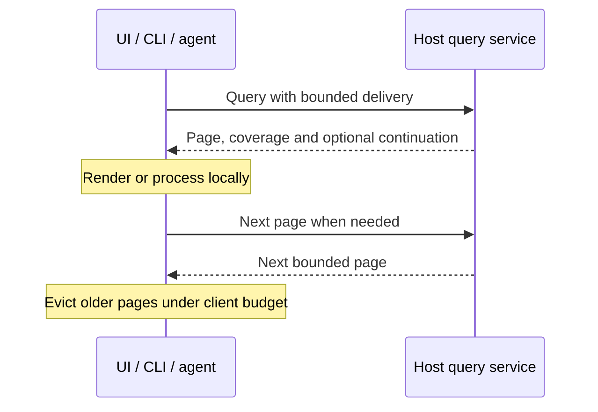

- UI scrolling stays local, with bounded retained pages, virtualization and modest boundary prefetch; no backend call per scroll event.
- Cap rows and bytes, projected field sizes, per-consumer queued bytes/batches and acquisition/evaluation work. Small output does not guarantee cheap acquisition.
- Exact total counts are optional; do not scan everything for a footer.
- Prefer table projections/references; fetch detailed representations when required.
- Use existing transport backpressure where available, bounded queues and safe coalescing. Latest row replacement or bounded-window replacement can be simpler/faster than fine-grained ordering edits.
- Apply batches/render scheduling efficiently; continuity loss resets instead of accumulating unlimited backlog.
- Stalled consumers cannot indefinitely block unrelated consumers or source ingestion.
- Ordinary modest client-side selection sets are valid interaction state.
- Future select-all-matching uses explicit host query/selection references, exclusions and validation, not every ID downloaded to JavaScript. Bulk mutation membership cannot silently grow with a live query; snapshot/current semantics and confirmation need a separate operation contract.
- Sophisticated server-side selection, random-access delivery and incremental diff machinery are not prerequisites for the first query release.

## 11. Accepted sharing, caching and cleanup

Begin with equivalent effective queries within compatible access contexts. Do not merge observation bodies across connections/credentials by default merely because resource identities match.

| Layer | Initial reuse rule |
| --- | --- |
| Schema resolution | Schema identity/revision and applicable access context |
| Parse/compile | Compatible program/environment with relevant schema/capability revisions; bounded cache |
| Source acquisition | Compatible access, authority, scope, representation and acquisition guarantees |
| Query evaluation | Equality of normalized effective queries and visibility context |
| Delivery | Independent lease and bounded delivery state per consumer |

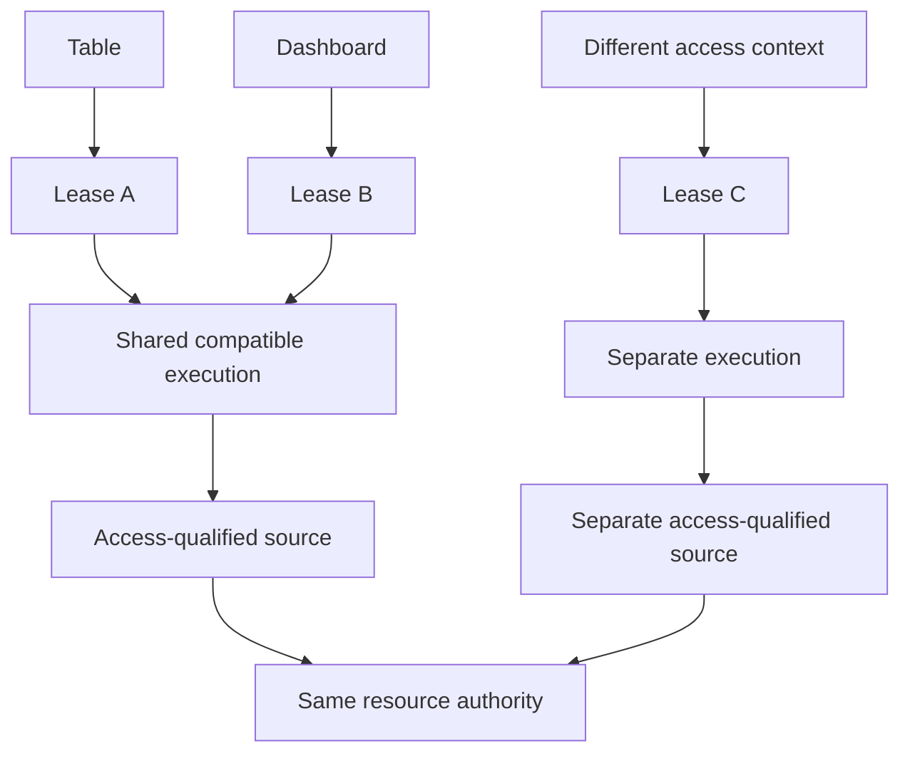

Execution identity includes effective targets/scopes, access/visibility context, expression and format/language versions, bound values, relevant schema/representation/capability revisions, projection/order and delivery requirements affecting execution. Host computes identity once; clients use opaque handles. Sensitive parameters do not enter ordinary logs/diagnostic keys. Query subsumption and different-window sharing are optional optimizations.

- Leases own consumer interest; caches own temporarily retained reusable data. Neither indefinitely keeps the other alive.
- Closing one consumer preserves others; release source acquisition only when no remaining work requires it.
- Compiled programs/snapshots may remain under explicit retention/memory budgets. Cached observations retain freshness/provenance/representation; cached is not current.
- Continuations may expire; invalidation never silently restarts a different result generation.
- Persist query/view configuration, not active handles/generations. Initial raw observations/results are bounded memory state; persistent indexes are separate.
- Explicit cancel/close is normal. Transport disconnect/shutdown cleans up; unreliable disconnect detection uses bounded session expiry/quotas rather than mandatory universal heartbeats.
- Cancellation stops delivery, releases interest and propagates where supported. It does not promise immediate remote abort or stop work still required by others; provider timeouts/concurrency limits still apply.
- Start with exact compatible-query sharing, reference-counted interest, bounded caches and revision invalidation. Defer cross-credential body merging, arbitrary subsumption and distributed caching.

## 12. Accepted errors, partial results and recovery

Use one structured error model across UI/CLI/agent clients. Failed requests, empty results, unavailable sources and successful-but-incomplete results have different meanings.

| Category | Required handling |
| --- | --- |
| Invalid request | Correct syntax/bindings/scope/types; useful source locations |
| Unsupported | Explain missing semantics; never silently simplify |
| Permission denied | Safe denial without protected details |
| Source unavailable | Explicit unavailable state; stale data only under policy |
| Resource limit | Explain budget and how request can be narrowed |
| Continuation expired | Explicitly restart traversal |
| Reset required | Use the result reset contract |
| Internal failure | Safe message and diagnostic identifier, not false success |

Cancellation is an expected lifecycle outcome, not an internal failure.

```typescript
type OperationError = {
  code: string;
  message: string;
  requestId: string;
  location?: { start: number; end: number };
  recovery:
    | "correctRequest"
    | "refreshContract"
    | "restartQuery"
    | "reconnect"
    | "none";
};
```

Illustrative envelope: define offset units before cross-language implementation. Recovery is advice, not authorization for indefinite retries or repeating mutations. Retain provider diagnostics internally while public details are safe.

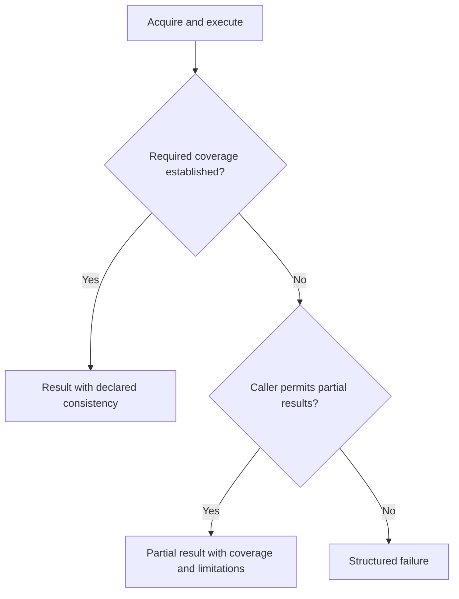

- Do not silently return incomplete data as complete success. Callers explicitly allow partial results; dashboards/Explore may choose that policy visibly.
- Complete is relative to declared source/access/consistency guarantees, not unrestricted infrastructure visibility.
- Partial results carry coverage/safe diagnostics; counts/order/aggregates state actual coverage.
- Invalid editor drafts may retain clearly labeled last-valid results.
- Disconnection may retain visibly stale data where permitted; known access invalidation overrides ordinary stale retention.
- Lost continuity resets; no skipped batches, weakened queries or hidden incomplete-data fallback.
- Shared failures notify affected consumers without killing unrelated executions.

## 13. Evidence gates before concrete implementation

Conceptual review is not runtime proof. The [executed CEL/JMESPath comparison](2026-10-17-query-language-comparison.md) uses a shared provider-neutral corpus, pinned Go implementations and sequential verification. The user accepted CEL as the language direction; retain its native checked AST internally inside the host query envelope rather than introducing a second universal expression evaluator. P01 remains open for concrete contracts and integration confirmation.

Keep the experiment's limits explicit: exact signed integers require safe admission, decimal/uint wire policy is not established, hand-declared Go types are not provider-schema integration, incomplete-draft completion remains host work, and builder/pushdown experiments cover only bounded subsets. Source-session ordering, actual provider equivalence and end-to-end performance were not tested by the language spike.

Before P45 implementation, publish concrete resource/authority/scope/capability/schema/source DTOs and ownership, Go/TypeScript/wire mappings, error codes/offset units, paging/session/frame rules and generation/reset invariants. Preserve the reviewed concepts without pretending these illustrative sketches already specify their encoding.

Measure representative acquisition/evaluation, cancellation, wire size and client interaction before fixing performance budgets. Use finite and event-driven provider profiles; no production credentials or full future provider implementations are required for experiments.

The completed language spike is evidence, not a product implementation. Source, fixtures, pins and measured outputs are archived beside the comparison. Continue with the concrete predicate/profile/binding/schema contract and targeted confirmation gates; perform source-session ordering experiments before dependent implementation plans. Revisit affected choices if those gates expose material incompatibilities.

## 14. Proposed CEL predicate/profile contract

Status: proposed next contract for review, not yet accepted or implemented. CEL is accepted; the profile below defines the product boundary without exposing library AST types.

```typescript
type CELPredicate = {
  language: "cel";
  profile: "omniview.resource-predicate.v1";
  source: string;
};
```

The profile identifies host-controlled language semantics, environment/function/macro availability, type/admission rules and diagnostics—not a Go module version. The implementation/library/extension pins belong to the host's profile implementation and compiled-artifact identity. Unsupported profiles are explicit errors; do not guess a compatible environment.

### 14.1 Public source versus internal compilation

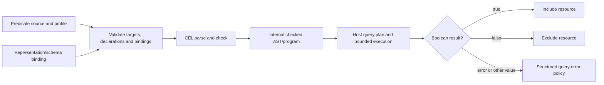

- Save source/profile and authoring configuration, not executable checked ASTs supplied by clients. Compiled programs are keyed by source, parameter declarations, schema/environment binding and profile implementation identity. Plans additionally depend on capabilities/access context; result sharing additionally includes bound values. Do not invalidate a reusable expression program solely because parameter values changed.
- `resource` is the proposed explicit root for the acquired resource body. Do not inject provider fields as unrelated top-level variables or invent different root semantics per provider.
- For the initial profile, named parameters are directly declared CEL identifiers, as supported by the executed binding APIs. Example: `environment` or `cpuMinimum`, not string substitution or an untyped magic parameter namespace.
- Declarations belong to the query definition; execution supplies typed values separately. Required/allowed names are checked before evaluation. Reserved roots/CEL identifiers cannot be shadowed; unknown or missing bindings fail explicitly.
- This preserves compile/program reuse across changing values. Actual result/execution sharing still includes bound values and access context.
- Known non-boolean expressions fail checking/admission. A dynamic result is included only if its actual result is boolean; do not apply JavaScript-style truthiness or treat errors as false.
- Predicates do not perform acquisition, mutation or IO. Only reviewed pure bounded functions/extensions are exposed. Provider actions are separate operations, not CEL functions.
- Ordering/grouping/projection, final pages and source coverage stay in QuerySpec/plan; do not add CEL Lists transforms to silently redefine them.

Example proposed product spelling:

```text
has(resource.tags) &&
resource.tags.exists(t, t.key == "env" && t.value == environment)
```

The experiment executed the equivalent expression with root `r`. Renaming the root is a proposed API convention, not a completed new integration test.

### 14.2 Binding, numeric and field semantics

- Declare parameter types independently of supplied values; validate before calling the evaluator rather than relying on a late overload error.
- Preserve exact integer lexemes across transport and range-check admission. Decimal-string encoding for exact integer bindings is the proposed JSON-wire approach; browser JSON numbers must not carry large exact integers. The complete value/declaration DTO and Go/protobuf mappings are not frozen by this section.
- Keep floating-point measurements distinct from exact integer domains. Unsafe mixed integer/double equality observed in the spike is a blocking confirmation case, not an acceptable implicit conversion.
- Decimal, uint64, nullable and collection parameter encodings require explicit supported policy and tests before those bindings are advertised; do not promise arbitrary precision or silently coerce unsupported values.
- Preserve CEL presence/error semantics. Builder output emits explicit presence guards where needed; arbitrary text is not silently rewritten to turn missing-key errors into nonmatches.
- Field resolution must distinguish true absence from unavailable projected fields/representations. Hydrate required fields where supported or expose unsupported/partial/error behavior; do not evaluate missing summary fields as known resource absence.
- Schema-known fields/types can be checked early; schema-absent/dynamic data needs runtime admission checks. The library dynamic map environment alone does not provide catalog-wide type safety.
- Completion/diagnostics requests carry document version and cursor/source context; responses echo that version so clients can reject stale edits. Proposed cross-client source offsets are zero-based UTF-8 byte positions with half-open ranges; the host translates CEL code-point positions and the UI adapter translates editor UTF-16 positions. These conversions require executable Unicode tests before freezing.

The user subsequently approved the [typed binding and catalog-backed schema-admission design](2026-10-17-cel-binding-schema-contract.md). Its [executed confirmation record](2026-10-17-cel-binding-schema-contract.md#6-executed-confirmation-evidence) establishes tagged transport and bounded schema-adapter feasibility, but records unsafe dynamic mixed numeric comparisons and weaker nullable/union checking. Approval does not freeze a production ABI or resolve those profile constraints.

## 15. Confirmation gates for the accepted CEL direction

Status: binding and schema-admission harnesses executed with bounded positive evidence and explicit unresolved constraints; remaining integration gates below are not passing results. These refine P01/P07/P13/P16/P19 and do not create additional product feature packets.

| Gate | Concrete evidence required | Existing evidence / remaining risk |
| --- | --- | --- |
| Binding and numeric transport | Serialized declaration/value DTO → Go admission → actual CEL → serialized result; large adjacent integers, int64 limits, fractional/exponent input, unsafe mixed comparisons, overflow, malformed/missing/extra/wrong-type bindings and malicious strings; include an actual JS consumer | Tagged JS/Go transport and recursive admission exercised; unsafe dynamic mixed comparisons remain. Repeat through real product bindings and resolve numeric profile |
| Provider-schema admission | Bundled cloud/container/VM and discovered-schema-shaped fixtures, actual catalog representation → CEL type/admission integration; maps/tag arrays/unions/nullability/recursive refs, unknown fields and unavailable projected fields | Bounded catalog-shaped native provider/adapter exercised; full product schema normalization, nullable/union checking guarantees and performance remain |
| Incomplete-draft authoring | `resource.`, partial nested and quoted keys, arrays, cursor in middle, Unicode/UTF-16 conversion, invalid prefixes, stale draft responses and bounded schema traversal; measure response latency | Direct CEL APIs do not supply recoverable completion; client mechanics may be local, host semantic services stay authoritative |
| Production evaluation profile | Exact function/macro/extensions list; boolean membership; parser/input limits, preflight cancellation plus evaluator cancellation, runtime cost enforcement, cache invalidation and allocation/latency under the actual configured path | Default/cost-tracked probe timings differ materially; cost limit/cancellation probes are not an end-to-end production configuration |
| Builder and native equivalence | Define initial authoring subset, prove parameter/presence/array correlation and roundtrip behavior; reject advanced reverse conversion without loss; compare supported native selectors to host residual results including final order/page | Seven bounded CEL roundtrips and simulated pushdown are not general builder UX or real provider proof |
| Source/result integration | Snapshot/update overlap, gap/reset, cancellation/shared consumers, partial sources, page expiry and privacy invalidation through actual source/query/result boundaries | Language spike did not exercise a provider session or IPC/UI result stream |

Run focused throwaway harnesses before corresponding implementation claims. Record exact versions, inputs, expected/actual values, limits and failing cases; do not turn every probe into a permanent suite. Retain regression tests for meaningful consumer-visible semantics when the real contract is implemented. Do not freeze performance thresholds from the five-resource microbenchmark.

A gate failure first identifies whether the problem is profile/admission, adapter, chosen library version or language capability. Report it and revise the affected design; acceptance of CEL does not authorize silent loss of required semantics or an open-ended custom interpreter project.


