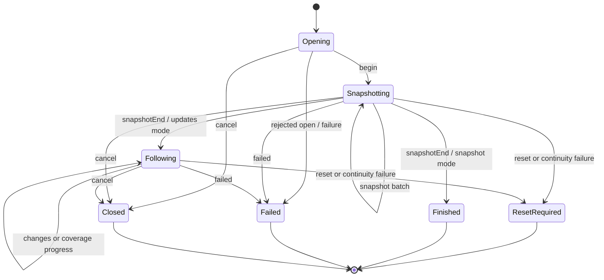
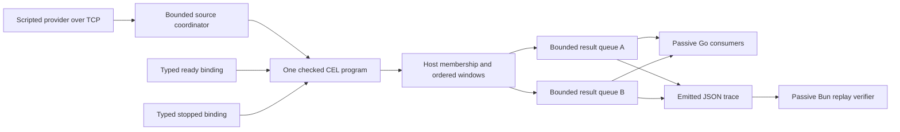

# Source session ordering, coverage and reset contract

Status: user-accepted source-session boundary; initial source probes and a bounded integrated CEL/result-window proof executed. Evidence is in sections 8–9. Refines the [accepted acquisition and result boundaries](2026-10-17-resource-foundation-design.md#5-accepted-source-acquisition-lifecycle); not a product implementation, frozen protobuf/result ABI or proof of actual provider/SDK/UI integration. P05 owns provider/host protocol implementation; P12 ingestion, P14 query leases and P15 runtime delivery remain separate.

## 1. Decision and alternatives

| Approach | Tradeoff | Decision |
| --- | --- | --- |
| Independent list plus event subscription, reconciled by each consumer | Small API surface; no common cutover, races spread across callers | Replace for migrated reads |
| One phased source stream, explicit snapshot boundary and declared continuity | One ingestion contract, bounded state and honest provider differences | Accepted direction |
| Require every provider to supply a transactional snapshot, globally ordered history and replay | Strong model but excludes ordinary cloud/container/hypervisor sources or requires an inventory service | Do not require |

A source session acquires observations for one provider/authority/type/access-qualified selection and representation. It is neither a saved query nor a UI subscription. Multiple host queries may share compatible acquisition; no client reconstructs inventory from raw provider frames.

## 2. Four distinct ordering concepts

- **Resource identity:** provider, authority, opaque type, exact identity scope and native ID. Connections/access routes are not identity. Optional incarnation distinguishes recreation only where actually supplied.
- **Provider revision/checkpoint:** opaque provider-owned tokens. The host cannot sort them lexicographically, numerically or by assuming Kubernetes resourceVersion semantics.
- **Source delivery:** host-bound session/generation plus contiguous frame sequence detects transport/order loss in one acquisition attempt. It does not prove upstream freshness or create a global provider order.
- **Query result delivery:** independent lease/result generation and sequence, after evaluation/membership/order/window transitions. Source frames are not forwarded as result deltas.

Native timestamps are not ordering substitutes. Equal addresses do not permit observation sharing across credentials or visibility contexts.

## 3. Proposed DTO shapes

These TypeScript shapes describe the accepted provider-neutral semantic boundary for confirmation, not frozen generated runtime exports. Domain identity/schema contracts are shared with the foundation; definitions here make the source shape readable. Canonical encoding, validation and actual Go/protobuf mapping must agree before implementation.

```typescript
type OpaqueToken = string;
type UInt64Text = string; // canonical unsigned decimal, range checked

type ResourceAddress = {
  provider: string;
  authority: string;
  type: string;
  scope: Readonly<Record<string, string>>;
  id: string;
};

type QueryScope = Readonly<Record<string,
  | { kind: "any" }
  | { kind: "oneOf"; values: readonly string[] }
>>;

type RepresentationBinding = {
  representationId: string;
  schema?: { id: string; revision: string };
};

type JsonDocument = { encoding: "json"; text: string };

type DocumentFieldPath = readonly (
  | { kind: "member"; name: string }
  | { kind: "index"; index: number }
)[];

type DocumentCoverage =
  | { kind: "complete" }
  | { kind: "partial"; knownAbsent: readonly DocumentFieldPath[] };

type SourceCoverage = {
  enumeration: "exhausted" | "partial" | "unknown";
  consistency: "pointInTime" | "bestEffort" | "unknown";
  limitations: readonly string[];
};

type SourceObservation = {
  address: ResourceAddress;
  representation: RepresentationBinding;
  document: JsonDocument;
  documentCoverage: DocumentCoverage;
  incarnation?: OpaqueToken;
  sourceRevision?: OpaqueToken;
  displayName?: string;
};

type SourceChange =
  | { kind: "upsert"; observation: SourceObservation }
  | {
      kind: "remove";
      address: ResourceAddress;
      incarnation?: OpaqueToken;
      sourceRevision?: OpaqueToken;
    };

type SourceMode = "snapshot" | "snapshotAndUpdates";

type SourceOpen = {
  requestId: string;
  sessionId: OpaqueToken;
  generation: OpaqueToken;
  connectionId: string;
  provider: string;
  authority: string;
  type: string;
  scope: QueryScope;
  representation: RepresentationBinding;
  mode: SourceMode;
  acquisition:
    | { kind: "enumerate" }
    | { kind: "nativeQuery"; format: string; request: JsonDocument };
  limits: { maxFrameBytes: number; maxBatchItems: number };
};

type SourceError = {
  code: "invalid" | "unsupported" | "denied" | "unavailable" | "limit" | "internal";
  message: string;
  requestId: string;
};

type SourceFrame = {
  sessionId: OpaqueToken;
  generation: OpaqueToken;
  sequence: UInt64Text;
  payload:
    | { kind: "begin"; mode: SourceMode }
    | { kind: "snapshot"; observations: readonly SourceObservation[] }
    | {
        kind: "snapshotEnd";
        coverage: SourceCoverage;
        continuity: "notApplicable" | "gapFree" | "bestEffort";
      }
    | {
        kind: "changes";
        changes: readonly SourceChange[];
        coverage?: SourceCoverage;
      }
    | {
        kind: "reset";
        reason: "continuityLost" | "overflow" | "bindingChanged" | "sourceInvalidated";
        message: string;
      }
    | { kind: "failed"; error: SourceError };
};
```

Scope is a normalized effective selection, not an authorization grant. Unknown dimensions, unresolved defaults and invalid exact identity scopes fail validation. Empty one-of means no matches, never all values. All addresses are validated against the bound provider/authority/type/selection; reject scope escapes instead of contaminating another read model.

The host creates session/generation IDs; the provider echoes them. Trusted invocation/access and cancellation/deadline context remain outside caller-supplied identity fields. `connectionId` identifies the resolved route, not a trusted principal. Native-query format/request is a capability-bound provider contract generated/validated by the host plan, not arbitrary client code passed through a public API.

Every observation must match the admitted representation/schema binding; incompatible changes require reset/replanning. Document coverage describes availability within that representation for this observation, independently of source enumeration coverage. Missing paths in a partial document are unknown unless explicitly known absent; present/known-absent contradictions fail admission. Typed path segments preserve quoted map keys and array positions without dotted-string ambiguity. Array-index facts apply only to that document, never to stable resource identity. Complete representation coverage does not assert unrestricted visibility, another representation's fields or authorization for a missing/denied field.

JSON document text preserves numeric lexemes across this source boundary; no protobuf Struct/default float64 decode is permitted to silently round exact integers. This is not the result-row transport or permission to send every raw body to JavaScript. Body/schema/representation admission remains host-owned; raw JSON alone does not establish type correctness or field completeness. Structural representation availability stays in the catalog; no sentinel fields are inserted into documents.

Sequence is a decimal string for lossless cross-language encoding; frame/batch limits are bounded positive safe integers. `maxFrameBytes` applies to an uncompressed serialized wire frame under the selected transport. Batch limits cover observations/change operations and are enforced before unbounded decoding/allocation. Transport-specific framing/decompression limits are part of the eventual implementation proof.

## 4. Legal stream phases and the cutover obligation

One RPC/transport stream carries one generation. `begin` is sequence 1; every subsequent frame increments exactly once, including terminal frames. No wraparound, implicit duplicate replay or best-guess frame recovery. An incompatible/malformed begin fails admission; capability/authorization failure may fail the open before begin.



- Snapshot batches carry full observations. They are staged under this source generation, not appended directly into a supposedly complete existing inventory. Empty acquisition needs no dummy observation batch.
- The query layer may expose bounded progressive previews only with explicit incomplete/provisional result semantics. Source staging does not require mirroring an entire account or treating early rows as a final globally sorted page.
- No `changes` before snapshotEnd, and no snapshot batches after it. The adapter must reconcile native startup events to this canonical boundary; the host does not guess event/page revision order.
- Snapshot mode's snapshotEnd is both the explicit boundary and successful terminal completion. It has continuity `notApplicable`. No redundant separate completion frame, fake watcher or mandatory poller is needed.
- Updates mode reports `gapFree` or `bestEffort`. Missing requested updates is unsupported, not silent downgrade to snapshot mode. SnapshotEnd means initial acquisition ended under its stated coverage, not that every provider resource was acquired.
- Snapshot arrival order is not a final query order or pagination cursor. Repeated addresses update the staged observation according to declared source ordering; they do not create duplicate inventory rows or prove native recency.
- A changes batch is applied as one host ingestion/publication unit. Ordered operations inside the batch describe its final state; this does not claim a multi-object transaction occurred upstream.
- Upsert replaces the observation for this access-qualified representation. Remove means removal from this acquisition's membership, not necessarily destruction of the infrastructure object. Native selector exits and actual deletions may both remove membership; other sessions/representations are not blindly erased.
- Incarnation-qualified removes cannot delete an observation known to have a different incarnation. Without suitable native ordering/incarnation evidence, the host cannot manufacture recreation safety. Tokens/revisions remain optional.
- Changes may carry coverage progress without resource operations. Empty batches without operations or coverage information are unnecessary.

### 4.1 Gap-free is an adapter obligation, not a frame-number property

```mermaid
sequenceDiagram
    participant H as Host coordinator
    participant A as Provider adapter
    participant N as Native source
    H->>A: Open bound acquisition generation
    A->>N: Establish native snapshot/update coordination
    A-->>H: begin and bounded snapshot batches
    Note over A,N: Close the native cut and reconcile startup changes
    A-->>H: snapshotEnd with coverage and continuity
    A-->>H: Ordered changes beyond the established boundary
    H->>H: Apply source state; evaluate query results separately
```

A native consistent list plus a valid update token, or an adapter-owned synchronized cache/barrier, can support this obligation where its native semantics suffice. Simply subscribing first, listing pages and replaying all buffered events afterward is not proof: a queued old event can overwrite a newer value returned in a page. Comparing opaque revision strings or timestamps does not fix that race.

A gap-free claim requires evidence that the initial observations and following changes form a coherent handoff for the bound acquisition, with no silent loss of relevant subsequent changes while that guarantee remains active. No known newer observation may be overwritten by a known older one. The provider performs native reconciliation; no generic host algorithm is assumed to repair an unorderable source. Unknown continuity invalidates the guarantee and requires reset.

If that handoff cannot be established, report bestEffort with limitations. The host must not elevate it to gap-free, point-in-time or reliable native recency just because frames are contiguous. Finite/event-driven profiles remain valid; an exact/live query requiring stronger guarantees can fail unsupported or require explicit weaker coverage policy.

Enumeration exhaustion is relative to the actual bound acquisition (including a native selector/access context), not unrestricted account inventory. `exhausted` and `pointInTime` are independent. A partial snapshot cannot justify deleting unseen members from some broader cache or declaring a broader query complete. Schema/type/representation completeness is also distinct from enumeration coverage.

## 5. Reset, recovery and result isolation

Reset/failed is terminal for that generation. A fresh snapshot uses a new host-issued generation and stream, even if the coordinator retains the logical source session/consumer interests. Do not resume by restarting frame sequence under the old generation.

- Lost transport continuity, invalid sequence or bounded queue overflow marks the source unsynchronized. Receiving an explicit reset frame is useful but cannot be required when the transport itself has failed; local detection produces the same invalidation.
- EOF after successful snapshot-mode snapshotEnd is normal; unexpected EOF during snapshot/following is not successful completion. Cancellation is a normal local terminal outcome, not an internal error.
- The coordinator marks dependent query results unsynchronized and issues their own reset/recovery transitions. Source generation IDs never substitute for query-result generation IDs.
- Previously valid rows may remain only under the accepted labeled stale-data policy; staging for a new snapshot does not mix with published old-generation rows. Known access invalidation clears protected material immediately instead of retaining it as ordinary stale data.
- A validated complete replacement snapshot can retire old source membership within its bound selection. Partial/unknown acquisition cannot silently prove that missing old members were deleted.
- Schema/representation/authority/scope/access-binding changes invalidate affected acquisition/plans; no silent retargeting or generation transplant. Capability changes that make the operation invalid fail/reset explicitly.
- Recovery is policy-driven and bounded: expose reset, then reopen/resnapshot only when allowed. Do not hide failures behind unbounded retries. Snapshot-only refresh remains explicit.

Recovery starts a new bounded snapshot generation. No public resume-checkpoint field, delta-only resume API or durable replay log is required in this initial contract. Native adapters may use their own cursor/checkpoint internally to establish the handoff. If measured recovery later needs host-visible resume, define its selection/access/representation binding and expiry semantics explicitly rather than treating an opaque source revision as a portable cursor.

## 6. Bounded flow control and shared lifetime

- Bound wire frames, pending bytes/items, snapshot staging, observation/read-model retention, native startup buffering and processing time separately. A row-count limit is not a byte bound; no queue may grow until the UI catches up.
- Use transport backpressure where supported. If a native source cannot pause safely, overflow requires reset/failure, not silent event loss. The terminal signal may need a reserved control path or transport closure; it cannot depend on space in the already full data queue.
- Do not coalesce provider operations merely by address unless an equivalence rule preserves recreation, membership, projection and batch semantics. Prefer bounded ordinary replacement batches first.
- Do not require a custom acknowledgement protocol, durable spool, heartbeat service or global event bus. Add them only if transport/probe evidence establishes a requirement. No delivery queue is shared directly with JavaScript.
- Conservative source sharing requires matching compatible effective selection/native request, access/visibility context, representation/schema binding and source guarantees. No cross-credential body merge or automatic query-subsumption engine.
- One source sequence cannot order observations from another session. Preserve source membership/provenance; reconcile shared bodies only under a proved compatibility/ordering rule, not a global last-arrival timestamp.
- A query owns interest, not the shared source. Closing one expanded row/query releases its interest; stop acquisition only after the final consumer releases it. Cancelling a pending open must release its reservation too.
- Slow query consumers have bounded result-delivery state. Their lag must not force unbounded source retention or block unrelated queries indefinitely; reset the affected consumer/result or shared source according to where continuity was lost.
- Late callbacks/frames from a cancelled or replaced generation cannot mutate the current read model, even if remote cancellation is best-effort. Terminal/cancellation cleanup releases buffers, staged observations and provider handles.

## 7. Confirmation and agent-ready work order

The user authorized the two initial throwaway probes and subsequently the bounded integrated proof. Source evidence is in section 8, integrated evidence in section 9. Repetition through the real SDK transport/first-party adapter and actual runtime/UI remains required.

1. **Acquisition cutover probe:** native-style ordered snapshot/update cursor profile plus a weak paginated/event profile. Exercise page/event overlap, an old buffered update after a newer page, additions/removals/recreation, empty/partial snapshots and supported/unsupported handoff guarantees. Demonstrate why arrival sequence alone is insufficient.
2. **Lifecycle/flow probe:** ordered frames over a real bounded transport, gaps/duplicates/invalid phases, oversized frames, full queues/control termination, cancellation/late frames, shared-interest cleanup, reset/reopen and explicit snapshot completion. Do not use timing sleeps as evidence of ordering.
3. **Integrated proof:** execute a query over that ingestion path and observe result generations/membership/window resets; later repeat with the real SDK transport and first-party adapter. The two probes alone cannot establish this integration or UI performance.

Freeze frame phases, identity/coverage semantics and ownership first. The two initial probes can run independently against that shared contract. P05 then implements the accepted provider/host transport; P12 supplies bounded staging/read-model application; P14 produces query-result transitions; P15 applies bounded result frames. P10 is the separate Kubernetes adapter integration, not a dependency of generic finite/cloud/container/VM conformance.

Still required before production: exact domain/protobuf/code-generation mapping, resolved transport/backpressure limits, native adapter ordering evidence, result publication/cancellation integration, access invalidation and measured memory/latency. Do not turn this proposal into legacy List/watch metadata patches or one giant cross-repo change.

## 8. Executed source-session confirmations

Status: independent throwaway probes, not implementation code to copy into SDK/host. The parent reran cutover with `GOWORK=off go run .` and lifecycle with `GOWORK=off go run -race .`. Runtime was Go `go1.26.1 darwin/arm64`; both modules use only the standard library.

### 8.1 Observed outcomes

| Probe | Observations | Interpretation |
| --- | --- | --- |
| Native-style acquisition cutover | 25 scenarios, 168 assertions, zero failures | Conditional strong native profile plus two explicitly expected counterexample/limitation records |
| Real bounded transport/lifecycle | 57 cases, 1,415 assertions, zero unexpected failures | OS loopback TCP, length-prefixed JSON; includes expected rejection/reset cases |
| Parent race-instrumented lifecycle rerun | Same 57 cases and 1,415 assertions passed | No race detector report observed for this workload; not proof for every schedule |

The strong cutover fixture uses an immutable native snapshot plus an adapter-owned opaque cursor chain; expected materialized states are independently authored from native history. Snapshot staging, following changes, recreation/removal, native gaps, startup overflow and source-owned membership obeyed their asserted outcomes. A simulated native guarantee is not evidence that any actual cloud/container/hypervisor API supplies it.

The weak subscribe/list/buffer/replay schedule actually overwrites a newer page with an older buffered update while source frame sequences remain contiguous. It remains explicitly bestEffort, not a successful reconciliation. A separate fixture with no surfaced incarnation evidence allows an old remove to erase a recreated host observation: the host cannot invent the missing native evidence.

### 8.2 Bounded transport and ownership evidence

The lifecycle probe uses real `127.0.0.1` TCP sockets, a fixed four-byte length prefix and JSON. Oversized lengths are rejected before allocating a payload buffer; this is not a claim of zero total Go allocations. Item and byte saturation close the socket independently instead of trying to enqueue reset into a full data queue.

Observed aggregate queue peak was two queued/in-flight items and 2,503 serialized bytes; staging peak was four observations and 2,157 serialized bytes. These are fixture-specific logical bounds, not recommended production budgets or heap/RSS measurements. The decoder's payload limit is 8,192 bytes plus a fixed four-byte transport prefix; queue accounting includes both. Actual SDK codec/framing/decompression accounting still needs an explicit mapping to negotiated frame limits.

Across cases, 116 socket endpoints were observably closed. Final release asserted zero tracked reservations, handles, readers, writers, queues, staging and retained source cache. Two late open callbacks and one already-decoded stale-generation frame were rejected without resurrecting current state. No global runtime goroutine-count or hostile-plugin isolation claim is made.

Finite snapshotEnd/EOF, empty snapshots, invalid phases, sequence gaps/duplicates/noncanonical text, binding escapes, partial/unknown coverage, atomic batch rejection, unexpected EOF, truncation, overflow, cancellation, shared-interest release and reset/new-generation recovery crossed the serialized socket where applicable. Pending-open cancellation is necessarily a local lifecycle operation; its stale callback still had a real socket to reject/close.

### 8.3 Clarifications carried into implementation

- **Partial is not deletion or promotion.** Unseen old observations remained in a separate stale cache with original generation provenance, never silently promoted into the current generation. Complete replacement retires membership only within its validated bound acquisition. Neither behavior decides global infrastructure deletion.
- **Native revision remains opaque.** Simulated adapter-native ordering does not become host sorting of sourceRevision strings, a portable checkpoint or a public resume contract.
- **Control paths need their own safety.** Admission notifications/writer gates in this harness are fixture-only schedule barriers, not product ACKs. The proof does not cover an arbitrarily saturated diagnostic/result-notification path. Production termination and notification paths must be independently cancellable and bounded.
- **Finite completion owns teardown.** The fixture deliberately keeps its finite reader until EOF to observe illegal post-terminal frames. That is not a requirement to wait indefinitely for a peer after snapshotEnd. Production completion/cancellation must release transport/producer resources under an explicit bounded policy.
- **Do not adopt fixture allocation patterns.** Transcript/history retention and small full-map clones support assertions, not production replay or read-model design. Measure physical memory and update cost; no inventory-wide copying per small change is justified by passing these bounded fixtures.

Unexercised surfaces include full SourceOpen negotiation/nativeQuery, general any/oneOf/empty-oneOf QueryScope normalization, alternative/absent schema bindings, strict exhaustive DTO discriminated-union validation and every SourceError code. Cutover checks selected typed document-knownAbsent contradictions; lifecycle explicitly rejects unsupported nonempty knownAbsent paths. The independently implemented subsets are not one complete interoperable SDK protocol.

The two initial source probes did not test a query evaluator/result window; section 9 records that subsequent bounded integration. Real provider, SDK gRPC/protobuf/Wails, access invalidation, actual UI interaction, many-source load and production latency/RSS remain unproven.

### 8.4 Reproduction and next work

[Sources, input fixtures, independently authored expectations, wire traces, results and parent verification](2026-10-17-source-session-evidence.zip). SHA-256: `e05e6e29192c2b3e83a3841196faa17df5b529248a9a2fe643b4dffb31f7e651`. Archive integrity passed `unzip -t`; no binaries/caches are included.

After extraction, run `GOWORK=off go run .` from `cutover/`, and `GOWORK=off go run -race .` from `lifecycle/`. Source/fixture hashes and exact expected/actual data are in each results file; reports regenerate on execution. The archive's `parent-verification.md` distinguishes real socket/race evidence from simulated native assumptions and prototype-only internals.

The subsequent bounded vertical proof is recorded in section 9. Next consolidate accepted domain/source/result/error contracts and remaining wire choices into reviewable implementation packets, then map them onto the actual SDK/host/runtime. Do not combine P05/P12/P13/P14/P15 into one change or wait for every provider to supply gap-free acquisition. Numeric dependency readiness and schema/authoring integration remain separate gates.

## 9. Executed integrated source → CEL → result-window proof

Status: one sequential throwaway integration, executed with real CEL and independently checked native/JavaScript client states. It connects the earlier source fixture rather than inferring end-to-end behavior from independent probe reports. No product code/dependencies changed.



The source uses actual loopback TCP. Result queues are bounded in-process serialized JSON; the Bun consumer replays emitted result frames, not a live result socket or actual UI. Neither client evaluates predicates or sorts inventory.

### 9.1 Observed checks

| Verification | Observed result | Scope |
| --- | --- | --- |
| Native vertical program with Go race detector | 127 assertions, zero unexpected failures, 17 checkpoints | Source ingestion, CEL, ordered windows, result generations, shared interests and cleanup |
| Separate passive Bun consumer | 105 assertions, zero unexpected failures, same 17 checkpoints | Applies and validates emitted JSON frames against independently authored expectations |
| Result delivery | 19 consumed frames, at most two rows per frame | Includes reset/recovery and an injected stale-generation negative control |

Commands actually run after final code changes: `GOWORK=off go run -race .` then `bun run client.ts`. Runtime was Go `go1.26.1 darwin/arm64`, Bun `1.1.20`, CEL `cel.dev/cel-go v0.32.0`; no race detector report was observed. That workload is not proof of all concurrency schedules.

`expected.json` was authored before execution. It specifies staging invisibility, initial windows, enter/exit, order and projection changes, deletion, atomic two-resource changes, identity tie-breaking, source reset/recovery, stale result rejection, consumer-local overflow/resnapshot and final cleanup. Neither client derives expected membership/order from actual emitted frames.

### 9.2 What this path establishes

- Two differently bound predicates share one source acquisition per source generation and one compiled CEL program. Parameters remain activation values, not source interpolation. One deliberate source reset creates a second acquisition generation; two opens here do not mean one open per consumer.
- Initial acquisition/resnapshot evaluates acquired observations; following changes evaluate distinct touched extant resources per active query. Removes update membership without evaluating nonexistent data. Observed work was 34 CEL invocations: 12 initialization/resnapshot and 22 following-update invocations. These are work counts, not performance benchmarks.
- Host-owned membership/order feeds bounded whole-window replacement projections. A two-resource source batch produces final window transitions without publishing intermediate states. A title-only projection change publishes even when membership/order do not change; unchanged windows emit nothing.
- Source sequence loss resets both query results. Result generations/sequences are independent of source generations/sequences. The clients accept the announced fresh snapshot and reject the stale old snapshot. The stale source callback is a local negative control; ordinary source update/gap/recovery frames cross TCP.
- One slow consumer fills its two-message queue, discards three missed/stale data frames and gets a separate bounded reset control. The other remains synchronized. Local result resnapshot uses maintained query state under a fresh result generation without reopening the shared source.
- Closing the first query leaves the second's source interest/reader alive. Final close releases source interests/reservations/handles/readers/staging/retained cache, writer queues/workers and query handles.
- Host ordering distinguishes adjacent exact integers `9007199254740992` and `9007199254740993`; projected ranks cross JSON as decimal strings. CEL performs string predicates in this experiment, so this does not close the independent mixed-numeric CEL dependency gate.

### 9.3 Do not promote probe choices into frozen contracts

The result reset's explicit `nextGeneration` is a probe protocol choice that prevents accepting arbitrary stale snapshots while waiting for recovery. Overflow reset control can skip lost data sequence numbers. Exact public frame/control/reattachment semantics, duplicate and repeated overlapping recovery, transport ordering and structured failure policy still require contract freeze/conformance; no custom durable ACK/replay service was introduced.

The source coordinator retains fixture full-map clones and schedule-notification channels. Query ordering uses a small sorted slice; incremental predicate work is not evidence for a scalable index or native-feeling UI. There is no physical memory, many-source, large-inventory or latency measurement. Result byte limits are enforced, but the scenario provokes item saturation rather than a separate byte-saturation workload.

This path uses one complete representation, fixed source/access/type/scope, a simple valid body and one predicate shape. It does not implement general QuerySpec parsing/planning, schema authoring, result cursors/counts/groups, arbitrary projections, federation, access changes or public structured CEL/body/order errors. No actual SDK/gRPC/protobuf/Wails, native provider or DOM/UI was exercised.

### 9.4 Reproduction and implementation planning

[Exact sources, independent expectations, module pins, source/result traces and both client results](2026-10-17-query-vertical-evidence.zip). SHA-256: `096bd31ee20adcda86fffb8bca8ae7b603cbfeb53963ef991c6ea981e4ea870c`. Archive integrity passed `unzip -t`; no executables/caches are included.

From the extracted `lifecycle/` directory:

```sh
GOWORK=off go run -race .
bun run client.ts
```

The archive's report explains each assertion family and prototype limitation. This is sufficient evidence to move from isolated engine feasibility into contract consolidation and implementation planning—not to mark P13/P14/P15 complete or ship the temporary code.

Keep the roadmap split: settle P01/P04 identity/binding/error/context and source/result wire ownership; verify P00/P44 baseline/fixtures; deliver P45's usable SDK/host boundary; then run the source/schema/identity packets according to their existing dependencies. P12→P13→P14→P15 supplies the real query data plane, with provider and editor/UI integrations as separately reviewable work. Required production gates remain explicit instead of becoming more speculative engine infrastructure.
