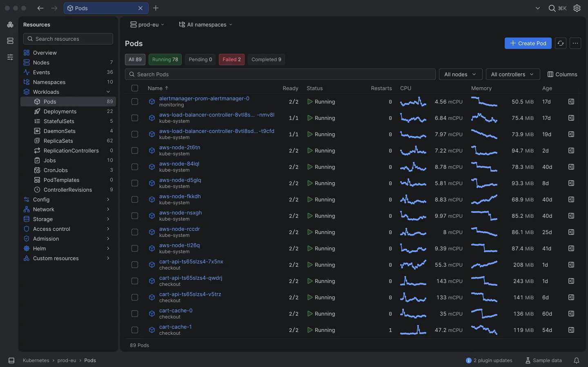
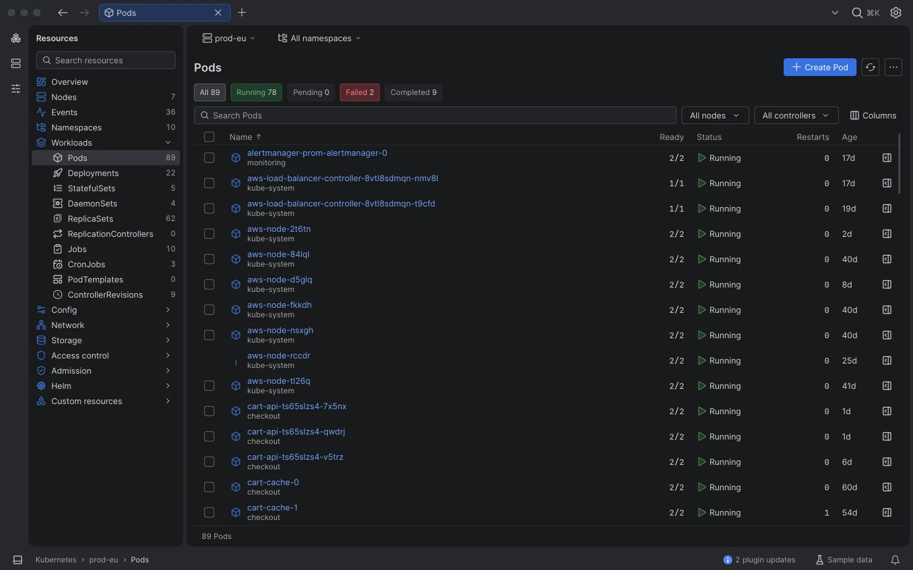
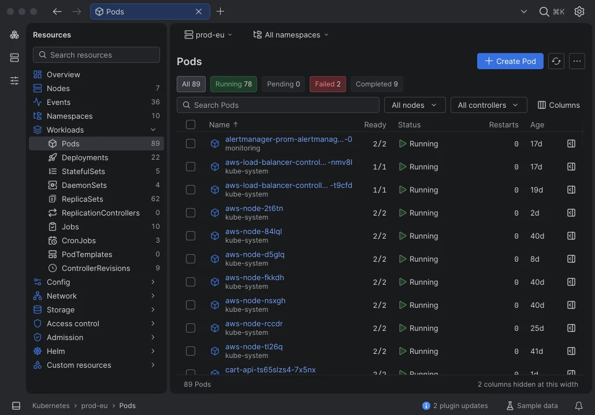
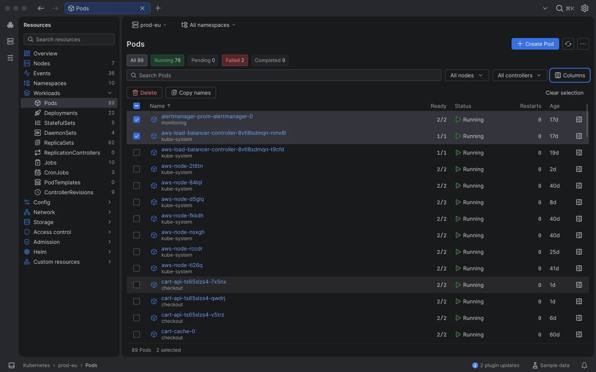

# Slice 1a: the Kubernetes Pods list on real data

The build plan for tracker row N11, written under row N11b on 2026-11-16 against host `origin/main` 146c0b03, the Kubernetes plugin `origin/main` 524d123 (0.21.2) and the design lab tag `spec-baseline-2026-11-16` (mock tree `c8e44a44…`). Ruling R8 applies: build through the screen, consumer first. The stop rule: the Pods list on real data by week 3–4, re-plan at week 6 (week 1 starts 2026-11-16). The skeleton in section 2.6 lands with this plan and is the proof of the data seam.

**Evidence key.** `[path:line]` = read in this repo. `K8S path:line` = the plugin at 524d123. `MOCK path:line` = `app/OmniviewNativeLab/frontend/mock/` of the design lab at the tag; `chNN` = the spec chapter `MOCK research/int-ui/NN-*.md`, rule ids as written there (`ch13 T3` is chapter 13, rule T3). `RT1`, `RT2`, `P1`, `P2` and `F06`, `F07` are the private background notes (red-team reviews, proposals, findings). `[ran: …]` = I ran it; commands are in appendix A. `[INFERENCE]` = reasoning, not run. **UNVERIFIED** = not verified. Mock numbers were measured in headless WebKit on a design-lab checkout whose mock tree is the tagged one (appendix B). Sizes are my scale: `S` under 1 day, `M` 1 to 3 days, `L` 3 to 6 days of agent work including its tests.

## 0. Decisions at a glance

| # | Question | Decision | Why | What would change it |
|---|---|---|---|---|
| D1 | How does the first screen get plugin data? | A host-side Pods page in `ui-next/` that reads through the existing runtime hooks. No plugin UI is loaded in 1a. | The read chain is already host-owned and runs from a new entry on the first try (2.6). Loading plugin UI first needs a loader, a plugin stream, the kit on npm (N16) and the contribution contract (R11): none is needed to show real Pods, all would sit on the critical path of the stop rule. | The owner wants the plugin stream proven before the screen. |
| D2 | Which loader, later? | For slice 1b (Pod detail): a new minimal loader in `ui-next/`, single-bundle plugin archives from a `feature/ui-next` stream. Decide at the week-6 re-plan with N12's load-time numbers. | The old loader, its shared-module map and its provider tree live in `ui/` and carry the old libraries (2.1). | N12 shows the old loader's cost is the problem rather than its coupling. |
| D3 | How does data arrive? | The runtime's fenced read chain, unchanged (V1.6): `useResourceTypes`, `useResolvedResourceTarget`, `useResources({ collection: true, live })`, explicit `pluginID: 'kubernetes'`, type `k8s:/pods`. Nothing in `ui-next/` calls `ResourceClient` or `Call` directly (lint, PR 1a.2). | Authority, generation and admission belong to the host (`useResolvedResourceTarget.ts:10-19`). | — |
| D4 | Connection? | The runtime readiness store. A read never connects; the real page shows the disconnected state with an explicit Connect. The skeleton connects by itself, as a dev shortcut. | `connectionReadiness.ts` and mock K8 ("nothing connects by itself"). | — |
| D5 | What is a real cluster? | Dev: a kind cluster with `1a-pods-list/fixture.yaml` and a private kubeconfig. CI: a new job with kind (the e2e harness has none: it writes an empty kubeconfig). The plugin is built from a pinned commit. | `e2e/scripts/application.mjs:242-243`; 2.2. | — |
| D6 | Contribution API? | None in 1a. The Pod definition is a host module shaped like the mock's definition record; it moves into the plugin stream when R11's contract exists (2.4). | 1a must not wait on R11. | — |
| D7 | Table? | TanStack Table 9.3.1 and TanStack Virtual 3.14.23 (already pinned), native `<table>`, fixed 40/38 px rows, declared widths plus sampled measurement, native per-row atoms by default. The measurement (≤ 3 days) and its decision rule are in 3.3, written before measuring. | R5, R9; `package.json:42-43`. | The measurement misses a budget after one week of tuning (trigger T1). |
| D8 | Scope? | Three tiers (1.2). Tier A is the week 3–4 line, tier B completes 1a by week 6, tier C is not 1a. | The sizing in 4.3 says tier A is at the optimistic edge of capacity. | The week-2 numbers (4.4). |
| D9 | Spec disagreements? | Twelve found; none chosen silently (1.5). | AGENTS.md: write it down and ask the lead. | N10's errata pass. |

## 1. Scope: what 1a builds, from the mock

### 1.1 The screen

The reference is the mock's Pods list (`MOCK k8s-resources.js`, the composition of `shell/page-kit-list`), connection `prod-eu`, 89 Pods, default theme. Four screenshots, all 1:1 pixels of the mock; appendix B gives the tag, the mock tree hash, the route and the viewport that reproduce each, with the hashes of the original PNG captures. The owner decided on 2026-11-16 that the design may be public.









Anatomy, in DOM order, with measured rectangles `x, y, w, h` in CSS px [ran: appendix A.8]. "Owner" says whether it is the shell, a page composition, or a kit part.

| Region | 1440 x 900 | 1030 x 720 | Owner | Mock source; rules |
|---|---|---|---|---|
| Top row (window controls, tab strip, actions) | 0,0,1440,40 | 0,0,1030,40 | shell | `MOCK shell-regions.js:599-615`; ch16 R1, R2, S4 |
| The one tab `Pods` (close, then New tab `+` at 368,6,28,28) | 156,6,208,28 | 156,6,208,28 | shell | `MOCK shell-tabs.js:170-188`; ch16 TI1 |
| Rail (Kubernetes tools) | 5,40,40,823 | 5,40,40,643 | shell | `MOCK shell-kubernetes.js:286-295`; ch16 R5 |
| Sidebar (header 41 px, search 28 px, tree rows 24 px, the Pods row at 50,237,234,24) | 45,40,244,823 | 45,40,244,643 | shell | `MOCK shell-kubernetes.js:329-364,389-436`; ch12 SB1, ch17 K23 B2, K61.2 |
| Page island (the frame island is 294,40,1141,823 and holds the scope lane; this is the page area below it) | 294,80,1141,783 | 294,80,731,603 | shell | `MOCK shell-regions.js:619-638`; ch16 R7 |
| Scope lane faces `prod-eu` and `All namespaces` (28 px faces in a 40 px lane) | 306,46,112,28 and 425,46,158,28 | the same | shell | `MOCK shell-kubernetes.js:306-323`; ch17 K5 |
| Page title `Pods` | 306,92,918,28 | 306,92,508,28 | page + `PageHeader` | `MOCK shell-page-kit.js:214-248`; ch12 PH1–PH3 |
| Quick filters | 306,132,1117,28 | 306,132,707,28 | page + `QuickFilters` | `MOCK shell-page-kit.js:302-311`; ch13 QF1 |
| Toolbar (search; facets `All nodes`, `All controllers`; Columns) | 306,168,1117,28 | 306,168,707,28 | page + kit | `MOCK k8s-resources.js:601-612`; ch12 TB1, ch17 K23 B3 |
| Selection bar (only while rows are selected) | 306,204.. | same | kit part | `MOCK core.js:770-772`; ch14 SEL1 |
| Table header | 306,204,1117,25 | 306,204,707,25 | kit `DataTable` | `MOCK core.js:1297-1303`; ch13 H1–H4 |
| Table row (two-line identity) | 306,229,1117,40 | 306,229,707,40 | kit `DataTable` | `MOCK k8s-resources.js:621`; ch13 D2, T2 |
| Footer (`89 Pods`, 33 px with its separator) | text at 318,839,47,16 | text at 318,659,47,16 | kit | `MOCK core.js:937-940`; ch13 G1–G5 |
| Status bar (panel toggle, path `Kubernetes > prod-eu > Pods`, items) | 0,868,1440,32 | 0,688,1030,32 | shell | `MOCK shell-regions.js:514-535`; ch16 S90–S97 |

Column widths as fitted by the mock (they sum to the content width): 1440 wide set `46 / 282 / 59 / 157 / 72 / 198 / 198 / 59 / 46` = 1117 (select, Name, Ready, Status, Restarts, CPU, Memory, Age, Inspect); 1440 without CPU and Memory `46 / 678 / 59 / 157 / 72 / 59 / 46`; 1030 `46 / 268 / 59 / 157 / 72 / 59 / 46` = 707. The wide set shows only while the list is at least 1006 px wide (`MOCK k8s-resource-definitions.js:1102-1104`; ch17 K60.3). Elements per row, counted in the mock [ran]: **68** with the wide set (`tr` plus 67 below it; rows range 64–73), **40** with the narrow set (36–41). The page holds 7,984 and 5,387 DOM nodes for 89 rows because the mock renders every row.

### 1.2 What 1a builds

| Part of the screen | Tier | In 1a as | Real source |
|---|---|---|---|
| Top row with ONE tab titled `Pods` (a `role=tab`, no Close, no New tab) | A | shell, static | there is no tab model in 1a |
| Sidebar: header `Resources`; tree with the one group `Workloads` expanded and the one entry `Pods` (selected, live count) | A | shell | the collection's count |
| Scope lane: connection name and `All namespaces`, as text | A | shell | `Connection.name`; 1a acquires all namespaces (2.2) |
| Status bar: the path `Kubernetes > connection > Pods` | A | shell | the same |
| Page header: title and the Refresh utility | A | `PageHeader` | `refetch()` of the collection |
| Quick filters `All / Running / Pending / Failed / Completed` with counts | A | `QuickFilters` | rows, definition below |
| Search over the acquired rows, 500 ms debounce | A | `SearchField` | rows |
| Table: Name over namespace, Ready, Status, Restarts, Age; sortable; live | A | `DataTable` | 1.3 |
| Footer `N Pods` | A | `CollectionFooter` | `view.count` |
| States: loading (text), disconnected with Connect, failure | A (plain) | 1a.7 | readiness phases |
| Selection column and bar with `Copy names` and `Clear selection` only | B | kit | host `key`; no other command exists |
| Facets `All nodes`, `All controllers`; Columns chooser and the 15 hidden columns | B | kit | `spec.nodeName`, controller owner, … |
| CPU and Memory (current value, capacity bar only with limits), shown when the catalog advertises a metric | B | `MetricCell` | runtime metric hooks (2.2) |
| Skeleton, empty, no match, failure with rows, refreshing, partial | B | `CollectionState` | 1.4 |
| Create Pod, the overflow menu (label selector), the Inspect column and drawer, row links to detail, Delete and other actions | C | not 1a | detail, create and action slices |
| Rail, sidebar search and the other tree entries, connection and namespace menus, tab model (open, close, restore, dedupe), command palette and the search button, bottom panel, notifications and the bell, Settings, `Sample data` (a mock-only status item, `MOCK shell-kubernetes.js:566-569`) | C | not 1a | the shell slices after the gate |

Why the cuts: an element that does nothing is a stub, and no stub ships. The mock draws the checkbox column only where a bulk command exists (`MOCK k8s-resources.js:576-578`; ch14 SEL1), so it arrives with `Copy names`. A link in the identity cell needs a place to go (ch15 L2), so the name is plain text until the detail slice.

### 1.3 The row model

Defaults come from `MOCK k8s-resource-definitions.js:737-742` (`PRINTER.Pod`): shown `Ready, Status, Restarts, Age` (plus the identity column); in the chooser `Namespace, Node, IP, Controller, QoS class, CPU, Memory, Nominated node, Readiness gates, Host IP, DNS policy, Service account, Preemption policy, Priority, Scheduler, Hostname, Conditions`. All data columns sort; default sort is Name ascending (the old table's default, `K8S ui/src/components/shared/table/ResourceTable/index.tsx:144`).

| Column | Cell | Width (mock fit) | Real source: body path, derivation | Rule |
|---|---|---|---|---|
| Name | Kind tile, name (middle ellipsis, keeps the generated tail `-[a-z0-9]{1,10}`), namespace below in 12 px muted | flex, floor 160 | `metadata.name`, `metadata.namespace`; identity key is `HostRecord.key`, never a field | ch13 D2, T5, T7, COL4 |
| Ready | mono `2/2`, right | fixed 59 | ready regular statuses over `spec.containers.length`; `—` when `spec` is missing (`MOCK k8s-resource-definitions.js:658-659`) | ch13 D1, D6, A1 |
| Status | glyph and the platform's own word | fixed 157 | kubectl's printer logic: phase, replaced by init progress, then a container's waiting or terminated reason, then `Terminating` (`MOCK …:661-683`); role by the word table (`…:163-171`) | ch13 S1–S4, SR1 |
| Restarts | mono integer, right | fixed 72 | sum of `status.containerStatuses[].restartCount`, regular containers only; missing is `—`, never 0 | ch13 D7, A1 |
| Age | relative (`17d`), absolute time in the tip | fixed 59 | `metadata.creationTimestamp` (arrives as a string `Value`) | ch13 D5, T1 |
| CPU, Memory (tier B) | reading, unit, optional bar | fixed 198 each at 1440 | runtime metric observation; native metrics are current only | ch13 V1–V8, VD3 |

Quick filters (counted over the rows after search and facets, before the chosen filter): Running = word `Running`; Pending = role `progress`; Failed = role `error`; Completed = `Completed` or `Succeeded` (`MOCK k8s-resource-definitions.js:741`; `k8s-resources.js:594-600`). The status words and their seven roles are `MOCK …:163-171`; the host ports them with a test against the printer: **`kubectl get pods -A` is the oracle for Ready, Status, Restarts and Age** on the fixture cluster (PR 1a.2).

### 1.4 States (from the mock; the plain ones are tier A)

| State | The mock | Rule |
|---|---|---|
| First load | eight static skeleton rows after 250 ms (immediately with reduced motion); header, quick filters and toolbar stay | ch13 ES2; ch17 K18, K24 |
| No Pods | header kept, `No Pods`, count 0 | ch13 ES1, ES2 |
| No match | header kept, `No Pods match`, `0 of N Pods`, one Clear filters | ch13 ES2 |
| Failure without rows | a notice in place of the rows, one Retry only if retry exists; no duplicate in the footer | ch17 K18, K24; ch15 §5.8 |
| Failure with rows | rows kept; the footer says `Load failed` or `Access denied` with Retry | ch17 K18; ch13 FT1 |
| Refreshing, stale, partial | previous rows kept; footer `Refreshing…` (at least 700 ms after an explicit Refresh), `Stale`, `Partial results` | ch17 K18.3 |
| Disconnected (real data only) | not a list state in the mock: a known connection that is not connected goes to its settings page where Connect lives (`MOCK shell-kubernetes.js` Recovery, K8) | ch17 K8 |

### 1.5 Where the mock, its chapters and real data disagree

The errata pass (N10) is pending. Each item is for the lead; 1a follows the proposal only after the lead agrees.

| # | Disagreement | Evidence | Proposal for 1a |
|---|---|---|---|
| E1 | Pods rows are 40 px (38 compact), not 24: Pods are two-line (identity over namespace). 24 is the single-line baseline. | `MOCK k8s-resources.js:621`; `base.css:1233`; ch13 §7; kit tokens `--ov-table-metadata-height` 40/38 (`packages/kit/src/generated/tokens.css:63,70`) | Use 40/38. |
| E2 | CPU and Memory draw a 64 x 24 trend from seeded history; native metrics are current-only and history needs an external range source. | `MOCK shell-page-kit-gallery.js:289-292` (invented series); `K8S pkg/plugin/metric/native.go:300-306`; `K8S docs/native-metrics.md:26` | **Owner decision (2026-11-16, A11): current values only in 1a.** No sparkline; a reading, plus a bar only when limits exist. What a trend needs, and the slice that carries it: section 6. |
| E3 | Ready: ch13 EN1 prescribes a ratio bar with value; the mock draws mono `2/2`. | `MOCK k8s-resource-definitions.js:740,1020-1023`; ch13 EN1 | Mono `2/2`, as the mock. |
| E4 | A missing restart count becomes 0 in the mock; D7 says `—`. | `MOCK …:600,1000-1001`; ch13 D7 | `—`. |
| E5 | The mock emits `tr tabindex=0`; ch15 L2 says rows are not Tab stops. | `MOCK core.js:1312`; ch15 L2 | Rows are not Tab stops. |
| E6 | The healthy footer carries `2 columns hidden at this width`; G5 and FT1 forbid prose there. | `MOCK k8s-resources.js:629-635`; ch13 G5 | Omit. |
| E7 | Skeleton delay: code 250 ms, chapter one second. | `MOCK core.js:1919`; ch15 §5.8 | 250 ms until told otherwise. |
| E8 | Pending glyph: the code always draws a loader; SR1 says a clock for queued Pending. | `MOCK core.js:108-115`; ch13 SR1 | Follow SR1. |
| E9 | The no-match body has no Clear filters; the toolbar supplies it. | `MOCK k8s-resources.js:623-624`; ch13 ES2 | One Clear filters, in the toolbar. |
| E10 | Acquisition: ch17 K23 B3 says bounded pages of 256 with an explicit Load more; the runtime's collection mode, which the old table uses, acquires everything, and its first row waits for the complete snapshot: 0.7 s at 1,025 real Pods, 2.7 s at 5,025 [ran]. The N8 baseline's in-page fake backend reaches the first row of 5,000 records in 179 to 197 ms, so a fake backend hides about 2.5 s of real delivery. | `useResources.ts:300-307`; `K8S …/ResourceTable/index.tsx:198-207`; `docs/ui-next/baseline/2026-11-16.md` | **Owner decision (2026-11-16, A10): a bounded first set.** The first set (256 rows, the runtime's batch size) paints first; the count and the sort order are provisional until loading completes, and while it loads the footer says `N Pods loaded` (the mock's count-unknown wording, `MOCK core.js:1875-1884`; `N shown · M loaded` when a filter hides rows). The runtime publishes a collection only when its snapshot is complete (`useResources.ts:300-307`), so PR 1a.2 chooses the mechanism by measurement: partial snapshots from the collection hook (a runtime change, through the owner of the hooks) or a first explicit page (`collection: false`, `pageSize: 256`) beside the collection. Either keeps the fenced chain: hooks only. |
| E11 | The Controller facet is the controller-true owner; the old table uses `ownerReferences[0]`. | ch17 K61; `K8S …/corev1/Pod/Table.tsx:45-49` | The controller owner (tier B). |
| E12 | The mock's acquisition scope is a read parameter; the old product reads all namespaces and filters client-side. | `MOCK k8s-resources.js:169-170`; `K8S …/ResourceTable/index.tsx:188-206` | All namespaces, client-side filter (tier B). |

## 2. The seams

### 2.1 How `ui-next` loads a plugin UI

**Today it does not.** `ui-next/main.tsx` mounts `App`; there is no plugin loader, no query client and no runtime import before this plan (`ui-next/main.tsx:1-7` at 146c0b03). The old chain, for what a new loader must replace:

1. `App` calls `preloadSharedDeps()`, which maps each shared package to a `shared://` SystemJS module (`ui/App.tsx:3-5`; `ui/features/plugins/api/preloader.ts:1-8`).
2. `PluginServiceProvider` discovers installed plugins and calls `loadAll` (`ui/features/plugins/react/PluginServiceProvider.tsx:24-83`; `core/PluginService.ts:684-716`).
3. An installed plugin is `systemJs.import('<origin>/_/plugins/<id>/assets/entry.js')` (`ui/features/plugins/adapters/importPlugin.ts:83-97`).
4. Go serves that path from the state root; the allow-list, containment and `no-store` are frontend-independent (`plugin_asset_handler.go:34-36`; `main.go:726-727`).
5. The bundle is SystemJS `System.register` with externals from `omniviewExternals` (`e2e/fixtures/workspace-probe/ui/vite.config.ts:13-25`; `packages/omniviewdev-vite-plugin/src/index.ts:204-241`) and must export a named `plugin` (`ui/features/plugins/core/validation.ts:30-83`).

**What cannot be reused.** Every loader piece that matters imports `ui/`: the shared registry maps the old libraries (`ui/features/plugins/api/shared_dependencies.ts:51-60`), the built-in registry imports the old Grafana frontend (`adapters/builtinModules.ts:21-26`), the production wiring imports the old extension store (`adapters/createProductionDeps.ts:1-2`), the provider and renderer import old hooks and overlays. AGENTS rule 10 forbids the import. The shared-module list (the plugin ABI) holds 34 packages including `@omniviewdev/base-ui`, `ai-ui` and `editors`, and does not hold `@omniviewdev/kit` (`packages/omniviewdev-vite-plugin/src/sharedPackages.ts:12-57`). The Go asset handler and the Vite plugin package are standalone and reusable.

| Option | What | Cost | Verdict |
|---|---|---|---|
| A | Import the old loader | rule 10 breaks; pulls base-ui into the new bundle | no |
| B | A new minimal loader in `ui-next/`: SystemJS (or native ESM), a shared map with the kit and the runtime singletons and without the old libraries, an admission check, CSS in the `ov.plugin` layer | S–M, plus the plugin stream below | for 1b |
| C | No plugin UI in 1a | none | **1a** |

**What the Kubernetes plugin must ship, later (1b).** A `ui-next` stream: a branch `feature/ui-next` in its repository, promoted on the marketplace, a workflow that publishes `X.Y.(Z+1)-feature-ui-next.N.M` with `min-ide-version` at or below 0.35.2, and a passing `archive-smoke` (`docs/ui-next/channels.md` §4, §7; K8S has a `feature-channel.yaml` that has never run). A stream, not a second bundle in one archive, because the plugin's Vite config writes unhashed `assets/[name].js` and injects its CSS into the first entry chunk, replacing by plugin id (`K8S ui/vite.config.ts:35-45`; `ui/vite/omniview.ts:13-34`; the trap of RT1 §2.2). The bundle needs `@omniviewdev/kit` at build time: the kit is `private` and a workspace package, and the first npm publish waits for N16 (`packages/kit/package.json`; tracker N16) [INFERENCE: that a plugin build needs the published kit or its shims]. **None of this is on 1a's path.** What the lead and owner can start now without blocking 1a: the plugin branch, the marketplace promotion and registration of `feature-ui-next` (`channels.md` §6), the `archive-smoke` check against a new-shell bundle (UNVERIFIED), and N16.

**What 1a changes in the plugin repository: nothing.** The old plugin UI keeps serving the old shell; the Pod knowledge ported into the host (1.3) is a copy until the stream exists.

### 2.2 How data arrives

**The chain, with the arguments the old Pods table uses** (`K8S ui/src/components/shared/table/ResourceTable/index.tsx:188-207`):

| Step | Hook (runtime) | Arguments | Result |
|---|---|---|---|
| Connection | `useConnectionReadiness({ pluginID, connectionID })` | `connect()` is explicit; a read never connects (`hooks/connection/useConnectionReadiness.ts:24`) | phase `checking`, `disconnected`, `connecting`, `connected`, `unauthorized`, `forbidden`, `not-found`, `error` |
| Catalog | `useResourceTypes({ pluginID, route })` (old table: `useResourceType`) | `route = { connection }` | types; the Pod type is `k8s:/pods`, namespaced, representations `kubernetes.object.v1/v1` (default) and `kubernetes.model.v1/v1`, capabilities include `sourceUpdates` [ran: real catalog] |
| Target | `useResolvedResourceTarget({ pluginID, route, type: 'k8s:/pods' })` | scope omitted: namespace becomes `any` | `{ targetId, target, authority, catalogRevision }`; asks once more on `RESET_REQUIRED` (`useResolvedResourceTarget.ts:10-19,33-38`) |
| Rows | `useResources({ pluginID, collection: true, live, request: { targetId, request: { target, pageSize: 256 } } })` | `live` = the type advertises `sourceUpdates` | `resources.data.records: HostRecord[]`, `view.count`, `source` status (`useResources.ts:241-371`); the first set before the snapshot completes is E10's open mechanism |

Real shapes [ran: captured through the page]: a `HostRecord` is `{ key: 'row:<sha256>', addressKey, targetId, route: { connection }, record }` (`resource/v2/host.ts:7-13`); `record.reference.address` is `{ provider: 'kubernetes', authority: 'local:<uuid>', type: 'k8s:/pods', scope: [{ dimension: 'namespace', value }], id: <name> }` with the UID as `incarnation`; `record.body` is an exact `Value` tree (`domain.ts:21-30`), not a Kubernetes object: integers arrive as `int64` strings, `creationTimestamp` as a `string`, and `valueToJSON` is the presentation projection. A running two-container Pod is 13.2 KB in `Value` form (6.6 KB plain, `managedFields` included) and decodes in 18 µs, so 5,000 records cost about 90 ms once and must never be decoded per render (the old plugin keeps a `WeakMap` per record, `K8S ui/src/utils/recordBody.ts`). `view.count` is `{ kind: 'exact', value }` and drives the footer.

**Connection selection.** Connections come from the plugin: one per kubeconfig context, id = context name, from the plugin setting `kubeconfigs` (default `~/.kube/config`, restart to change); the ambient `KUBECONFIG` variable is not read (`K8S pkg/main.go:68-80`; `pkg/plugin/resource/connections.go:20-58`). The host lists them with `useConnections({ plugin })` (`hooks/connection/useConnections.ts:20-27`), which needs an `ActivityProvider` above it (`activity/context.ts:96-103`); the read hooks need only a `QueryClientProvider` when `pluginID` is explicit (`useResolvedPluginId.ts:11-19`). The skeleton takes `?connection=<id>`, else the first one. The shell's menu is tier C.

**Metrics (tier B).** CPU and Memory are not part of the record. They come from `useTableMetricObservation`, fed by cells that register demand in an effect, with a 120 ms quiet and 250 ms maximum publish delay (`packages/omniviewdev-runtime/src/hooks/metric/useTableMetricObservation.ts:6-10`), and from the plugin's source-selection and catalog hooks (`K8S …/table/shared/TableMetrics.tsx:18-68`). That is plugin-side orchestration; it is a separate PR and needs `metrics-server` in the dev cluster (`K8S hack/kind-lab/README.md:182-193`).

**A real cluster.**

| | Dev | CI |
|---|---|---|
| Cluster | `kind` v0.30.0, one node, `kindest/node:v1.35.0`, private kubeconfig | none today: the e2e harness installs the plugin with `clusters: []` (`e2e/scripts/application.mjs:86-100,242-243`), the render and app benches fake the backend (`bench/render/README.md`; `bench/app/README.md`) |
| Fixture | `docs/ui-next/slices/1a-pods-list/fixture.yaml`: Running 1/1 and 2/2, Completed, Error, ErrImagePull, Pending, a crash-looping Pod | the same file |
| Scale | `kubectl scale` of an unschedulable Deployment: 1,000 and 5,000 real Pod objects in minutes [ran: A.7] | a kind job caps near 1,000 |
| Plugin | built from a pinned commit in 12.5 s warm (A.3) | the same, `actions/checkout` at the pin |
| Where the plugin's own kind tools are | `K8S Makefile` `make cluster` (three nodes, `hack/seed`), `K8S hack/kind-lab/lab.py` (load presets of 300 to 2,000 Pods, stdlib Python) | not used by any workflow |

CI gets a job on a plain `ubuntu-latest` runner (the e2e runner runs in a container without a Docker socket, `.github/workflows/e2e-runner.yml:35-44`): kind, the fixture, `OMNIVIEW_UI=next` server build, the plugin at the pin, then a Playwright check that the page and `kubectl` agree (PR 1a.1).

### 2.3 What the new entry needs

| Need | Finding |
|---|---|
| Wails transport | Importing `@omniviewdev/runtime` initialises `@wailsio/runtime`; neither HTML entry loads a runtime script. RPC is a JSON POST to the page's own origin `/wails/runtime`, events a WebSocket (`node_modules/@wailsio/runtime/dist/runtime.js:15-17,97-126`; `index.js:12-14,45-65`). The browser warns `Browser Environment Detected` and works. |
| Same origin | The page must be served by the Go host. A Vite page on `:9245` sends RPC to Vite: there is no proxy (`vite.config.ts:75-91`), and cross-origin RPC is refused (`WAILS/pkg/application/transport_http_server.go:14-37`). Documented arrangement: browser, Go origin, proxy to Vite (`docs/development-workspaces.md:174`). **UNVERIFIED** with `OMNIVIEW_UI=next task dev`. |
| Dev loop | `OMNIVIEW_UI=next task build:server`: 26 s cold, 8 s warm; the binary embeds `dist/` (`main.go:91`) [ran]. |
| Providers | `QueryClientProvider` (the old shell mounts it at `ui/App.tsx:130-134`); `ActivityProvider` only for `useConnections` and `useConnection` (`packages/omniviewdev-runtime/src/hooks/connection/useConnections.ts:26`; `activity/context.ts:96-103`); no `PluginContextProvider`, router, Redux or drawer for the read hooks, because an explicit `pluginID` is accepted (`hooks/useResolvedPluginId.ts:11-19`). |
| Identity and caller | The Go middleware injects `__OMNIVIEW_INSTANCE__` into any served HTML (`internal/instance/boot.go:16-27`); the new HTML ignores it. A browser tab has no native window, so its context carries an empty principal (`backend/pkg/invocation/window_realm.go:85-92`); the read chain worked, mutating and consent-gated calls were not exercised. |
| Old libraries | The runtime package has a peer dependency on `@omniviewdev/base-ui` through five files (`ActivityCard`, `ActivitySurfaces`, `NotificationCenter`, `ConnectionBoundary`, `useMetricObservation`). Bundled, they are tree-shaken: the `next` bundle holds 110 modules and none from the old libraries [ran: A.9]. Imported unbundled (Node) the barrel evaluates base-ui and throws `document is not defined` [ran]. Guard it: the `next` build's module list must stay free of the old libraries (PR 1a.2). |
| Fonts | `--ov-font-ui` names `Int UI Inter` but no font file is delivered; the mock uses Inter Regular and SemiBold (OTF). Parity needs them (PR 1a.4d). |

### 2.4 Where the contribution contract starts

**Not in 1a.** The Pod definition is a TypeScript module in `ui-next/k8s/` whose shape is the mock's definition record: `{ type, kind, nouns, columns[{ id, label, fit, width, align, sort, default }], list: { defaultSort, identity: { second, tail }, quickFilters, facets }, fields[{ id, display(record) → Cell }] }` (`MOCK k8s-resource-definitions.js:1053-1086`), with the closed cell vocabulary `text, status, age, ref, tags, bar, none, metric`. Nothing outside `ui-next/k8s/` and the Pods page imports it.

What R11 will need to turn it into a contribution (the questions 1a answers by building it):

| Part of the Pod definition | Data or code | Note |
|---|---|---|
| Columns, widths, fit, default and hidden, sort, nouns, identity tail rule, facet ids and paths | data | pure |
| Cell kinds | data (closed vocabulary) | |
| Quick filters | three of four are `status word` or `role` predicates; Completed is two words | expressible as data over the derived status |
| Derived fields: Ready, Status word and role, Restarts, controller owner | code (about 80 lines with tests) | a record-path predicate language cannot express the printer logic (RT2 C5) |
| Row actions with enablement over resource data (6 functions in the old plugin) | code | tier C |
| Sidebar tree, CRDs, metric columns | per connection, from the catalog (`K8S ui/src/hooks/useSidebarLayout.tsx:374-380`) | runtime, not manifest |

So Pod through the real chrome with plugin JavaScript blocked needs a data-only definition plus a lazily loaded module for four derived fields (RT2 §3.2 C4). The tab contract (`describe`, `resolve`, `key`, `restore`) starts at slice 1b.

### 2.5 What the plugin stream and the host need from each other in 1a

Nothing beyond what runs today: the plugin is the same release that the old shell uses, installed by directory in a state root. `docs/ui-next/channels.md` §4's one-time sync is how a channel host would receive it; the skeleton does not use the channel.

### 2.6 The skeleton, and what ran

**Code.** `ui-next/main.tsx` opens `?screen=pods`, else the frame of N11a. `ui-next/pods/PodsSkeleton.tsx` mounts `QueryClientProvider` and `ActivityProvider`, lists the plugin's connections, starts one found disconnected, runs the chain of 2.2 with the old table's arguments and renders `namespace/name` per row through the kit's `Text` and `Stack`. `ui-next/pods/podNames.ts` projects a `HostRecord`. Both files are throwaway: PR 1a.2 replaces them. Built test-first: the red commits `b0648b8f` and `c40b7f5d` precede their fixes.

**Surface and sources of truth.** The browser server mode: the Go host built `OMNIVIEW_UI=next task build:server` (`-tags production,server`) on macOS arm64, served at `http://localhost:34115/?screen=pods`, driven by the omp headless WebKit browser; a temporary `HOME`; state root `~/.omniview-feature-ui-next` (channel `feature-ui-next`); the Kubernetes plugin built from `omniview-plugin-kubernetes` 524d123 and installed by directory; a real `kind` v0.30.0 cluster, one node `kindest/node:v1.35.0`, with `fixture.yaml`. **Not run:** the native window and WKWebView, Windows, Linux, a channel build, `OMNIVIEW_UI=next task dev`, a cloud cluster, metrics, the plugin UI.

| Check | Result |
|---|---|
| Names | The page lists 25 names; the set equals `kubectl get pods -A` (25) |
| Cold load, fresh profile | first name at 285 ms, list complete at 444 ms, including the connection start |
| Live | a Pod created with `kubectl run` shows in 92 ms and its deletion in 93 ms (poll step 50 ms) |
| Scale (real objects) | 1,025 Pods: first row 0.71 s, complete 0.87 s. 5,025 Pods: 2.69 s and 2.85 s, the list waits for the complete snapshot (E10) |
| Bundle | 110 modules, none from `base-ui`, `ai-ui` or `editors` (A.9) |
| Stable output | `vite build` of origin/main 146c0b03 and of this branch: 137 files each, `diff -r` empty |
| Guards | `scripts/react-compiler.test.mjs` and `scripts/ui-flavour.test.mjs`: 16 tests pass |
| Tests | `pnpm test ui-next`: 13 pass. Seven probes against the first version of the seam test (collection off, live off, enabled always, wrong type, connect always, ignore the URL, wrong page size) each failed it |
| Page errors | none, except a `Load request cancelled` for an RPC in flight when the page navigates |

The one thing the skeleton does that the real page must not: it connects a disconnected connection by itself (D4).

## 3. The kit parts, in build order through the screen

### 3.1 Parts

Each row lands with the PR that first renders it on the real page (section 4). Order is consumer-first: the screen asks, the part is built. `Text` and `Stack` exist (N11a). The contract column is the mock function and the rules that bind it. Sizes are `S`, `M`, `L`; "hard" is the table (RT1 §3.3 row 4).

| # | Part | Needed by | Mock contract; rules | Size | Acceptance beyond 3.2 |
|---|---|---|---|---|---|
| K1 | `DataTable` core: native table, header with sort, virtual body, fixed rows, sticky header, column model, cell slots | the list | `MOCK core.js:1256-1315`; ch13 D1–D7, H1–H4, A1–A3, T1, T2, T4, T7, T8; ch14 E1, E4, E7; ch15 §5.1–5.5, L1–L3 | hard | header 25 px, rows 40 px, content 1117 and 707 wide, fixed widths 59/157/72/59 within 1 px at both viewports; header sort is a native button, `aria-sort`; rows are not Tab stops; `aria-rowcount`, `aria-rowindex`; budgets B1–B7 (3.3) on 60, 1,000 and 5,000 rows |
| K2 | `TableFit` planner, pure | the list | `MOCK core.js:4763-4839,4891-4963`; ch13 T3–T9; ch15 §5.1 | hard | B5; Name width 678 or 282 at 1440 and 268 at 1030 within 2 px; unit-tested with no DOM |
| K3 | `DataView`: header and footer fixed, one named scroll region | the list | `MOCK core.js:851-856`; ch12 §5; ch14 F-8b | M | the footer sits at the island bottom, 33 px with its separator; the region is named `Pods` |
| K4 | `Icon` and a typed static registry of the glyphs this screen uses | everything | `MOCK core.js:38-42,529`; ch13 GL1 | S | decorative SVG hidden from AT, `pointer-events: none`; at most 2 elements per glyph |
| K5 | `Button`, `IconButton` | Refresh; Clear filters; Columns trigger | `MOCK core.js:531-541`; ch14 P2, P4; ch15 §4.1, L1, L3 | M + M | 28 px target; name from its own markup; a reasoned-disabled control stays focusable with the reason visible (P2); focus ring |
| K6 | `Chip` (static, pressed), `RovingGroup`, `QuickFilters` | quick filters | `MOCK core.js:546-559,5666-5686`; `shell-page-kit.js:302-311`; ch13 QF1; ch14 V3, V19, P6; ch15 L6 | M + M + S | strip 28 px at y=132; one Tab stop, arrows, Home and End; group named, `aria-pressed`; at most 3 elements per chip |
| K7 | `Status`, the seven-role table | Status cell | `MOCK core.js:571-588`; ch13 S1–S4, SR1, SR2 | M | glyph on the shared left axis, the native word is the name; at most 4 elements |
| K8 | `MissingValue`, `KindTile`, `MiddleEllipsis` (keeps the tail) | Name, Restarts | `MOCK core.js:898-900,38-42`; `shell-panel.js:150-153`; ch13 D7, GL1, COL4, T5 | S + S + M | `-7x5nx` stays whole; full name in the tip only while cut; dash has a name |
| K9 | `TooltipHost` and `tip` v0: one delegated host over Base UI's tooltip handle, text only | cut names, Age, reasons | `MOCK core.js:869-876`; ch13 T1, E1–E5; ch14 P1, P3; ch15 L4 | M | 1,000 triggers add O(1) listeners; the first Escape closes the tip only (`findings` F06 G.2); 500 ms hover, immediate on `:focus-visible`; no `title` attribute anywhere |
| K10 | `PageHeader`: title lane and the utility command | header | `MOCK shell-page-kit.js:214-248`; ch12 PH1–PH3; ch14 PX1 | M | title 28 px at y=92; command named `Refresh Pods`; the disabled reason `Refreshing` is visible, not only in a tip (ch14 P2) |
| K11 | `WorkspaceToolbar`, `SearchField` | search | `MOCK core.js:829-831,849`; ch12 TB1; ch13 N3; ch14 P4 | S + S | 28 px lane at y=168; `searchbox` named `Search Pods`; the draft is the caller's, 500 ms |
| K12 | `CollectionFooter`, `CollectionCount` | footer | `MOCK core.js:937-940,1871-1886`; ch13 G1–G5, N1, FT1; ch17 K18 | S + S | exact `N Pods`; `N of M Pods` only when filtered; one line at 1024 px, at most three items per cluster |
| K13 | `Checkbox.Command`, `SelectionBar` (tier B) | selection | `MOCK core.js:949,969-972,770-772`; ch14 V4, V76, SEL1, F-10; ch15 §5.4 | M + S | named per row; header `mixed`; the bar mounts only with eligible rows |
| K14 | `FacetPicker`, `ColumnChooser` (tier B) | toolbar | `MOCK core.js:1818-1836,1933-1940`; ch17 K17, K19, K23, K55; ch13 C3 | L + L | multi-select with All, unavailable values, keyboard, focus return; identity column cannot be hidden |
| K15 | `MetricCell`, `MicroBar`, `Measure` (tier B); `Sparkline` only with real history | CPU, Memory | `MOCK shell-metric-summary.js:130-140`; ch13 V1–V8, VD3, VD4; ch17 K55 | M + S + S (+ M) | current-only, unavailable, stale, failed; at most 6 elements per metric cell |
| K16 | `Skeleton`, `EmptyState`, `Notice`, `CollectionState` (tier B) | states | `MOCK core.js:514-520,1206-1209,1887-1927`; ch13 ES1, ES2, FT1; ch15 §4.3, §5.8 | S + M + M + M | 1.4 |

Shell, not kit (built beside, in `ui-next/shell/`, from kit parts): the window frame, the one tab, the sidebar tree with one group, the scope lane, the status bar (`MOCK shell-regions.js:599-638`; ch16 R1–R10, S4, S12, S90–S97; ch12 SB1). Fonts (Inter Regular and SemiBold, with their licence file) ship with K9's PR.

### 3.2 Acceptance common to every part

1. **Parity.** Rectangles of the part within 1 px for fixed sizes (28 px controls, 25 px header, 40 px rows) and within 2 px for flexible ones, against the table in 1.1, at **1440 x 900 and 1030 x 720**, in WebKit and Chromium. Visual diff against the reference renderings (appendix B) as advisory until the tolerance is calibrated (RT1 4.7), then blocking part by part.
2. **Keyboard.** Every control reachable and operable by keyboard; Escape ownership as the part's rules say; rows are never Tab stops (ch15 L2).
3. **Accessible names.** Every control, group and region has a name from its own markup (ch15 L3), no `title` attribute (L4); axe-core reports no serious or critical issue in both engines.
4. **Exact counts** (asserted in tests, not read from a profile): mounted DOM nodes at rest at most 3,000 on the 5,000-row corpus; elements per row at most 40 (`tr` included); no write to `<html>` or `<body>` `style` and no custom-property write at run time (the existing lint and a `MutationObserver` assertion); listeners O(1) in rows.
5. **Compiler and closed props.** No React Compiler bail-out (`pnpm lint`'s `Compilation Skipped` report), no `className` or `style` on a kit part, tokens through `tokenVar`.
6. **Real surface.** The part is shown on the real page against real data before its PR is ready (AGENTS rule 8).

### 3.3 The table (R9): decision, measurement and the rule written first

**Decided now, without measuring.**

1. **Engine.** TanStack Table 9.3.1 (headless: columns, sorting, selection, visibility) and TanStack Virtual 3.14.23, both pinned and locked (`package.json:42-43`; `pnpm-lock.yaml:236-241`); the v9 root API is `useTable` and `Subscribe` (`node_modules/@tanstack/react-table/dist/index.d.ts:1-7`), not v8's `useReactTable`. Plugins already share both (`sharedPackages.ts`). No grid library: AG Grid ships its own markup and theme, glide-data-grid draws on a canvas with accessibility flaws it admits (`findings` F07 §2.5).
2. **Markup.** A native `<table>`, `thead`, `tbody`, `th scope="col"`, `aria-sort`, a named scroll region, `aria-rowcount` and `aria-rowindex` for the window, spacer rows above and below. No ARIA grid; rows are not Tab stops (E5). The mock's own markup is native (`MOCK core.js:1299-1303,1314`).
3. **Rows.** Fixed height from the density token (`--ov-table-metadata-height` 40 and 38; header 25 and 23); no per-row measuring; overscan six rows.
4. **Row model.** Computed once per record identity in a `WeakMap` (18 µs, 2.2), never in render. A live update gives a new array only when members change; rows are keyed by `HostRecord.key`; a row component re-renders only when its record changes.
5. **Fit (R9).** Columns declare `fit: 'fixed' | 'flex' | 'id'` (ch13 T6) and a pixel width for fixed formats; Ready, Status, Restarts and Age take the mock's fitted 59, 157, 72, 59. The identity column takes the remainder with a floor of 160 and pins when the table overflows (T4, T7). Flex text columns (the chooser, tier B) are measured on a **sample** by canvas `measureText`: first 100, last 100 and the visible rows, once per data or column change, **grow-only** while scrolling (T3–T6); the planner refits from the actual parent with one `ResizeObserver` (T9). The planner is a pure function. The reason: measuring every string costs 104 to 291 ms for 60,000 strings (RT1 4.6) against a budget of 8 ms, and a sample of 3,600 costs 1 ms but under-estimates by up to 17 px.
6. **Fallback ladder** if a budget is missed, in order: fewer default columns, flatter cells, less overscan, no per-row effects; a grid library last.

**Measured inside PR 1a.3 (at most 3 days, owner: table track).**

| | |
|---|---|
| Corpora | (a) the fixture cluster's Pods through the real runtime, 25; (b) real Pod objects at 1,025 and 5,025 from the kind cluster (A.7); (c) the render bench's seeded 1,000 and 5,000 Pods through `servePods` for repeatability (`bench/render/fixtures/kubernetes.ts:22-115,177`). Copies of real shapes are diagnostic, not identities (`bench/app/real-resource.mjs`). |
| Engines | Chromium through `pnpm bench:render`; Playwright WebKit on every change; real WKWebView through the owner's native pass and `wkperf` once per milestone (the new tree has never run in one: AGENTS.md). Absolute budgets only; a CI proxy is not a native number. |
| Variants | V-native: native atoms per row. V-Base UI: Base UI's checkbox and tooltip trigger per row. Chip, status and text are native in both. The narrow and the wide set each. |
| Harness | `bench/render` gets a bench for the new table beside `k8s-pod-table.bench.tsx` (which imports the old plugin table), same fixtures, same iteration rules (`bench/render/harness/bench.ts:21-40`). |
| Reference | Today's Pods table, from the N8 baseline (Chromium headless, software rendering, fake backend, machine load 7 to 14, so differences under about 15% are noise): render bench, 1,000-Pod corpus: mount to first row 72 to 80 ms, 30 scroll steps 383 to 385 ms, sort 15 to 17 ms; 5,000-Pod corpus: 133 to 140 ms, 334 to 392 ms, 22 to 24 ms; whole app, 5,000 records to first row 179 to 197 ms, 31 scroll steps 1,042 to 1,089 ms wall and 661 to 702 ms main-thread busy (`docs/ui-next/baseline/2026-11-16.md`). V1.2 compares the new table with these on the same machine, same day. |

**The decision rule (committed now).**

| | Budget | How |
|---|---|---|
| B1 | bulk re-mount of a 60-row window: p50 at most 16.7 ms, p95 at most 33.4 ms | 30 runs after 5 warm-ups (P2 D5 table gate) |
| B2 | scroll at 1,200 px/s over 5,000 rows for 5 s: rAF interval p95 at most 16.7 ms, composite cadence p95 at most 33.4 ms, 0 coverage holes | the frame diagnostics of `bench/app/README.md:444-448` |
| B3 | mounted DOM nodes at rest on the 5,000-row corpus: at most 3,000 | `querySelectorAll('*')` |
| B4 | elements per row: at most 40 with `tr`, aiming at 30, on the narrow and the wide set | exact, asserted in CI (the mock: 40 and 68) |
| B5 | fit plan at most 8 ms for 5,000 rows by 12 columns; no column-width change during a full scripted scroll after the first settled frame; sampled against full-DOM width within 4 px on 99 percent of columns and datasets, and for the fixed formats no cut that the full measure would not make | the planner's own bench and the full-DOM oracle run once offline |
| B6 | hover: 0 commits; a selection click: at most 1 commit and 2 row renders; an unrelated parent update: 0 row renders; listeners O(1) | React Profiler counts; `getEventListeners` |
| B7 | no style or custom-property write on `<html>` or `<body>` during any interaction | `MutationObserver` |
| V | **Accessibility is a veto**: a variant is out if any control lacks a name from its own markup, the checkbox state or sort state is not exposed, rows become Tab stops, axe reports a serious or critical issue in either engine, or a VoiceOver pass on the table reads name, ready and status out of order | the a11y matrix in the PR |

Per atom, take native unless Base UI meets B1–B7 on all three corpora in both engines **and** adds at most one element per row **and** closes an accessibility gap named in the matrix; a tie goes to the owned code (R5). **Outcomes:** all budgets met, the table is accepted and the numbers go to `docs/ui-next/baseline/` (rows N8 and N12); a miss escalates the same week, the ladder runs for at most one week (V1.2), and if it is still missed the lead and owner decide at the week-6 re-plan (trigger T1).

### 3.4 Elements per row

The mock's cells, counted [ran]: select 3, identity 15, Ready 2, Status 7, Restarts 2, CPU 14, Memory 14, Age 3, Inspect 7, plus the `tr`: 68 wide, 40 narrow. The budget for the real row:

| Cell | Mock | Budget | How |
|---|---|---|---|
| `tr` | 1 | 1 | |
| Select (tier B) | 3 | 2 | the mark is CSS, not an SVG |
| Identity | 15 | 8 | `td`, tile (a CSS glyph), name span with its tail split, namespace span; no link in 1a |
| Ready | 2 | 2 | |
| Status | 7 | 4 | `td`, status, glyph by CSS mask, word |
| Restarts | 2 | 2 | |
| Age | 3 | 2 | the absolute time lives in the delegated tip |
| CPU, Memory (tier B) | 14 | 6 each | value, unit and bar as spans; one SVG path only with real history |
| Inspect (tier C) | 7 | 3 | |
| **Total** | 68 / 40 | **33 wide, 21 narrow** (24 with Inspect) | |

## 4. Pull requests, parallel work and calibration

Week 1 is the week of 2026-11-16. Dates are the lines the stop rule implies, not forecasts (R12).

### 4.1 The sequence

Each PR is one reviewable step against `main` with its own exit test; a kit part's PR shows the part on the real page.

| PR | What | Exit test | Track | After | Target |
|---|---|---|---|---|---|
| 1a.0 | this plan, the skeleton, the fixture, tracker rows N11b and N16 | CI green; stable output unchanged; the skeleton run (2.6) | plan | | W1 |
| 1a.1 | CI cluster: a kind job, the fixture, the plugin at a pin, a Playwright check that the page and `kubectl` agree | job green; negative control: with the plugin binary removed the job fails at the connection | CI | 1a.0 | W1–2 |
| 1a.2 | Data layer: `ui-next/k8s/` (Pod definition, row model, connection states, `usePods`), the bounded first set with provisional count and sort (E10: mechanism chosen by measurement), lint that forbids `ResourceClient` and `Call` outside it, the bundle guard, plain-text rows replace the skeleton | red goldens first for each fixture state; the page's Ready, Status, Restarts, Age equal `kubectl get pods -A`; the first rows appear before the complete snapshot at 1,025 and 5,025 real Pods, numbers recorded; the runtime's `RESET_REQUIRED` test passes (V1.6) | data | 1a.0 | W1–2 |
| 1a.3 | `DataTable`, `TableFit`, the bench, the measurement and its decision, after reading N17's table section | 3.3: budgets met or the rule's outcome recorded, numbers in `docs/ui-next/baseline/`; every N17 must-not-regress item for tables kept or re-expressed | table | 1a.0, N17 (table section) | W1–3 |
| 1a.4a | `Icon`, `Button`, `IconButton` | per part: probes at both viewports, a11y matrix, counts | atoms | 1a.0 | W1–2 |
| 1a.4b | `Chip`, `RovingGroup`, `QuickFilters` | the same; keyboard probe for the group | atoms | 1a.4a | W2 |
| 1a.4c | `Status`, `MissingValue`, `KindTile`, `MiddleEllipsis` | the same; tail kept on a cut name | atoms | 1a.4a | W2 |
| 1a.4d | `TooltipHost` and `tip` v0, the fonts | 1,000-trigger stress page; Escape layering; fonts delivered, no layout shift | atoms | 1a.4a | W2–3 |
| 1a.5 | Shell frame: window, one tab, sidebar tree with one group, scope lane, status bar | every region's rectangle in 1.1 at both viewports | shell | 1a.4a | W2–3 |
| 1a.6 | Page chrome: `PageHeader`, `WorkspaceToolbar`, `SearchField`, `CollectionFooter`, `DataView` wired | rectangles of title, filters, toolbar, footer; quick-filter counts equal `kubectl` | page | 1a.3, 1a.4b, 1a.5 | W3 |
| 1a.7 | **The Pods list on real data (milestone M1)**: cells, sort, live updates, plain states, the footer's `N Pods loaded` and the provisional sort while the rest loads (E10) | parity probes at both viewports; budgets B1–B7 on the real page; the CI check green on the kind job; keyboard and a11y matrix; the owner's native pass scheduled | integration | 1a.2, 1a.3, 1a.4c, 1a.4d, 1a.6, N17 (table section) | end of W3, no later than W4 |
| 1a.8 | States and selection: `CollectionState` family, `Checkbox.Command`, `SelectionBar` | the state matrix of 1.4; selection rules of ch15 §5.4 | page | 1a.7 | W4–5 |
| 1a.9 | Facets and Columns chooser, hidden columns | parity; chooser keyboard and a11y | page | 1a.7 | W5–6 |
| 1a.10 | CPU and Memory, current-only, with `metrics-server` in the dev cluster; the wide set at 1006 px | the rectangles of the wide rendering; counts; at most 6 elements per metric cell | page | 1a.7 | W5–6 |
| 1a.11 | WKWebView pass: row cost on the real table, defects triaged (row N12) | numbers against B1–B7; the owner's defect list | owner and lead | 1a.7 | W4 |

### 4.2 Parallel work, one owner per file

| Track | Files it owns | Starts |
|---|---|---|
| data | `ui-next/k8s/**` | now |
| table | `packages/kit/src/components/DataTable/**`, `packages/kit/src/table/**`, `bench/render/` files it adds | now (the long pole) |
| atoms | one directory per part under `packages/kit/src/components/`; no two open PRs touch one directory | now |
| shell | `ui-next/shell/**` | after K4, K5 |
| page | `ui-next/pods/**` (composition, cells) | after the table has a stub row |
| CI | `.github/workflows/ui-next-pods.yml`, `ui-next/e2e/**`, `docs/ui-next/slices/1a-pods-list/fixture.yaml` | now |
| single owner, the lead | `packages/kit/src/index.ts`, `packages/kit/api/kit.api.md` (every kit PR touches both: rebase by regenerating with `api:update`), `docs/ui-next/TRACKER.md`, `ui-next/main.tsx` and `App.tsx` | |

### 4.3 Sizing, and the honest reading of the stop rule

Predicted agent-hours to a first reviewable PR (G) and to a clean parity pass (I), by the classes of RT1 §3.3 (atom about 1.5/2, composite 4/5, hard part 80/120), `[INFERENCE]`:

| Work | G | I |
|---|---|---|
| table core, fit, DataView (hard) | 80 | 120 |
| K4 | 2 | 3 |
| K5 | 10 | 12 |
| K6 | 12 | 15 |
| K7 | 5 | 6 |
| K8 | 9 | 12 |
| K9 and fonts | 7 | 9 |
| K10 | 5 | 6 |
| K11 | 4 | 6 |
| K12 | 4 | 6 |
| shell (five regions) | 25 | 30 |
| data layer and Pod definition | 10 | 12 |
| page composition and parity rounds | 10 | 12 |
| CI cluster job | 5 | 6 |
| **Tier A** | **188** | **255** |

That is about 443 agent-hours. RT1 puts effective agent capacity at 90 to 150 hours a week: 3.0 to 4.9 weeks of work for tier A, with about 14 PRs to review. **The week 3–4 line is reachable only at the top of that capacity, with the table decision landing in week 2.** Levers if the week-2 numbers lag: ship tier A without quick filters and search first (K6 and K11: about 16 and 21 hours), build the sidebar, scope lane and status bar as plain markup, and start the table in week 1. Tier B (K13–K16, selection, facets, chooser, metrics, states) adds about 150 to 200 hours.

### 4.4 Calibration data, per part, for the week-7 gate (R12)

Record in the part's PR description (a `Calibration:` block) and as a dated line in `docs/ui-next/status/N11-<part>.md`; the lead copies them under `docs/ui-next/baseline/`.

| Field | Meaning |
|---|---|
| hours | agent-hours to the first reviewable PR (G) and from "renders on the real page" to "parity pass clean" (I); the class (S, M, L) it was predicted in |
| review | open to first review, open to approval, reviewer minutes; for the gate the median and p90 |
| parity failures | probes failing on the first run, by rule id; rectangle deviations in px at both viewports at first run and at merge; defects the owner's native pass found that no gate did |
| budget misses | which of B1–B7, how many tuning iterations |
| rework | follow-up fix PRs on the part within 14 days |

## 5. Risks, and what triggers the week-6 re-plan

| # | Risk | Evidence | Mitigation |
|---|---|---|---|
| R-1 | Tier A needs the top of capacity (4.3) | the arithmetic above | start the table now; the levers in 4.3 |
| R-2 | The table misses a budget: the mock's own wide row has 68 elements and its fit cannot be computed at scale | 1.1, 3.4; RT1 4.6 | 3.3's ladder and rule; native atoms; declared widths |
| R-3 | Review throughput: the second reviewer approved 2 of 72 PRs in the baseline fortnight; tier A is about 14 PRs | `findings` P1 §10; RT2 7.1 | one part or family per PR; the review queue age is tracked; agent pre-review (R16) |
| R-4 | The first row of a large cluster waits for the complete snapshot: 2.7 s at 5,025 Pods | E10; `useResources.ts:300-307` | the owner decided a bounded first set (A10); the mechanism, partial snapshots from the hook or a first explicit page, is chosen and measured in 1a.2 |
| R-5 | Spec disagreements block a part | 1.5; N10 pending | write each in the status file, ask the lead (AGENTS.md) |
| R-6 | The mock's CPU and Memory trends cannot be real | E2 | current-only cell; owner decision |
| R-13 | The new table replaces behaviour the host already optimised (virtualisation, the shared ActionMenu handle #470, column sizing variables, memoised rows) and could undo it unseen | N17; the baseline (`docs/ui-next/baseline/2026-11-16.md`) | every PR that touches the table depends on N17's table section and keeps or re-expresses its must-not-regress items (AGENTS rule 14) |
| R-7 | Parity tolerance is uncalibrated; blocking gates wedge agents (the 8 November wedge) | RT1 4.7 | advisory first, promote one gate at a time |
| R-8 | The new tree has never run in WKWebView | AGENTS.md "Not verified" | PR 1a.11 in week 4, not week 6 |
| R-9 | Fonts are not delivered, so pixel parity cannot pass | 2.3 | with K9's PR |
| R-10 | A change to the runtime barrel ships the old library into the new bundle | 2.3 | the module-list guard in PR 1a.2 |
| R-11 | A CI cluster job is slow or flaky | none run yet | a plain `ubuntu-latest` job, a pinned kind and node image, a one-node cluster, retries only for the cluster start |
| R-12 | Plugin-stream prerequisites start late and slice 1b slips | 2.1 | the parallel list in 2.1 (owner and lead actions, none blocking 1a) |

**Triggers for the week-6 re-plan** (2026-12-21), any one is enough to stop and re-plan with the numbers in hand:

1. **T1** a table budget is still missed after one week of the ladder (3.3);
2. **T2** the Pods list on real data (1a.7) has not been shown by the end of week 4;
3. **T3** median open-to-approval over three working days (V1.7), or fewer than 5 PRs approved by the second person;
4. **T4** the measured G and I of the first five parts exceed 1.5 times 4.3's classes (P2's calibration tripwire);
5. **T5** more than three of E1–E12 are still undecided in week 5;
6. **T6** the WKWebView pass finds a defect class the Chromium and WebKit gates cannot see.

The re-plan decides: tier B's scope, whether the plugin stream or the host-side path carries slice 1b, and whether the table needs a different primitive.

## 6. Later: metric trends

Owner decision (2026-11-16, A11): 1a shows current CPU and Memory values only (tier B, PR 1a.10). Trends come later.

**What the mock shows.** In the wide set each CPU and Memory cell is the reading with its unit and a 64 x 24 trend graphic, with a lazily built hover card of the same facts and the Inspect drawer as the keyboard path (`MOCK shell-metric-summary.js:41-44,130-140`; ch13 V1–V8, VD3, VD4; ch17 K55). The mock's history is seeded (`MOCK shell-page-kit-gallery.js:289-292`); the rule for the real list is that history is never invented (ch13 VD3).

**What it needs.**

1. A history source. The native source (metrics-server) is current-only and keeps no history (`K8S pkg/plugin/metric/native.go:300-306`; `K8S docs/native-metrics.md:26`). Range data comes only from an external source through mapped PromQL recipes that support `range`, with Grafana as the generic executor (`K8S docs/native-metrics.md`). The dev cluster then needs Prometheus beside `metrics-server`; the plugin's manual Kind, Prometheus and Grafana lab has no CI workflow (`K8S README.md:1106-1112`).
2. Retention and sampling decided: how far back a trend goes, the step, and how many rows may ask (the mock caps metric targets and says `Usage partial`, `MOCK k8s-resources.js:467-474`). One batched range query for the visible rows, not one per cell: the runtime already batches cell demand with a 120 ms quiet and a 250 ms maximum delay (`packages/omniviewdev-runtime/src/hooks/metric/useTableMetricObservation.ts:6-10`) [INFERENCE: range shapes can ride the same demand path].
3. A real series in the cell: the kit's `Sparkline` (K15) draws real points only, shows gaps, has no axes and carries an accessible summary of unit and time span (ch13 V1–V7, VD3; ch15 L7).

**Which slice carries it.** The slice that first brings a history source into the new tree: the Pod detail Metrics tab (`MOCK k8s-resource.js:27-28` has one) and the cluster Metrics page, which follow the Pods triad in the migration order (`findings` F11 §8, sub-slice S5). List trends ride with it, so the list never gets a history source of its own. Tracker row N18.

## Appendix A. Runbook: what I ran

Machine: macOS arm64, 2026-11-16. Tools: Docker Desktop, `kind` v0.30.0, `kubectl`, Go with `GOWORK=off GOTOOLCHAIN=local`, `pnpm` 12.14.0, `task`. Paths are the worktrees under `~/Repos/omniviewdev/worktrees/`.

**A.1 Worktrees.** `git worktree add ~/Repos/omniviewdev/worktrees/ui-next-slice-1a-plan -b ui-next/slice-1a-plan origin/main`; the plugin at `git worktree add --detach <dir> origin/main` (524d123), read-only.

**A.2 Cluster.**

```sh
unset KUBECONFIG
kind create cluster --name n11b-slice1a --kubeconfig /tmp/n11b/kubeconfig --image kindest/node:v1.35.0 --wait 120s
kubectl --kubeconfig /tmp/n11b/kubeconfig apply -f docs/ui-next/slices/1a-pods-list/fixture.yaml
kubectl --kubeconfig /tmp/n11b/kubeconfig -n checkout wait --for=condition=Ready pod -l app=cart-api --timeout=240s
```

From nothing to a ready cluster with the fixture: 33 s with the node image and busybox cached. `kind load docker-image busybox` failed on this machine (a multi-platform digest); the node pulls the image itself.

**A.3 Plugin from the pinned commit** (the flags of `hack/package.sh`, current platform only):

```sh
cd <plugin checkout at 524d123>
GOWORK=off GOFLAGS= CGO_ENABLED=0 go build -trimpath \
  -ldflags="-s -w -X github.com/omniview/kubernetes/pkg/pluginid.ID=kubernetes -X github.com/omniview/kubernetes/pkg/pluginid.Version=0.21.2" \
  -o /tmp/n11b/plugin-kubernetes/bin/plugin ./pkg
```

**A.4 A profile with only the plugin and one kubeconfig.**

```sh
H=/tmp/n11b/home; S=$H/.omniview-feature-ui-next/plugins/kubernetes
mkdir -p $H/.kube $S/bin $S/assets
cp /tmp/n11b/kubeconfig $H/.kube/config && chmod 600 $H/.kube/config
cp /tmp/n11b/plugin-kubernetes/bin/plugin $S/bin/plugin
cp <plugin checkout>/plugin.yaml $S/plugin.yaml
```

A temporary `HOME` keeps the owner's kubeconfig, with its cloud clusters, out of reach: the plugin reads `~/.kube/config` of the `HOME` it runs under.

**A.5 Host and page.**

```sh
pnpm install --frozen-lockfile && task packages
git checkout -- packages/omniviewdev-vite-plugin/shims/_omniviewdev__runtime__models.mjs   # task packages dirties it
GOWORK=off GOTOOLCHAIN=local OMNIVIEW_UI=next task build:server          # 26 s cold, 8 s warm
git checkout -- dist/.gitkeep
env -u KUBECONFIG HOME=/tmp/n11b/home OMNIVIEW_CHANNEL=feature-ui-next bin/Omniview-server
# page: http://localhost:34115/?screen=pods   (&connection=<context name>)
```

The server port is fixed at 34115 (`main.go:83`); the e2e harness overrides it with `WAILS_SERVER_PORT` (`e2e/scripts/application.mjs:228`) [INFERENCE: it works outside the harness], which parallel agents will need.

**A.6 Compare and live check.** Names: `kubectl get pods -A --no-headers | awk '{print $1"/"$2}' | sort` against the sorted `textContent` of `[data-testid=pod-name]`. Live: `kubectl run live-probe --image=busybox:1.37.0 --restart=Never -n checkout -- sleep 3600`, then `kubectl delete pod live-probe -n checkout --grace-period=0 --force`, polling the page every 50 ms.

**A.7 Scale.** `kubectl create namespace scale`, then a Deployment `scale-probe` with `replicas: 1000`, `nodeSelector: {does-not-exist: "true"}` and one busybox container (every Pod stays Pending: real objects, no kubelet cost); 1,025 Pods after 49 s. `kubectl -n scale scale deployment scale-probe --replicas=5000`: 5,025 Pods after 4 min 51 s. Deleting the namespace removed them within a minute.

**A.8 The mock.** The design lab's `mock/server.js` serves it, but `frontend/package.json` has `"type": "module"`, so a CommonJS copy of the script with `root` set to the mock directory was run from `/tmp` (the lab itself is read-only). Opened in headless WebKit at 1440 x 900 and 1030 x 720; the route was opened with `Shell.tabs.open({ plugin: 'kubernetes', route: K8s.route.make('k8s-resources', { logicalType: 'k8s:/pods' }, K8s.connections.defaultScope('prod-eu')) }, { how: 'here' })`. Rectangles are `getBoundingClientRect()` of the elements in 1.1; elements per row are `tr.querySelectorAll('*').length` over the 89 rows. Resizing a page that had already rendered once left the table body blank in one screenshot; each reference screenshot was taken from a freshly loaded page.

**A.9 Bundle modules.** A throwaway Node script loaded `vite.config.ts` with `OMNIVIEW_UI=next`, built with a plugin recording `generateBundle`'s module ids, and grouped them by package: `react-dom` 9 modules, `@tanstack/query-core` 16, `@wailsio/runtime` 17, `packages/omniviewdev-runtime` 31, `react` 15, `@tanstack/react-query` 7, kit 2, `ui-next` the rest: 110 in all.

**A.10 Checks.** `pnpm test ui-next` (13), `pnpm exec tsc -p tsconfig.app.json --noEmit` and `-p tsconfig.test.json`, `pnpm exec eslint ui-next --report-unused-disable-directives`, `pnpm lint:ui-policy`, `node --test scripts/react-compiler.test.mjs scripts/ui-flavour.test.mjs` with `OMNIVIEW_STABLE_DIST` pointing at a stable build. Stable output: `OMNIVIEW_BUILD_OUTPUT_DIRECTORY=… pnpm exec vite build` in a worktree of origin/main and in this one, `diff -r`.

## Appendix B. Reference screenshots and how to reproduce them

The WebP files in `1a-pods-list/` are quality 88 of the PNG captures. Source: private repository `omniviewdev/design-lab`, tag `spec-baseline-2026-11-16` (commit `108d7049536e52d8d2f48c9a9b8d8cd94886fe81`), mock tree `c8e44a445bdbec07ad81d5ec036dd26cc0a8bef0` (`app/OmniviewNativeLab/frontend/mock`). The measurements in 1.1 were taken on a local checkout whose mock tree has that same hash [ran: `git rev-parse HEAD:app/OmniviewNativeLab/frontend/mock`].

To reproduce: serve the mock (`node server.js` from the mock directory; the parent `package.json` has `"type": "module"`, so run a CommonJS copy, A.8), open `http://127.0.0.1:<port>/` in a freshly loaded page at the viewport below, and run this in the page's console. Wait about 3.5 s and do not move the pointer. Reload the page for each rendering: resizing a page that had rendered once left the table body blank in one capture.

```js
const scope = K8s.connections.defaultScope('prod-eu');
Shell.tabs.open({ plugin: 'kubernetes', route: K8s.route.make('k8s-resources', { logicalType: 'k8s:/pods' }, scope), scope }, { how: 'here' });
```

| File | Viewport | After opening the route | sha-256 of the PNG capture |
|---|---|---|---|
| `mock-pods-1440x900.webp` | 1440 x 900 | nothing | `c22003d43e7e72e44a858cfb6de08d8788205a67cd2703d742dcb982aaee6c49` |
| `mock-pods-1440x900-narrow.webp` | 1440 x 900 | Columns, untick CPU and Memory, Escape | `71b363a3c78ed5d5990e09e9bfd3896b9c0431a9f596db02a23e8ed6f95ff31d` |
| `mock-pods-1440x900-narrow-selected.webp` | 1440 x 900 | as the row above, then tick the checkboxes of the first two rows | `14b790c023d6321cb7fa61e9df30c2d278c4ec9754146c71ca331487ecd04b28` |
| `mock-pods-1030x720.webp` | 1030 x 720 | nothing | `beb1731d48ffaf1cd1e99f91a049754a38a0c08a88697ec08afbcbde146f2c59` |

## Appendix C. Questions for the lead and the owner

1. E10 (closed, owner 2026-11-16, A10): a bounded first set; the count and the sort are provisional until loading completes, with the mock's count-unknown wording while loading. The mechanism is chosen in PR 1a.2.
2. E2 (closed, owner 2026-11-16, A11): current CPU and Memory values only in 1a; trends later (section 6, tracker row N18).
3. The tier cuts of 1.2, above all: no tab Close and New, no identity link, selection in tier B.
4. The screenshots (closed, owner 2026-11-16, A12): the design may be public, so the four WebP files stay in this repository.
5. Whether the plugin-stream prerequisites (2.1) start now in parallel, and who owns them.
6. Where Inter is delivered from and under which licence file (the lab holds `Inter Font License.txt`).
7. The CI cluster job's owner, and whether a Docker-capable runner is allowed for it.

## Appendix D. Not verified

The native app and WKWebView; Windows and Linux; a channel build; `OMNIVIEW_UI=next task dev` and Vite hot reload through the Go host; the plugin UI of any plugin in the new tree; a cloud cluster; metrics and their sources; mutating and consent-gated calls from a browser tab (empty principal); the number of elements of any part that does not exist yet; `archive-smoke` against a new-shell bundle; line numbers after `origin/main` moves.
