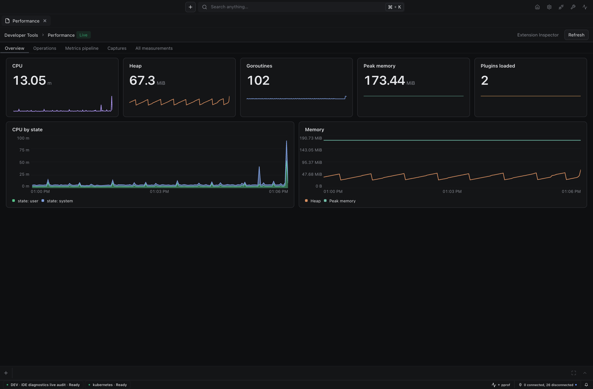
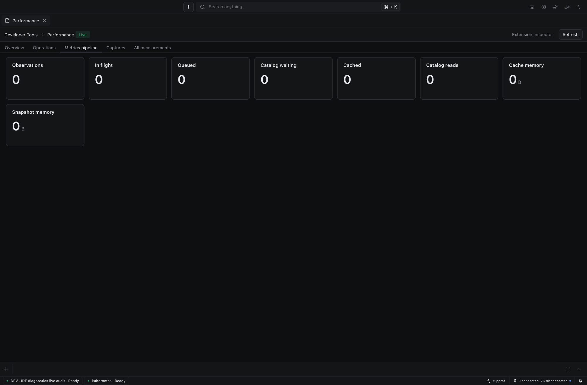
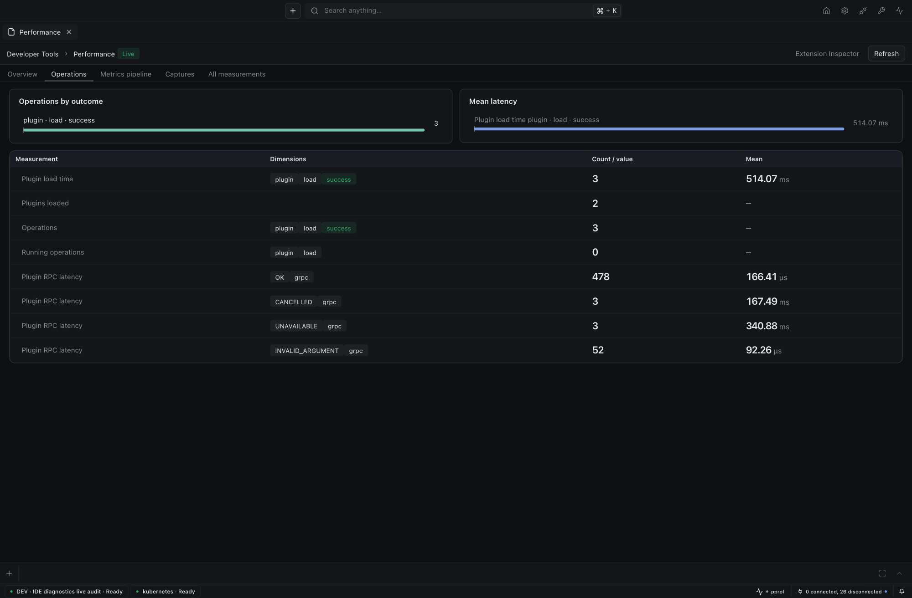
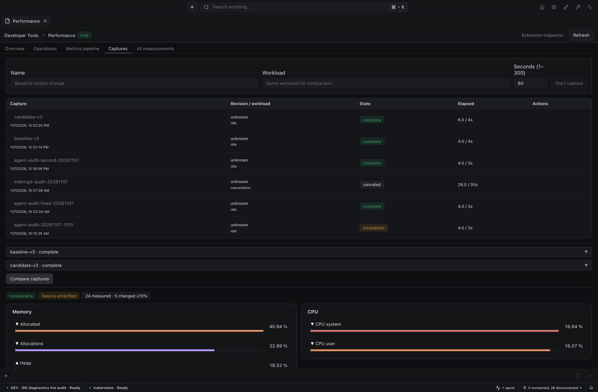

# IDE diagnostics visual evidence

Actual local IDE instance (owned workspace, source cohort), real host measurements.

| View | Image |
|---|---|
| Overview |  |
| Metrics pipeline |  |
| Operations |  |
| Capture comparison |  |

Captured at 1600×1050 CSS px. Comparison is between two real same-session 4s captures; allocation rates are non-zero after aligning runtime MemStats reads with the 2s collection cadence.
