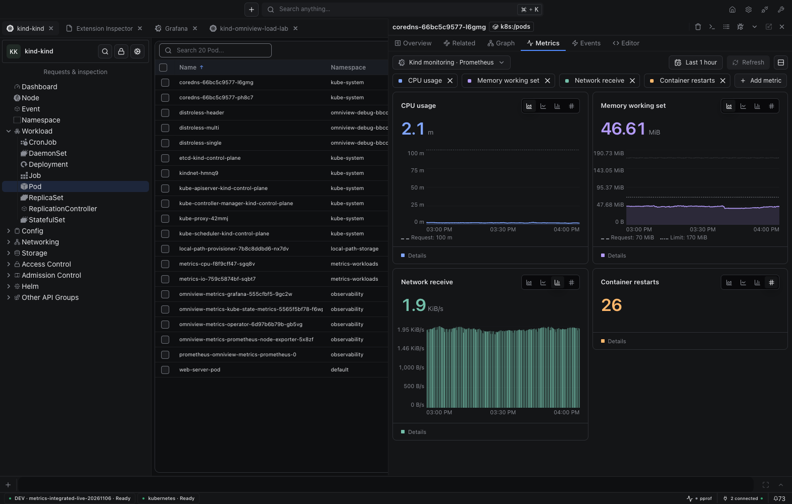
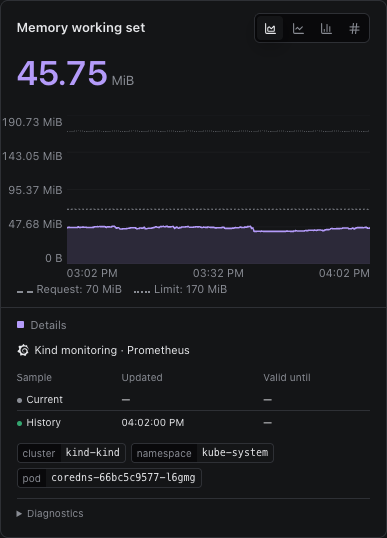
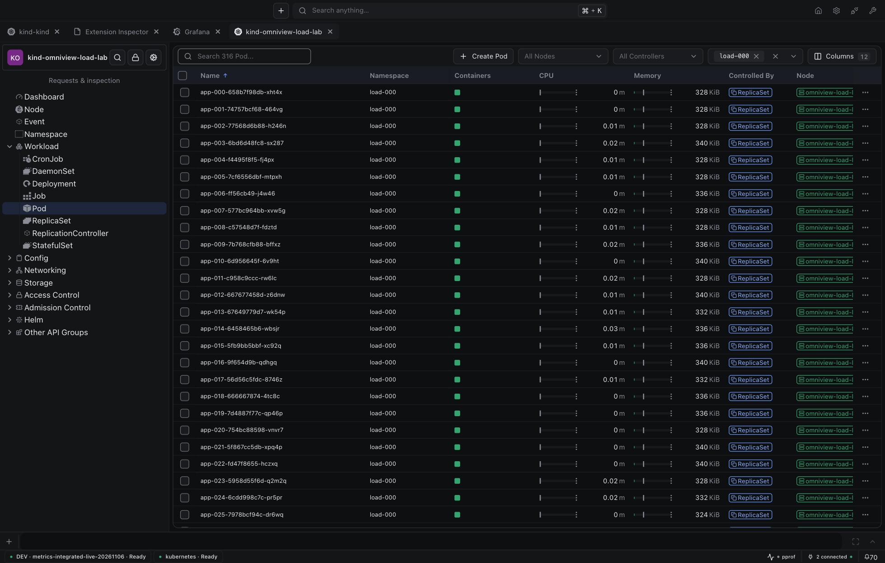
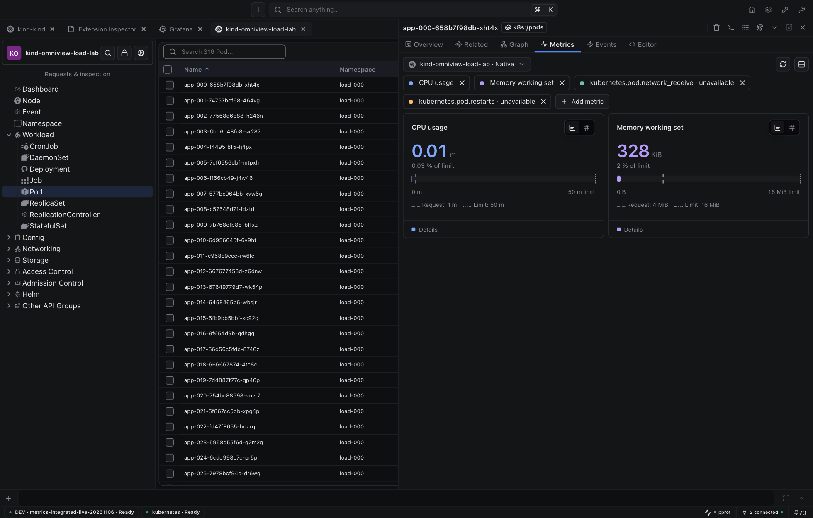
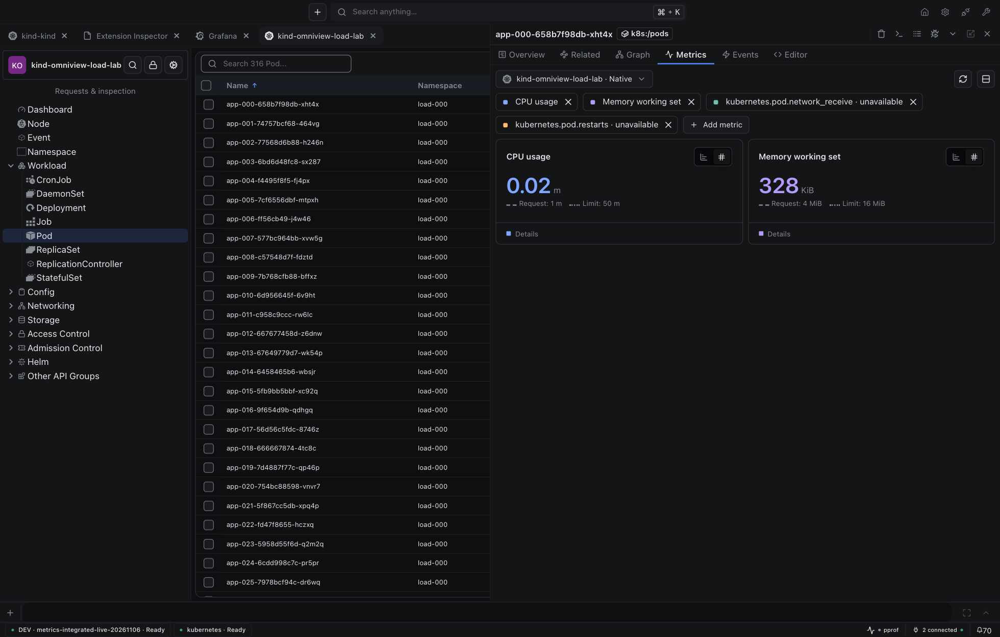
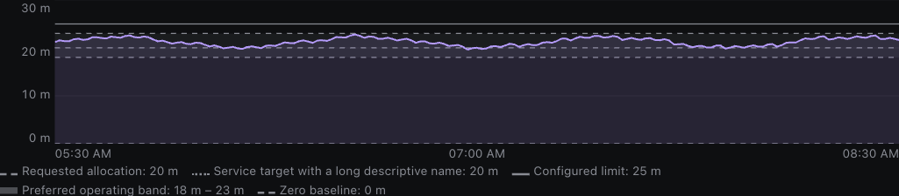
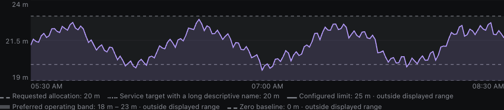

# Metric reference overlays

[Live IDE](http://127.0.0.1:34836/) · [Interactive component](http://127.0.0.1:23680/?path=/story/metrics-components-timeserieschart--default&globals=theme:void) · [Plugin-author example](../../docs/finite-resource-metrics.md#4-overlay-object-attributes) · [Measured verification](verification.json)

## Actual IDE

Grafana/Prometheus supplies real history on `kind-kind`. Current object configuration supplies the dashed request and dotted limit. Automatic chart bounds include both; series colors stay unchanged.

The separate native fixture has 316 Pods. Its visible table renders 30 body rows; cells retain their 15.75px height and two reference markers. CPU uses cores; memory uses bytes.

Native capacity and value-only views

## Shared API

Use one `references` array with `kind: 'line'` or `kind: 'band'`. Pass values in the component's base unit. Shared components render the geometry; resource plugins extract and normalize object attributes.

- Supported: time-series, stacked charts, capacity bars, compact cells, gauges, ranked bars, and value-only summaries.
- Omit missing/non-finite values and invalid intervals. Preserve real zero.
- Automatic chart bounds include references. Explicit bounds stay pinned; inspection identifies off-scale values.
- References do not create capacity bounds. Partial Pod limits are not complete limits; partial requests are labeled.
- References describe current configuration, not historical configuration.

`MetricAnnotation`/`annotations` and request-only marker props are replaced, not aliased. A **base-ui minor release** is required before normal consumers adopt the cutover.

## Interactive checks

| Case | Live story |
|---|---|
| Lines, bands, coincident values | [Time series](http://127.0.0.1:23680/?path=/story/metrics-components-timeserieschart--default&globals=theme:void) |
| Pinned, partly off-scale band | [Pinned bounds](http://127.0.0.1:23680/?path=/story/metrics-components-timeserieschart--pinned-off-scale-references&globals=theme:void) |
| Narrow/wide geometry | [Resize without remount](http://127.0.0.1:23680/?path=/story/metrics-components-timeserieschart--wrapped-legend-resize&globals=theme:void) |
| Keyboard and pointer inspection | [Compact cells](http://127.0.0.1:23680/?path=/story/metrics-components-metriccell--keyboard-and-pointer-reference-inspection&globals=theme:void) |
| Zero/coincident references | [Ranked bars](http://127.0.0.1:23680/?path=/story/metrics-components-rankedbars--coincident-zero-references&globals=theme:void) |
| Missing sample, available configuration | [Value-only summary](http://127.0.0.1:23680/?path=/story/metrics-components-metricvalue--missing-sample-with-references&globals=theme:void) |

Automatic and pinned domain examples — Storybook fixture data

## Verification

| Check | Result |
|---|---|
| Shared UI | 1,860 tests; native source/test TypeScript; zero-warning lint; formatting; production bundles/declarations |
| Kubernetes UI | 1,783 tests pass, 3 skipped; TypeScript; runtime-import check; changed-source lint has zero errors and one existing Fast Refresh warning |
| Real refresh | All three SVG nodes stay mounted while data paths change; chart heights remain 180px |
| Wrapped legend | 160px and 640px widths retain the same SVG and 180px chart height; no clipped labels |
| Native values | Actual metrics-server samples and object-derived request/limit markers; capacity and scalar views exercised |

Storybook uses fixture data; IDE screenshots use real provider data. The Grafana fixture's native namespace scan failed; native verification uses the working native fixture. No new request-count or throughput claim is made.

Independent reviews found and resolved gauge legend positioning, extreme numeric projection, and zero-range ranked-bar geometry. Permanent tests cover behavior and numeric boundaries; forwarding-only assertions were removed.

No host/SDK protocol or CI workflow changed. Drafts remain unmerged pending desktop approval and normal compatible package publication.
