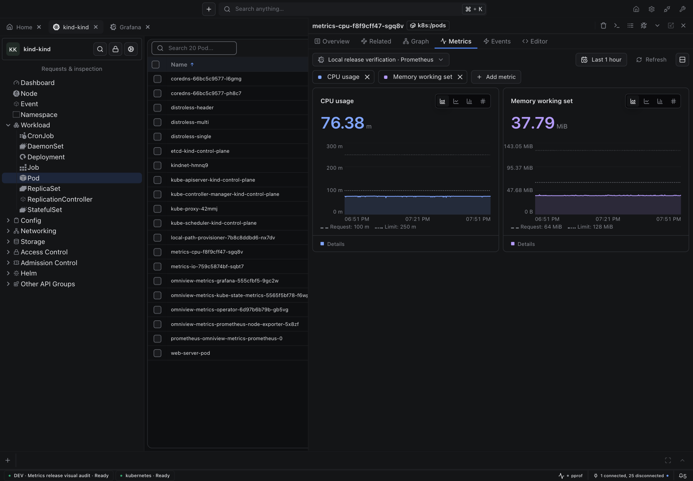
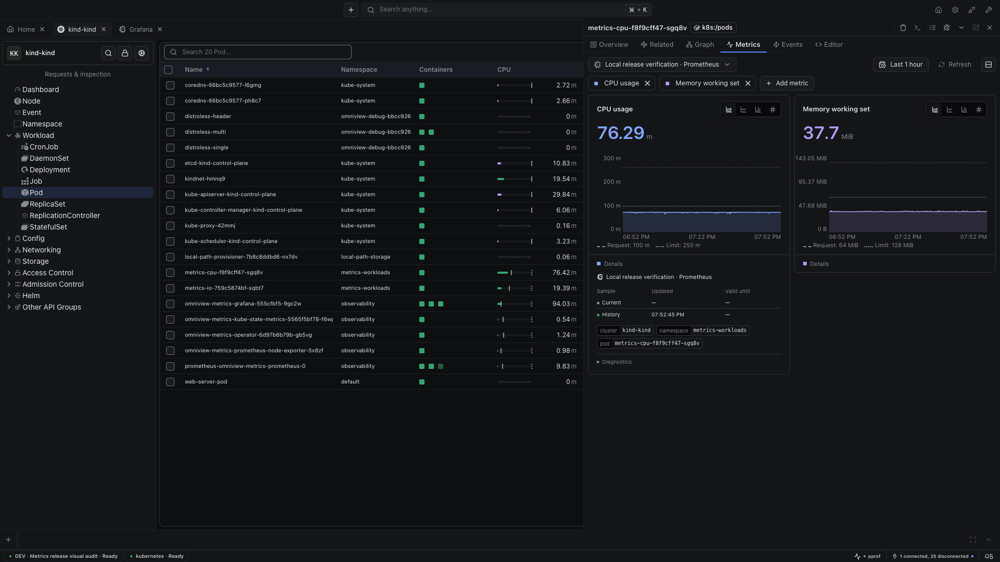

# Metrics release visual evidence

Real local Kind cluster, real Grafana gateway, real Prometheus/cAdvisor samples. No generated metric values.

## Published cohort

| Project | Version | Release |
|---|---|---|
| Shared UI | base-ui 0.16.0, ai-ui 6.1.10, editors 6.2.1 | Public npm registry verified |
| Plugin SDK | v0.16.0 | [Release](https://github.com/omniviewdev/plugin-sdk/releases/tag/v0.16.0); public Go checksum verified |
| IDE / providers / runtime / Vite plugin | 0.31.0 | [Release](https://github.com/omniviewdev/omniview/releases/tag/v0.31.0) |
| Kubernetes | 0.17.0 | [Release](https://github.com/omniviewdev/omniview-plugin-kubernetes/releases/tag/v0.17.0) |

All three IDE desktop downloads match their published SHA-256 checksums. The macOS DMG verifies; Homebrew points to the same version and checksum.

All five Kubernetes archives match GitHub's SHA-256 digests and contain manifest version 0.17.0, a platform binary and the UI entry. The actual IDE registry client discovers marketplace version 0.17.0, minimum IDE 0.31.0, as compatible.

## Screenshot inputs

These captures precede final publication; exact source revisions are retained below.

| Input | Revision |
|---|---|
| Host/runtime candidate | `847a77e9ccc4a0e11a15113872c310c6afb7d8ea` |
| Kubernetes candidate | `77cf9f58d35dc6e339c64d0efa4ca58ee3bf243c` |
| Released SDK | `v0.16.0` / `7d41d708065d896cfae6d5b1caa0fda48c4eb1af` |
| Published UI | base-ui `0.16.0`, ai-ui `6.1.10`, editors `6.2.1` |

## Pod metrics and object references

CPU and memory histories include request/limit references from the Pod object. Domains include those references. Grafana uses a temporary Viewer token stored privately.

## Compact table and details

Container indicators, table bars, compact values, source details and cluster/namespace/Pod chips use the published component library.

## Observed checks

- Host: backend build, 61 Go test packages, metric/Grafana race suites, production frontend and 1,555 frontend tests passed. Canonical E2E: 83/83 passed.
- Kubernetes after upstream integration: 11 Go test packages, native metric race suite and 1,843 UI tests passed; three UI tests remain skipped. Public UI/runtime dependencies, TypeScript, production build and runtime-import checks passed. Existing consumer lint warnings remain.
- Native metrics verification measured 30 real load-lab Pods. Real Prometheus verification covered CPU, memory, network and KSM. Helm ownership/CRD preflight passed without cluster mutations.
- The actual IDE showed Grafana-backed Pod values, request/limit overlays, identity chips and a Metrics tab when opening a linked Node.
- Local source-cohort profile passed with no peer errors. Final host and Kubernetes CI passed before merge; normal release workflows completed successfully.
- Native namespace rotation regression failed before the fix and passed afterward, preserving the shared scan budget. All 19 fixture safety tests passed.
- Real 20,000-Pod performance was not measured. Native scan optimization and that benchmark remain [#416](https://github.com/omniviewdev/omniview/issues/416).
- Temporary Grafana Viewer credentials were revoked after capture. The owned visual-audit workspace was stopped; screenshots remain permanent.
