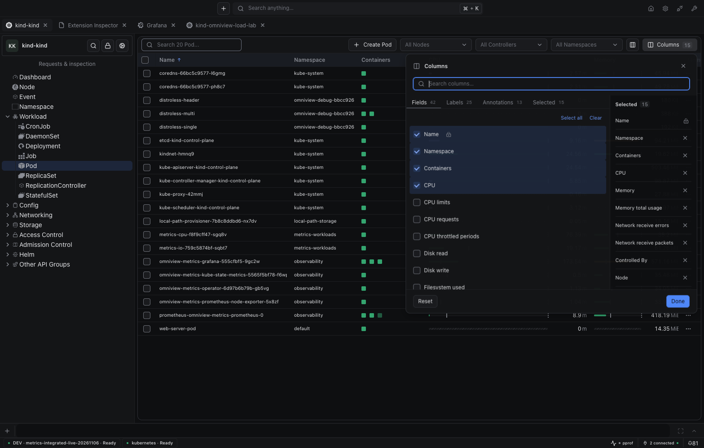
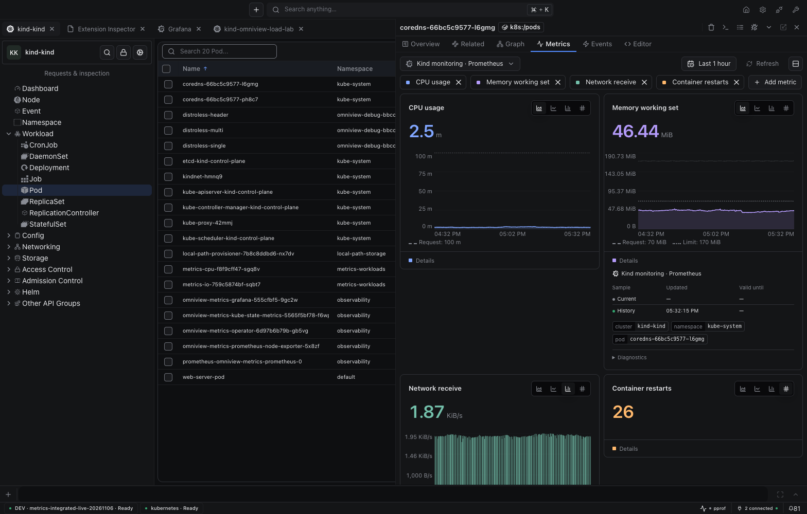
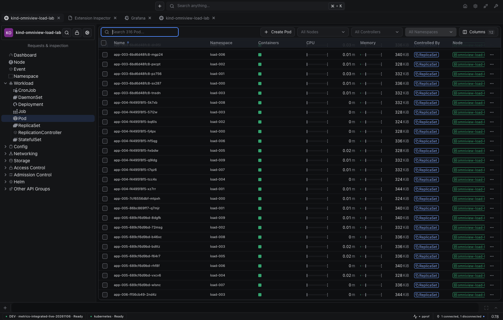
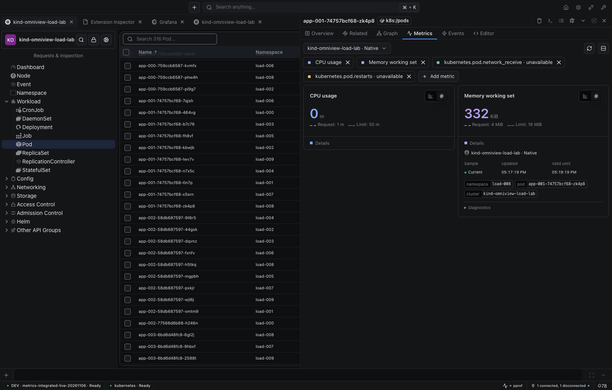

# Metrics merge-safety pass

[Findings recorded before fixes](https://github.com/omniviewdev/omniview/issues/410#issuecomment-6697330966) · [Live IDE](http://127.0.0.1:34836/) · [Bar motion story](http://127.0.0.1:23680/?path=/story/metrics-components-metriccell--updating-values&globals=theme:void) · [Measured evidence](verification.json) · [Deferred work #416](https://github.com/omniviewdev/omniview/issues/416)

## Findings → fixes

| Finding | Change |
|---|---|
| Catalog admission fails under shared-slot pressure | Bounded, cancellable admission shares fair scheduling with samples |
| Operational failures erase unrelated values | Keep authorized samples and report the error; authority/configuration invalidation still clears |
| Tab/viewport return repeats work | Reuse exact compatible completed pairs for up to 30 seconds, within freshness and memory limits |
| Scroll churn can generate repeated starts | 25ms coalescing, one global start per 250ms, oldest-demand scheduling, four occupied slots |
| Canceled multi-job waiter leaves work running | Detach from every job; cancel orphaned work; keep slots occupied until provider returns |
| Source save refreshes unrelated catalogs | Invalidate only matching owner/plugin/connection/resource catalogs |
| Bars jump between values | Shared horizontal/vertical fill transitions use theme motion tokens; reduced motion disables transitions |

**Clarified during review:** discovery comes from `GetResourceMetricsCatalog`/`useMetricCatalog`. Observation catalogs describe admitted sample metadata and may be subsets. Subset collection does not corrupt discovery. No second catalog wire field, frontend cache, or asynchronous discovery-recovery layer was added.

## Actual IDE

Five metric columns and all 42 selectable fields survived browser reload. The picker still offered CPU requests/limits, memory variants, network metrics, and the other optional fields.

The native fixture contains 316 Pods. Rapid scrolling mounted at most 60 table rows including the header, not the inventory. Both CPU and memory panels resolved with real samples.

## Measured checks

| Check | Result |
|---|---|
| Immediate Graph → Metrics return, same six-hour domain | Direct Prometheus counters increased by **0 instant / 0 range** requests |
| Refresh observation window | 100 metric cells never entered blank/loading state; all three SVGs stayed mounted at 180px chart height while provider counters advanced |
| Native panel completion | CPU and memory settled in 1,654ms in this dev run |
| Native namespace API probe | 30 objects / 10,499 bytes / 82ms; all objects supplied CPU and memory |
| Shared motion | Both orientations animated; 21px cell height stayed fixed; reduced-motion duration was 0s with no running transitions |
| Backend | Full Go suite, metric race suite, and backend build pass |
| Runtime | 468 tests using the actual Go transport corpus; TypeScript, runtime-first build, and shim verification pass |
| Shared UI | 1,860 tests, TypeScript, zero-warning lint, formatting, production bundles/declarations pass |

## Limits and remaining work

- Native viewport revisit still took about **3.2 seconds** in this development run. This pass does not claim native scan/render latency is optimized.
- Native namespace LIST can scan unrequested Pods. A visible-target bound is not an HTTP-call, byte, or inventory-scan bound.
- Four starts/second bounds coordinator jobs, not every HTTP call a provider may perform internally.
- The 20,000-inventory test is synthetic coordinator demand coverage, not a real 20,000-Pod provider benchmark.
- Provider counters are real shared endpoint counters. The zero-delta immediate-return window is direct evidence; broader activity is not attributed exclusively to one browser action.
- Existing macOS linker deployment warnings and the Vite-plugin CommonJS `import.meta` warning remain. No new CI workflow or dependency policy was introduced.

Range-coverage reuse, partial-range loading, safe opt-in range-to-current substitution, and provider-native large-inventory optimization remain in **#416**. The reported CPU-only perpetual stall was not isolated to a CPU-specific collector defect; both metrics settled in the live rerun.

No merge or release. Existing desktop approval and compatible package-publication gates remain.
